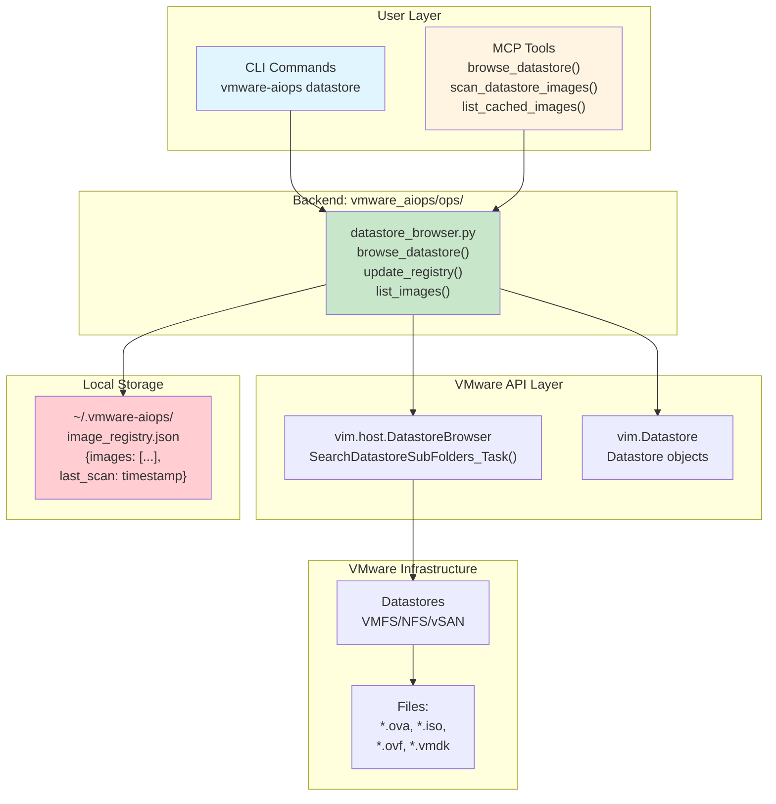
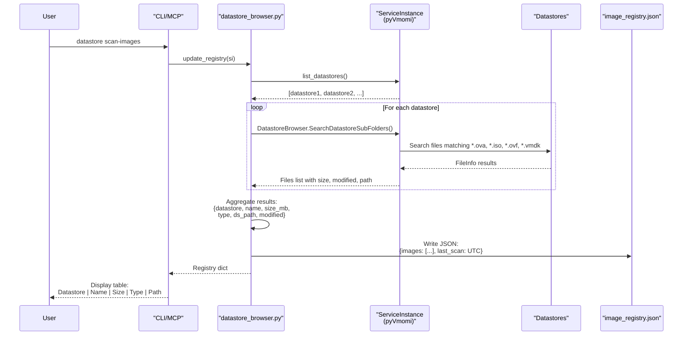
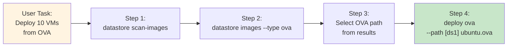

<!-- source: DeepWiki mcp.deepwiki.com · repo zw008/VMware-AIops · page 7.7 Datastore Browser · fetched 2026-10-26 -->

# Datastore Browser

<details>
<summary>Relevant source files</summary>

The following files were used as context for generating this wiki page:

- [README.md](README.md)
- [mcp_server/server.py](mcp_server/server.py)
- [vmware_aiops/cli.py](vmware_aiops/cli.py)

</details>


The Datastore Browser provides file-level access to vSphere datastores, enabling users to discover and catalog deployable images (OVA, ISO, OVF, VMDK files) stored in the VMware infrastructure. This feature scans datastores, caches discovered images in a local registry, and supports deployment operations by providing visibility into available installation media.

For VM deployment operations that use these discovered images, see [VM Deployment](#7.3).

---

## Overview

The Datastore Browser exposes three core capabilities:

| Capability | Purpose | Registry Impact |
|------------|---------|-----------------|
| **Browse** | List files and directories in a specific datastore path | Read-only, no cache update |
| **Scan** | Discover all deployable images across all accessible datastores | Updates `~/.vmware-aiops/image_registry.json` |
| **List Cached** | Query previously scanned images from local registry | Read-only from cache |

The system uses the vSphere `vim.host.DatastoreBrowser` API to traverse datastore file systems and identify deployment-ready artifacts without requiring manual datastore paths.

**Sources:** [README.md:178-184](), [cli.py:952-1035](), [mcp_server/server.py:232-285]()

---

## System Architecture

### Component Interaction



**Diagram: Datastore Browser Architecture**

The `datastore_browser` module acts as an adapter between user-facing interfaces (CLI/MCP) and the vSphere `DatastoreBrowser` API. All datastore queries flow through pyVmomi to the VMware infrastructure, while discovered images are persisted locally for fast retrieval.

**Sources:** [cli.py:30-44](), [mcp_server/server.py:39](), [README.md:942-943]()

---

## Data Flow: Scan and Cache



**Diagram: Image Scanning Data Flow**

The scanning process iterates through all accessible datastores, using pattern matching to identify deployable files. Results include file metadata (size, modification time) and datastore-qualified paths in the format `[datastoreName] path/to/file.ext`, which can be directly used in deployment commands.

**Sources:** [cli.py:982-1007](), [mcp_server/server.py:258-269]()

---

## CLI Usage

### Browse Datastore Files

**Command:** `vmware-aiops datastore browse <datastore_name>`

Lists files and directories at a specific datastore path with optional pattern filtering.

**Parameters:**

| Flag | Type | Default | Description |
|------|------|---------|-------------|
| `--path` | string | `""` | Subdirectory path within datastore (empty = root) |
| `--pattern` | string | `"*"` | Glob pattern: `*.ova`, `*.iso`, etc. |
| `--target` | string | None | Target from config (uses default if omitted) |

**Example Output:**

```
┌─ Datastore: datastore1 ─────────────────────────────────────┐
│ Name          │ Size (MB) │ Type │ Modified        │ Path   │
├───────────────┼───────────┼──────┼─────────────────┼────────┤
│ ubuntu.iso    │    4096   │ file │ 2024-01-15 10:30│ [ds1]  │
│ windows.ova   │   12288   │ file │ 2024-02-01 14:20│ [ds1]  │
└───────────────┴───────────┴──────┴─────────────────┴────────┘
```

**Sources:** [cli.py:955-979]()

---

### Scan All Datastores for Images

**Command:** `vmware-aiops datastore scan-images`

Discovers all OVA/ISO/OVF/VMDK files across all accessible datastores and updates the local registry cache.

**Parameters:**

| Flag | Type | Default | Description |
|------|------|---------|-------------|
| `--target` | string | None | Target from config (uses default if omitted) |
| `--config` | Path | None | Custom config file path |

**Example Output:**

```
Scanning all datastores for images...

┌─ Image Registry (3 images) ──────────────────────────────────┐
│ Datastore  │ Name           │ Size (MB) │ Type │ Path        │
├────────────┼────────────────┼───────────┼──────┼─────────────┤
│ datastore1 │ ubuntu-22.04   │    4096   │ ova  │ [ds1] iso/  │
│ datastore1 │ windows-2022   │   12288   │ iso  │ [ds1] iso/  │
│ datastore2 │ centos-stream  │    8192   │ ova  │ [ds2] vms/  │
└────────────┴────────────────┴───────────┴──────┴─────────────┘

Registry saved. Last scan: 2024-03-15T10:30:00Z
```

**Behavior:**
- Scans all datastores accessible to the connected vCenter/ESXi
- Overwrites previous registry contents
- Stores results in `~/.vmware-aiops/image_registry.json`
- Returns total count and last scan timestamp

**Sources:** [cli.py:982-1007]()

---

### List Cached Images

**Command:** `vmware-aiops datastore images`

Queries the local registry cache without contacting vSphere infrastructure.

**Parameters:**

| Flag | Type | Default | Description |
|------|------|---------|-------------|
| `--type` | string | None | Filter by extension: `ova`, `iso`, `ovf`, `vmdk` |
| `--ds` | string | None | Filter by datastore name |

**Example:**

```bash
# List all cached images
vmware-aiops datastore images

# List only ISOs
vmware-aiops datastore images --type iso

# List images on specific datastore
vmware-aiops datastore images --ds datastore1
```

**Example Output:**

```
┌─ Available Images ───────────────────────────────────────────┐
│ # │ Datastore  │ Name           │ Size (MB) │ DS Path        │
├───┼────────────┼────────────────┼───────────┼────────────────┤
│ 1 │ datastore1 │ ubuntu-22.04   │    4096   │ [ds1] iso/u... │
│ 2 │ datastore2 │ centos-stream  │    8192   │ [ds2] vms/c... │
└───┴────────────┴────────────────┴───────────┴────────────────┘
```

**Sources:** [cli.py:1010-1034]()

---

## MCP Server Tools

The MCP server exposes three datastore tools for AI agent integration.

### browse_datastore

```python
browse_datastore(
    datastore_name: str,
    path: str = "",
    pattern: str = "*",
    target: str | None = None
) -> list[dict]
```

**Returns:** List of file dicts with keys: `name`, `size_mb`, `type`, `modified`, `ds_path`

**Use Case:** Discover files before deploying from a specific datastore location.

**Sources:** [mcp_server/server.py:236-255]()

---

### scan_datastore_images

```python
scan_datastore_images(
    target: str | None = None
) -> dict
```

**Returns:** Registry dict with `images` (list) and `last_scan` (ISO timestamp)

**Use Case:** Refresh the image catalog before batch deployment operations.

**Sources:** [mcp_server/server.py:258-269]()

---

### list_cached_images

```python
list_cached_images(
    image_type: str | None = None,
    datastore: str | None = None
) -> list[dict]
```

**Returns:** Filtered list of cached images matching the criteria

**Use Case:** Quick lookup of available images without vSphere API calls (low latency).

**Sources:** [mcp_server/server.py:272-285]()

---

## Image Registry Schema

The local cache is stored at `~/.vmware-aiops/image_registry.json` with the following structure:

```json
{
  "images": [
    {
      "datastore": "datastore1",
      "name": "ubuntu-22.04.iso",
      "size_mb": 4096,
      "type": "iso",
      "ds_path": "[datastore1] iso/ubuntu-22.04.iso",
      "modified": "2024-01-15T10:30:00"
    }
  ],
  "last_scan": "2024-03-15T10:30:00Z"
}
```

### Field Definitions

| Field | Type | Description |
|-------|------|-------------|
| `datastore` | string | Datastore name where the file resides |
| `name` | string | File name with extension |
| `size_mb` | int | File size in megabytes |
| `type` | string | File extension: `ova`, `iso`, `ovf`, or `vmdk` |
| `ds_path` | string | Datastore-qualified path in VMware bracket notation |
| `modified` | string | ISO 8601 timestamp of last modification |
| `last_scan` | string | UTC timestamp when the scan was performed |

The `ds_path` format `[datastoreName] path/to/file` is the canonical VMware syntax used in deployment commands and API calls.

**Sources:** [README.md:183-184](), [cli.py:997-1006]()

---

## Common Workflows

### Pre-Deployment Discovery



**Diagram: Deployment Discovery Workflow**

Before deploying VMs, users scan datastores to identify available images. The cached registry provides fast lookups for subsequent deployment commands, eliminating the need to manually browse datastore paths.

**Sources:** [README.md:166-176](), [cli.py:1040-1076]()

---

### Batch Deployment with Auto-Discovery

When using MCP-based AI agents, the workflow can be fully automated:

1. **Agent calls** `scan_datastore_images()` → updates cache
2. **Agent calls** `list_cached_images(image_type="ova")` → retrieves OVA list
3. **Agent selects** appropriate image based on user request
4. **Agent calls** `deploy_vm_from_ova()` with the discovered `ds_path`

This eliminates manual path entry and reduces user error in deployment specifications.

**Sources:** [mcp_server/server.py:258-285](), [mcp_server/server.py:293-325]()

---

## API Integration

The Datastore Browser uses the following vSphere API objects:

| API Object | Usage |
|------------|-------|
| `vim.Datastore` | Enumerate accessible datastores |
| `vim.host.DatastoreBrowser` | File system traversal and search |
| `vim.host.DatastoreBrowser.SearchSpec` | Define file patterns and filters |
| `vim.host.FileInfo` | File metadata: size, type, modification time |

The `SearchDatastoreSubFolders_Task()` method recursively traverses datastore directories, returning file metadata without downloading file contents. This enables efficient discovery across large datastore hierarchies.

**Sources:** [README.md:942-943]()

---

## Supported File Types

| Type | Extension | Deployment Method | Notes |
|------|-----------|-------------------|-------|
| **OVA** | `.ova` | `deploy ova` | Self-contained VM archive (OVF + VMDKs) |
| **OVF** | `.ovf` | `deploy ova` | VM descriptor (requires separate VMDKs) |
| **ISO** | `.iso` | `deploy iso` | Attach to VM CD-ROM for OS installation |
| **VMDK** | `.vmdk` | Manual attach | Virtual disk file (requires VM creation first) |

The scanner identifies files by extension match. VMDKs are cataloged but typically used as components of OVA/OVF deployments rather than standalone deployment sources.

**Sources:** [README.md:178-184](), [cli.py:958-959]()

---

## Multi-Target Support

When multiple vCenter/ESXi targets are configured in `config.yaml`, each target maintains its own datastore namespace:

```bash
# Scan production vCenter
vmware-aiops datastore scan-images --target prod-vcenter

# Scan lab ESXi
vmware-aiops datastore scan-images --target lab-esxi
```

**Limitation:** The registry cache (`image_registry.json`) stores results from the **most recent scan only**. Scanning a different target overwrites the cache. For multi-target workflows, scan the appropriate target immediately before querying cached images.

**Sources:** [cli.py:92-99](), [cli.py:982-1007]()

---

## Performance Characteristics

| Operation | API Calls | Typical Duration | Use Case |
|-----------|-----------|------------------|----------|
| `browse` | 1 per datastore | <1 second | Quick directory listing |
| `scan-images` | N (# of datastores) | 5-30 seconds | Full catalog refresh |
| `images` (cached) | 0 (local file read) | <100ms | Repeated queries |

The scanning operation scales with the number of datastores and total file count. For large environments (10+ datastores, 1000+ files), expect scan times of 30-60 seconds. The local cache eliminates this latency for subsequent queries.

**Sources:** [cli.py:982-1007](), [cli.py:1010-1034]()

---

## Integration with Deployment Commands

Discovered image paths can be used directly in deployment commands:

```bash
# 1. Scan and cache
vmware-aiops datastore scan-images

# 2. List ISOs
vmware-aiops datastore images --type iso
# Output: [datastore1] iso/ubuntu-22.04.iso

# 3. Deploy using discovered path
vmware-aiops deploy ova "[datastore1] iso/ubuntu-22.04.iso" \
  --name my-vm \
  --datastore datastore1 \
  --network "VM Network"
```

The datastore-qualified path format is required by VMware OVF import APIs and must include the bracket notation.

**Sources:** [cli.py:1040-1076](), [README.md:166-176]()

---

