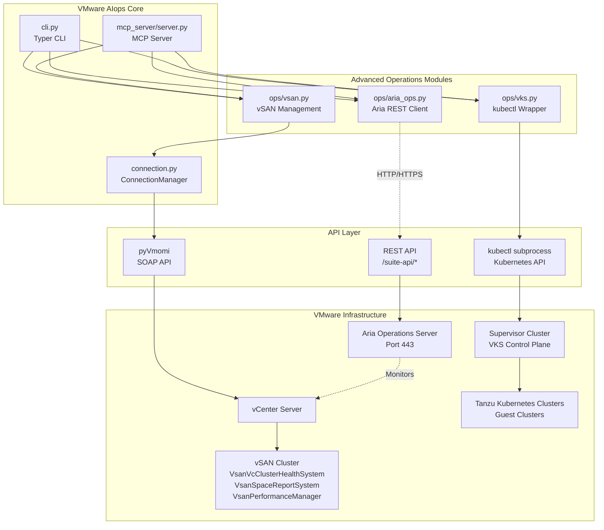
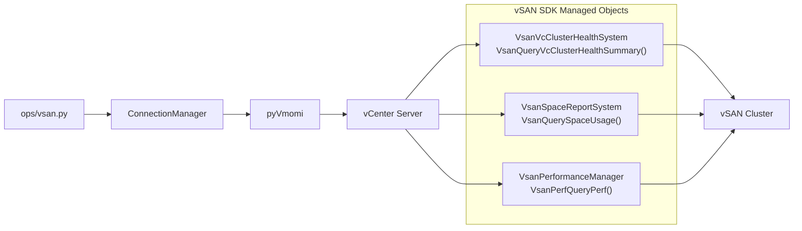
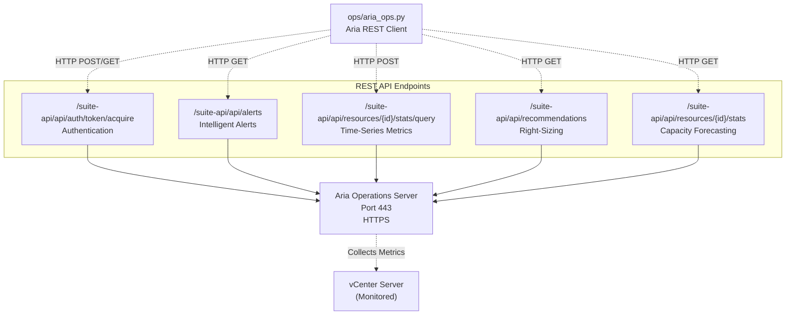
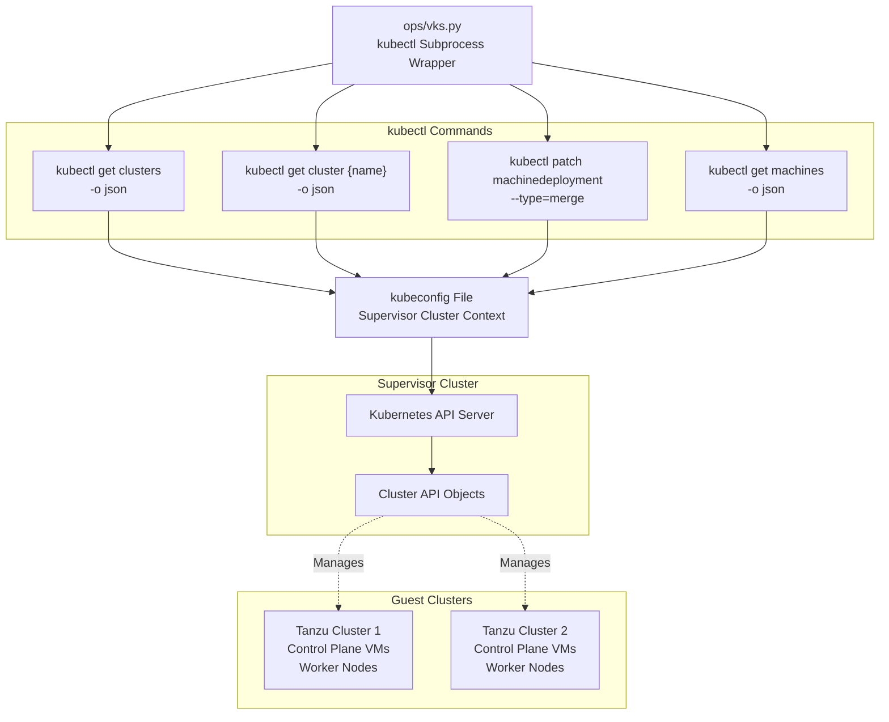

<!-- source: DeepWiki mcp.deepwiki.com · repo zw008/VMware-AIops · page 7.8 Advanced Features: vSAN, Aria Operations, VKS · fetched 2026-10-26 -->

# Advanced Features: vSAN, Aria Operations, VKS

<details>
<summary>Relevant source files</summary>

The following files were used as context for generating this wiki page:

- [README.md](README.md)
- [codex-skill/AGENTS.md](codex-skill/AGENTS.md)
- [skills/vmware-aiops/SKILL.md](skills/vmware-aiops/SKILL.md)

</details>


## Purpose and Scope

This page documents advanced VMware infrastructure features integrated into VMware AIops: **vSAN** (Software-Defined Storage), **Aria Operations** (formerly vRealize Operations), and **vSphere Kubernetes Service (VKS)**. These features extend beyond basic VM lifecycle and inventory management to provide enterprise-grade storage analytics, ML-powered operations intelligence, and Kubernetes cluster management.

For basic VM operations, see [VM Lifecycle Management](#7.2). For standard monitoring, see [Inventory and Monitoring](#7.1). For cluster infrastructure configuration, see [Cluster Management](#7.5).

---

## Overview of Advanced Features

VMware AIops integrates with three distinct advanced platforms, each using different API protocols and serving different operational domains:

| Feature | Primary Use Case | API Protocol | Availability |
|---------|-----------------|--------------|--------------|
| **vSAN** | Storage health, capacity planning, performance monitoring | pyVmomi SOAP (vSAN SDK) | vCenter with vSAN clusters |
| **Aria Operations** | Historical metrics, anomaly detection, capacity forecasting | REST API (`/suite-api/`) | Standalone Aria Operations server |
| **VKS** | Kubernetes cluster lifecycle, worker scaling, node health | Kubernetes API (kubectl) | vSphere 7.0+ with Supervisor enabled |

Sources: [README.md:215-247](), [skills/vmware-aiops/SKILL.md:240-272]()

---

## System Architecture: Advanced Features Integration



**Architecture Notes:**

- **vSAN** uses the pyVmomi connection established by `ConnectionManager`, accessing vSAN-specific managed objects (`VsanVcClusterHealthSystem`, `VsanSpaceReportSystem`, `VsanPerformanceManager`)
- **Aria Operations** bypasses pyVmomi and communicates directly via REST API to a separate Aria Operations server
- **VKS** uses `kubectl` subprocess commands, requiring a kubeconfig file for Supervisor cluster authentication

Sources: [README.md:69-82](), [codex-skill/AGENTS.md:328-410]()

---

## vSAN Management

vSAN (Virtual SAN) is VMware's software-defined storage platform that aggregates local storage devices across ESXi hosts into a distributed datastore. VMware AIops provides monitoring and analytics for vSAN clusters.

### vSAN API Integration



**SDK Requirements:**

- pyVmomi 8.0.3+ includes vSAN SDK merged
- For vSphere 7.0 and earlier, install standalone vSAN Management SDK
- vSAN cluster must be configured in vCenter

Sources: [README.md:215-224](), [skills/vmware-aiops/SKILL.md:240-249](), [codex-skill/AGENTS.md:328-360]()

### vSAN Features

| Feature | API Method | Description | Output |
|---------|-----------|-------------|--------|
| **Health Check** | `VsanQueryVcClusterHealthSummary()` | Cluster-wide health summary with per-group test results | Overall health status, test group statuses (network, physical disk, data, cluster, limits) |
| **Capacity** | `VsanQuerySpaceUsage()` | Total/free/used capacity with projections | Total capacity (bytes), free capacity, used capacity, capacity projections |
| **Disk Groups** | Query host storage system | Cache SSD + capacity disks per host | Disk group configuration, cache tier, capacity tier, disk health |
| **Performance** | `VsanPerfQueryPerf()` | IOPS, latency, throughput metrics | Read/write IOPS, average latency, throughput per cluster/host/VM |

### vSAN CLI Commands

```bash
# Health check - cluster-wide health summary
vmware-aiops vsan health --target prod-vcenter

# Capacity report - total/free/used with projections
vmware-aiops vsan capacity --target prod-vcenter

# Disk groups - cache SSD + capacity disks per host
vmware-aiops vsan disks --target prod-vcenter

# Performance metrics - IOPS, latency, throughput
vmware-aiops vsan performance --hours 1 --target prod-vcenter
```

### vSAN Health Implementation Example

From the AGENTS.md file, the vSAN health check implementation follows this pattern:

```python
# Access vSAN cluster health system
vsan_cluster_system = content.vsan.VsanVcClusterHealthSystem

# Query health summary (do not use cache)
health = vsan_cluster_system.VsanQueryVcClusterHealthSummary(
    cluster=cluster_ref, 
    fetchFromCache=False
)

# Overall health status
print(f"Overall: {health.overallHealth}")

# Per-group test results
for group in health.groups:
    print(f"  {group.groupName}: {group.groupHealth}")
```

Health groups typically include:
- **Network**: vSAN network connectivity and configuration
- **Physical Disk**: Disk health, wear level, failures
- **Data**: Object health, compliance, resyncing
- **Cluster**: Cluster partition, host connectivity
- **Limits**: Configuration maximums, resource limits

Sources: [codex-skill/AGENTS.md:328-340]()

### vSAN Capacity Reporting

Capacity queries return detailed space usage information:

```python
vsan_space = content.vsan.VsanSpaceReportSystem
report = vsan_space.VsanQuerySpaceUsage(cluster=cluster_ref)

print(f"Total: {report.totalCapacityB / (1024**4):.1f} TB")
print(f"Free:  {report.freeCapacityB / (1024**4):.1f} TB")
```

Capacity metrics include:
- `totalCapacityB`: Total raw capacity in bytes
- `freeCapacityB`: Available capacity after failures-to-tolerate (FTT) overhead
- `usedCapacityB`: Used capacity including replicas and overhead
- Future projections based on current growth rate

Sources: [codex-skill/AGENTS.md:343-348]()

### vSAN Performance Metrics

Performance queries use `VsanPerfQuerySpec` to request specific time-series metrics:

```python
vsan_perf = content.vsan.VsanPerformanceManager

spec = vim.cluster.VsanPerfQuerySpec(
    entityRefId="cluster-domclient:*",
    startTime=datetime.now() - timedelta(hours=1),
    endTime=datetime.now(),
    labels=["iopsRead", "iopsWrite", "latencyAvgRead", "latencyAvgWrite"]
)

metrics = vsan_perf.VsanPerfQueryPerf(querySpecs=[spec], cluster=cluster_ref)
```

Available metric labels:
- `iopsRead` / `iopsWrite`: Read/write IOPS
- `latencyAvgRead` / `latencyAvgWrite`: Average latency in milliseconds
- `throughputRead` / `throughputWrite`: Throughput in MB/s
- `congestion`: Backend congestion percentage
- `outstandingIO`: Outstanding I/O count

Sources: [codex-skill/AGENTS.md:350-360]()

---

## Aria Operations Integration

Aria Operations (formerly vRealize Operations, rebranded as VCF Operations in VCF 9.0) provides AI/ML-powered infrastructure analytics, anomaly detection, and capacity planning. It operates as a standalone server that connects to vCenter and collects metrics independently.

### Aria Operations Architecture



**Key Differences from pyVmomi:**

- Uses REST API instead of SOAP
- Requires separate authentication token (`vRealizeOpsToken`)
- Provides historical data (months of retention) vs. real-time vSphere data
- ML-based analytics vs. raw metrics

Sources: [README.md:226-236](), [skills/vmware-aiops/SKILL.md:251-261](), [codex-skill/AGENTS.md:362-389]()

### Aria Operations Features

| Feature | REST Endpoint | Description | Use Case |
|---------|--------------|-------------|----------|
| **Historical Metrics** | `/suite-api/api/resources/{id}/stats/query` | Time-series CPU, memory, disk, network with months of history | Trend analysis, performance investigation |
| **Anomaly Detection** | `/suite-api/api/alerts` | ML-based dynamic baselines and anomaly alerts | Proactive issue detection |
| **Capacity Planning** | `/suite-api/api/resources/{id}/stats` | What-if analysis, time-to-exhaustion, forecasting | Capacity budgeting, procurement planning |
| **Right-sizing** | `/suite-api/api/recommendations` | CPU/memory recommendations per VM | Cost optimization, resource reclamation |
| **Intelligent Alerts** | `/suite-api/api/alerts` | Root cause analysis, remediation recommendations | Faster troubleshooting |

### Aria Operations Authentication

Aria Operations uses token-based authentication separate from vSphere credentials:

```python
import requests

# Acquire authentication token
resp = requests.post(
    f"https://{ops_host}/suite-api/api/auth/token/acquire",
    json={
        "username": "admin",
        "password": "xxx",
        "authSource": "local"  # or "ldap"
    }
)
token = resp.json()["token"]

# Use token in subsequent requests
headers = {
    "Authorization": f"vRealizeOpsToken {token}",
    "Accept": "application/json"
}
```

Token characteristics:
- Valid for 24 hours by default
- Must be refreshed before expiration
- Different from vCenter session tokens

Sources: [codex-skill/AGENTS.md:367-372]()

### Intelligent Alerts

Query alerts with root cause analysis and severity filtering:

```python
# Get critical active alerts
GET /suite-api/api/alerts?alertCriticality=CRITICAL&status=ACTIVE
```

Alert response includes:
- `alertDefinitionId`: Alert rule that triggered
- `resourceId`: Affected resource (VM, host, cluster)
- `criticality`: CRITICAL, IMMEDIATE, WARNING, INFO
- `status`: ACTIVE, CANCELED, SUSPENDED
- `startTimeUTC`: Alert trigger timestamp
- `rootCause`: ML-inferred root cause analysis
- `recommendations`: Suggested remediation actions

### Time-Series Metrics

Query historical metrics for any resource:

```python
# Query CPU and memory metrics for a VM
POST /suite-api/api/resources/{id}/stats/query
{
    "statKey": [
        "cpu|usage_average",
        "mem|usage_average",
        "disk|usage_average",
        "net|usage_average"
    ],
    "begin": "2024-01-01T00:00:00Z",
    "end": "2024-01-31T23:59:59Z",
    "rollupType": "AVG",
    "intervalType": "HOURS",
    "intervalQuantifier": 1
}
```

Supported metric categories:
- `cpu|*`: CPU utilization, demand, ready time
- `mem|*`: Memory consumption, active, swap
- `disk|*`: IOPS, latency, throughput
- `net|*`: Network usage, packets, errors
- `datastore|*`: Datastore capacity, latency

Sources: [codex-skill/AGENTS.md:376-389]()

### Right-Sizing Recommendations

Aria Operations analyzes VM resource usage patterns and generates recommendations:

```python
GET /suite-api/api/recommendations
```

Recommendation types:
- **Oversized VMs**: VMs with consistently low CPU/memory utilization
- **Undersized VMs**: VMs experiencing resource contention
- **Idle VMs**: VMs with no activity (candidates for decommissioning)
- **Snapshot sprawl**: VMs with excessive snapshots

Each recommendation includes:
- Current allocation vs. actual usage
- Suggested new allocation
- Projected savings (cost/resource)

### Capacity Planning

Query remaining capacity and time-to-exhaustion:

```python
GET /suite-api/api/resources/{cluster_id}/stats?statKey=summary|capacity_remaining_percentage
```

Capacity metrics:
- `capacity_remaining_percentage`: Remaining capacity percentage
- `time_remaining`: Days until resource exhaustion
- `demand_trend`: Historical demand growth rate
- `what_if_scenarios`: Impact of adding/removing workloads

Sources: [codex-skill/AGENTS.md:382-389]()

### Aria Operations CLI Commands

```bash
# Get intelligent alerts (with root cause analysis)
vmware-aiops ops alerts --severity critical --target prod-vcenter

# Query historical metrics for a VM or host
vmware-aiops ops metrics my-vm-name --hours 24 --target prod-vcenter

# Get right-sizing recommendations
vmware-aiops ops recommendations --target prod-vcenter

# Capacity planning for a cluster
vmware-aiops ops capacity my-cluster-name --target prod-vcenter
```

Sources: [README.md:853-856](), [skills/vmware-aiops/SKILL.md:445-448]()

---

## vSphere Kubernetes Service (VKS)

VKS enables deployment and management of Tanzu Kubernetes clusters on vSphere infrastructure. VMware AIops integrates with VKS using the Kubernetes API (kubectl) rather than pyVmomi.

### VKS Architecture



**Architecture Notes:**

- VKS uses Cluster API specification (CAPI) for cluster lifecycle management
- Supervisor cluster is a Kubernetes control plane running on vSphere
- Guest clusters (Tanzu Kubernetes clusters) are managed as Kubernetes custom resources
- `kubectl` commands execute against the Supervisor cluster's API server

Sources: [README.md:238-247](), [skills/vmware-aiops/SKILL.md:263-272](), [codex-skill/AGENTS.md:391-410]()

### VKS Features

| Feature | kubectl Command | Description | Output |
|---------|----------------|-------------|--------|
| **List Clusters** | `kubectl get clusters -o json` | List all Tanzu Kubernetes clusters | Cluster name, phase (Provisioning, Provisioned, Running) |
| **Cluster Health** | `kubectl get cluster {name} -o json` | Check cluster conditions | InfrastructureReady, ControlPlaneAvailable, WorkersAvailable |
| **Scale Workers** | `kubectl patch machinedeployment` | Adjust worker node count | Updated replica count |
| **Node Status** | `kubectl get machines -o json` | List cluster machines | Machine name, ready status, node reference |

### VKS CLI Commands

```bash
# List all Tanzu Kubernetes clusters
vmware-aiops vks clusters --namespace default --target prod-vcenter

# Check cluster health and conditions
vmware-aiops vks health my-k8s-cluster --target prod-vcenter

# Scale worker nodes in a cluster
vmware-aiops vks scale my-cluster-md-0 --replicas 5 --target prod-vcenter

# List node status and machine objects
vmware-aiops vks nodes my-k8s-cluster --target prod-vcenter
```

Sources: [README.md:858-862](), [skills/vmware-aiops/SKILL.md:450-454]()

### VKS Cluster Listing

List all Tanzu Kubernetes clusters in a namespace:

```python
import subprocess
import json

result = subprocess.run(
    ["kubectl", "--kubeconfig", kubeconfig_path, "-n", namespace,
     "get", "clusters", "-o", "json"],
    capture_output=True,
    text=True
)

clusters = json.loads(result.stdout)
for cluster in clusters["items"]:
    name = cluster["metadata"]["name"]
    phase = cluster["status"]["phase"]
    print(f"{name}: {phase}")
```

Cluster phases:
- `Provisioning`: Cluster is being created
- `Provisioned`: Infrastructure is ready
- `Running`: Cluster is operational
- `Failed`: Cluster provisioning failed
- `Deleting`: Cluster is being deleted

Sources: [codex-skill/AGENTS.md:398-401]()

### VKS Cluster Health

Check cluster readiness conditions:

```python
result = subprocess.run(
    ["kubectl", "--kubeconfig", kubeconfig_path, "-n", namespace,
     "get", "cluster", cluster_name, "-o", "json"],
    capture_output=True,
    text=True
)

cluster = json.loads(result.stdout)
for condition in cluster["status"]["conditions"]:
    print(f"{condition['type']}: {condition['status']}")
```

Key conditions:
- `InfrastructureReady`: vSphere VMs provisioned
- `ControlPlaneReady`: Control plane nodes running
- `WorkersReady`: Worker nodes joined cluster
- `Ready`: Overall cluster readiness

Sources: [codex-skill/AGENTS.md:403-405]()

### VKS Worker Scaling

Scale worker nodes by patching MachineDeployment replicas:

```python
import json

subprocess.run(
    ["kubectl", "--kubeconfig", kubeconfig_path, "-n", namespace,
     "patch", "machinedeployment", machine_deployment_name,
     "-p", json.dumps({"spec": {"replicas": new_count}}),
     "--type=merge"]
)
```

MachineDeployment naming convention:
- Typically `{cluster-name}-md-0` for first worker pool
- Can have multiple MachineDeployments per cluster
- Each MachineDeployment manages a pool of identical worker nodes

Sources: [codex-skill/AGENTS.md:407-410]()

### VKS Version Requirements

| vSphere Version | VKS Support | Notes |
|----------------|-------------|-------|
| vSphere 8.0 | Full | VKS 3.6+ with Cluster API |
| vSphere 7.0U3+ | Full | VKS 3.x with Supervisor enabled |
| vSphere 7.0U1-U2 | Limited | Earlier VKS versions |
| vSphere 6.7 | ❌ | VKS not available |

**Prerequisites:**
- Supervisor cluster must be enabled on vSphere
- `kubectl` binary installed and accessible in PATH
- kubeconfig file for Supervisor cluster authentication
- Appropriate RBAC permissions on Supervisor cluster

Sources: [README.md:238-247](), [skills/vmware-aiops/SKILL.md:263-272]()

---

## Configuration

### vSAN Configuration

vSAN functionality requires:

1. **vSAN cluster** configured in vCenter
2. **pyVmomi 8.0.3+** for merged vSAN SDK (or standalone vSAN SDK for older versions)
3. **vCenter connection** in `config.yaml`:

```yaml
targets:
  - name: prod-vcenter
    host: vcenter.example.com
    port: 443
    username: administrator@vsphere.local
    type: vcenter  # vSAN only works with vCenter, not standalone ESXi
```

4. **Target cluster** must have vSAN enabled in vSphere configuration

No additional configuration needed in VMware AIops — vSAN APIs are accessed through existing pyVmomi connection.

Sources: [README.md:215-224](), [skills/vmware-aiops/SKILL.md:240-249]()

### Aria Operations Configuration

Aria Operations requires separate configuration as it uses a different authentication system:

```yaml
# ~/.vmware-aiops/config.yaml
aria_operations:
  - name: prod-aria
    host: aria-ops.example.com
    port: 443
    username: admin
    # Password via env: VMWARE_PROD_ARIA_PASSWORD
    verify_ssl: true
```

**Authentication flow:**
1. VMware AIops authenticates to Aria Operations using username/password
2. Receives `vRealizeOpsToken` valid for 24 hours
3. Uses token for all subsequent API requests
4. Token refresh handled automatically

**Environment variable:**
```bash
# In ~/.vmware-aiops/.env
VMWARE_PROD_ARIA_PASSWORD=your_aria_password
```

Sources: [codex-skill/AGENTS.md:367-372]()

### VKS Configuration

VKS requires kubeconfig file for Supervisor cluster access:

```yaml
# ~/.vmware-aiops/config.yaml
vks:
  - name: prod-supervisor
    kubeconfig_path: ~/.kube/supervisor-config
    namespace: default  # Default namespace for cluster operations
```

**Kubeconfig setup:**
1. Export Supervisor cluster kubeconfig from vSphere
2. Place at configured path (e.g., `~/.kube/supervisor-config`)
3. Ensure `kubectl` binary is in PATH
4. Test connectivity: `kubectl --kubeconfig ~/.kube/supervisor-config get clusters`

**Alternative:** Use `KUBECONFIG` environment variable:
```bash
export KUBECONFIG=~/.kube/supervisor-config
vmware-aiops vks clusters
```

Sources: [codex-skill/AGENTS.md:398-410]()

---

## MCP Tools for Advanced Features

The MCP server exposes advanced features through structured JSON tools:

### vSAN Tools

```json
{
  "name": "vsan_health",
  "description": "Get vSAN cluster health summary",
  "parameters": {
    "target": "optional target name from config"
  }
}
```

Available vSAN MCP tools (inferred from CLI commands):
- `vsan_health`: Cluster health summary
- `vsan_capacity`: Capacity usage and projections
- `vsan_disks`: Disk groups per host
- `vsan_performance`: IOPS, latency, throughput metrics

### Aria Operations Tools

```json
{
  "name": "aria_get_alerts",
  "description": "Get intelligent alerts with root cause analysis",
  "parameters": {
    "severity": "CRITICAL | IMMEDIATE | WARNING | INFO",
    "target": "optional target name"
  }
}
```

Available Aria MCP tools (inferred):
- `aria_get_alerts`: Query alerts with filtering
- `aria_get_metrics`: Historical time-series metrics
- `aria_get_recommendations`: Right-sizing recommendations
- `aria_get_capacity`: Capacity planning data

### VKS Tools

```json
{
  "name": "vks_list_clusters",
  "description": "List Tanzu Kubernetes clusters",
  "parameters": {
    "namespace": "optional Kubernetes namespace",
    "target": "optional target name"
  }
}
```

Available VKS MCP tools (inferred):
- `vks_list_clusters`: List all clusters
- `vks_cluster_health`: Get cluster conditions
- `vks_scale_workers`: Scale MachineDeployment replicas
- `vks_list_nodes`: Get machine/node status

Sources: [README.md:279-314](), [skills/vmware-aiops/SKILL.md:98-128]()

---

## Complete CLI Reference

### vSAN Commands

```bash
# Health check - cluster-wide health summary with per-group test results
vmware-aiops vsan health [--target <name>]

# Capacity report - total/free/used capacity with projections
vmware-aiops vsan capacity [--target <name>]

# Disk groups - cache SSD + capacity disks configuration per host
vmware-aiops vsan disks [--target <name>]

# Performance metrics - IOPS, latency, throughput
vmware-aiops vsan performance [--hours 1] [--target <name>]
```

### Aria Operations Commands

```bash
# Intelligent alerts with root cause analysis
vmware-aiops ops alerts [--severity critical|immediate|warning|info] [--target <name>]

# Time-series metrics for any resource (VM, host, cluster)
vmware-aiops ops metrics <resource-name> [--hours 24] [--target <name>]

# Right-sizing recommendations for VMs
vmware-aiops ops recommendations [--target <name>]

# Capacity planning and forecasting
vmware-aiops ops capacity <cluster-name> [--target <name>]
```

### VKS Commands

```bash
# List Tanzu Kubernetes clusters
vmware-aiops vks clusters [--namespace default] [--target <name>]

# Check cluster health and conditions
vmware-aiops vks health <cluster-name> [--target <name>]

# Scale worker nodes (MachineDeployment replicas)
vmware-aiops vks scale <machine-deployment-name> --replicas <n> [--target <name>]

# List cluster nodes and machine status
vmware-aiops vks nodes <cluster-name> [--target <name>]
```

Sources: [README.md:847-862](), [skills/vmware-aiops/SKILL.md:439-454]()

---

## Version Compatibility Matrix

| Feature | vSphere 8.0 | vSphere 7.0 | vSphere 6.7 | vSphere 6.5 |
|---------|:-----------:|:-----------:|:-----------:|:-----------:|
| **vSAN Health** | ✅ Full | ✅ Full | ✅ Compatible | ✅ Compatible |
| **vSAN Capacity** | ✅ Full | ✅ Full | ✅ Compatible | ✅ Compatible |
| **vSAN Performance** | ✅ Full | ✅ Full | ⚠️ Limited | ⚠️ Limited |
| **Aria Operations** | ✅ Full | ✅ Full | ✅ Full | ✅ Full |
| **VKS** | ✅ Full | ✅ 7.0U3+ | ❌ | ❌ |

**Notes:**
- vSAN SDK merged into pyVmomi 8.0.3+; earlier versions require standalone vSAN SDK
- Aria Operations compatibility depends on Aria version, not vSphere version
- VKS requires Supervisor cluster enabled (vSphere 7.0U1+, fully supported 7.0U3+)
- vSphere 6.x vSAN performance metrics may have limited label support

Sources: [README.md:84-93](), [skills/vmware-aiops/SKILL.md:320-328]()

---

## Troubleshooting

### vSAN Issues

**Error: "vSAN cluster health system not found"**
- Verify vSAN is enabled on the cluster in vSphere
- Check pyVmomi version: `pip show pyVmomi`
- For vSphere 7.0 and earlier, install standalone vSAN SDK

**Error: "No disk groups found"**
- Cluster may not have vSAN configured
- Check ESXi hosts have local disks claimed by vSAN
- Verify vSAN disk claim status in vSphere Client

### Aria Operations Issues

**Error: "Authentication failed"**
- Verify Aria Operations hostname/port in config
- Check username/password in `.env` file
- Ensure Aria Operations server is reachable
- Token may have expired — reauthenticate

**Error: "Resource not found"**
- Resource ID may be incorrect
- vCenter adapter may not be configured in Aria Operations
- Data collection may not have completed yet

### VKS Issues

**Error: "kubectl: command not found"**
- Install `kubectl` binary and add to PATH
- Verify: `kubectl version --client`

**Error: "Unable to connect to the server"**
- Check kubeconfig path in configuration
- Verify Supervisor cluster credentials
- Test: `kubectl --kubeconfig <path> get nodes`

**Error: "No resources found in namespace"**
- Verify namespace exists: `kubectl get namespaces`
- Check RBAC permissions for kubeconfig user
- Cluster may not be provisioned yet

Sources: [README.md:962-963](), [codex-skill/AGENTS.md:442-444]()

---

