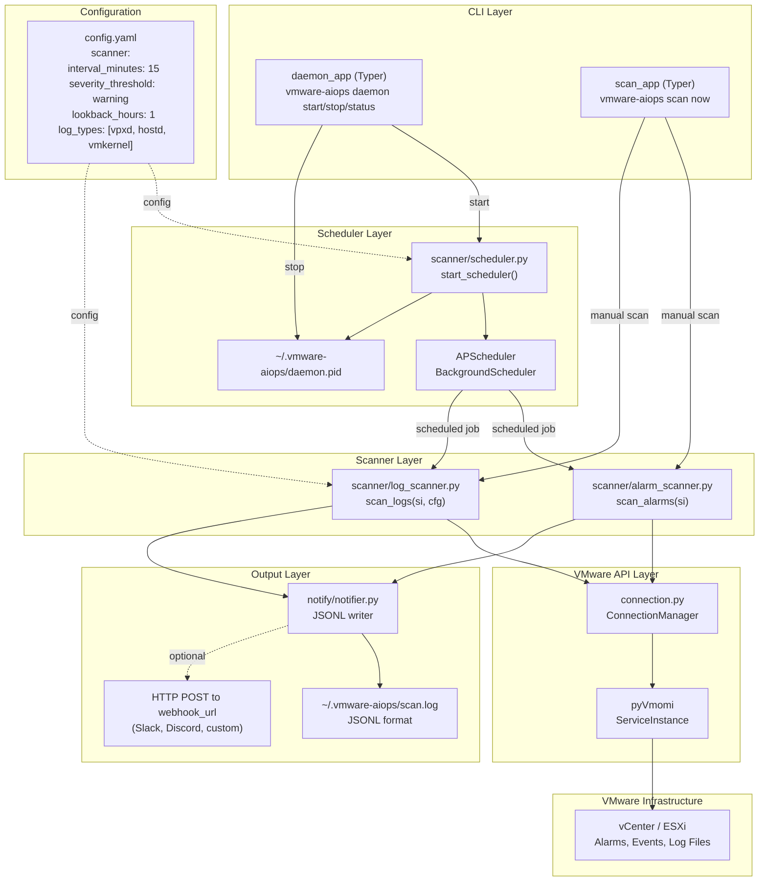
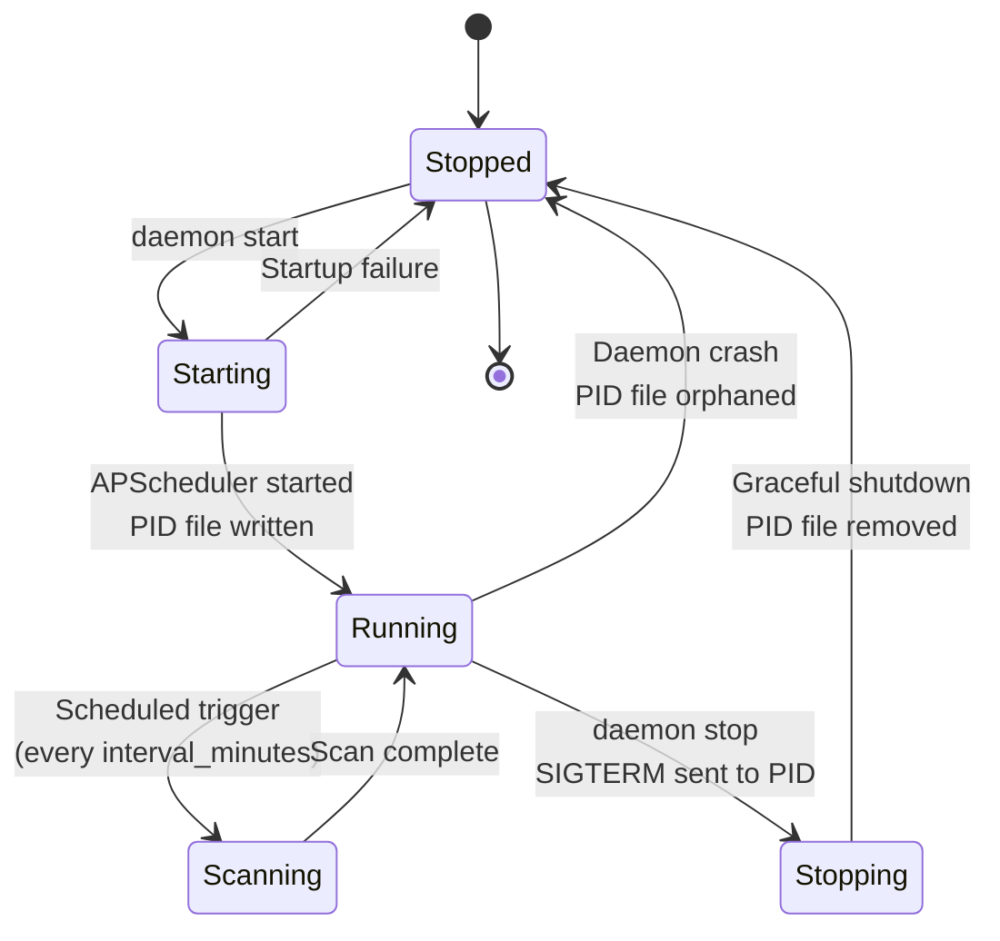
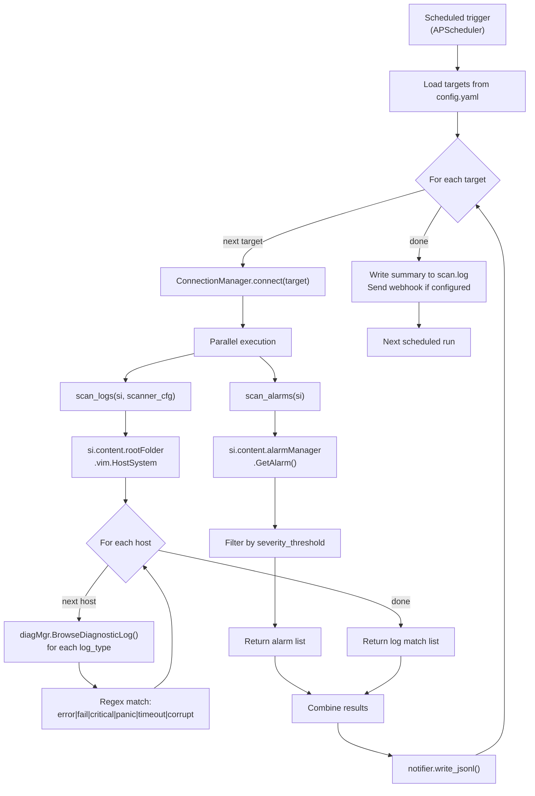
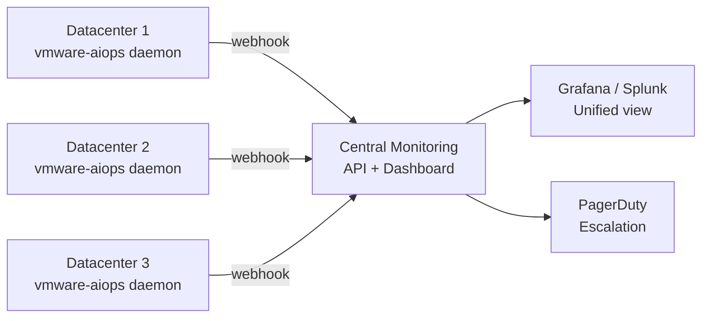

<!-- source: DeepWiki mcp.deepwiki.com · repo zw008/VMware-AIops · page 8 Scheduled Scanning and Daemon · fetched 2026-10-26 -->

# Scheduled Scanning and Daemon

<details>
<summary>Relevant source files</summary>

The following files were used as context for generating this wiki page:

- [README.md](README.md)
- [skills/vmware-aiops/SKILL.md](skills/vmware-aiops/SKILL.md)
- [vmware_aiops/cli.py](vmware_aiops/cli.py)

</details>


This page documents the scheduled scanning daemon that performs proactive monitoring of VMware infrastructure. The daemon runs background scans at configurable intervals to detect alarms, events, and log patterns across all configured vCenter/ESXi targets.

> **Related pages:** For one-time manual scanning, see the `scan now` command in [CLI Mode Usage](#4). For audit logging of user operations, see [Audit Logging](#10.2). For alarm and event queries via CLI, see [Inventory and Monitoring](#7.1).

## Overview

The scheduled scanning daemon provides automated, continuous monitoring of VMware infrastructure health. It periodically scans all configured targets for:

- Active alarms (triggered by vSphere alarm definitions)
- Recent events (vSphere event log entries)
- Host log files (ESXi system logs: `hostd`, `vmkernel`, `vpxd`)

The daemon runs as a background process using APScheduler for interval-based execution. All scan results are written to structured JSONL log files and can optionally be forwarded to webhook endpoints (Slack, Discord, or custom HTTP endpoints).

**Key characteristics:**
- **Stateless scanning**: Each scan is independent; no historical state is maintained
- **Multi-target**: Scans all configured vCenter/ESXi targets sequentially in a single daemon instance
- **Configurable intervals**: Default 15 minutes, adjustable via `config.yaml`
- **Pattern-based log analysis**: Regex matching for error/failure keywords in host logs
- **Minimal overhead**: Scans run on a schedule; no polling or real-time event streaming

**Sources:** [README.md:186-197](), [skills/vmware-aiops/SKILL.md:295-304]()

## Architecture and Components

### Component Diagram



**Sources:** [vmware_aiops/cli.py:1637-1704](), [README.md:186-197]()

### Key Components

| Component | File Path | Purpose |
|-----------|-----------|---------|
| **Scheduler** | `vmware_aiops/scanner/scheduler.py` | Main daemon entry point; manages APScheduler lifecycle and PID file |
| **APScheduler** | Third-party library | Background job scheduler; executes scans at configured intervals |
| **AlarmScanner** | `vmware_aiops/scanner/alarm_scanner.py` | Queries vSphere alarm manager for active alarms via `vim.alarm.AlarmManager` |
| **LogScanner** | `vmware_aiops/scanner/log_scanner.py` | Retrieves ESXi host logs and applies regex pattern matching |
| **Notifier** | `vmware_aiops/notify/notifier.py` | Writes scan results to JSONL log file and sends webhook notifications |
| **PID File** | `~/.vmware-aiops/daemon.pid` | Stores daemon process ID for status checking and graceful shutdown |
| **Scan Log** | `~/.vmware-aiops/scan.log` | Structured JSONL log of all scan findings |

**Sources:** [vmware_aiops/cli.py:1637-1704]()

## Configuration

The scanner daemon is configured via the `scanner` section in `~/.vmware-aiops/config.yaml`.

### Configuration Schema

```yaml
scanner:
  interval_minutes: 15           # Scan frequency (default: 15)
  severity_threshold: warning    # Minimum severity: critical|warning|info
  lookback_hours: 1              # Event/log lookback window (default: 1)
  log_types:                     # ESXi log files to scan
    - vpxd                       # vCenter agent logs
    - hostd                      # Host daemon logs
    - vmkernel                   # Kernel logs
```

| Parameter | Type | Default | Description |
|-----------|------|---------|-------------|
| `interval_minutes` | integer | 15 | How often to run scans. Minimum recommended: 5 minutes to avoid API throttling |
| `severity_threshold` | string | "warning" | Filter alarms/events by severity. Options: `critical`, `warning`, `info` |
| `lookback_hours` | integer | 1 | How far back to query events and logs. Increase for less frequent scans |
| `log_types` | list | `[vpxd, hostd, vmkernel]` | Which ESXi log files to scan. `vpxd` only exists on vCenter-managed hosts |

### Notification Configuration

Webhook notifications are configured under the `notify` section:

```yaml
notify:
  log_file: ~/.vmware-aiops/scan.log  # JSONL output (always enabled)
  webhook_url: ""                     # Optional: Slack/Discord/HTTP endpoint
```

**Webhook payload format:**
```json
{
  "timestamp": "2024-01-15T10:30:00Z",
  "target": "prod-vcenter",
  "severity": "critical",
  "message": "Found 3 critical alarms on prod-vcenter",
  "details": {
    "alarm_count": 3,
    "event_count": 12,
    "log_match_count": 5
  }
}
```

**Sources:** [README.md:869-884](), [config.example.yaml]()

## Daemon Management

The daemon is managed via the `vmware-aiops daemon` CLI commands.

### Daemon Lifecycle Flow



**Sources:** [vmware_aiops/cli.py:1664-1704]()

### CLI Commands

#### Start Daemon

```bash
vmware-aiops daemon start [--config /path/to/config.yaml]
```

**Behavior:**
1. Loads configuration from `~/.vmware-aiops/config.yaml` (or specified path)
2. Validates connectivity to all configured targets
3. Initializes APScheduler with `BackgroundScheduler`
4. Schedules `scan_job()` to run every `interval_minutes`
5. Writes process ID to `~/.vmware-aiops/daemon.pid`
6. Detaches from terminal and runs in background

**Implementation:** [vmware_aiops/cli.py:1664-1670]()

#### Stop Daemon

```bash
vmware-aiops daemon stop
```

**Behavior:**
1. Reads PID from `~/.vmware-aiops/daemon.pid`
2. Sends `SIGTERM` to the daemon process
3. Waits for graceful shutdown (APScheduler stops all jobs)
4. Removes PID file

**Error cases:**
- PID file exists but process not found → Cleans up orphaned PID file
- PID file does not exist → Reports "Daemon not running"

**Implementation:** [vmware_aiops/cli.py:1684-1703]()

#### Check Status

```bash
vmware-aiops daemon status
```

**Output:**
- `Daemon running (PID: 12345)` if PID file exists
- `Daemon not running` if PID file does not exist

**Note:** This command only checks for PID file presence; it does not verify if the process is still alive. Use `ps aux | grep 12345` to confirm process is running.

**Implementation:** [vmware_aiops/cli.py:1673-1681]()

**Sources:** [vmware_aiops/cli.py:1664-1704]()

## Scan Process

### Scan Execution Flow



**Sources:** [vmware_aiops/cli.py:1637-1659](), [README.md:186-197]()

### Alarm Scanning

The `scan_alarms()` function queries the vSphere alarm manager for all triggered alarms.

**API sequence:**
1. `si.content.alarmManager.GetAlarm()` → Retrieves all alarm definitions
2. For each alarm, check `alarm.info.enabled` and `alarm.triggeredAlarmState`
3. Filter by `severity_threshold` (critical, warning, info)
4. Extract alarm metadata: name, entity, severity, timestamp

**Alarm severity mapping:**
- `red` → critical
- `yellow` → warning
- `green` → info (normal, not included in scans by default)

**Sources:** [README.md:109-113](), [skills/vmware-aiops/SKILL.md:161-167]()

### Event Scanning

Events are retrieved from the vSphere event manager using a time-based filter.

**API sequence:**
1. Calculate time range: `now - lookback_hours` to `now`
2. `si.content.eventManager.QueryEvents(filterSpec)`
3. Filter by event type (50+ monitored types)
4. Extract event metadata: type, message, timestamp, severity

**Monitored event types:**

| Category | Event Types |
|----------|------------|
| VM Failures | `VmFailedToPowerOnEvent`, `VmDiskFailedEvent`, `VmFailoverFailed` |
| Host Issues | `HostConnectionLostEvent`, `HostShutdownEvent`, `HostIpChangedEvent` |
| Storage | `DatastoreCapacityIncreasedEvent`, `NASDatastoreEvent`, SCSI high latency |
| HA/DRS | `DasHostFailedEvent`, `DrsVmMigratedEvent`, `DrsSoftRuleViolationEvent` |
| Auth | `UserLoginSessionEvent`, `BadUsernameSessionEvent` |

**Sources:** [README.md:114-123](), [skills/vmware-aiops/SKILL.md:168-177]()

### Log Scanning

The `scan_logs()` function retrieves raw ESXi log files and applies regex pattern matching.

**Log file types:**

| Log Type | Path on ESXi | Content |
|----------|-------------|---------|
| `vpxd` | `/var/log/vpxa.log` | vCenter agent (only on vCenter-managed hosts) |
| `hostd` | `/var/log/hostd.log` | ESXi host daemon (all operations) |
| `vmkernel` | `/var/log/vmkernel.log` | Kernel-level events (driver, hardware) |

**Pattern matching:**
```python
# Regex patterns applied to each log line
patterns = [
    r'\berror\b',
    r'\bfail(ed)?\b',
    r'\bcritical\b',
    r'\bpanic\b',
    r'\btimeout\b',
    r'\bcorrupt(ed)?\b'
]
```

**API sequence:**
1. `si.content.diagnosticManager` (on vCenter or ESXi)
2. For each host: `diagMgr.BrowseDiagnosticLog(host, key=log_type, start=start_line)`
3. Read `lookback_hours` worth of log lines
4. Apply regex matching to each line
5. Collect matched lines with line number and timestamp

**Output format:**
```json
{
  "severity": "warning",
  "source": "host_log",
  "host": "esxi-01.example.com",
  "log_type": "hostd",
  "line_number": 12345,
  "message": "Failed to connect to datastore ds-nfs-01: timeout",
  "matched_pattern": "fail|timeout"
}
```

**Sources:** [README.md:186-197](), [skills/vmware-aiops/SKILL.md:295-304]()

## Output and Notifications

### JSONL Log Format

All scan results are written to `~/.vmware-aiops/scan.log` in JSONL (JSON Lines) format. Each line is a complete JSON object representing a single finding.

**Schema:**
```json
{
  "timestamp": "2024-01-15T10:30:15.123Z",
  "target": "prod-vcenter",
  "severity": "critical",
  "source": "alarm",
  "entity_name": "vm-web-01",
  "alarm_name": "Virtual machine CPU usage",
  "message": "CPU usage exceeded 90% threshold",
  "details": {
    "current_value": 95,
    "threshold": 90
  }
}
```

**Fields:**

| Field | Type | Description |
|-------|------|-------------|
| `timestamp` | ISO8601 string | When the finding was recorded (UTC) |
| `target` | string | Target name from `config.yaml` |
| `severity` | string | `critical`, `warning`, or `info` |
| `source` | string | `alarm`, `event`, or `host_log` |
| `entity_name` | string | VM, host, or resource name |
| `message` | string | Human-readable description |
| `details` | object | Additional metadata (varies by source) |

**Log rotation:**
- No automatic rotation; users must configure external log rotation (e.g., `logrotate`)
- Recommended: Rotate when file exceeds 100MB or after 30 days

**Sources:** [README.md:194](), [skills/vmware-aiops/SKILL.md:295-304]()

### Webhook Notifications

When `notify.webhook_url` is configured, the daemon sends HTTP POST requests with scan summaries.

**Supported endpoints:**
- **Slack Incoming Webhooks:** `https://hooks.slack.com/services/...`
- **Discord Webhooks:** `https://discord.com/api/webhooks/...`
- **Custom HTTP endpoints:** Any URL accepting JSON POST requests

**Payload structure:**
```json
{
  "text": "VMware Health Alert: 3 critical issues found",
  "attachments": [
    {
      "color": "danger",
      "fields": [
        {
          "title": "Target",
          "value": "prod-vcenter",
          "short": true
        },
        {
          "title": "Severity",
          "value": "critical",
          "short": true
        },
        {
          "title": "Summary",
          "value": "3 alarms, 12 events, 5 log matches"
        }
      ]
    }
  ]
}
```

**Webhook behavior:**
- Sent only when findings exist (severity ≥ `severity_threshold`)
- If webhook request fails, error is logged but scan continues
- No retry mechanism; use external monitoring to detect missed notifications

**Security notes:**
- Webhook payloads contain aggregated metadata only (no credentials, IPs, or PII)
- All data sent to user-configured URLs only; no third-party services by default
- Use HTTPS URLs in production to prevent interception

**Sources:** [README.md:211](), [skills/vmware-aiops/SKILL.md:502-503]()

## Manual One-Time Scanning

For ad-hoc health checks without starting the daemon, use the `scan now` command.

```bash
vmware-aiops scan now [--target <name>]
```

**Behavior:**
- Runs a single scan against the specified target (or all targets if omitted)
- Prints results to console (color-coded by severity)
- Writes findings to `scan.log` (same format as daemon)
- Does not send webhook notifications (CLI output only)

**Output example:**
```
Running scan...
  [CRITICAL] Host esxi-01: CPU usage > 95%
  [WARNING] Datastore ds-nfs-01: Free space < 10%
  [WARNING] VM web-01: Memory ballooning active
Found 3 issue(s).
```

**Use cases:**
- Pre-deployment health checks
- Troubleshooting after infrastructure changes
- Validating daemon configuration before starting background scans

**Implementation:** [vmware_aiops/cli.py:1637-1659]()

**Sources:** [vmware_aiops/cli.py:1637-1659](), [skills/vmware-aiops/SKILL.md:456-458]()

## Use Cases and Workflows

### Continuous Monitoring

**Scenario:** Monitor multiple vCenter/ESXi environments for health issues.

**Setup:**
1. Configure all targets in `config.yaml` with unique names
2. Set `scanner.interval_minutes` based on environment size (15-60 min)
3. Configure webhook to Slack for real-time alerts
4. Start daemon: `vmware-aiops daemon start`

**Outcome:**
- Automated scans every 15 minutes (or configured interval)
- Critical alarms trigger immediate Slack notifications
- JSONL log provides audit trail for compliance/security review

### Alarm-Driven Automation

**Scenario:** Trigger remediation workflows based on specific alarms.

**Setup:**
1. Start daemon with `severity_threshold: critical`
2. Write external script to parse `scan.log` JSONL
3. Filter for specific alarm names (e.g., "Datastore capacity exceeded")
4. Trigger automation (e.g., expand datastore, migrate VMs)

**Example script:**
```bash
#!/bin/bash
tail -f ~/.vmware-aiops/scan.log | while read line; do
  alarm=$(echo $line | jq -r '.alarm_name')
  entity=$(echo $line | jq -r '.entity_name')
  
  if [[ "$alarm" == "Datastore capacity exceeded" ]]; then
    echo "Triggering expansion for $entity"
    # Call automation here
  fi
done
```

### Multi-Datacenter Aggregation

**Scenario:** Aggregate health data from 10+ datacenters into a centralized monitoring system.

**Setup:**
1. Deploy daemon in each datacenter (or one daemon with all targets)
2. Configure `webhook_url` to point to central monitoring API
3. Central system receives all scan results via webhook
4. Build dashboards/alerts on aggregated data

**Architecture:**


**Sources:** [README.md:186-197](), [skills/vmware-aiops/SKILL.md:295-304]()

---

**Sources for entire page:** [README.md:186-197](), [skills/vmware-aiops/SKILL.md:295-304](), [vmware_aiops/cli.py:1637-1704](), [config.example.yaml]()

---

