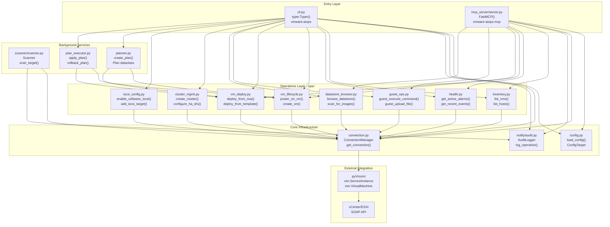
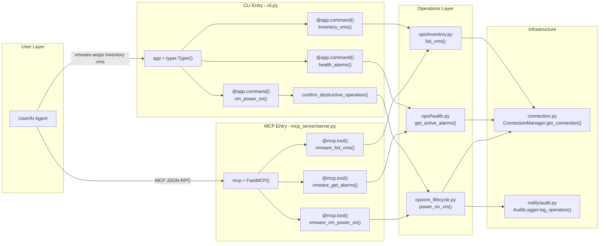
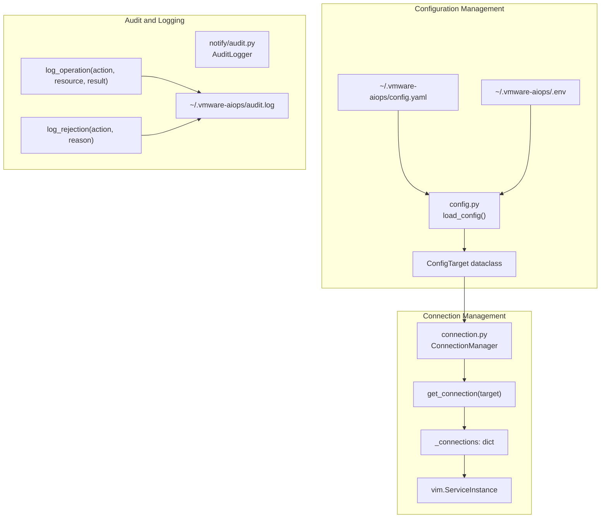
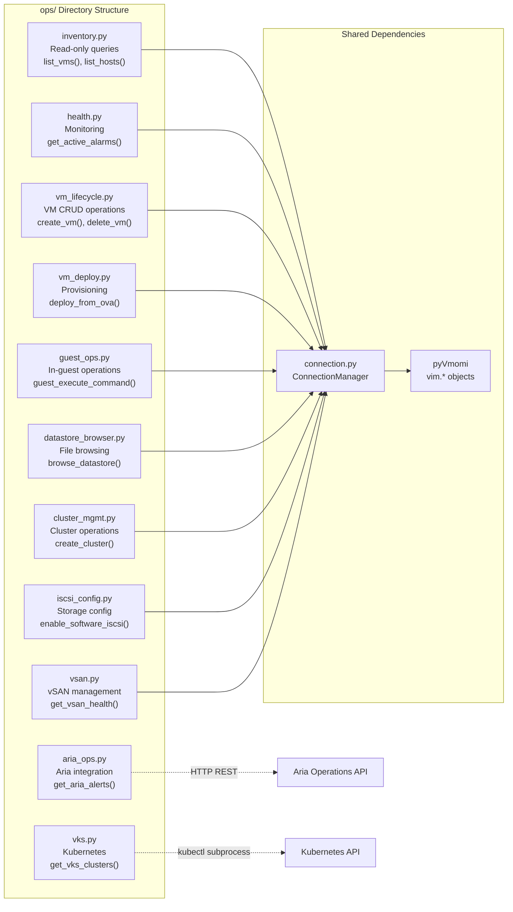
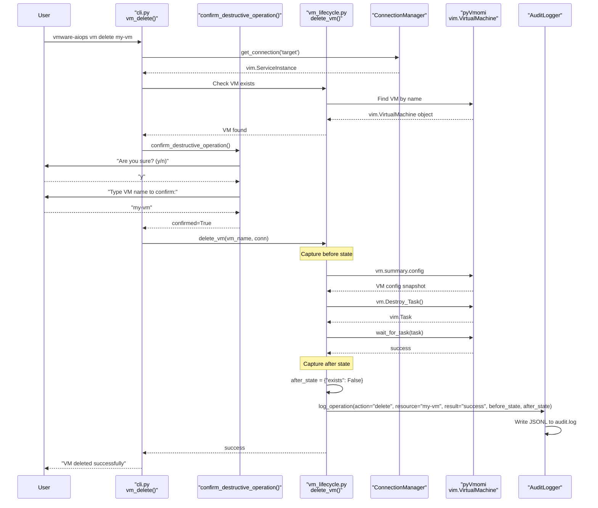
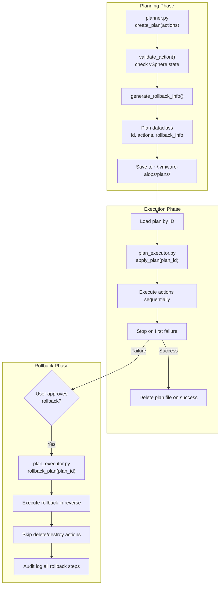
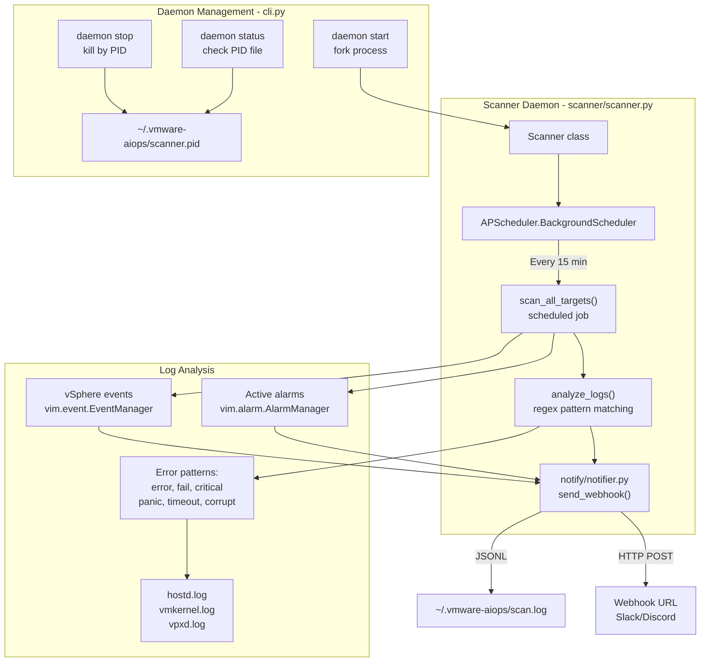
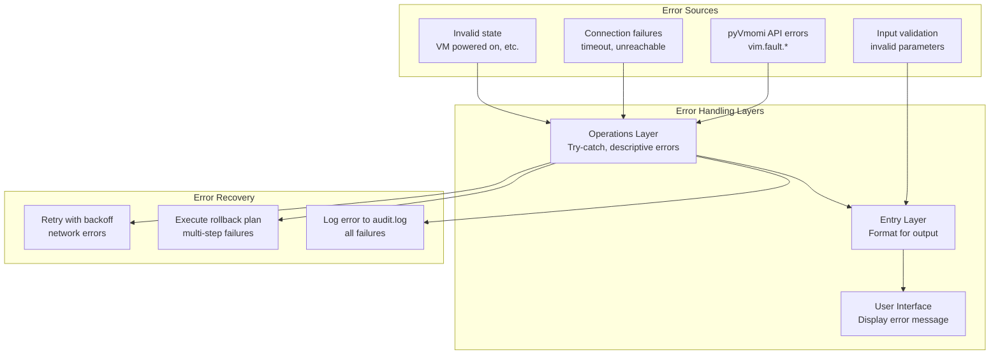

<!-- source: DeepWiki mcp.deepwiki.com · repo zw008/VMware-AIops · page 9 System Architecture · fetched 2026-10-26 -->

# System Architecture

<details>
<summary>Relevant source files</summary>

The following files were used as context for generating this wiki page:

- [README-CN.md](README-CN.md)
- [README.md](README.md)
- [pyproject.toml](pyproject.toml)

</details>


This document provides a deep dive into the internal architecture of VMware AIops, covering component relationships, design patterns, and the code-level structure of the system. It explains how the major subsystems interact and how requests flow through the application from entry points to VMware infrastructure.

For specific details on:
- Backend module organization and the `ops/` directory structure, see [Backend Module Structure](#9.1)
- Connection pooling and multi-target session management, see [Connection Management](#9.2)  
- VMware API integration and protocol details, see [API Integration Layers](#9.3)

## System Overview

VMware AIops is built as a layered Python application with two distinct operational modes (CLI and MCP) that share a common backend. The architecture separates concerns between user interface layers, business logic in operations modules, infrastructure services, and external API integration.



**Sources:** [README.md:1-933](), [pyproject.toml:1-48]()

## Dual-Mode Architecture

The system implements two operational modes that share the same backend but expose different interfaces optimized for different use cases.

### CLI Mode Entry Point

The CLI mode is implemented using the Typer framework and serves as the primary interface for human operators and AI agents using bash execution.

| Component | Implementation | Purpose |
|-----------|----------------|---------|
| Entry Point | `vmware_aiops.cli:app` | Registered in `pyproject.toml` as `vmware-aiops` command |
| Framework | `typer.Typer()` | Command-line interface framework with automatic help generation |
| Command Groups | `app.add_typer()` | Organized subcommands: `inventory`, `health`, `vm`, `deploy`, `daemon`, etc. |
| Helper Functions | `confirm_destructive_operation()` | Double confirmation for destructive operations |
| Context Management | `~/.vmware-aiops/` | Configuration, audit logs, image registry, plans |

The CLI mode consumes approximately **2K tokens** of context when used with AI agents via `SKILL.md` documentation files.

**Sources:** [pyproject.toml:31-33](), [README.md:56-66]()

### MCP Mode Entry Point

The MCP (Model Context Protocol) mode exposes operations as structured tools for AI agent integration.

| Component | Implementation | Purpose |
|-----------|----------------|---------|
| Entry Point | `mcp_server.server:main` | Registered in `pyproject.toml` as `vmware-aiops-mcp` command |
| Framework | `FastMCP()` from `mcp[cli]` | Model Context Protocol server implementation |
| Tool Registration | `@mcp.tool()` decorators | 43 structured tools with JSON schema validation |
| Transport | `stdio` | Standard input/output communication with AI clients |
| Context Management | Same as CLI mode | Shared configuration and state management |

The MCP mode consumes approximately **10K tokens** of context due to inclusion of all tool schemas in the initial handshake.

**Sources:** [pyproject.toml:21-22](), [README.md:56-66]()

## Entry Point Request Flow

This diagram shows how user requests enter the system and flow through to the operations layer, using actual function names from the codebase.



**Key Design Decisions:**

1. **Thin Entry Layers**: Both `cli.py` and `mcp_server/server.py` contain minimal business logic, acting as adapters that validate input and delegate to operations modules
2. **Shared Operations**: Both entry points call the same functions in `ops/*` modules, ensuring consistent behavior regardless of interface
3. **Safety at Entry**: CLI implements double confirmation via `confirm_destructive_operation()` before calling destructive operations; MCP relies on AI agent confirmation prompts
4. **Audit at Operation**: Audit logging occurs in the operations layer, not at entry points, ensuring all operations are logged regardless of interface

**Sources:** [pyproject.toml:31-33](), [README.md:68-83]()

## Core Infrastructure Layer

The infrastructure layer provides shared services used by all operations modules.



### Configuration Architecture

The configuration system implements a **two-file pattern** for security:

| File | Purpose | Content | Security |
|------|---------|---------|----------|
| `config.yaml` | Target definitions | Hostnames, ports, settings | Plain text, version controlled safe |
| `.env` | Credentials | Passwords, tokens | Owner-only (chmod 600), never committed |

The `load_config()` function in [vmware_aiops/config.py]() reads `config.yaml`, then loads environment variables from `.env` using `python-dotenv`, and merges them into `ConfigTarget` dataclass instances. Environment variable naming follows the pattern `VMWARE_{TARGET_NAME_UPPER}_PASSWORD`.

### Connection Pooling

The `ConnectionManager` class in [vmware_aiops/connection.py]() implements connection pooling and reuse:

1. **Lazy Initialization**: Connections are created on first use via `get_connection(target_name)`
2. **Session Caching**: Active `vim.ServiceInstance` objects are stored in `_connections` dict
3. **Multi-Target Support**: Each target name maps to its own connection instance
4. **Error Handling**: Connection failures raise descriptive errors with target context

### Audit Trail

The `AuditLogger` class in [vmware_aiops/notify/audit.py]() implements comprehensive audit logging:

- **JSONL Format**: Each log entry is a single JSON object per line for easy parsing
- **Operation Context**: Records timestamp, target, operation, resource, parameters, user
- **State Capture**: Logs before and after state for change tracking
- **Rejection Recording**: Even declined confirmations are logged for security review
- **Structured Fields**: Consistent schema across all log entries

**Sources:** [README.md:344-381](), [config.example.yaml](), [.env.example]()

## Operations Module Organization

The `ops/` directory contains all business logic modules, organized by functional domain.



### Module Categorization

| Category | Modules | Access Pattern | Side Effects |
|----------|---------|----------------|--------------|
| **Monitoring** | `inventory.py`, `health.py` | Read-only | None |
| **VM Management** | `vm_lifecycle.py`, `vm_deploy.py`, `guest_ops.py` | Read-write | Creates/modifies/deletes VMs |
| **Infrastructure** | `cluster_mgmt.py`, `iscsi_config.py`, `vsan.py` | Read-write | Modifies cluster/storage config |
| **Integration** | `aria_ops.py`, `vks.py` | Varies | Depends on external system |
| **Utilities** | `datastore_browser.py` | Read-only | None |

### Function Naming Conventions

All operations modules follow consistent naming patterns:

- **List operations**: `list_*()` - returns list of objects (e.g., `list_vms()`, `list_hosts()`)
- **Get operations**: `get_*()` - returns single object or specific data (e.g., `get_vm_info()`, `get_active_alarms()`)
- **Action operations**: `{verb}_*()` - performs action (e.g., `power_on_vm()`, `create_vm()`, `delete_vm()`)
- **Deploy operations**: `deploy_from_*()` - provisioning operations (e.g., `deploy_from_ova()`, `deploy_from_template()`)

**Sources:** [README.md:887-933]()

## Request Flow with State Management

This diagram illustrates a complete request flow for a destructive operation, showing state capture and audit logging.



### State Capture Pattern

All destructive operations follow this pattern:

1. **Pre-validation**: Check resource exists and operation is valid for current state
2. **Double confirmation**: Two-step user confirmation for destructive operations
3. **Before-state capture**: Record current configuration using `vim` object properties
4. **API execution**: Call pyVmomi API method (e.g., `Destroy_Task()`)
5. **Task waiting**: Synchronously wait for completion using `wait_for_task()`
6. **After-state capture**: Record new state or mark resource as deleted
7. **Audit logging**: Write complete operation record to `audit.log`

**Sources:** [README.md:196-214]()

## Plan-Apply-Rollback Architecture

For multi-step operations involving multiple VMs or complex sequences, the system implements a plan-based workflow.



### Plan Data Structure

The `Plan` dataclass in [vmware_aiops/planner.py]() contains:

| Field | Type | Purpose |
|-------|------|---------|
| `id` | str | UUID for plan identification |
| `actions` | List[Dict] | Ordered list of operations to execute |
| `rollback_info` | List[Dict] | Reverse operations for each action (if reversible) |
| `metadata` | Dict | Creation timestamp, user, target, etc. |

### Irreversible Actions

Certain actions cannot be rolled back and are marked in `rollback_info`:

- `delete_vm`: Cannot restore a deleted VM without backup
- `destroy_snapshot`: Deleted snapshots cannot be recreated
- `disk_extend`: Disk shrinking is not supported in vSphere

When rollback occurs, these actions are logged but skipped in the rollback sequence.

**Sources:** [README.md:153-164]()

## Background Services Architecture

The system includes long-running background services for proactive monitoring and scheduled tasks.



### Scanner Configuration

The scanner daemon configuration in `config.yaml`:

| Parameter | Default | Purpose |
|-----------|---------|---------|
| `interval_minutes` | 15 | Frequency of scan execution |
| `severity_threshold` | warning | Minimum severity to log (critical/warning/info) |
| `lookback_hours` | 1 | How far back to scan logs and events |
| `log_types` | [hostd, vmkernel, vpxd] | Which ESXi logs to analyze |

### Process Management

The daemon uses standard Unix process management:

1. **Start**: Forks child process, writes PID to `~/.vmware-aiops/scanner.pid`
2. **Status**: Checks if process with PID exists and is running
3. **Stop**: Sends SIGTERM to PID, allows graceful shutdown with timeout
4. **Cleanup**: Removes PID file on normal exit

**Sources:** [README.md:186-197]()

## Design Patterns and Principles

The codebase implements several key design patterns consistently across all modules.

### Dependency Injection via Connection Manager

Rather than creating connections within operations modules, all modules receive a `vim.ServiceInstance` connection object:

```python
# Pattern used throughout ops/* modules
def list_vms(conn: vim.ServiceInstance, target_name: str) -> List[Dict]:
    """Connection is injected, not created within function"""
    container = conn.content.viewManager.CreateContainerView(...)
```

This enables:
- **Testability**: Mock connections can be injected for unit tests
- **Connection reuse**: Same connection used across multiple operations
- **Error handling**: Connection failures handled centrally in ConnectionManager

### Command Pattern in Entry Layers

Both CLI and MCP entry points implement the command pattern:

1. **CLI**: Each `@app.command()` function is a command object that maps to an operation
2. **MCP**: Each `@mcp.tool()` function is a command object that maps to an operation

This separation allows:
- Operations logic independent of interface
- Same operations callable from multiple interfaces
- Easy addition of new interfaces (e.g., REST API) without modifying operations

### Repository Pattern in Operations Modules

Operations modules act as repositories that encapsulate vSphere API access:

- **Inventory module**: Repository for VM/host/datastore queries
- **Lifecycle module**: Repository for VM state modifications
- **Health module**: Repository for alarm/event queries

This pattern provides:
- **Abstraction**: Entry layers don't need to know pyVmomi details
- **Consistency**: All vSphere access goes through well-defined functions
- **Maintainability**: API changes isolated to operations modules

### Factory Pattern in Deployment

The `vm_deploy.py` module implements factory methods for different deployment types:

- `deploy_from_ova()`: Factory for OVA-based VMs
- `deploy_from_template()`: Factory for template-based VMs
- `deploy_linked_clone()`: Factory for linked clone VMs

Each factory method encapsulates the specific vSphere API calls needed for that deployment type.

**Sources:** [vmware_aiops/ops/](), [vmware_aiops/cli.py](), [mcp_server/server.py]()

## Error Handling Strategy

The system implements a layered error handling approach:



### Error Context Enrichment

Errors are enriched with context as they propagate up:

1. **Operations layer**: Catches `vim.fault.*` exceptions, adds target name, resource name
2. **Entry layer**: Adds user context, command invoked, parameters used
3. **Audit layer**: Logs complete error context for debugging

This approach provides detailed error information for troubleshooting while presenting clear messages to users.

**Sources:** [vmware_aiops/ops/](), [vmware_aiops/notify/audit.py]()

---

