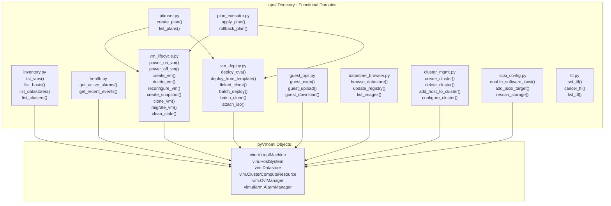
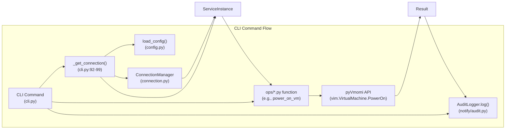

<!-- source: DeepWiki mcp.deepwiki.com · repo zw008/VMware-AIops · page 9.1 Backend Module Structure · fetched 2026-10-26 -->

# Backend Module Structure

<details>
<summary>Relevant source files</summary>

The following files were used as context for generating this wiki page:

- [README.md](README.md)
- [pyproject.toml](pyproject.toml)
- [vmware_aiops/__init__.py](vmware_aiops/__init__.py)
- [vmware_aiops/cli.py](vmware_aiops/cli.py)

</details>


This document provides a detailed overview of the Python backend module organization in VMware AIops. It explains the directory structure, the role of each major module, and how the `ops/` directory is organized by functional domain. For information about connection management and session pooling, see [Connection Management](#9.2). For details on API integration layers, see [API Integration Layers](#9.3).

---

## Directory Structure Overview

The backend is organized as a Python package under `vmware_aiops/` with the following top-level structure:

```
vmware_aiops/
├── __init__.py              # Package version metadata
├── cli.py                   # Typer CLI application (main entry point)
├── config.py                # YAML + .env configuration loader
├── connection.py            # ConnectionManager for pyVmomi sessions
├── doctor.py                # Environment diagnostics
├── ops/                     # Operations modules by domain
│   ├── inventory.py         # VM, host, datastore, cluster listing
│   ├── health.py            # Alarms, events, sensors
│   ├── vm_lifecycle.py      # VM power, create, delete, snapshot, clone, migrate
│   ├── vm_deploy.py         # OVA, template, linked clone, batch deploy
│   ├── guest_ops.py         # VMware Tools guest operations
│   ├── datastore_browser.py # Datastore file browsing, image registry
│   ├── cluster_mgmt.py      # Cluster create, delete, configure HA/DRS
│   ├── iscsi_config.py      # iSCSI adapter configuration
│   ├── vsan.py              # vSAN health, capacity, performance
│   ├── aria_ops.py          # Aria Operations REST API client
│   ├── vks.py               # vSphere Kubernetes Service (kubectl)
│   ├── planner.py           # Multi-step operation plan creation
│   ├── plan_executor.py     # Plan execution and rollback
│   └── ttl.py               # Time-to-live VM auto-deletion
├── scanner/                 # Background scanning daemon
│   ├── scheduler.py         # APScheduler daemon manager
│   ├── alarm_scanner.py     # Alarm monitoring
│   └── log_scanner.py       # ESXi log analysis
└── notify/                  # Audit logging and notifications
    ├── audit.py             # JSONL audit logger
    └── notifier.py          # JSONL + webhook notifier
```

The MCP server is in a separate top-level directory:

```
mcp_server/
├── __init__.py
├── __main__.py              # MCP server entry point
└── server.py                # FastMCP server with 43 tools
```

**Sources:** [README.md:889-932](), [pyproject.toml:1-48]()

---

## Entry Points: CLI and MCP

### CLI Entry Point: `cli.py`

The CLI is built with **Typer** and serves as the primary entry point for human operators and AI agents using CLI mode. The main application is defined at [vmware_aiops/cli.py:18-23]() as `app = typer.Typer(...)` with the command name `vmware-aiops`.

The CLI is organized into **sub-applications** for each functional domain:

| Sub-app | Purpose | Defined at |
|---------|---------|------------|
| `inventory_app` | Query VMs, hosts, datastores, clusters | [cli.py:26]() |
| `health_app` | Alarms, events, hardware sensors | [cli.py:27]() |
| `vm_app` | VM lifecycle operations | [cli.py:28]() |
| `deploy_app` | VM deployment (OVA, template, linked clone) | [cli.py:29]() |
| `datastore_app` | Datastore browsing, image scanning | [cli.py:30]() |
| `cluster_app` | Cluster management | [cli.py:31]() |
| `storage_app` | iSCSI configuration | [cli.py:32]() |
| `scan_app` | One-time scanning | [cli.py:33]() |
| `daemon_app` | Background daemon management | [cli.py:34]() |
| `plan_app` | Plan → Apply workflow | [cli.py:1709]() |
| `mcp_config_app` | MCP config generator | [cli.py:1742]() |

Each sub-app is registered to the main app at [cli.py:36-44]() using `app.add_typer(...)`.

```mermaid
graph TB
    Entry["vmware-aiops CLI<br/>(cli.py:app)"]
    
    Entry --> Inventory["inventory_app<br/>vmware-aiops inventory"]
    Entry --> Health["health_app<br/>vmware-aiops health"]
    Entry --> VM["vm_app<br/>vmware-aiops vm"]
    Entry --> Deploy["deploy_app<br/>vmware-aiops deploy"]
    Entry --> Datastore["datastore_app<br/>vmware-aiops datastore"]
    Entry --> Cluster["cluster_app<br/>vmware-aiops cluster"]
    Entry --> Storage["storage_app<br/>vmware-aiops storage"]
    Entry --> Scan["scan_app<br/>vmware-aiops scan"]
    Entry --> Daemon["daemon_app<br/>vmware-aiops daemon"]
    Entry --> Plan["plan_app<br/>vmware-aiops plan"]
    Entry --> MCPConfig["mcp_config_app<br/>vmware-aiops mcp-config"]
    
    Inventory --> InventoryOps["ops/inventory.py<br/>list_vms(), list_hosts()"]
    Health --> HealthOps["ops/health.py<br/>get_active_alarms()"]
    VM --> LifecycleOps["ops/vm_lifecycle.py<br/>power_on_vm(), delete_vm()"]
    Deploy --> DeployOps["ops/vm_deploy.py<br/>deploy_ova(), linked_clone()"]
    Datastore --> BrowserOps["ops/datastore_browser.py<br/>browse_datastore()"]
    Cluster --> ClusterOps["ops/cluster_mgmt.py<br/>create_cluster()"]
    Storage --> StorageOps["ops/iscsi_config.py<br/>enable_software_iscsi()"]
    Scan --> ScannerOps["scanner/alarm_scanner.py<br/>scanner/log_scanner.py"]
    Daemon --> SchedulerOps["scanner/scheduler.py<br/>start_scheduler()"]
    Plan --> PlannerOps["ops/planner.py<br/>ops/plan_executor.py"]
```



**Sources:** [cli.py:18-44](), [cli.py:1709-1710](), [cli.py:1742-1743]()

### MCP Entry Point: `mcp_server/server.py`

The MCP server exposes VMware operations as **43 structured tools** via the Model Context Protocol. It is built with **FastMCP** and uses stdio transport. The entry point is `vmware-aiops-mcp` defined at [pyproject.toml:33]().

The MCP server delegates to the same `ops/` modules as the CLI but provides JSON-structured input/output instead of shell output.

**Sources:** [pyproject.toml:32-33](), [README.md:565-596]()

---

## Core Infrastructure Modules

### `config.py` - Configuration Management

The `config.py` module loads configuration from YAML files and `.env` credential files. It provides multi-target support, allowing operations against multiple vCenter/ESXi instances.

**Key responsibilities:**
- Load `config.yaml` from `~/.vmware-aiops/` or custom path
- Parse target definitions (hostname, port, type, SSL verification)
- Load passwords from `.env` using naming convention `VMWARE_{TARGET}_PASSWORD`
- Provide configuration objects to `ConnectionManager`

**Sources:** [README.md:342-368](), [cli.py:93-99]()

### `connection.py` - pyVmomi Session Management

The `connection.py` module implements the `ConnectionManager` class that handles pyVmomi connections. This is covered in detail in [Connection Management](#9.2).

**Key responsibilities:**
- Establish pyVmomi `ServiceInstance` connections
- Multi-target connection pooling
- SSL certificate validation control
- Session lifecycle management

**Sources:** [cli.py:93-99]()

### `notify/audit.py` - Audit Logging

The `AuditLogger` class provides structured audit logging in JSONL format to `~/.vmware-aiops/audit.log`.

**Logged data structure:**
- `timestamp` - ISO 8601 timestamp
- `target` - vCenter/ESXi target name
- `operation` - Operation type (e.g., "power_off", "delete_vm")
- `resource` - VM or resource name
- `parameters` - Operation parameters
- `before_state` - Resource state before operation
- `after_state` - Resource state after operation
- `result` - Operation result or "rejected" for declined confirmations

The audit logger is instantiated at [cli.py:16]() as `_audit = AuditLogger()` and used throughout CLI commands.

**Sources:** [cli.py:14-16](), [cli.py:82-89](), [cli.py:389-395](), [README.md:206]()

---

## Operations Modules: The `ops/` Directory

The `ops/` directory contains all operational logic organized by **functional domain**. Each module is self-contained and imports pyVmomi objects as needed. All modules accept a `ServiceInstance` (pyVmomi connection) as the first parameter.



**Sources:** [README.md:907-913]()

### `inventory.py` - Read-only Queries

Provides listing functions for vCenter/ESXi inventory:

| Function | Returns | Usage |
|----------|---------|-------|
| `list_vms(si, limit, sort_by, power_state)` | List of VM dicts | [cli.py:177-180]() |
| `list_hosts(si)` | List of host dicts | [cli.py:223-224]() |
| `list_datastores(si)` | List of datastore dicts | [cli.py:250-251]() |
| `list_clusters(si)` | List of cluster dicts | [cli.py:278-279]() |

These functions iterate over pyVmomi view objects and extract properties into dictionaries.

**Sources:** [cli.py:168-292]()

### `health.py` - Monitoring

Provides health monitoring functions:

| Function | Purpose |
|----------|---------|
| `get_active_alarms(si)` | Query `vim.alarm.AlarmManager` for triggered alarms |
| `get_recent_events(si, hours, severity)` | Query `vim.event.EventManager` with time filter |

**Sources:** [cli.py:298-345](), [README.md:106-123]()

### `vm_lifecycle.py` - VM Operations

The largest ops module, containing all VM lifecycle operations:

**Query operations:**
- `get_vm_info(si, vm_name)` - Retrieve VM configuration and state

**Power operations:**
- `power_on_vm(si, vm_name)` - Call `vim.VirtualMachine.PowerOn()`
- `power_off_vm(si, vm_name, force)` - Graceful shutdown or force power off

**CRUD operations:**
- `create_vm(si, vm_name, cpu, memory_mb, disk_gb, ...)` - Create via `vim.Folder.CreateVM_Task()`
- `delete_vm(si, vm_name)` - Destroy via `vim.VirtualMachine.Destroy_Task()`
- `reconfigure_vm(si, vm_name, cpu, memory_mb)` - Reconfigure via `vim.VirtualMachine.ReconfigVM_Task()`

**Snapshot operations:**
- `create_snapshot(si, vm_name, snap_name, description, memory)` - Create snapshot
- `list_snapshots(si, vm_name)` - List snapshot tree
- `revert_to_snapshot(si, vm_name, snap_name)` - Revert to snapshot
- `delete_snapshot(si, vm_name, snap_name)` - Remove snapshot

**Advanced operations:**
- `clone_vm(si, vm_name, new_name)` - Full clone
- `migrate_vm(si, vm_name, to_host)` - vMotion migration
- `clean_slate(si, vm_name, snapshot_name)` - Power off + revert to baseline

**Sources:** [cli.py:351-866]()

### `vm_deploy.py` - Deployment

Handles various VM deployment methods:

| Function | Method | Speed |
|----------|--------|-------|
| `deploy_ova(si, ova_path, vm_name, ...)` | OVA import via `vim.OvfManager` | Minutes |
| `deploy_from_template(si, template_name, new_name, ...)` | Clone from template | Minutes |
| `linked_clone(si, source_vm_name, new_name, snapshot_name, ...)` | Linked clone from snapshot | Seconds |
| `batch_deploy(si, spec_file)` | Deploy multiple VMs from YAML spec | Variable |
| `batch_clone(si, source_vm_name, vm_names, ...)` | Clone multiple VMs from source | Minutes |
| `attach_iso(si, vm_name, iso_path)` | Attach ISO to CD-ROM | Instant |
| `convert_to_template(si, vm_name)` | Mark VM as template | Instant |

**Sources:** [cli.py:1040-1292](), [README.md:166-176]()

### `guest_ops.py` - Guest OS Operations

Provides guest operations via VMware Tools:

- `guest_exec(si, vm_name, command, username, password, arguments)` - Execute command in guest
- `guest_upload(si, vm_name, local_path, guest_path, username, password)` - Upload file to guest
- `guest_download(si, vm_name, guest_path, local_path, username, password)` - Download file from guest

All functions require VMware Tools running in the guest OS.

**Sources:** [cli.py:872-949](), [README.md:147-151]()

### `datastore_browser.py` - Datastore Operations

Provides datastore file browsing and image discovery:

- `browse_datastore(si, datastore_name, path, pattern)` - Browse files via `vim.host.DatastoreBrowser`
- `update_registry(si)` - Scan all datastores for OVA/ISO/OVF/VMDK files, update `~/.vmware-aiops/image_registry.json`
- `list_images(image_type, datastore)` - Query cached image registry

The image registry caches datastore scan results to avoid repeated slow scans.

**Sources:** [cli.py:955-1035](), [README.md:178-185]()

### `cluster_mgmt.py` - Cluster Management

Provides cluster operations:

- `get_cluster_info(si, cluster_name)` - Retrieve cluster configuration
- `create_cluster(si, cluster_name, datacenter_name, ha_enabled, drs_enabled, drs_behavior)` - Create cluster
- `delete_cluster(si, cluster_name)` - Destroy empty cluster
- `add_host_to_cluster(si, cluster_name, host_name)` - Move host into cluster
- `remove_host_from_cluster(si, cluster_name, host_name)` - Remove host from cluster
- `configure_cluster(si, cluster_name, ha_enabled, drs_enabled, drs_behavior)` - Reconfigure HA/DRS

**Sources:** [cli.py:1297-1486]()

### `iscsi_config.py` - Storage Configuration

Provides iSCSI adapter configuration:

- `enable_software_iscsi(si, host_name)` - Enable software iSCSI adapter
- `get_iscsi_status(si, host_name)` - Retrieve adapter status and send targets
- `add_iscsi_target(si, host_name, address, port)` - Add send target
- `remove_iscsi_target(si, host_name, address, port)` - Remove send target
- `rescan_storage(si, host_name)` - Rescan HBAs and VMFS

**Sources:** [cli.py:1492-1631]()

### `planner.py` and `plan_executor.py` - Multi-step Operations

The planning system provides **Plan → Apply → Rollback** workflow for complex operations:

**`planner.py`:**
- `create_plan(operations, target)` - Validate operations, generate plan with rollback info
- `list_plans()` - List pending/failed plans from `~/.vmware-aiops/plans/`

**`plan_executor.py`:**
- `apply_plan(plan_id, si)` - Execute plan steps sequentially, stop on failure
- `rollback_plan(plan_id, si)` - Reverse executed steps (irreversible steps skipped)

Plans are stored in `~/.vmware-aiops/plans/{plan_id}.json` and auto-deleted on success or after 24h.

**Sources:** [cli.py:1713-1737](), [README.md:153-164]()

### `ttl.py` - Time-to-Live Management

Provides VM auto-deletion based on TTL:

- `set_ttl(vm_name, minutes, target)` - Register VM for auto-deletion
- `cancel_ttl(vm_name)` - Cancel pending TTL
- `list_ttl()` - List all VMs with active TTLs

TTL registry is stored in `~/.vmware-aiops/ttl_registry.json`. The scanner daemon checks for expired TTLs.

**Sources:** [cli.py:777-831](), [README.md:143-145]()

---

## Background Services: `scanner/` and `notify/`

### Scanner Daemon

The scanner daemon runs background monitoring tasks on a schedule (default 15 minutes).

**Modules:**

| Module | Purpose |
|--------|---------|
| `scanner/scheduler.py` | APScheduler-based daemon manager, PID file handling |
| `scanner/alarm_scanner.py` | Scan alarms via `get_active_alarms()` |
| `scanner/log_scanner.py` | Parse ESXi logs (hostd, vmkernel, vpxd) for error patterns |

**Daemon commands:**
- `vmware-aiops daemon start` → [cli.py:1665-1670]()
- `vmware-aiops daemon status` → [cli.py:1673-1681]()
- `vmware-aiops daemon stop` → [cli.py:1684-1703]()

The scanner writes results to `~/.vmware-aiops/scan.log` in JSONL format.

**Sources:** [cli.py:1637-1703](), [README.md:186-196]()

### Notifier

The `notify/notifier.py` module handles notifications:

- JSONL logging to `~/.vmware-aiops/scan.log`
- Optional webhook notifications to user-configured URLs (Slack, Discord, etc.)

**Sources:** [README.md:186-196]()

---

## Module Dependency Patterns

All ops modules follow a consistent pattern:

1. **Accept `ServiceInstance` as first parameter** - All functions receive a pyVmomi connection from `ConnectionManager`
2. **Import pyVmomi objects as needed** - Each module imports only the `vim.*` objects it uses
3. **Return structured data** - Functions return dictionaries or lists, not pyVmomi objects
4. **Raise exceptions on failure** - Use standard Python exceptions for error handling
5. **No direct config access** - Modules don't load config; they receive pre-configured connections



**Sources:** [cli.py:92-99](), [cli.py:366-395]()

---

## Helper Functions in `cli.py`

The CLI module provides reusable helper functions for common patterns:

### `_get_connection(target, config_path)`

Returns a tuple of `(ServiceInstance, Config)` by:
1. Loading config via `load_config(config_path)`
2. Creating `ConnectionManager(cfg)`
3. Connecting via `mgr.connect(target)`

Defined at [cli.py:92-99]().

### `_double_confirm(action, vm_name, target, resource_type)`

Implements double confirmation for destructive operations:
1. First prompt: "确定要{action} '{vm_name}'?"
2. Second prompt: "再次确认{action} '{vm_name}'，此操作不可撤销?"
3. Logs rejection to audit trail if user declines

Defined at [cli.py:141-162]().

### `_validate_vm_params(name, cpu, memory_mb, disk_gb)`

Validates VM parameter ranges:
- VM name: 1-80 characters, not starting with `-` or `.`
- CPU: 1-128
- Memory: 128-1048576 MB
- Disk: 1-65536 GB

Raises `typer.BadParameter` on invalid input. Defined at [cli.py:120-138]().

### `_dry_run_print(target, vm_name, operation, api_call, parameters, ...)`

Prints dry-run preview showing:
- Target, resource, operation
- Exact pyVmomi API call that would be made
- Parameters
- Current state vs. expected state

Logs to audit trail with `result="dry-run"`. Defined at [cli.py:57-89]().

### `_show_state_preview(info, action, vm_name)`

Displays current VM state before destructive operations:
- power_state, cpu, memory_mb, guest_os
- host, ip_address, snapshot_count

Defined at [cli.py:107-118]().

**Sources:** [cli.py:57-162]()

---

## Code-to-Concept Mapping

This diagram maps high-level system concepts to actual Python modules and functions:

```mermaid
graph TB
    subgraph "System Concepts"
        Inventory_Concept["Inventory<br/>Management"]
        Health_Concept["Health<br/>Monitoring"]
        VM_Concept["VM<br/>Lifecycle"]
        Deploy_Concept["VM<br/>Deployment"]
        Cluster_Concept["Cluster<br/>Management"]
        Storage_Concept["Storage<br/>Configuration"]
        Scanner_Concept["Background<br/>Scanning"]
        Audit_Concept["Audit<br/>Trail"]
    end
    
    subgraph "Code Entities"
        InventoryPy["vmware_aiops/ops/inventory.py<br/>list_vms()<br/>list_hosts()<br/>list_datastores()<br/>list_clusters()"]
        
        HealthPy["vmware_aiops/ops/health.py<br/>get_active_alarms()<br/>get_recent_events()"]
        
        LifecyclePy["vmware_aiops/ops/vm_lifecycle.py<br/>power_on_vm()<br/>create_vm()<br/>delete_vm()<br/>create_snapshot()<br/>clone_vm()"]
        
        DeployPy["vmware_aiops/ops/vm_deploy.py<br/>deploy_ova()<br/>deploy_from_template()<br/>linked_clone()<br/>batch_deploy()"]
        
        ClusterPy["vmware_aiops/ops/cluster_mgmt.py<br/>create_cluster()<br/>configure_cluster()<br/>add_host_to_cluster()"]
        
        StoragePy["vmware_aiops/ops/iscsi_config.py<br/>enable_software_iscsi()<br/>add_iscsi_target()<br/>rescan_storage()"]
        
        ScannerPy["vmware_aiops/scanner/scheduler.py<br/>vmware_aiops/scanner/alarm_scanner.py<br/>vmware_aiops/scanner/log_scanner.py<br/>start_scheduler()<br/>scan_alarms()<br/>scan_logs()"]
        
        AuditPy["vmware_aiops/notify/audit.py<br/>AuditLogger<br/>AuditLogger.log()"]
    end
    
    Inventory_Concept --> InventoryPy
    Health_Concept --> HealthPy
    VM_Concept --> LifecyclePy
    Deploy_Concept --> DeployPy
    Cluster_Concept --> ClusterPy
    Storage_Concept --> StoragePy
    Scanner_Concept --> ScannerPy
    Audit_Concept --> AuditPy
```



**Sources:** [cli.py:1-1846](), [README.md:889-932]()

---

## Summary

The VMware AIops backend follows a **clean layered architecture** with clear separation of concerns:

1. **Entry points** (CLI and MCP) are thin adapters that delegate to ops modules
2. **Core infrastructure** (config, connection, audit) is shared by all modules
3. **Operations modules** (`ops/`) are organized by functional domain and self-contained
4. **Background services** (scanner, notifier) run independently
5. **Planning system** provides multi-step workflow orchestration

All modules share the `ConnectionManager` for pyVmomi session management and follow consistent patterns for parameter validation, error handling, and audit logging. This modular design enables independent testing and evolution of each functional area.

---

