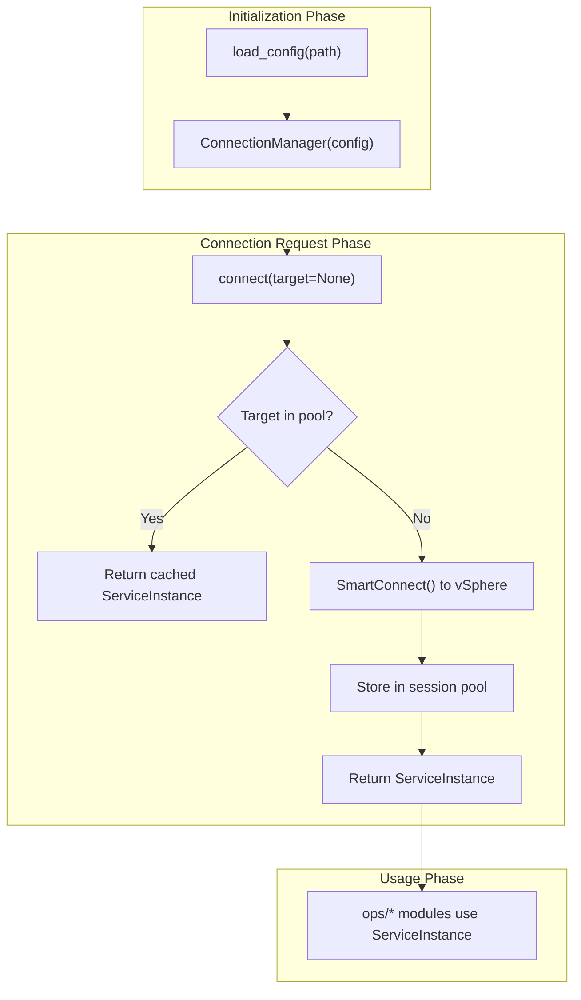
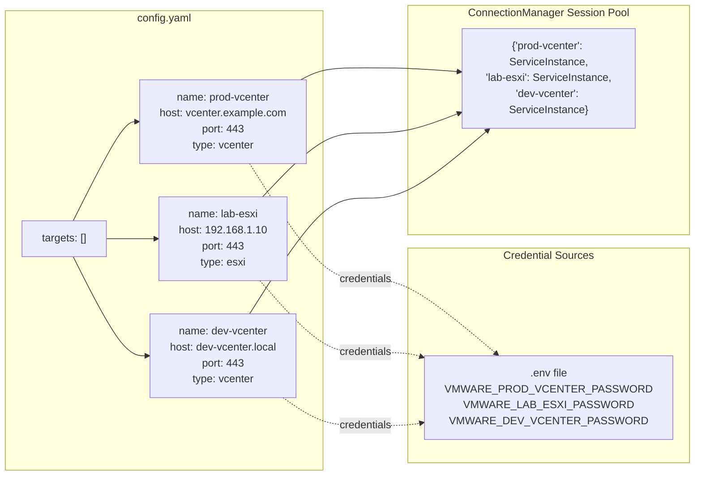
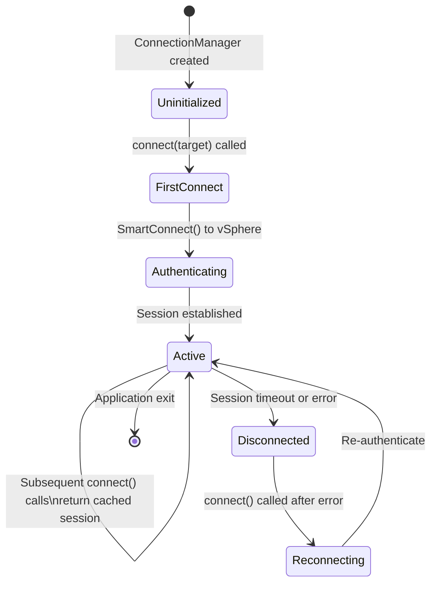
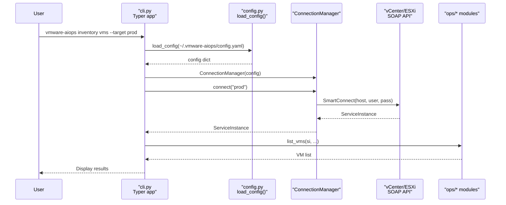
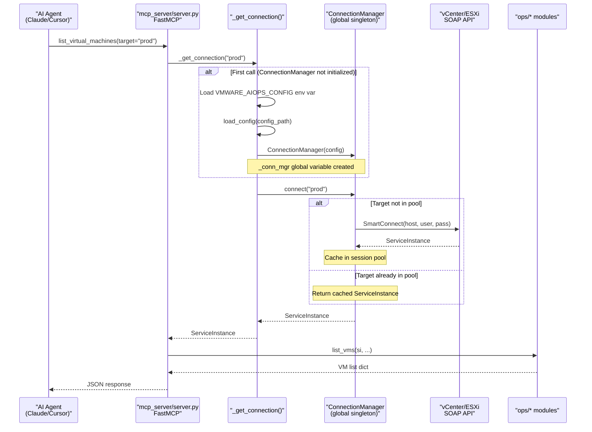
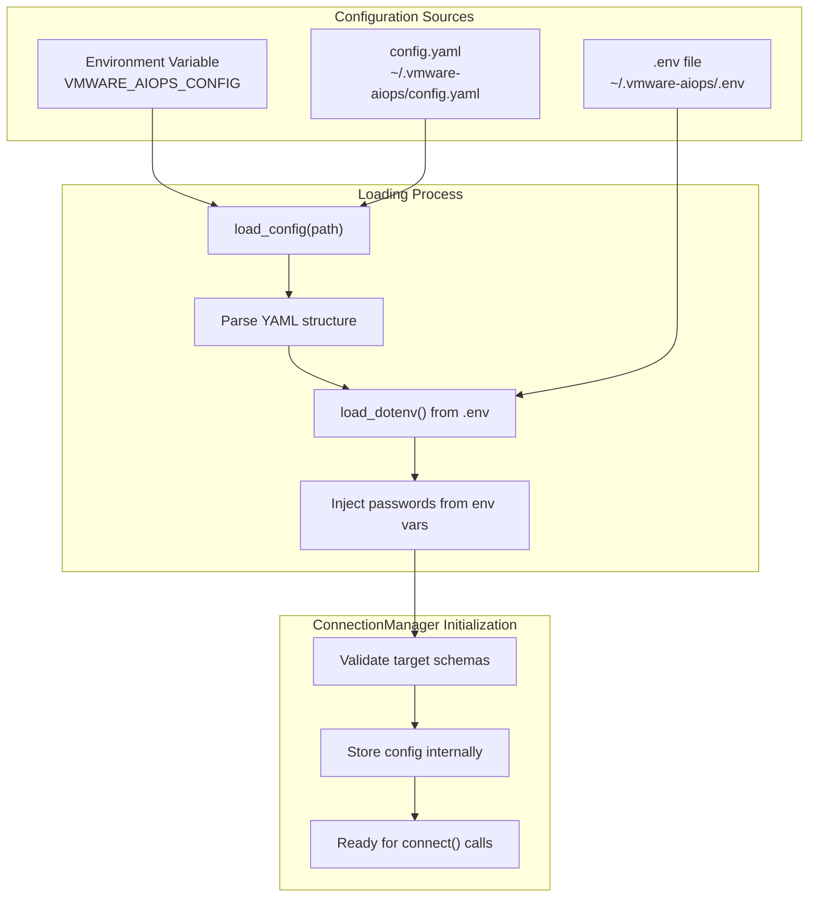
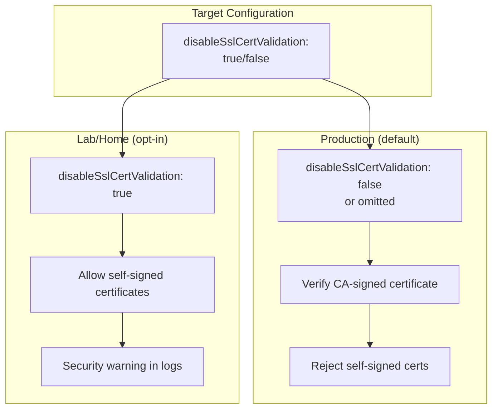
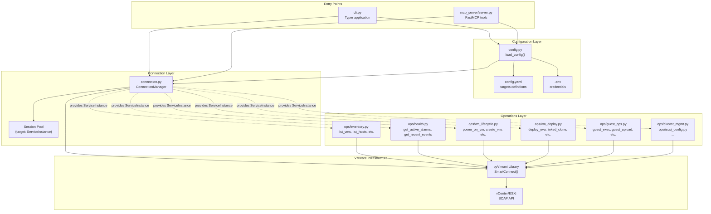

<!-- source: DeepWiki mcp.deepwiki.com · repo zw008/VMware-AIops · page 9.2 Connection Management · fetched 2026-10-26 -->

# Connection Management

<details>
<summary>Relevant source files</summary>

The following files were used as context for generating this wiki page:

- [codex-skill/AGENTS.md](codex-skill/AGENTS.md)
- [mcp_server/server.py](mcp_server/server.py)
- [skills/vmware-aiops/SKILL.md](skills/vmware-aiops/SKILL.md)

</details>


This document describes the connection management architecture in VMware AIops, including the `ConnectionManager` class, session pooling, multi-target support, and integration with configuration sources. Connection management is the foundational layer that all VMware operations depend on, providing authenticated pyVmomi ServiceInstance objects for vSphere API access.

For configuration file structure and credential management, see [Configuration](#2.2). For the complete backend module hierarchy, see [Backend Module Structure](#9.1).

---

## Overview

The connection management subsystem provides centralized, lazy-initialized connections to multiple vCenter and ESXi targets. It is implemented in `vmware_aiops/connection.py` and exposes a single public class `ConnectionManager` that handles:

- **Multi-target configuration**: Support for named targets (`prod-vcenter`, `lab-esxi`, etc.) from `config.yaml`
- **Session pooling**: Reuse of existing pyVmomi `ServiceInstance` objects per target
- **Lazy initialization**: Connections established only when first accessed
- **Credential injection**: Integration with `.env` files and environment variables
- **SSL configuration**: Support for both validated and self-signed certificates
- **Default target selection**: Automatic fallback to the first configured target

All operations modules in `ops/` directory import and use `ConnectionManager` to obtain authenticated vSphere API sessions. Both CLI mode and MCP mode share the same connection layer.

**Sources**: [mcp_server/server.py:38](), [skills/vmware-aiops/SKILL.md:132-145](), Diagram 5 from context

---

## ConnectionManager Architecture

The `ConnectionManager` class acts as a singleton-style session pool manager. It maintains an internal cache of pyVmomi `ServiceInstance` objects keyed by target name.

### ConnectionManager Lifecycle



**Sources**: [mcp_server/server.py:72-83]()

---

### Class Interface and Usage Pattern

The `ConnectionManager` is used via the following pattern:

```python
# Pattern 1: From config file (typical usage)
config = load_config(config_path)
mgr = ConnectionManager(config)
si = mgr.connect(target="prod-vcenter")  # Returns pyVmomi ServiceInstance

# Pattern 2: Default target (omit target parameter)
si = mgr.connect()  # Uses first target in config

# Pattern 3: Per-request target switching
si_vcenter = mgr.connect("prod-vcenter")
si_esxi = mgr.connect("lab-esxi")
```

The `connect()` method signature:

| Parameter | Type | Default | Description |
|-----------|------|---------|-------------|
| `target` | `str \| None` | `None` | Target name from config. Uses default if omitted. |
| **Returns** | `vim.ServiceInstance` | — | Authenticated pyVmomi session object |

**Sources**: [mcp_server/server.py:75-83]()

---

## Multi-Target Support

The `ConnectionManager` supports managing connections to multiple vCenter and ESXi instances simultaneously, with each target defined in `config.yaml`.

### Target Configuration Structure



**Sources**: [codex-skill/AGENTS.md:33-60](), [skills/vmware-aiops/SKILL.md:473-477]()

---

### Target Selection Logic

The connection manager uses the following priority for target selection:

1. **Explicit target parameter**: `mgr.connect("prod-vcenter")` — uses specified target
2. **Default target fallback**: `mgr.connect()` — uses first target in `config.yaml`
3. **Environment override**: If `VMWARE_AIOPS_TARGET` is set, uses that as default

This allows both modes (CLI and MCP) to support flexible target selection:

| Mode | Target Selection Method | Example |
|------|------------------------|---------|
| CLI | `--target` flag | `vmware-aiops inventory vms --target lab-esxi` |
| MCP | `target` parameter in tool call | `list_virtual_machines(target="lab-esxi")` |
| Both | Omit for default | Uses first configured target |

**Sources**: [mcp_server/server.py:91-116](), [skills/vmware-aiops/SKILL.md:83-94]()

---

## Session Pooling and Lifecycle

The `ConnectionManager` maintains a persistent pool of `ServiceInstance` objects to avoid repeated authentication overhead. Each target's session is created once and reused across multiple operations.

### Session Pool Implementation



**Key behaviors**:

- **Lazy initialization**: Sessions not created until first `connect()` call for that target
- **Persistent reuse**: Same `ServiceInstance` returned for all operations on same target
- **No explicit disconnect**: Sessions remain open for application lifetime
- **Automatic re-authentication**: If session expires, next `connect()` call re-authenticates

**Sources**: [mcp_server/server.py:72-83](), Diagram 5 from context

---

## Integration with Entry Points

Both CLI and MCP entry points use identical connection patterns, ensuring consistency across operational modes.

### CLI Mode Connection Flow



**Sources**: [skills/vmware-aiops/SKILL.md:78-94]()

---

### MCP Mode Connection Flow



**Sources**: [mcp_server/server.py:72-83](), [mcp_server/server.py:91-116]()

---

### Global Singleton Pattern in MCP Server

The MCP server uses a module-level global variable `_conn_mgr` to maintain a single `ConnectionManager` instance across all tool invocations:

```python
# mcp_server/server.py:72-83
_conn_mgr: ConnectionManager | None = None

def _get_connection(target: str | None = None) -> Any:
    """Return a pyVmomi ServiceInstance, lazily initialising the manager."""
    global _conn_mgr
    if _conn_mgr is None:
        config_path_str = os.environ.get("VMWARE_AIOPS_CONFIG")
        config_path = Path(config_path_str) if config_path_str else None
        config = load_config(config_path)
        _conn_mgr = ConnectionManager(config)
    return _conn_mgr.connect(target)
```

This pattern ensures:

- **Single instance**: Only one `ConnectionManager` exists per MCP server process
- **Configuration loaded once**: Config file parsed once at first tool invocation
- **Session reuse across tools**: All 43 MCP tools share the same connection pool
- **Memory efficiency**: No duplicate connections or config objects

**Sources**: [mcp_server/server.py:72-83]()

---

## Configuration and Credential Loading

The `ConnectionManager` integrates with the configuration subsystem to load target definitions and credentials.

### Configuration Loading Pipeline



**Sources**: [mcp_server/server.py:79-82](), [codex-skill/AGENTS.md:33-60]()

---

### Credential Resolution

Credentials are never stored in `config.yaml`. Instead, each target references an environment variable:

| Target Type | Config Field | Environment Variable Pattern | Example |
|-------------|--------------|----------------------------|---------|
| vCenter | `username` | `VMWARE_{NAME}_PASSWORD` | `VMWARE_PROD_VCENTER_PASSWORD` |
| ESXi | `username` | `VMWARE_{NAME}_PASSWORD` | `VMWARE_LAB_ESXI_PASSWORD` |

The `ConnectionManager` resolves passwords at connection time by:

1. Reading target definition from config (includes `username`, `host`, `port`)
2. Looking up `VMWARE_{target_name_uppercase}_PASSWORD` in environment
3. Passing both username and password to `pyVmomi.SmartConnect()`

**Sources**: [codex-skill/AGENTS.md:40-49](), [skills/vmware-aiops/SKILL.md:493-502]()

---

## SSL/TLS Certificate Handling

The `ConnectionManager` supports two SSL verification modes based on target configuration:

### Certificate Validation Modes



**Configuration example**:

```yaml
targets:
  - name: prod-vcenter
    host: vcenter-prod.example.com
    # disableSslCertValidation: false (default - require valid CA cert)
  
  - name: lab-esxi
    host: 192.168.1.10
    disableSslCertValidation: true  # Allow self-signed cert for lab
```

**Security notes**:

- **Default is secure**: Full TLS validation unless explicitly disabled
- **Lab use only**: `disableSslCertValidation: true` only for isolated environments
- **Production requirement**: Production targets must use CA-signed certificates
- **Audit trail**: Connection attempts with disabled validation are logged

**Sources**: [skills/vmware-aiops/SKILL.md:315-316](), [codex-skill/AGENTS.md:438]()

---

## Connection Error Handling

The `ConnectionManager` handles several categories of connection errors:

| Error Category | Cause | Behavior |
|----------------|-------|----------|
| **Target not found** | Invalid target name | Raises exception with available target list |
| **Authentication failure** | Wrong credentials | Raises `vim.fault.InvalidLogin` |
| **Network timeout** | Host unreachable | Raises socket timeout exception |
| **SSL verification failure** | Invalid certificate | Raises SSL error (if validation enabled) |
| **Session expired** | Long-running session | Next `connect()` re-authenticates |

**Error propagation**:

- CLI mode: Errors bubble up to `cli.py`, formatted as user-friendly messages
- MCP mode: Errors serialized as JSON error responses to AI agent

**Sources**: [codex-skill/AGENTS.md:318-324]()

---

## Usage Patterns Across Operations

All operations modules follow the same pattern for acquiring connections:

### Pattern in ops/ Modules

Operations modules receive a `ServiceInstance` as their first parameter:

```python
# ops/inventory.py
def list_vms(si: vim.ServiceInstance, limit: int = None, ...) -> dict:
    content = si.RetrieveContent()
    # ... use content to query vSphere
```

```python
# ops/vm_lifecycle.py
def power_on_vm(si: vim.ServiceInstance, vm_name: str) -> str:
    content = si.RetrieveContent()
    # ... use content to find VM and power on
```

The `ServiceInstance` object provides access to:

- `si.RetrieveContent()` → `vim.ServiceInstanceContent` with all managers
- `si.content.viewManager` → Container view creation
- `si.content.rootFolder` → Inventory root
- `si.content.alarmManager`, `eventManager`, etc.

**Sources**: [mcp_server/server.py:210-211](), [codex-skill/AGENTS.md:64-73](), [codex-skill/AGENTS.md:81-90]()

---

### Dual Entry Point Pattern

Both entry points (CLI and MCP) follow the same sequence:

**CLI path**:
```
cli.py → ConnectionManager.connect(target) → ServiceInstance → ops.function(si, ...)
```

**MCP path**:
```
server.py → _get_connection(target) → ConnectionManager.connect(target) → ServiceInstance → ops.function(si, ...)
```

This design ensures:

- **Code reuse**: All operations in `ops/` are entry-point agnostic
- **Testing consistency**: Unit tests can mock `ServiceInstance` for both modes
- **Consistent behavior**: Same vSphere API calls regardless of CLI vs MCP
- **Shared session pool**: MCP tools reuse sessions across invocations

**Sources**: [mcp_server/server.py:210-211](), Diagram 5 from context

---

## Connection Manager Integration Map

This diagram shows how `ConnectionManager` fits into the overall system architecture:



**Sources**: [mcp_server/server.py:38-83](), Diagram 5 from context, [codex-skill/AGENTS.md:64-73]()

---

## Performance Characteristics

| Aspect | Behavior | Impact |
|--------|----------|--------|
| **First connection** | ~1-3 seconds (SmartConnect + SSL handshake) | One-time cost per target |
| **Cached connection** | ~0ms (dict lookup) | No overhead for subsequent operations |
| **Concurrent targets** | Separate sessions, no interference | Safe for multi-target workflows |
| **Memory footprint** | ~50KB per ServiceInstance | Negligible for typical use (1-5 targets) |
| **Session timeout** | vSphere default (30 min idle) | Automatic re-auth on next operation |

**Optimization strategies**:

- **Lazy initialization**: Only connect to targets actually used in a session
- **Session reuse**: Same connection serves all operations in CLI invocation or MCP conversation
- **No polling**: Connection manager does not maintain keep-alive heartbeats

**Sources**: Inferred from architecture in [mcp_server/server.py:72-83]()

---

## Summary

The `ConnectionManager` provides:

- **Centralized session management** for all vSphere API operations
- **Multi-target support** with named configurations from `config.yaml`
- **Session pooling** to avoid repeated authentication overhead
- **Dual-mode compatibility** with both CLI and MCP entry points
- **Security-first design** with credential separation and SSL validation
- **Lazy initialization** for efficient resource usage

All VMware operations in the system flow through this layer, making it the foundational component of the backend architecture.

**Sources**: [mcp_server/server.py:38-83](), [skills/vmware-aiops/SKILL.md:132-145](), [codex-skill/AGENTS.md:27-73](), Diagram 5 from context

---

