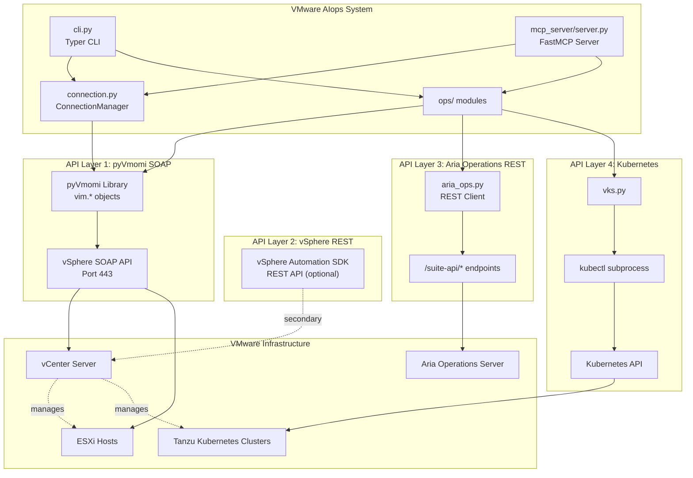
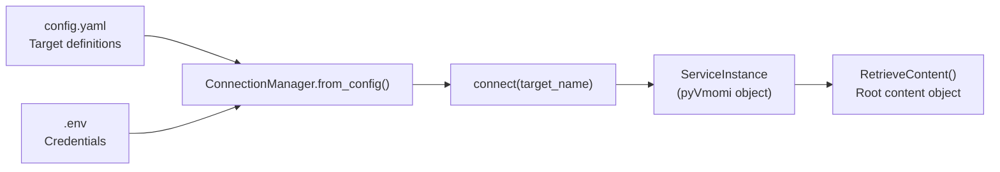
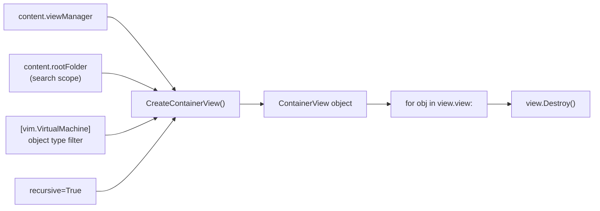
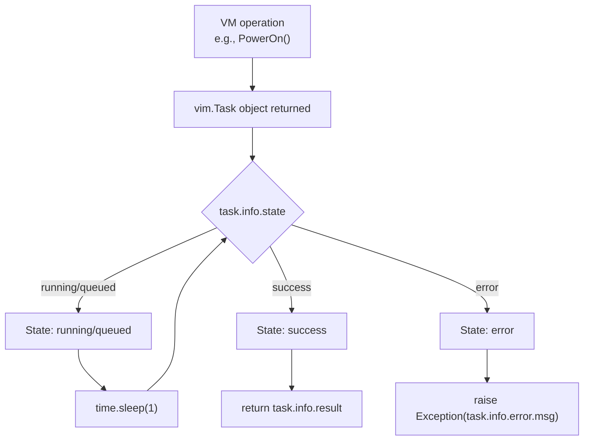
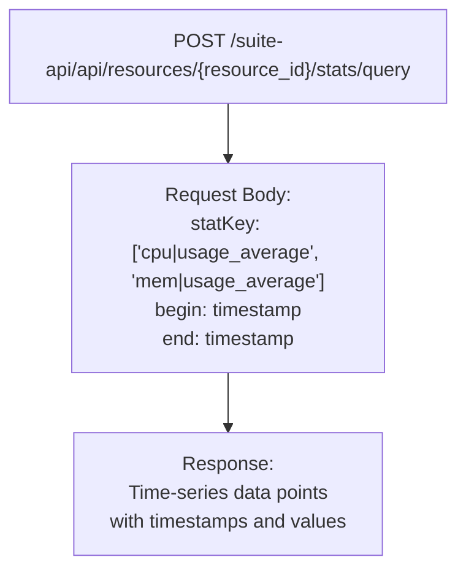
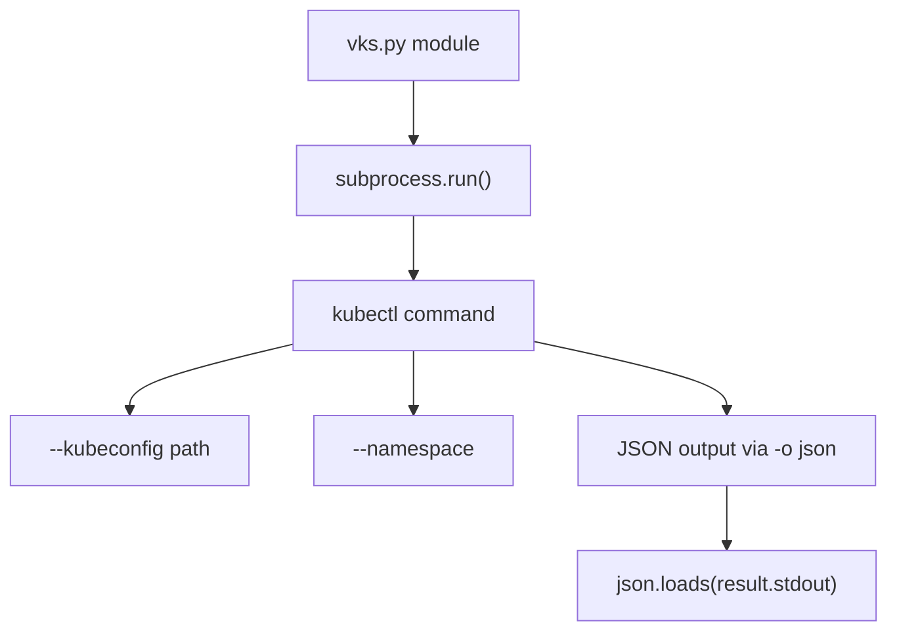
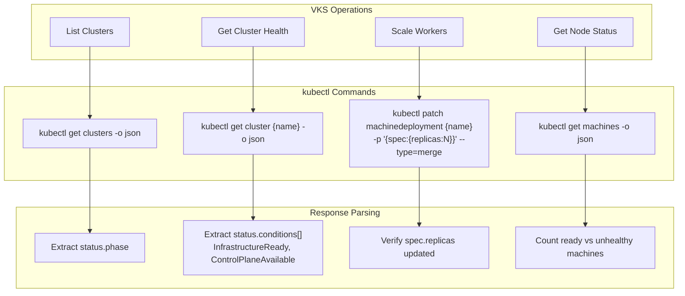

<!-- source: DeepWiki mcp.deepwiki.com · repo zw008/VMware-AIops · page 9.3 API Integration Layers · fetched 2026-10-26 -->

# API Integration Layers

Relevant source files

The following files were used as context for generating this wiki page:

- [README.md](README.md)
- [codex-skill/AGENTS.md](codex-skill/AGENTS.md)
- [skills/vmware-aiops/SKILL.md](skills/vmware-aiops/SKILL.md)

## Purpose and Scope

This document describes the four distinct API integration layers through which VMware AIops interacts with VMware infrastructure components. It covers the technical implementation of pyVmomi SOAP API integration (the primary interface), vSphere REST API usage, Aria Operations REST API integration for advanced analytics, and Kubernetes API integration for VKS cluster management.

For details on the connection management architecture that underlies these integrations, see [Connection Management](#9.2). For the operational modules that use these APIs, see [Backend Module Structure](#9.1).

---

## Integration Architecture Overview

VMware AIops employs four distinct API layers to interact with VMware infrastructure:

**Sources:** [README.md:936-948](), [vmware_aiops/connection.py](), [vmware_aiops/ops/]()

---

## Layer 1: pyVmomi SOAP API (Primary Interface)

### Role and Scope

The pyVmomi library provides Python bindings to the vSphere Web Services API (SOAP). This is the **primary interface** for all core infrastructure operations including inventory queries, health monitoring, VM lifecycle management, cluster operations, and storage configuration. Both vCenter Server and standalone ESXi hosts expose the same SOAP API on port 443.

### Connection Establishment

All SOAP API interactions begin with establishing a `ServiceInstance` connection through the `ConnectionManager`:

The connection process handles SSL verification, credential loading, and API version negotiation automatically.

**Sources:** [vmware_aiops/connection.py](), [vmware_aiops/config.py]()

### vim Object Hierarchy

The SOAP API exposes a hierarchical object model through the `vim` namespace. VMware AIops uses these primary managed object types:

| vim Object Type | Purpose | Used By Modules | Key Properties |
|----------------|---------|-----------------|----------------|
| `vim.VirtualMachine` | VM lifecycle operations | inventory.py, vm_lifecycle.py, vm_deploy.py, guest_ops.py | runtime.powerState, config.hardware, snapshot |
| `vim.HostSystem` | ESXi host management | inventory.py, health.py, cluster_mgmt.py, iscsi_config.py | hardware.cpuInfo, runtime.connectionState, configManager |
| `vim.Datastore` | Storage information | inventory.py, datastore_browser.py | summary.capacity, summary.freeSpace, summary.type |
| `vim.ClusterComputeResource` | Cluster management | inventory.py, cluster_mgmt.py | configuration.drsConfig, configuration.dasConfig, host[] |
| `vim.Network` | Network objects | inventory.py | name, vm[] |
| `vim.alarm.AlarmManager` | Alarm queries | health.py | GetAlarm(), triggeredAlarmState |
| `vim.event.EventManager` | Event/log queries | health.py, scanner/scanner.py | QueryEvents(), eventTypeId filter |
| `vim.OvfManager` | OVA deployment | vm_deploy.py | ParseDescriptor(), CreateImportSpec() |
| `vim.host.DatastoreBrowser` | File browsing | datastore_browser.py | SearchDatastore(), fileQuery |
| `vim.ResourcePool` | Resource allocation | vm_lifecycle.py, vm_deploy.py | Used in VM create/clone operations |

**Sources:** [README.md:936-948](), [codex-skill/AGENTS.md:62-310]()

### Operation to vim Object Mapping

The following diagram shows how high-level operations map to specific vim objects and their methods:

```mermaid
graph TB
    subgraph "Inventory Operations"
        ListVMs["list_vms()"]
        ListHosts["list_hosts()"]
        ListDS["list_datastores()"]
        ListClusters["list_clusters()"]
    end
    
    subgraph "Health Operations"
        GetAlarms["get_active_alarms()"]
        GetEvents["get_recent_events()"]
    end
    
    subgraph "VM Lifecycle Operations"
        VMPower["vm_power_on/off()"]
        VMCreate["vm_create()"]
        VMDelete["vm_delete()"]
        VMSnapshot["vm_snapshot_*()"]
        VMClone["vm_clone()"]
        VMMigrate["vm_migrate()"]
    end
    
    subgraph "Deployment Operations"
        DeployOVA["deploy_vm_from_ova()"]
        DeployTemplate["deploy_vm_from_template()"]
    end
    
    subgraph "vim Objects & Methods"
        VimVM["vim.VirtualMachine"]
        VimHost["vim.HostSystem"]
        VimDS["vim.Datastore"]
        VimCluster["vim.ClusterComputeResource"]
        VimAlarm["vim.alarm.AlarmManager"]
        VimEvent["vim.event.EventManager"]
        VimOvf["vim.OvfManager"]
        
        VMPowerOn["PowerOn_Task()"]
        VMPowerOff["PowerOff_Task()"]
        VMShutdown["ShutdownGuest()"]
        VMCreate_Task["CreateVM_Task()"]
        VMDestroy["Destroy_Task()"]
        VMReconfig["ReconfigVM_Task()"]
        VMSnapshot_Task["CreateSnapshotEx_Task()"]
        VMRevert["RevertToSnapshot_Task()"]
        VMClone_Task["Clone()"]
        VMRelocate["Relocate()"]
        OvfParse["ParseDescriptor()"]
        OvfImport["CreateImportSpec()"]
    end
    
    ListVMs --> VimVM
    ListHosts --> VimHost
    ListDS --> VimDS
    ListClusters --> VimCluster
    
    GetAlarms --> VimAlarm
    GetEvents --> VimEvent
    
    VMPower --> VMPowerOn
    VMPower --> VMPowerOff
    VMPower --> VMShutdown
    VMCreate --> VMCreate_Task
    VMDelete --> VMDestroy
    VMSnapshot --> VMSnapshot_Task
    VMSnapshot --> VMRevert
    VMClone --> VMClone_Task
    VMMigrate --> VMRelocate
    
    DeployOVA --> OvfParse
    DeployOVA --> OvfImport
    DeployTemplate --> VMClone_Task
    
    VMPowerOn -.used by.-> VimVM
    VMPowerOff -.used by.-> VimVM
    VMShutdown -.used by.-> VimVM
    VMCreate_Task -.used by.-> VimVM
    VMDestroy -.used by.-> VimVM
    VMReconfig -.used by.-> VimVM
    VMSnapshot_Task -.used by.-> VimVM
    VMRevert -.used by.-> VimVM
    VMClone_Task -.used by.-> VimVM
    VMRelocate -.used by.-> VimVM
    OvfParse -.used by.-> VimOvf
    OvfImport -.used by.-> VimOvf
```

**Sources:** [vmware_aiops/ops/inventory.py](), [vmware_aiops/ops/health.py](), [vmware_aiops/ops/vm_lifecycle.py](), [vmware_aiops/ops/vm_deploy.py]()

### Container Views for Inventory Traversal

All inventory operations use the `CreateContainerView()` pattern to efficiently traverse the object hierarchy without recursion:

This pattern appears in all inventory modules: `list_vms()`, `list_hosts()`, `list_datastores()`, `list_clusters()`.

**Sources:** [vmware_aiops/ops/inventory.py](), [codex-skill/AGENTS.md:79-137]()

### Task Completion Pattern

All asynchronous operations return a `vim.Task` object. The system implements a standard wait pattern:

The `wait_for_task()` helper function implements this pattern and is used by all operations that return tasks.

**Sources:** [vmware_aiops/ops/vm_lifecycle.py](), [codex-skill/AGENTS.md:313-325]()

### vSAN SDK Integration

Since pyVmomi 8.0.3+, the vSAN Management SDK is merged into the core library. vSAN operations use specialized vim objects:

| vSAN vim Object | Purpose | Operations |
|----------------|---------|------------|
| `vim.vsan.VsanVcClusterHealthSystem` | Health monitoring | `VsanQueryVcClusterHealthSummary()` |
| `vim.vsan.VsanSpaceReportSystem` | Capacity reporting | `VsanQuerySpaceUsage()` |
| `vim.vsan.VsanPerformanceManager` | Performance metrics | `VsanPerfQueryPerf()` |

**Sources:** [README.md:216-224](), [codex-skill/AGENTS.md:327-361]()

### API Version Compatibility

pyVmomi automatically negotiates the API version during the SOAP handshake:

| vSphere Version | Support Level | API Differences |
|----------------|---------------|-----------------|
| 8.0 / 8.0U1-U3 | Full | `CreateSnapshot_Task` deprecated → use `CreateSnapshotEx_Task` |
| 7.0 / 7.0U1-U3 | Full | All APIs supported |
| 6.7 | Compatible | Backward-compatible |
| 6.5 | Compatible | Backward-compatible |

The system detects the API version at connection time and adapts method calls accordingly. No manual configuration is needed.

**Sources:** [README.md:84-93](), [codex-skill/AGENTS.md:426-440]()

---

## Layer 2: vSphere REST API (Secondary Interface)

### Role and Scope

The vSphere Automation REST API provides an alternative JSON/HTTP interface to some vSphere operations. **This layer is currently not actively used** by VMware AIops, which relies primarily on the SOAP API for consistency and feature coverage. The SOAP API provides broader coverage of vSphere functionality and is supported across all ESXi versions.

The REST API is noted as available for future enhancements but is not implemented in the current codebase.

**Sources:** [README.md:57-66]()

---

## Layer 3: Aria Operations REST API

### Role and Scope

Aria Operations (formerly vRealize Operations, rebranded as VCF Operations in VCF 9.0) provides advanced analytics, ML-based anomaly detection, capacity planning, and intelligent alerting through a REST API at `/suite-api/`. This layer complements the SOAP API by providing historical time-series data and predictive insights that are not available through vSphere's real-time APIs.

### Authentication Flow

The token is acquired once per session and included in all subsequent requests using the `vRealizeOpsToken` scheme.

**Sources:** [codex-skill/AGENTS.md:362-376]()

### REST Endpoint Categories

| Endpoint Category | Base Path | Purpose | Key Operations |
|------------------|-----------|---------|----------------|
| Alerts | `/suite-api/api/alerts` | Intelligent alerts with root cause analysis | Filter by criticality, status, time range |
| Metrics | `/suite-api/api/resources/{id}/stats` | Time-series data for any resource | Query historical CPU, memory, disk, network |
| Recommendations | `/suite-api/api/recommendations` | Right-sizing and optimization | Get actionable recommendations per VM/cluster |
| Capacity | `/suite-api/api/resources/{id}/stats` | Capacity planning | What-if analysis, time-to-exhaustion forecasts |

**Sources:** [README.md:226-237](), [skills/vmware-aiops/SKILL.md:251-261](), [codex-skill/AGENTS.md:377-389]()

### Metrics Query Pattern

The metrics endpoint accepts a POST request with a structured query:

This allows querying months of historical data for any vSphere resource (VM, host, cluster, datastore) with arbitrary metric keys.

**Sources:** [codex-skill/AGENTS.md:377-389]()

### Capacity Planning Capabilities

Aria Operations provides predictive analytics not available through SOAP API:

- **What-if analysis**: Simulate adding VMs or workloads and predict resource impact
- **Time-to-exhaustion**: Calculate when storage/CPU/memory will be depleted based on trend analysis
- **Anomaly detection**: ML-based baselines identify abnormal resource usage patterns
- **Right-sizing**: Compare actual VM resource usage against allocation to identify oversized VMs

**Sources:** [README.md:226-237](), [skills/vmware-aiops/SKILL.md:251-261]()

---

## Layer 4: Kubernetes API (kubectl Integration)

### Role and Scope

VMware's vSphere Kubernetes Service (VKS, formerly Tanzu Kubernetes Grid Service) exposes Kubernetes clusters as Kubernetes-native resources using the Cluster API specification. VMware AIops interacts with VKS through the standard Kubernetes API using `kubectl` subprocess calls rather than through vSphere SOAP APIs.

### kubectl Subprocess Architecture

All VKS operations follow this pattern: construct a kubectl command with appropriate flags, execute via subprocess, capture stdout, parse JSON output.

**Sources:** [codex-skill/AGENTS.md:391-410]()

### Kubernetes Resource Mapping

VMware AIops interacts with these Kubernetes custom resources:

| K8s Resource Kind | API Group | Purpose | Key Fields |
|------------------|-----------|---------|------------|
| `Cluster` | `cluster.x-k8s.io/v1beta1` | Top-level cluster object | status.phase, status.conditions[] |
| `MachineDeployment` | `cluster.x-k8s.io/v1beta1` | Worker node groups | spec.replicas (for scaling) |
| `Machine` | `cluster.x-k8s.io/v1beta1` | Individual nodes | status.phase, status.ready |

**Sources:** [README.md:239-247](), [skills/vmware-aiops/SKILL.md:263-272]()

### Operation to kubectl Command Mapping

**Sources:** [codex-skill/AGENTS.md:396-410]()

### Health Condition Checks

VKS cluster health is determined by checking Kubernetes condition objects:

| Condition Type | Meaning | Status Field |
|---------------|---------|--------------|
| `InfrastructureReady` | vSphere resources provisioned | `status: True/False` |
| `ControlPlaneAvailable` | Control plane nodes healthy | `status: True/False` |
| `WorkersAvailable` | Worker nodes healthy | `status: True/False` |

All three conditions must be `True` for a cluster to be considered healthy.

**Sources:** [README.md:239-247](), [skills/vmware-aiops/SKILL.md:263-272]()

---

## API Layer Selection Logic

The system selects which API layer to use based on the operation type:

| Operation Category | API Layer Used | Reason |
|-------------------|----------------|--------|
| Inventory queries (VMs, hosts, datastores, clusters) | pyVmomi SOAP | Real-time data, comprehensive coverage |
| Health monitoring (alarms, events, sensors) | pyVmomi SOAP | vSphere native alarm system |
| VM lifecycle (power, create, delete, snapshot, clone) | pyVmomi SOAP | Core vSphere operations |
| Cluster management (create, configure HA/DRS) | pyVmomi SOAP | Cluster API is SOAP-only |
| Storage configuration (iSCSI, rescan) | pyVmomi SOAP | Storage management is SOAP-only |
| vSAN operations (health, capacity, performance) | pyVmomi SOAP + vSAN SDK | Merged into pyVmomi 8.0.3+ |
| Historical metrics (time-series data) | Aria Operations REST | Requires Aria Ops; not in core vSphere |
| Anomaly detection, capacity planning | Aria Operations REST | ML features unique to Aria Ops |
| VKS cluster management | Kubernetes API (kubectl) | Kubernetes-native resources, not vSphere objects |

This layered approach maximizes feature coverage by using the most appropriate API for each operation type.

**Sources:** [README.md:57-66](), [README.md:226-247]()

---

## Error Handling and Retry Logic

Each API layer implements its own error handling strategy:

### SOAP API Errors

pyVmomi raises typed exceptions that the system catches and translates:

- `vim.fault.InvalidLogin` → credential error
- `vim.fault.InvalidState` → operation not valid for current VM state
- `vim.fault.NotFound` → resource doesn't exist
- Task failures → `task.info.error.msg` contains detailed error

### REST API Errors

HTTP status codes are checked and mapped:

- `401 Unauthorized` → token expired, re-authenticate
- `404 Not Found` → resource ID invalid
- `500 Internal Server Error` → Aria Operations service issue

### kubectl Errors

Subprocess return codes and stderr output:

- Non-zero exit code → command failed
- JSON parse errors → malformed kubectl output
- Resource not found → cluster/namespace doesn't exist

All errors are logged to the audit trail with full context for debugging.

**Sources:** [vmware_aiops/ops/](), [vmware_aiops/notify/audit.py]()

---

