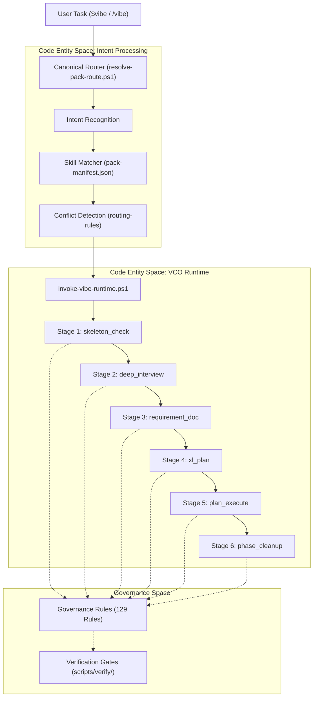
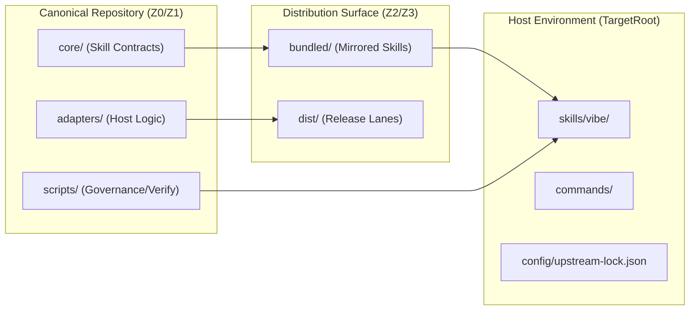

<!-- source: DeepWiki mcp.deepwiki.com · repo foryourhealth111-pixel/Vibe-Skills · page 1 VibeSkills Overview · fetched 2026-10-26 -->

# VibeSkills Overview

Relevant source files

The following files were used as context for generating this wiki page:

- [README.en.md](README.en.md)
- [README.md](README.md)
- [SKILL.md](SKILL.md)
- [bundled/skills/vibe/SKILL.md](bundled/skills/vibe/SKILL.md)
- [bundled/skills/vibe/references/changelog.md](bundled/skills/vibe/references/changelog.md)
- [docs/cold-start-install-paths.en.md](docs/cold-start-install-paths.en.md)
- [docs/cold-start-install-paths.md](docs/cold-start-install-paths.md)
- [docs/install/manual-copy-install.en.md](docs/install/manual-copy-install.en.md)
- [docs/install/manual-copy-install.md](docs/install/manual-copy-install.md)
- [docs/install/one-click-install-release-copy.en.md](docs/install/one-click-install-release-copy.en.md)
- [docs/install/one-click-install-release-copy.md](docs/install/one-click-install-release-copy.md)
- [docs/install/recommended-full-path.en.md](docs/install/recommended-full-path.en.md)
- [docs/install/recommended-full-path.md](docs/install/recommended-full-path.md)
- [docs/manifesto.en.md](docs/manifesto.en.md)
- [docs/manifesto.md](docs/manifesto.md)
- [docs/plans/2026-03-19-public-docs-entrypoint-restructure-plan.md](docs/plans/2026-03-19-public-docs-entrypoint-restructure-plan.md)
- [docs/quick-start.en.md](docs/quick-start.en.md)
- [docs/quick-start.md](docs/quick-start.md)
- [docs/requirements/2026-03-19-public-docs-entrypoint-restructure.md](docs/requirements/2026-03-19-public-docs-entrypoint-restructure.md)
- [references/changelog.md](references/changelog.md)

VibeSkills is an industrial-grade runtime framework designed to transform AI interactions from simple "code patching" into a structured, reliable, and governed "AI Operating System." It integrates over 340 specialized skills, Model Context Protocol (MCP) entry points, and a comprehensive governance engine known as the **VCO (Vibe Core Orchestrator)**.

The project addresses the core failure modes of modern AI agents—such as "skill sleep" (where models forget available tools), "black-box sprinting" (execution without requirement clarification), and workspace clutter—by enforcing a fixed, multi-stage execution protocol.

### High-Level System Concept

VibeSkills bridges the gap between a user's natural language intent and a deterministic execution path through the **Canonical Router**.

| Feature | Description |
| :--- | :--- |
| **Super-Capability Network** | 340+ skills covering planning, engineering, life sciences, and more. [README.md:104-116]() |
| **VCO Runtime** | The underlying engine that enforces stability and traceability. [README.md:42-42]() |
| **Execution Grades** | Automatic scaling between M (Single-agent), L (Multi-stage), and XL (Multi-agent) modes. [README.md:202-214]() |
| **Governance** | 129 configuration-based policies to prevent drift and protect workspaces. [README.en.md:58-60]() |

**Sources:** [README.md:19-21](), [README.md:104-116](), [README.en.md:35-37]()

---

### System Architecture: Intent to Execution

The following diagram illustrates how a user's natural language request is processed by the system's code entities to reach a governed state.

**Intent Routing and Governance Flow**

**Sources:** [README.md:155-168](), [README.md:170-176](), [references/changelog.md:54-60]()

---

### Core Subsystems

#### 1. The Canonical Router
The `Canonical Router` serves as the central decision hub. Instead of letting an AI model "hallucinate" which tool to use, the router analyzes intent keywords and context to trigger specific skill packs while enforcing priority and exclusivity rules.
*   **For details, see [The Canonical Router](#2.1)**

#### 2. Governed Runtime (VCO)
VibeSkills enforces a "Truth-First" design. Every complex task follows a 6-stage state machine (from `skeleton_check` to `phase_cleanup`). This ensures that requirements are documented and plans are approved before the AI begins destructive file operations.
*   **For details, see [The 6-Stage Governed Runtime](#2.2)**

#### 3. Skill Library and Packs
The repository contains 340+ skills organized into "Packs" (e.g., `orchestration-core`, `scientific-computing`). These are indexed via `pack-manifest.json` to allow the router to load only necessary context, preventing "token explosion."
*   **For details, see [Skill Library and Pack Manifest](#2.5)**

#### 4. Host Adapters and Deployment
VibeSkills is designed to be host-agnostic but provides deep integration for specific "Hosts" via `one-shot-setup.ps1`. Currently supported hosts include `codex`, `claude-code`, `cursor`, and `windsurf`.

**Host Support Matrix**
| Host | Mode | Default Root | Integration Level |
| :--- | :--- | :--- | :--- |
| `codex` | Governed | `~/.codex` | Full Runtime + Settings |
| `windsurf` | Runtime-Core | `~/.codeium/windsurf` | Adapter + Global Workflows |
| `claude-code` | Preview | `~/.claude` | Guidance Payload |
| `cursor` | Preview | `~/.cursor` | Guidance Payload |

**Sources:** [docs/install/one-click-install-release-copy.md:22-30](), [docs/cold-start-install-paths.md:7-21]()

---

### Repository Mirror Topology

The repository maintains a strict boundary between "Canonical" source code and "Bundled" distribution files. This ensures that the runtime can be deployed to a host environment (like `~/.cursor`) without bringing unnecessary development overhead.

**Directory Mapping and Mirroring**

**Sources:** [docs/install/manual-copy-install.md:12-20](), [references/changelog.md:3-9]()

---

### Child Pages

For deeper technical exploration, refer to the following sections:

*   **[Project Manifesto and Philosophy](#1.1)**: The "Why" behind the architecture—solving agent failure modes and the capability-first principle.
*   **[Repository Structure and Key Directories](#1.2)**: Detailed breakdown of the directory layout and the mirror topology between canonical and bundled assets.

---
**Sources:** [README.md:79-87](), [docs/install/one-click-install-release-copy.md:50-62]()

---

