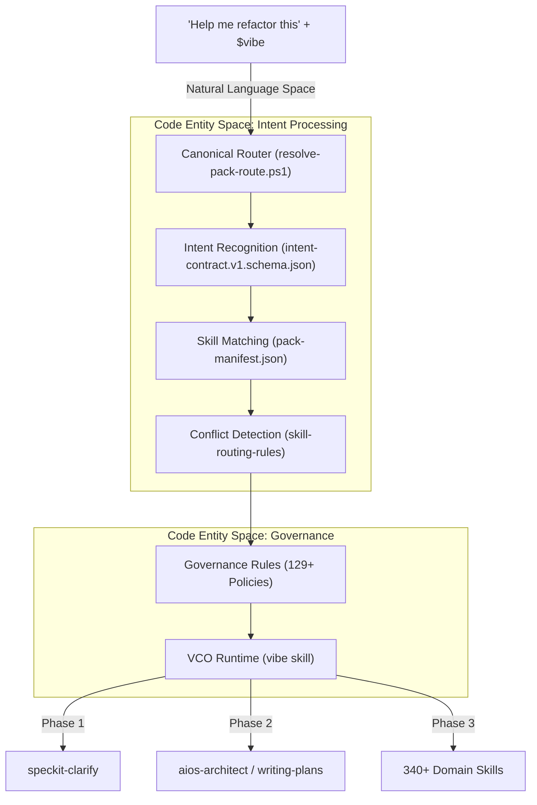
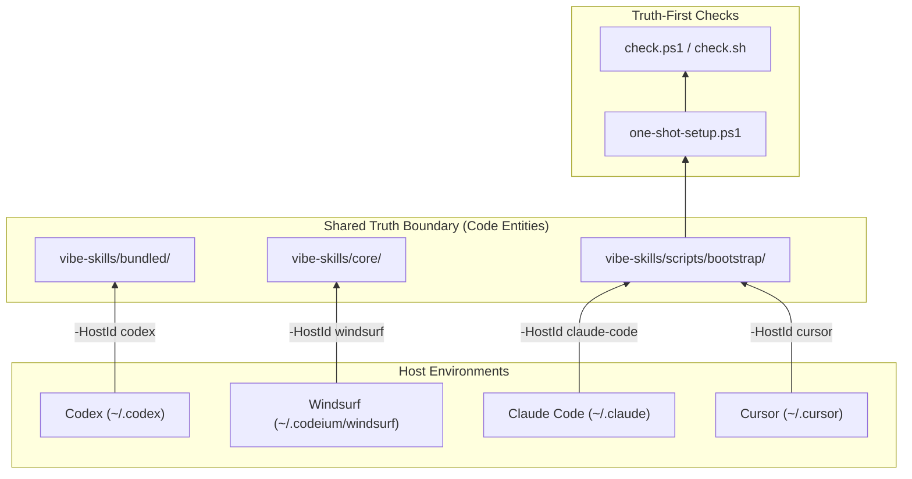

<!-- source: DeepWiki mcp.deepwiki.com · repo foryourhealth111-pixel/Vibe-Skills · page 1.1 Project Manifesto and Philosophy · fetched 2026-10-26 -->

# Project Manifesto and Philosophy

Relevant source files

The following files were used as context for generating this wiki page:

- [README.en.md](README.en.md)
- [README.md](README.md)
- [docs/cold-start-install-paths.en.md](docs/cold-start-install-paths.en.md)
- [docs/cold-start-install-paths.md](docs/cold-start-install-paths.md)
- [docs/install/manual-copy-install.en.md](docs/install/manual-copy-install.en.md)
- [docs/install/manual-copy-install.md](docs/install/manual-copy-install.md)
- [docs/install/one-click-install-release-copy.en.md](docs/install/one-click-install-release-copy.en.md)
- [docs/install/one-click-install-release-copy.md](docs/install/one-click-install-release-copy.md)
- [docs/install/recommended-full-path.en.md](docs/install/recommended-full-path.en.md)
- [docs/install/recommended-full-path.md](docs/install/recommended-full-path.md)
- [docs/manifesto.en.md](docs/manifesto.en.md)
- [docs/manifesto.md](docs/manifesto.md)
- [docs/plans/2026-03-19-public-docs-entrypoint-restructure-plan.md](docs/plans/2026-03-19-public-docs-entrypoint-restructure-plan.md)
- [docs/quick-start.en.md](docs/quick-start.en.md)
- [docs/quick-start.md](docs/quick-start.md)
- [docs/requirements/2026-03-19-public-docs-entrypoint-restructure.md](docs/requirements/2026-03-19-public-docs-entrypoint-restructure.md)

This page outlines the foundational motivation and design principles behind VibeSkills. It explains how the project addresses systemic AI agent failure modes through a capability-first architecture and a "truth-first" governance model.

## 1. The Motivation: Solving AI Agent Failure Modes

VibeSkills was created to move beyond simple "prompt libraries" and address the core pain points experienced by heavy AI users in production environments. Traditional AI interactions often suffer from several critical failure modes that VibeSkills is architected to solve.

### Key Failure Modes Addressed

| Failure Mode | Description | VibeSkills Solution |
| :--- | :--- | :--- |
| **Skill Sleep** | AI ignores available tools/skills in its context, leading to low activation rates. | **Intelligent Routing**: Automated discovery and activation via the Canonical Router. |
| **Black-Box Sprinting** | AI starts execution without clarifying requirements, leading to goal drift. | **Governed Workflow**: Mandatory `clarify → plan → execute → verify` sequence. |
| **Workspace Clutter** | Lack of standardized file structures makes it difficult for new agents to pick up context. | **Semantic Directory Governance**: Fixed architecture for storing plans, requirements, and logs. |
| **Conflicting Execution** | Multiple plugins or sub-agents fighting for control or creating infinite loops. | **Global Governance**: 129+ contract rules and mutual exclusion logic. |
| **Silent Failures** | AI deletes files or makes "fixes" without explicit warnings or backups. | **Built-in Protections**: Prohibition of bulk deletes and mandatory explicit warnings. |

Sources: [README.md:122-141](), [README.en.md:64-73](), [docs/manifesto.en.md:10-20]()

---

## 2. Capability-First Philosophy

VibeSkills treats AI not as a simple chat interface, but as a **Super-Capability Network** integrated into a personal AI Operating System (VCO Runtime).

### The Three Pillars of the Ecosystem
1.  **Skill Modules (340+)**: Industrial-grade skills covering the full lifecycle from life sciences to software engineering.
2.  **Ecosystem Integration (19+)**: Absorption of high-value upstream open-source projects into a unified interface.
3.  **Governance Rules (129+)**: Configuration-based policies that ensure execution remains stable and traceable.

Sources: [README.md:104-116](), [README.en.md:54-61]()

### Execution Grades (M/L/XL)
To manage complexity, the system categorizes tasks into three execution grades, ensuring the right amount of "compute" and "governance" is applied to each intent.

*   **M (Medium)**: Narrow scope, single-agent, fast response.
*   **L (Large)**: Multi-stage tasks requiring explicit design and review.
*   **XL (Extra Large)**: Complex, long-running flows involving multi-agent coordination and parallel execution.

Sources: [README.md:202-214](), [README.en.md:118-130]()

---

## 3. Truth-First Design Principle

The "Truth-First" principle is the cornerstone of VibeSkills governance. It mandates that the system must be honest about its state, boundaries, and dependencies rather than "hallucinating" readiness.

### Core Truth-First Tenets
*   **Explicit Boundaries**: The system clearly distinguishes between "Installed Locally" and "Online-Ready". If an API key or MCP server is missing, it must report the gap plainly.
*   **Evidence Trails**: Every execution must leave a trail (plans in `docs/plans/`, requirements in `docs/requirements/`) to ensure long-term maintainability.
*   **No "Prompt Magic"**: Reliability is achieved through structured protocols and verification gates, not just clever prompting.
*   **Host Neutrality**: While supporting specific hosts (Codex, Windsurf, etc.), the core logic remains decoupled to prevent vendor lock-in.

Sources: [docs/manifesto.en.md:39-64](), [docs/install/one-click-install-release-copy.md:43-49](), [docs/cold-start-install-paths.md:101-107]()

---

## 4. Technical Data Flow: Natural Language to Code Entity

The following diagrams illustrate how VibeSkills bridges the gap between a user's natural language intent and the specific code entities that govern execution.

### Intent Resolution Pipeline
This diagram shows how a user's "Vibe" request is transformed into a governed execution state.

Sources: [README.md:151-168](), [README.en.md:144-162](), [docs/install/manual-copy-install.md:12-20]()

### Host-to-Runtime Mapping
This diagram maps the different host environments to their respective "Truth Boundaries" and local directory structures.

Sources: [docs/install/one-click-install-release-copy.md:23-30](), [docs/install/recommended-full-path.md:10-18](), [docs/cold-start-install-paths.md:7-21]()

---

