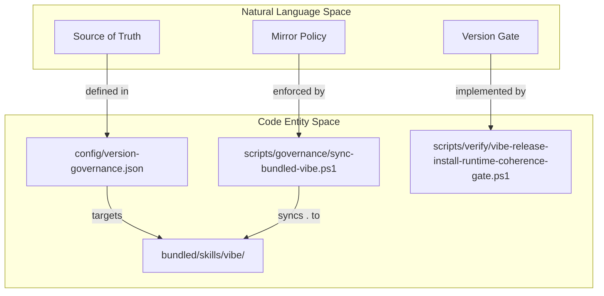
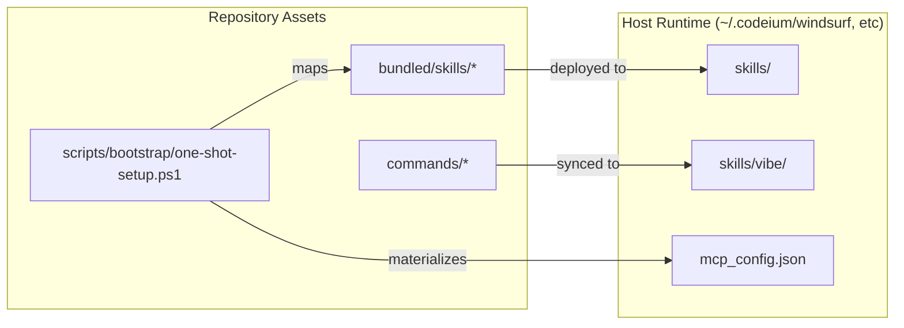

<!-- source: DeepWiki mcp.deepwiki.com · repo foryourhealth111-pixel/Vibe-Skills · page 1.2 Repository Structure and Key Directories · fetched 2026-10-26 -->

# Repository Structure and Key Directories

Relevant source files

The following files were used as context for generating this wiki page:

- [README.en.md](README.en.md)
- [README.md](README.md)
- [bundled/skills/vibe/bundled/skills/vibe/config/version-governance.json](bundled/skills/vibe/bundled/skills/vibe/config/version-governance.json)
- [bundled/skills/vibe/bundled/skills/vibe/references/changelog.md](bundled/skills/vibe/bundled/skills/vibe/references/changelog.md)
- [bundled/skills/vibe/bundled/skills/vibe/references/release-ledger.jsonl](bundled/skills/vibe/bundled/skills/vibe/references/release-ledger.jsonl)
- [bundled/skills/vibe/config/version-governance.json](bundled/skills/vibe/config/version-governance.json)
- [bundled/skills/vibe/docs/releases/README.md](bundled/skills/vibe/docs/releases/README.md)
- [bundled/skills/vibe/references/release-ledger.jsonl](bundled/skills/vibe/references/release-ledger.jsonl)
- [config/version-governance.json](config/version-governance.json)
- [docs/cold-start-install-paths.en.md](docs/cold-start-install-paths.en.md)
- [docs/cold-start-install-paths.md](docs/cold-start-install-paths.md)
- [docs/install/manual-copy-install.en.md](docs/install/manual-copy-install.en.md)
- [docs/install/manual-copy-install.md](docs/install/manual-copy-install.md)
- [docs/install/one-click-install-release-copy.en.md](docs/install/one-click-install-release-copy.en.md)
- [docs/install/one-click-install-release-copy.md](docs/install/one-click-install-release-copy.md)
- [docs/install/recommended-full-path.en.md](docs/install/recommended-full-path.en.md)
- [docs/install/recommended-full-path.md](docs/install/recommended-full-path.md)
- [docs/releases/README.md](docs/releases/README.md)
- [docs/universalization/distribution-lanes.md](docs/universalization/distribution-lanes.md)
- [docs/universalization/install-matrix.md](docs/universalization/install-matrix.md)
- [references/release-ledger.jsonl](references/release-ledger.jsonl)

This page maps the top-level directory layout of the VibeSkills repository. VibeSkills is an industrial-grade runtime framework (VCO) that integrates over 340 skills, MCP entry points, and governance rules [README.md:19-21](). The repository employs a specific "mirror topology" to ensure that the core orchestration logic (the `vibe` skill) remains consistent whether it is accessed from the root or from within the bundled skill library [config/version-governance.json:14-46]().

## Top-Level Directory Map

The repository is organized into functional zones that separate the skill library, core orchestration logic, host adapters, and governance infrastructure.

| Directory | Purpose | Key Contents |
| :--- | :--- | :--- |
| `bundled/` | The library of 340+ skills and the mirrored orchestration core. | `bundled/skills/`, `bundled/skills/vibe/` |
| `config/` | System-wide configuration, governance policies, and versioning. | `version-governance.json`, `runtime-contract.json` |
| `core/` | Host-neutral skill contracts and universalization definitions. | Skill contract schemas and logic. |
| `scripts/` | Automation for routing, governance, verification, and setup. | `scripts/router/`, `scripts/verify/`, `scripts/bootstrap/` |
| `docs/` | Comprehensive documentation, requirements, and release notes. | `docs/install/`, `docs/releases/`, `docs/plans/` |
| `adapters/` | Host-specific integration logic for different AI environments. | `adapters/index.json` |
| `dist/` | Distribution artifacts and lane-specific build outputs. | Lane definitions and truth boundaries. |
| `protocols/` | Multi-agent coordination and execution stage protocols. | `think.md`, `do.md`, `review.md`, `retro.md` |
| `rules/` | Guardrails and coding standards for agents and humans. | `coding-style.md`, `security.md`, `agent-rules.md` |
| `schemas/` | JSON schemas for validating contracts and manifests. | `skill.schema.json`, `router-provider.schema.json` |
| `templates/` | Scaffolding for new skills, plans, and requirements. | `SKILL.md` template, `requirement-doc` template. |
| `tests/` | Runtime-neutral and replay-based testing suites. | `tests/runtime_neutral/`, `tests/replay/` |

**Sources:** [README.md:104-116](), [config/version-governance.json:62-80](), [docs/install/one-click-install-release-copy.md:22-29]()

---

## Mirror Topology: Canonical vs. Bundled

VibeSkills utilizes a `mirror_topology` defined in the governance configuration [config/version-governance.json:14-17](). This ensures that the `vibe` orchestration skill (the "Vibe Core Orchestrator" or VCO) is identical across three levels of nesting.

### Topology Definition
1.  **Canonical Root (`.`):** The authoritative source of truth for the entire repository [config/version-governance.json:19-26]().
2.  **Bundled Root (`bundled/skills/vibe`):** A full mirror of the core logic located within the skill library [config/version-governance.json:28-35]().
3.  **Nested Bundled Root (`bundled/skills/vibe/bundled/skills/vibe`):** A recursive mirror used for deep-nesting compatibility [config/version-governance.json:37-44]().

### Natural Language to Code Entity: Mirroring Logic
The following diagram bridges the conceptual "Source of Truth" to the physical file paths and the governance scripts that enforce parity.

**Mirror Parity Enforcement**

**Sources:** [config/version-governance.json:9-13](), [config/version-governance.json:95-110]()

---

## Key Directories and Data Flow

### 1. `scripts/router/` (The Canonical Router)
This is the "brain" of the system. The `resolve-pack-route.ps1` script acts as the entry point for all user intents [README.md:153-164](). It processes the context and selects the appropriate skill from the `bundled/skills/` library.

### 2. `scripts/verify/` (Verification Gates)
These scripts are "gates" that must pass before a release or execution.
*   **Freshness Gate:** `vibe-installed-runtime-freshness-gate.ps1` checks if the installed payload matches the expected version [config/version-governance.json:93]().
*   **BOM Gate:** `vibe-bom-frontmatter-gate.ps1` validates the Bill of Materials in skill files [config/version-governance.json:94]().

### 3. `docs/install/` (Host Adapters)
VibeSkills supports four primary hosts, each with a specific `HostId` and installation root [docs/install/one-click-install-release-copy.md:22-29]():
*   **Codex:** `~/.codex` (Governed mode)
*   **Claude Code:** `~/.claude` (Preview guidance)
*   **Cursor:** `~/.cursor` (Preview guidance)
*   **Windsurf:** `~/.codeium/windsurf` (Runtime adapter mode)

### Installation Data Flow
The installation process maps repository assets to host-specific directories.

**Asset Deployment Flow**

**Sources:** [docs/install/manual-copy-install.md:12-32](), [docs/install/recommended-full-path.md:12-17](), [config/version-governance.json:90-92]()

---

## Governance and Packaging Policies

The `packaging` section of the governance config defines which files are allowed to exist only in the bundled mirror and which must be synced [config/version-governance.json:62-88]().

*   **Mirror Files:** Core scripts like `check.ps1`, `install.ps1`, and directories like `protocols/` and `templates/` are strictly mirrored [config/version-governance.json:64-80]().
*   **Execution Context Policy:** The system enforces that scripts are not executed directly from a mirror root to prevent configuration drift [config/version-governance.json:47-50]().
*   **Runtime Markers:** A set of 25+ files (e.g., `Invoke-PlanExecute.ps1`, `resolve-pack-route.ps1`) are required for a runtime to be considered valid [config/version-governance.json:98-125]().

**Sources:** [config/version-governance.json:47-50](), [config/version-governance.json:62-80](), [config/version-governance.json:98-125]()

---

