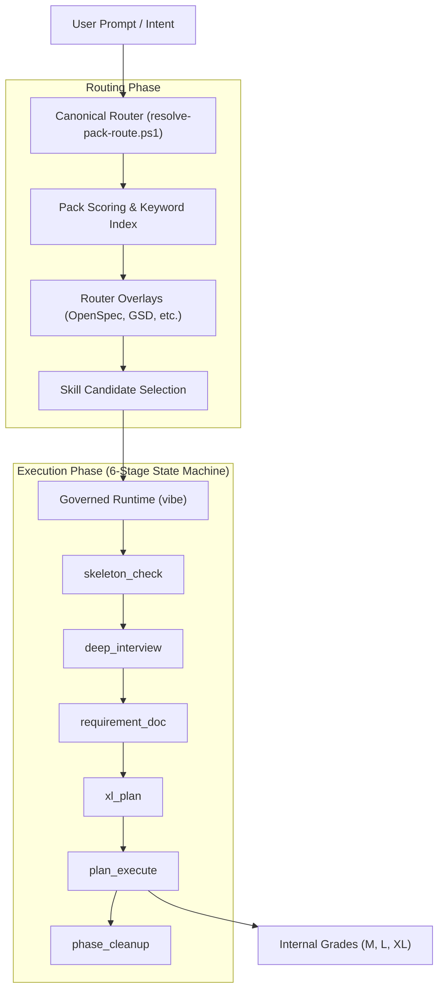
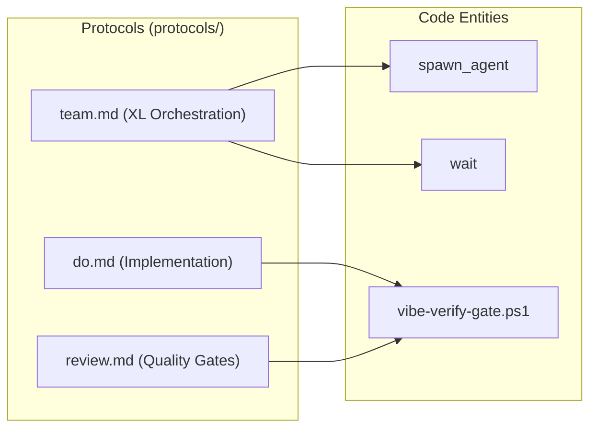

<!-- source: DeepWiki mcp.deepwiki.com · repo foryourhealth111-pixel/Vibe-Skills · page 2 Core Architecture · fetched 2026-10-26 -->

# Core Architecture

Relevant source files

The following files were used as context for generating this wiki page:

- [SKILL.md](SKILL.md)
- [bundled/skills/vibe/SKILL.md](bundled/skills/vibe/SKILL.md)
- [bundled/skills/vibe/references/changelog.md](bundled/skills/vibe/references/changelog.md)
- [bundled/skills/vibe/references/index.md](bundled/skills/vibe/references/index.md)
- [references/changelog.md](references/changelog.md)
- [references/index.md](references/index.md)
- [scripts/router/resolve-pack-route.ps1](scripts/router/resolve-pack-route.ps1)
- [scripts/verify/README.md](scripts/verify/README.md)
- [scripts/verify/vibe-config-parity-gate.ps1](scripts/verify/vibe-config-parity-gate.ps1)

The Vibe Core Orchestrator (VCO) architecture is a governed runtime designed to eliminate AI agent failure modes such as workspace clutter and conflicting execution. It enforces a strict boundary between **Route Authority** (selecting the right tool) and **Runtime Authority** (executing the task under governance) [SKILL.md:154-160]().

The architecture is built upon a modular routing pipeline, a fixed 6-stage state machine, and a tiered execution model that scales from simple edits to complex multi-agent orchestration.

### System Overview Diagram
This diagram illustrates the flow from a user prompt through the Canonical Router to the Governed Runtime.

**VCO Logical Flow: Natural Language to Execution**

Sources: [SKILL.md:44-57](), [scripts/router/resolve-pack-route.ps1:18-50]()

---

### The Canonical Router
The **Canonical Router**, implemented in `resolve-pack-route.ps1`, is the central authority for all skill selection [SKILL.md:156-157](). It uses a modular pipeline of 49+ modules to evaluate prompts against the skill library [scripts/router/resolve-pack-route.ps1:19-50]().

Key responsibilities include:
*   **Pack Scoring:** Matching intents against the `skill-keyword-index.json` [scripts/router/resolve-pack-route.ps1:65]().
*   **Overlay Refinement:** Applying advisory layers like `OpenSpec` or `GSD-Lite` to adjust routing logic without replacing it [scripts/router/resolve-pack-route.ps1:29-30]().
*   **Route Modes:** Supporting `confirm_required` for human-in-the-loop and `unattended` for autonomous flows [scripts/router/resolve-pack-route.ps1:14-15]().

For details, see [The Canonical Router](#2.1).

---

### The 6-Stage Governed Runtime
The `vibe` skill enforces a mandatory 6-stage state machine for any non-trivial task [SKILL.md:27-37](). This ensures that requirements are frozen and plans are verified before any code is modified.

| Stage | Code Entity / Artifact | Purpose |
| :--- | :--- | :--- |
| **1. skeleton_check** | `skeleton_check` | Validates repo shape and prerequisites [SKILL.md:98-100](). |
| **2. deep_interview** | `deep_interview` | Produces a structured intent contract [SKILL.md:102-115](). |
| **3. requirement_doc** | `docs/requirements/` | Freezes intent to prevent goal drift [SKILL.md:117-122](). |
| **4. xl_plan** | `docs/plans/` | Defines waves, batches, and verification [SKILL.md:123-135](). |
| **5. plan_execute** | `plan_execute` | Executes the plan using M/L/XL grades [SKILL.md:136-142](). |
| **6. phase_cleanup** | `phase_cleanup` | Mandatory removal of temp artifacts [SKILL.md:143-153](). |

For details, see [The 6-Stage Governed Runtime](#2.2).

---

### Execution Grades and Protocols
While the user only interacts with the `vibe` entry point, the system internally selects an **Execution Grade** based on task complexity [SKILL.md:73-81]().

*   **M (Medium):** Narrow, single-agent execution.
*   **L (Large):** Staged planning with mandatory user approval and two-stage review.
*   **XL (Extra Large):** Multi-agent coordination using the `team.md` protocol [SKILL.md:94-95]().

**Code Entity Mapping: Protocols and State**

Sources: [SKILL.md:90-95](), [SKILL.md:187-196]()

For details, see [Execution Grades and Multi-Agent Protocols](#2.3).

---

### Router Overlays and Acceleration
Overlays are modular advisory layers that inject specific domain logic into the routing process [scripts/router/resolve-pack-route.ps1:29-49]().

*   **Logic Overlays:** `OpenSpec` for specification adherence and `GSD-Lite` for "Get Stuff Done" efficiency.
*   **Technical Overlays:** `Data Scale`, `Memory Governance`, and `CUDA Kernel` specific routing [scripts/router/resolve-pack-route.ps1:32-39]().
*   **LLM Acceleration:** Integration for advanced models (e.g., GPT-5.2) using committee sampling and vector diffs [scripts/router/resolve-pack-route.ps1:48]().

For details, see [Router Overlays and LLM Acceleration](#2.4).

---

### Skill Library and Pack Manifest
The system manages 340+ skills organized into **Packs** [SKILL.md:2.5](). This taxonomy is governed by the `pack-manifest.json`, which defines the structural boundaries between core orchestration and domain-specific capabilities [scripts/router/resolve-pack-route.ps1:62]().

*   **Bundled Skills:** Located in `bundled/skills/`, these are the authoritative versions of core skills like `vibe` [references/index.md:13]().
*   **Parity Enforcement:** The `vibe-config-parity-gate.ps1` ensures that configuration remains consistent between the repository root and the bundled skill distributions [scripts/verify/vibe-config-parity-gate.ps1:184-195]().

For details, see [Skill Library and Pack Manifest](#2.5).

---

