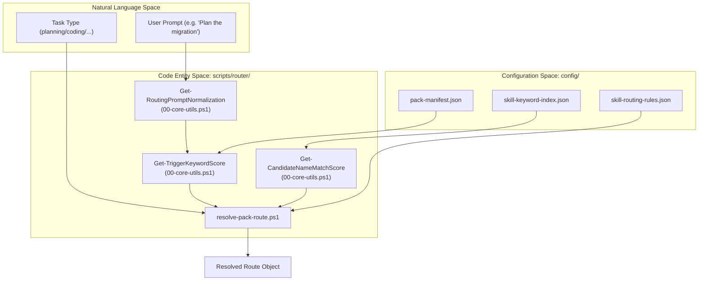
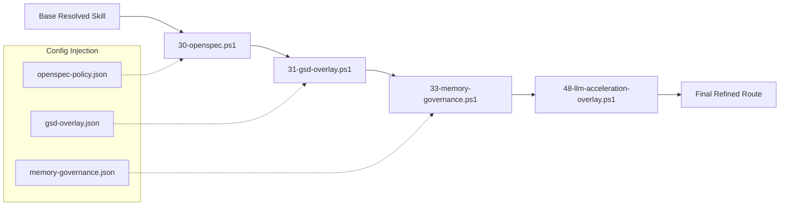

<!-- source: DeepWiki mcp.deepwiki.com · repo foryourhealth111-pixel/Vibe-Skills · page 2.1 The Canonical Router · fetched 2026-10-26 -->

# The Canonical Router

Relevant source files

The following files were used as context for generating this wiki page:

- [bundled/skills/vibe/bundled/skills/vibe/docs/prompt-asset-boost-integration.md](bundled/skills/vibe/bundled/skills/vibe/docs/prompt-asset-boost-integration.md)
- [bundled/skills/vibe/bundled/skills/vibe/docs/router-modularization-governance.md](bundled/skills/vibe/bundled/skills/vibe/docs/router-modularization-governance.md)
- [bundled/skills/vibe/bundled/skills/vibe/scripts/router/modules/11-route-probe.ps1](bundled/skills/vibe/bundled/skills/vibe/scripts/router/modules/11-route-probe.ps1)
- [bundled/skills/vibe/bundled/skills/vibe/scripts/router/resolve-pack-route.ps1](bundled/skills/vibe/bundled/skills/vibe/scripts/router/resolve-pack-route.ps1)
- [bundled/skills/vibe/bundled/skills/vibe/scripts/verify/fixtures/prompt-asset-boost.mock.json](bundled/skills/vibe/bundled/skills/vibe/scripts/verify/fixtures/prompt-asset-boost.mock.json)
- [bundled/skills/vibe/config/pack-manifest.json](bundled/skills/vibe/config/pack-manifest.json)
- [bundled/skills/vibe/config/router-thresholds.json](bundled/skills/vibe/config/router-thresholds.json)
- [bundled/skills/vibe/config/skill-keyword-index.json](bundled/skills/vibe/config/skill-keyword-index.json)
- [bundled/skills/vibe/config/skill-routing-rules.json](bundled/skills/vibe/config/skill-routing-rules.json)
- [bundled/skills/vibe/references/index.md](bundled/skills/vibe/references/index.md)
- [bundled/skills/vibe/scripts/router/resolve-pack-route.ps1](bundled/skills/vibe/scripts/router/resolve-pack-route.ps1)
- [config/pack-manifest.json](config/pack-manifest.json)
- [config/router-thresholds.json](config/router-thresholds.json)
- [config/skill-keyword-index.json](config/skill-keyword-index.json)
- [config/skill-routing-rules.json](config/skill-routing-rules.json)
- [references/index.md](references/index.md)
- [scripts/router/modules/00-core-utils.ps1](scripts/router/modules/00-core-utils.ps1)
- [scripts/router/modules/10-observability.ps1](scripts/router/modules/10-observability.ps1)
- [scripts/router/modules/11-route-probe.ps1](scripts/router/modules/11-route-probe.ps1)
- [scripts/router/modules/22-intent-contract.ps1](scripts/router/modules/22-intent-contract.ps1)
- [scripts/router/resolve-pack-route.ps1](scripts/router/resolve-pack-route.ps1)
- [scripts/verify/README.md](scripts/verify/README.md)
- [scripts/verify/vibe-config-parity-gate.ps1](scripts/verify/vibe-config-parity-gate.ps1)
- [scripts/verify/vibe-pack-regression-matrix.ps1](scripts/verify/vibe-pack-regression-matrix.ps1)
- [scripts/verify/vibe-pack-routing-smoke.ps1](scripts/verify/vibe-pack-routing-smoke.ps1)

The Canonical Router, implemented in `resolve-pack-route.ps1`, is the central decision engine of the Vibe Core Orchestrator (VCO). It transforms raw user intent into a structured execution plan by selecting the most appropriate skill packs and refining them through a multi-layered overlay pipeline.

## Purpose and Scope

The router's primary responsibility is to resolve a "route" — a combination of a target skill, an execution grade (M/L/XL), and a set of advisory overlays — based on the user's prompt and task type [scripts/router/resolve-pack-route.ps1:1-15](). It replaces static tool mapping with a dynamic, scoring-based selection process that accounts for task-specific defaults and keyword precision [config/skill-keyword-index.json:4-10]().

## The Modular Routing Pipeline

The router uses a modular architecture where distinct logic units are loaded from the `modules/` directory [scripts/router/resolve-pack-route.ps1:18-50](). This allows the system to separate core utility functions from complex AI-driven re-ranking and domain-specific overlays.

### Execution Flow
1.  **Normalization**: The raw prompt is cleaned of control tokens (e.g., `$vibe`, `/vibe`) to prevent routing pollution while preserving user intent [scripts/router/modules/00-core-utils.ps1:19-61]().
2.  **Pack Scoring**: The router iterates through all packs defined in `pack-manifest.json`, calculating a score based on `trigger_keywords` [scripts/router/modules/00-core-utils.ps1:159-166]().
3.  **Candidate Selection**: Within the winning pack, individual skills are scored using a weighted mix of keyword matches (85%) and name matches (15%) [config/skill-keyword-index.json:4-10]().
4.  **Overlay Refinement**: Advisory layers (OpenSpec, GSD, Memory, etc.) are applied to the selected route to inject additional constraints or context [scripts/router/resolve-pack-route.ps1:29-49]().

### Natural Language to Code Entity Mapping (Routing)

The following diagram illustrates how natural language inputs are processed by specific code entities to produce a resolved route.

**Diagram: Intent Resolution Pipeline**

Sources: [scripts/router/resolve-pack-route.ps1:59-96](), [scripts/router/modules/00-core-utils.ps1:19-61](), [scripts/router/modules/00-core-utils.ps1:159-234]().

## Pack Scoring and Skill Selection

The router uses a hierarchical selection process. It first identifies the correct "Pack" (a logical grouping of skills) before selecting a specific "Skill Candidate" within that pack.

### Scoring Logic
| Component | Logic Entity | Description |
| :--- | :--- | :--- |
| **Pack Score** | `Get-TriggerKeywordScore` | Calculates a ratio of matched keywords in the prompt against the pack's `trigger_keywords` [scripts/router/modules/00-core-utils.ps1:159-166](). |
| **Intent Score** | `Get-IntentScore` | Boosts scores if pack ID tokens or specific candidate names appear in the prompt [scripts/router/modules/00-core-utils.ps1:168-190](). |
| **Skill Match** | `Get-CandidateNameMatchScore` | Performs boundary-aware matching for skill identifiers [scripts/router/modules/00-core-utils.ps1:213-234](). |

### Selection Thresholds
The router utilizes `config/router-thresholds.json` to determine if a match is strong enough to proceed or if it should fall back to a default [config/skill-keyword-index.json:9-10](). If no pack exceeds the threshold, the system can engage `legacy_matrix_fallback` if enabled in the manifest [config/pack-manifest.json:4]().

Sources: [scripts/router/modules/00-core-utils.ps1:159-234](), [config/pack-manifest.json:1-10](), [config/skill-keyword-index.json:1-10]().

## Route Modes and Overlays

The router supports several operational modes that dictate how the final tool is presented to the user or host.

### Route Modes
*   **pack_overlay**: The standard mode where the resolved skill is augmented with advisory overlays like `OpenSpec` or `GSD-Lite` [scripts/router/resolve-pack-route.ps1:29-31]().
*   **confirm_required**: Triggered when routing confidence is low or when the `dialectic-team-gate` determines a human-in-the-loop check is necessary [scripts/router/resolve-pack-route.ps1:44-46]().
*   **legacy_fallback**: Used when the modular router cannot find a suitable match, reverting to the original Vibe routing matrix [config/pack-manifest.json:4]().

### Overlay Pipeline (Code Entity Space)
The overlay system provides a non-destructive way to enhance the execution context.

**Diagram: Overlay Refinement Flow**

Sources: [scripts/router/resolve-pack-route.ps1:18-50](), [scripts/router/resolve-pack-route.ps1:67-96]().

## The Intent Contract Lifecycle

The "Intent Contract" is the final artifact produced by the router. It is a structured JSON object that encapsulates the resolved skill, the execution grade, and all active overlays [scripts/router/modules/22-intent-contract.ps1]().

### Lifecycle Stages
1.  **Interview**: If a skill requires more information, `21-capability-interview.ps1` is invoked to ask the user clarifying questions [scripts/router/resolve-pack-route.ps1:27]().
2.  **Contract Materialization**: The router assembles the `IntentContract` including the `TaskType`, `Grade`, and `Skill` [scripts/router/resolve-pack-route.ps1:1-15]().
3.  **Observability**: The routing decision, including scores for all candidates, is logged via `10-observability.ps1` for later regression testing [scripts/router/resolve-pack-route.ps1:23]().
4.  **Verification**: The `vibe-pack-routing-smoke.ps1` gate ensures that the configuration files (manifests, indices) are structurally sound and free of keyword collisions [scripts/verify/vibe-pack-routing-smoke.ps1:74-91]().

Sources: [scripts/router/resolve-pack-route.ps1:18-50](), [scripts/router/modules/22-intent-contract.ps1](), [scripts/verify/vibe-pack-routing-smoke.ps1:74-91]().

---

