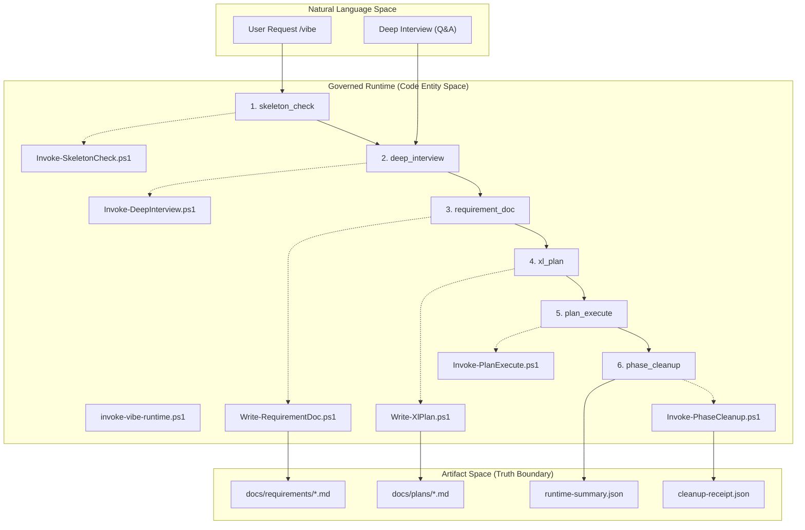
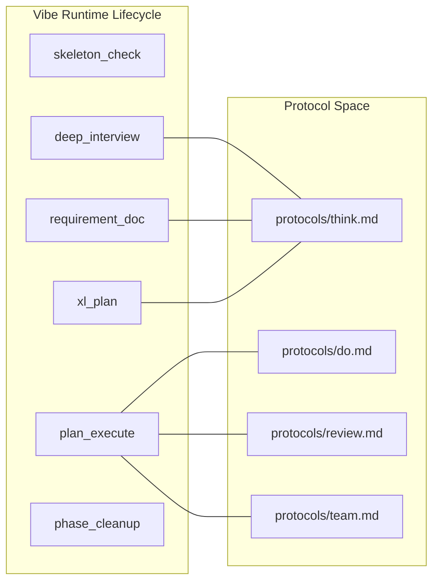

<!-- source: DeepWiki mcp.deepwiki.com · repo foryourhealth111-pixel/Vibe-Skills · page 2.2 The 6-Stage Governed Runtime · fetched 2026-10-26 -->

# The 6-Stage Governed Runtime

Relevant source files

The following files were used as context for generating this wiki page:

- [SKILL.md](SKILL.md)
- [bundled/skills/vibe/SKILL.md](bundled/skills/vibe/SKILL.md)
- [bundled/skills/vibe/bundled/skills/vibe/scripts/runtime/Freeze-RuntimeInputPacket.ps1](bundled/skills/vibe/bundled/skills/vibe/scripts/runtime/Freeze-RuntimeInputPacket.ps1)
- [bundled/skills/vibe/bundled/skills/vibe/scripts/runtime/Invoke-PhaseCleanup.ps1](bundled/skills/vibe/bundled/skills/vibe/scripts/runtime/Invoke-PhaseCleanup.ps1)
- [bundled/skills/vibe/bundled/skills/vibe/scripts/runtime/VibeRuntime.Common.ps1](bundled/skills/vibe/bundled/skills/vibe/scripts/runtime/VibeRuntime.Common.ps1)
- [bundled/skills/vibe/bundled/skills/vibe/scripts/runtime/invoke-vibe-runtime.ps1](bundled/skills/vibe/bundled/skills/vibe/scripts/runtime/invoke-vibe-runtime.ps1)
- [bundled/skills/vibe/bundled/skills/vibe/scripts/verify/vibe-benchmark-autonomous-proof-gate.ps1](bundled/skills/vibe/bundled/skills/vibe/scripts/verify/vibe-benchmark-autonomous-proof-gate.ps1)
- [bundled/skills/vibe/config/phase-cleanup-policy.json](bundled/skills/vibe/config/phase-cleanup-policy.json)
- [bundled/skills/vibe/protocols/do.md](bundled/skills/vibe/protocols/do.md)
- [bundled/skills/vibe/protocols/retro.md](bundled/skills/vibe/protocols/retro.md)
- [bundled/skills/vibe/protocols/review.md](bundled/skills/vibe/protocols/review.md)
- [bundled/skills/vibe/protocols/runtime.md](bundled/skills/vibe/protocols/runtime.md)
- [bundled/skills/vibe/protocols/think.md](bundled/skills/vibe/protocols/think.md)
- [bundled/skills/vibe/references/changelog.md](bundled/skills/vibe/references/changelog.md)
- [bundled/skills/vibe/scripts/governance/phase-end-cleanup.ps1](bundled/skills/vibe/scripts/governance/phase-end-cleanup.ps1)
- [bundled/skills/vibe/scripts/runtime/Freeze-RuntimeInputPacket.ps1](bundled/skills/vibe/scripts/runtime/Freeze-RuntimeInputPacket.ps1)
- [bundled/skills/vibe/scripts/runtime/Invoke-PhaseCleanup.ps1](bundled/skills/vibe/scripts/runtime/Invoke-PhaseCleanup.ps1)
- [bundled/skills/vibe/scripts/runtime/VibeRuntime.Common.ps1](bundled/skills/vibe/scripts/runtime/VibeRuntime.Common.ps1)
- [bundled/skills/vibe/scripts/runtime/invoke-vibe-runtime.ps1](bundled/skills/vibe/scripts/runtime/invoke-vibe-runtime.ps1)
- [bundled/skills/vibe/scripts/verify/fixtures/README.md](bundled/skills/vibe/scripts/verify/fixtures/README.md)
- [config/phase-cleanup-policy.json](config/phase-cleanup-policy.json)
- [protocols/runtime.md](protocols/runtime.md)
- [references/changelog.md](references/changelog.md)
- [scripts/governance/phase-end-cleanup.ps1](scripts/governance/phase-end-cleanup.ps1)
- [scripts/runtime/invoke-vibe-runtime.ps1](scripts/runtime/invoke-vibe-runtime.ps1)
- [scripts/verify/fixtures/README.md](scripts/verify/fixtures/README.md)
- [tests/runtime_neutral/test_governed_runtime_bridge.py](tests/runtime_neutral/test_governed_runtime_bridge.py)

The **Vibe Governed Runtime** is the official execution engine of the Vibe Code Orchestrator (VCO). It enforces a fixed, six-stage state machine for all tasks that require more than trivial edits. By freezing requirements and planning execution before a single line of code is written, the runtime prevents "skill sleep," conflicting executions, and workspace clutter.

## Purpose and Scope

The governed runtime provides a unified entry point (`vibe`) that abstracts internal execution grades (M, L, XL) into a consistent user experience. It ensures that every task follows a rigorous lifecycle of inspection, documentation, execution, and cleanup [SKILL.md:12-26]().

Key capabilities include:
*   **Requirement Clarification:** Mandatory intent freezing before building.
*   **Autonomous Execution:** Bounded execution with retained governance.
*   **Multi-Agent Coordination:** Native support for XL-grade orchestration.
*   **Mandatory Cleanup:** Automatic removal of temporary artifacts and node residue [SKILL.md:14-20]().

---

## The 6-Stage State Machine

Every `vibe` invocation transitions through six mandatory stages. While these stages may become "lighter" for simpler tasks, they are never skipped by policy [SKILL.md:46-56]().

### 1. `skeleton_check`
Inspects the repository shape, active branch, and existing plan/requirement artifacts. It ensures the environment is ready for the task before any state is modified [SKILL.md:98-100]().

### 2. `deep_interview`
Produces a structured **Intent Contract**. In interactive modes, this involves asking the user clarifying questions. In autonomous modes, assumptions are inferred and recorded [SKILL.md:102-115]().
*   **Outputs:** Goal, Deliverables, Constraints, Acceptance Criteria, and Inferred Assumptions.

### 3. `requirement_doc`
Freezes the Intent Contract into a formal document located in `docs/requirements/`. Once this file is written, all subsequent execution must trace back to this document rather than the raw chat history [SKILL.md:117-122]().

### 4. `xl_plan`
Generates an execution plan in `docs/plans/`. This plan determines the internal execution grade (M, L, or XL) and defines the wave/batch structure for implementation [SKILL.md:124-135]().

### 5. `plan_execute`
Carries out the approved plan. For complex tasks, this stage utilizes XL multi-agent orchestration (`spawn_agent`, `send_input`). All spawned subagents are required to end their prompts with `$vibe` to maintain the governed context [SKILL.md:137-142]().

### 6. `phase_cleanup`
The final stage performs a mandatory audit. It removes temporary files and generates a `cleanup-receipt.json` [SKILL.md:144-153]().

### Runtime Data Flow
The following diagram illustrates the transition from Natural Language intent to the Code Entity Space of artifacts and scripts.

**Sources:** [SKILL.md:46-54](), [scripts/runtime/invoke-vibe-runtime.ps1:72-78](), [protocols/think.md:10-17]()

---

## Runtime Modes

The runtime operates in two primary modes, though they have been normalized to ensure a single control path.

| Mode | Description | Behavior |
| :--- | :--- | :--- |
| `interactive_governed` | **Default Mode.** | Pauses for user confirmation at plan boundaries and asks high-value questions during interview [SKILL.md:60-65](). |
| `benchmark_autonomous` | **Legacy/Compatibility.** | Silently normalized to `interactive_governed`. It ensures that unattended execution still produces the same artifacts (plans/requirements) [SKILL.md:67-72](). |

**Sources:** [SKILL.md:58-72](), [references/changelog.md:14-17]()

---

## Implementation Details

### The Runtime Bridge
The runtime is orchestrated by `invoke-vibe-runtime.ps1`. This script is responsible for:
1.  **Context Resolution:** Loading common functions via `VibeRuntime.Common.ps1` [scripts/runtime/invoke-vibe-runtime.ps1:13]().
2.  **Sequence Enforcement:** Calling the stage scripts in the exact order defined by the state machine [scripts/runtime/invoke-vibe-runtime.ps1:72-78]().
3.  **Artifact Durability:** Waiting for critical files (receipts, manifests, plans) to become durable on disk before returning control [scripts/runtime/invoke-vibe-runtime.ps1:80-96]().

### Internal Execution Grades
While the user only sees `vibe`, the runtime selects an internal grade after the `deep_interview` [SKILL.md:81]():
*   **M (Single-Agent):** Narrow, tightly scoped edits.
*   **L (Staged):** Coordination work requiring design → plan → approval.
*   **XL (Team):** Parallelizable work using `protocols/team.md` [SKILL.md:75-80]().

### Runtime Protocol Mapping
The runtime maps specific stages to specialized protocols:

**Sources:** [SKILL.md:186-196](), [protocols/think.md:19-24]()

---

## Governance and Cleanup

### Phase Cleanup Policy
Cleanup is an integral part of the runtime, governed by `config/phase-cleanup-policy.json`. The policy mandates:
*   **Protected Documents:** Extensions like `.docx`, `.pdf`, and `.xlsx` are snapshotted or quarantined before any destructive actions [config/phase-cleanup-policy.json:25-32]().
*   **Node Audit:** Running `Invoke-NodeProcessAudit.ps1` to identify and clean up "zombie" processes left by agents [config/phase-cleanup-policy.json:52-53]().

### Verification Gates
The integrity of the 6-stage runtime is verified by the `vibe-governed-runtime-contract-gate.ps1`. This gate ensures that:
1.  The `runtime-contract.json` matches the implemented stages [tests/runtime_neutral/test_governed_runtime_bridge.py:97-98]().
2.  Execution produces a full artifact closure in the `vibe-sessions` directory [tests/runtime_neutral/test_governed_runtime_bridge.py:124-126]().

**Sources:** [config/phase-cleanup-policy.json:1-57](), [SKILL.md:218-224](), [tests/runtime_neutral/test_governed_runtime_bridge.py:83-126]()

---

