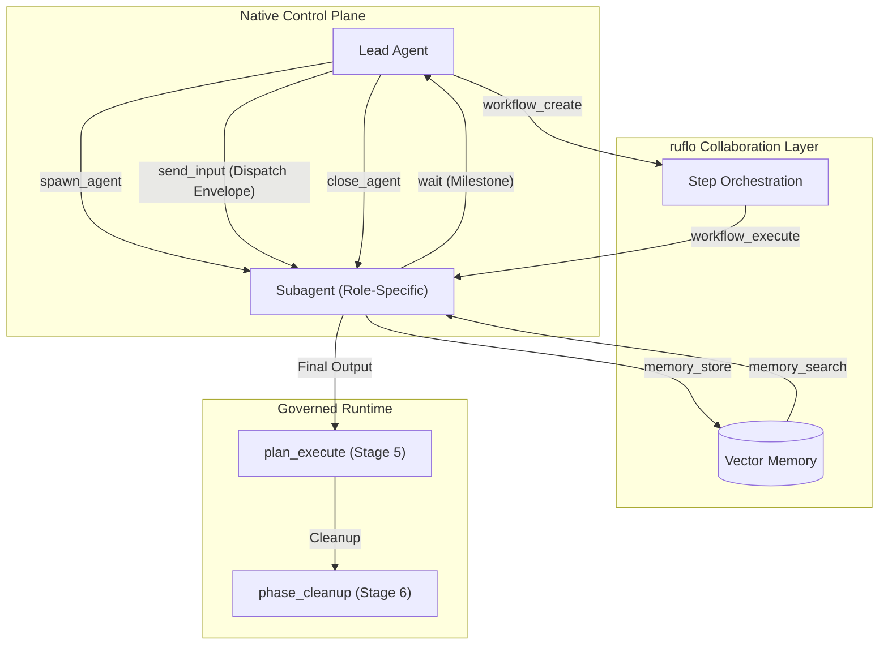
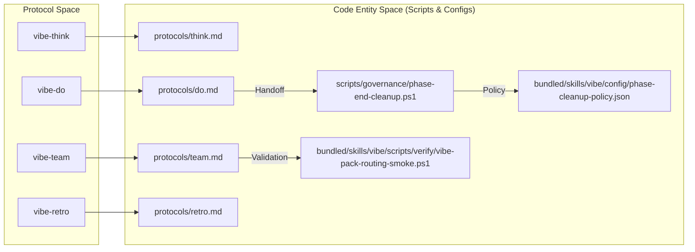

<!-- source: DeepWiki mcp.deepwiki.com · repo foryourhealth111-pixel/Vibe-Skills · page 2.3 Execution Grades and Multi-Agent Protocols · fetched 2026-10-26 -->

# Execution Grades and Multi-Agent Protocols

Relevant source files

The following files were used as context for generating this wiki page:

- [bundled/skills/vibe/config/phase-cleanup-policy.json](bundled/skills/vibe/config/phase-cleanup-policy.json)
- [bundled/skills/vibe/protocols/do.md](bundled/skills/vibe/protocols/do.md)
- [bundled/skills/vibe/protocols/retro.md](bundled/skills/vibe/protocols/retro.md)
- [bundled/skills/vibe/protocols/review.md](bundled/skills/vibe/protocols/review.md)
- [bundled/skills/vibe/protocols/runtime.md](bundled/skills/vibe/protocols/runtime.md)
- [bundled/skills/vibe/protocols/team.md](bundled/skills/vibe/protocols/team.md)
- [bundled/skills/vibe/protocols/think.md](bundled/skills/vibe/protocols/think.md)
- [bundled/skills/vibe/references/team-templates.md](bundled/skills/vibe/references/team-templates.md)
- [bundled/skills/vibe/scripts/governance/phase-end-cleanup.ps1](bundled/skills/vibe/scripts/governance/phase-end-cleanup.ps1)
- [bundled/skills/vibe/scripts/verify/README.md](bundled/skills/vibe/scripts/verify/README.md)
- [bundled/skills/vibe/scripts/verify/fixtures/README.md](bundled/skills/vibe/scripts/verify/fixtures/README.md)
- [bundled/skills/vibe/scripts/verify/vibe-keyword-precision-audit.ps1](bundled/skills/vibe/scripts/verify/vibe-keyword-precision-audit.ps1)
- [bundled/skills/vibe/scripts/verify/vibe-pack-routing-smoke.ps1](bundled/skills/vibe/scripts/verify/vibe-pack-routing-smoke.ps1)
- [bundled/skills/vibe/scripts/verify/vibe-trigger-keyword-hygiene-gate.ps1](bundled/skills/vibe/scripts/verify/vibe-trigger-keyword-hygiene-gate.ps1)
- [protocols/do.md](protocols/do.md)
- [protocols/retro.md](protocols/retro.md)
- [protocols/review.md](protocols/review.md)
- [protocols/team.md](protocols/team.md)
- [protocols/think.md](protocols/think.md)
- [references/conflict-rules.md](references/conflict-rules.md)
- [references/extending-vco.md](references/extending-vco.md)
- [references/team-templates.md](references/team-templates.md)

This page defines the technical standards for task execution within the Vibe Core Orchestrator (VCO). It details the classification of tasks into M, L, and XL execution grades, the multi-agent coordination protocols for high-complexity tasks, and the governing protocol files (`think`, `do`, `review`, `retro`) that ensure consistent agent behavior and anti-drift guardrails.

## Execution Grades (M, L, XL)

VCO classifies tasks into three grades based on complexity and coordination requirements. These grades determine the toolsets and protocols used during the `plan_execute` stage of the governed runtime [protocols/think.md:107-132]().

| Grade | Description | Primary Orchestration | Key Tools/Protocols |
| :--- | :--- | :--- | :--- |
| **M** | Medium complexity; single-agent focus. | Claude native reasoning | `tdd-guide`, `think-harder` [protocols/do.md:82-90]() |
| **L** | Large complexity; requires structured planning. | Subagent-driven development | `writing-plans`, `subagent-driven-development` [protocols/do.md:91-99]() |
| **XL** | Extra-Large; multi-agent coordination. | Codex Native Team + `ruflo` | `vibe-team` protocol, `spawn_agent` [protocols/team.md:1-42]() |

**Sources:** [protocols/think.md:107-132](), [protocols/do.md:82-103](), [protocols/team.md:1-42]()

## Multi-Agent Protocols (XL Team)

The `vibe-team` protocol is the execution topology for XL-grade tasks requiring parallel work, swarm coordination, or long-running iterative workflows [protocols/team.md:21-27](). It activates exclusively during runtime stage 5, `plan_execute`, after the requirement and plan artifacts are frozen [protocols/team.md:7-19]().

### Team Lifecycle Primitives
VCO utilizes Codex native APIs as the primary path for agent lifecycle management, supplemented by `ruflo` for workflow and memory enhancements [protocols/team.md:30-31]().

*   **`spawn_agent`**: Initializes subagents with specific roles and prompts [protocols/team.md:39]().
*   **`send_input`**: Assigns tasks and provides follow-up instructions [protocols/team.md:40]().
*   **`wait`**: Synchronizes agents at defined milestones (fan-in) [protocols/team.md:41]().
*   **`close_agent`**: Terminates agent sessions upon task completion [protocols/team.md:42]().

### Hybrid Architecture Data Flow
The following diagram illustrates the interaction between the Lead Agent, Native Codex Primitives, and the `ruflo` collaboration layer.

**XL Multi-Agent Coordination Flow**

**Sources:** [protocols/team.md:30-47](), [protocols/team.md:65-74](), [protocols/team.md:119-122]()

### Team Templates
VCO provides predefined compositions in `references/team-templates.md` to standardize common XL scenarios [references/team-templates.md:1-5]():
*   **feature-team**: Lead, Planner, Implementers (Frontend/Backend), and Reviewer [references/team-templates.md:6-16]().
*   **debug-team**: Lead, Investigators (Module-specific), and Fixer [references/team-templates.md:20-29]().
*   **dialectic-design**: A specialized 4-agent team using isolated groups (Group A vs Group B) to analyze designs from opposing perspectives (e.g., Top-down vs Bottom-up) [references/team-templates.md:114-130]().

**Sources:** [references/team-templates.md:1-130]()

## Protocol Files and Stages

The governed runtime is driven by a set of protocol files that define behavior across different task types and lifecycle stages.

### Think/Do/Review/Retro Lifecycle
1.  **`vibe-think`**: Owns stages 2-4 (`deep_interview`, `requirement_doc`, `xl_plan`). It enforces a "Closure-First Preflight" consisting of 2 probes (glob/rg) and 1 verification before finalizing plans [protocols/think.md:19-24](), [protocols/think.md:62-76]().
2.  **`vibe-do`**: The execution surface for stage 5 (`plan_execute`). It requires a "minimal closed loop" within the first 3 actions to avoid "dead-air" [protocols/do.md:7-17](), [protocols/do.md:58-72]().
3.  **`vibe-review`**: Provides multi-perspective audits (Security, Quality, Architecture) [references/team-templates.md:46-57]().
4.  **`vibe-retro`**: A post-execution surface for error pattern detection and workflow optimization. It utilizes a 5-phase architecture: GATHER -> ANALYZE -> DISCUSS -> DECIDE -> ACT [protocols/retro.md:18-28](), [protocols/retro.md:79-81]().

**Sources:** [protocols/think.md:19-76](), [protocols/do.md:7-72](), [protocols/retro.md:18-81]()

### Anti-Proxy-Goal-Drift Guardrails
To prevent agents from optimizing for "proxy signals" (like implementation convenience) over primary objectives, the protocols enforce specific guardrails [protocols/think.md:48-57]():
*   **Objective Freeze**: The primary objective must be frozen before discussing implementation [protocols/think.md:53]().
*   **Honest Completion**: Bounded specializations must be preserved and not flattened into false generalized claims [protocols/team.md:61](), [protocols/retro.md:50]().
*   **Validation Isolation**: Validation materials (tests/examples) must remain distinct from the "product truth" [protocols/do.md:44]().

**Sources:** [protocols/think.md:48-57](), [protocols/do.md:40-50](), [protocols/team.md:48-62](), [protocols/retro.md:33-51]()

## Implementation and Data Flow

Coordination is maintained through structured "Dispatch Envelopes" and "Task Contracts" to ensure subagent reliability [protocols/team.md:134-137]().

### The Dispatch Envelope
When the Lead Agent uses `send_input`, the subtask is wrapped in a YAML envelope [protocols/team.md:138-150]():
*   `run_id`: Shared identifier for the XL execution.
*   `phase`: Current stage (plan, investigate, implement, verify).
*   `memory`: Keys for `private_key` (agent-specific) and `shared_key` (the `<agents_memory>` for the team).

### Task Contract (DoD)
The subtask interface defines the "Definition of Done" (DoD) to prevent drift [protocols/team.md:156-179]():
*   **Goal**: One-sentence testable outcome.
*   **Scope**: Explicit "in" and "out" boundaries.
*   **Verification**: Copy-paste runnable commands to validate the work.

**Sources:** [protocols/team.md:134-179](), [references/team-templates.md:85-112]()

### Mapping Protocols to Code Entities
The following diagram bridges the protocol definitions to the physical scripts and configuration files that enforce them.

**Protocol-to-Code Mapping**

**Sources:** [protocols/think.md:1-10](), [protocols/do.md:1-10](), [protocols/team.md:1-10](), [protocols/retro.md:1-10](), [bundled/skills/vibe/config/phase-cleanup-policy.json:1-57](), [bundled/skills/vibe/scripts/verify/vibe-pack-routing-smoke.ps1:74-91]()

---

