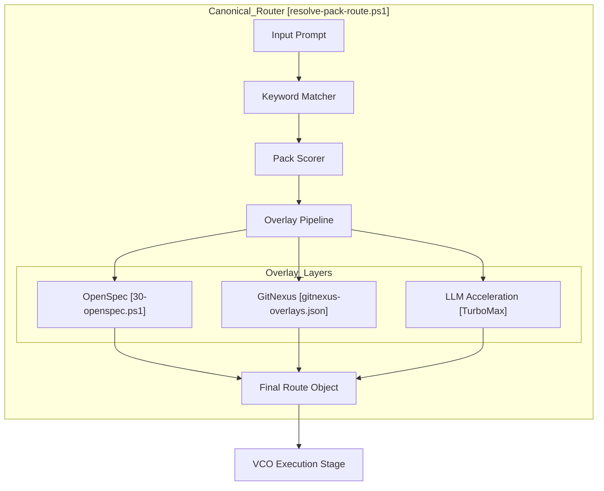
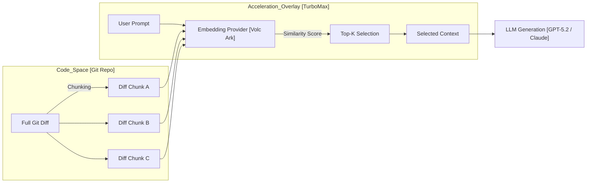

<!-- source: DeepWiki mcp.deepwiki.com · repo foryourhealth111-pixel/Vibe-Skills · page 2.4 Router Overlays and LLM Acceleration · fetched 2026-10-26 -->

# Router Overlays and LLM Acceleration

Relevant source files

The following files were used as context for generating this wiki page:

- [bundled/skills/vibe/bundled/skills/vibe/config/gitnexus-overlays.json](bundled/skills/vibe/bundled/skills/vibe/config/gitnexus-overlays.json)
- [bundled/skills/vibe/bundled/skills/vibe/docs/plans/2026-03-04-turbomax-vector-context-design.md](bundled/skills/vibe/bundled/skills/vibe/docs/plans/2026-03-04-turbomax-vector-context-design.md)
- [bundled/skills/vibe/config/agency-overlays.json](bundled/skills/vibe/config/agency-overlays.json)
- [bundled/skills/vibe/config/cuda-kernel-overlay.json](bundled/skills/vibe/config/cuda-kernel-overlay.json)
- [bundled/skills/vibe/config/data-scale-overlay.json](bundled/skills/vibe/config/data-scale-overlay.json)
- [bundled/skills/vibe/config/deep-discovery-policy.json](bundled/skills/vibe/config/deep-discovery-policy.json)
- [bundled/skills/vibe/config/framework-interop-overlay.json](bundled/skills/vibe/config/framework-interop-overlay.json)
- [bundled/skills/vibe/config/gitnexus-overlays.json](bundled/skills/vibe/config/gitnexus-overlays.json)
- [bundled/skills/vibe/config/memory-governance.json](bundled/skills/vibe/config/memory-governance.json)
- [bundled/skills/vibe/config/ml-lifecycle-overlay.json](bundled/skills/vibe/config/ml-lifecycle-overlay.json)
- [bundled/skills/vibe/config/openspec-policy.json](bundled/skills/vibe/config/openspec-policy.json)
- [bundled/skills/vibe/config/skill-alias-map.json](bundled/skills/vibe/config/skill-alias-map.json)
- [bundled/skills/vibe/docs/blackbox-probe-and-enhancement-playbook.md](bundled/skills/vibe/docs/blackbox-probe-and-enhancement-playbook.md)
- [bundled/skills/vibe/docs/deep-discovery-mode-design.md](bundled/skills/vibe/docs/deep-discovery-mode-design.md)
- [bundled/skills/vibe/docs/plans/2026-03-04-turbomax-vector-context-design.md](bundled/skills/vibe/docs/plans/2026-03-04-turbomax-vector-context-design.md)
- [bundled/skills/vibe/scripts/governance/invoke-openspec-governance.ps1](bundled/skills/vibe/scripts/governance/invoke-openspec-governance.ps1)
- [bundled/skills/vibe/scripts/router/modules/30-openspec.ps1](bundled/skills/vibe/scripts/router/modules/30-openspec.ps1)
- [bundled/skills/vibe/scripts/verify/vibe-openspec-governance-gate.ps1](bundled/skills/vibe/scripts/verify/vibe-openspec-governance-gate.ps1)
- [config/gitnexus-overlays.json](config/gitnexus-overlays.json)
- [docs/blackbox-probe-and-enhancement-playbook.md](docs/blackbox-probe-and-enhancement-playbook.md)
- [docs/deep-discovery-mode-design.md](docs/deep-discovery-mode-design.md)
- [docs/plans/2026-03-04-turbomax-vector-context-design.md](docs/plans/2026-03-04-turbomax-vector-context-design.md)
- [scripts/governance/invoke-openspec-governance.ps1](scripts/governance/invoke-openspec-governance.ps1)
- [scripts/router/modules/30-openspec.ps1](scripts/router/modules/30-openspec.ps1)
- [scripts/verify/vibe-openspec-governance-gate.ps1](scripts/verify/vibe-openspec-governance-gate.ps1)

The Router Overlay system provides a modular layer of advisory logic that sits atop the Canonical Router. Unlike the core routing logic which selects specific skill packs, overlays provide "soft" guidance, governance requirements, and performance accelerations without replacing the underlying skill selection. This allows VibeSkills to enforce project-specific standards (OpenSpec), provide deep domain context (GitNexus), and leverage advanced LLM capabilities (TurboMax) while maintaining a stable routing backbone.

## The Overlay System Architecture

Overlays are triggered during the routing pipeline to inject additional context or requirements into the final route object. They are primarily defined via JSON configurations in the `config/` directory and executed by specialized PowerShell modules.

### Data Flow and Integration
The router integrates overlays at different stages of the `resolve-pack-route.ps1` lifecycle. For example, OpenSpec governance is typically applied as a post-route check to ensure the selected path meets documentation standards.

Title: Router Overlay Integration Flow

**Sources:** [scripts/router/modules/30-openspec.ps1:25-48](), [scripts/verify/vibe-openspec-governance-gate.ps1:46-66]()

---

## OpenSpec Governance Overlay

OpenSpec is the primary governance overlay, enforcing documentation requirements based on the execution grade (M/L/XL) and task type. It ensures that complex plans (L/XL) are backed by formal requirement documents or "Lite Cards" for smaller tasks.

### Enforcement Modes
OpenSpec operates in several modes defined in `config/openspec-policy.json`:
*   **Strict**: Documentation is `required` before execution [bundled/skills/vibe/config/openspec-policy.json:92-92]().
*   **Soft**: Triggers `confirm_required` if within the defined scope (e.g., planning tasks for L/XL grades) [bundled/skills/vibe/config/openspec-policy.json:45-53]().
*   **Advisory**: Provides a `recommended_artifact` path but does not block execution [bundled/skills/vibe/config/openspec-policy.json:89-90]().

### Key Entities
*   **Lite Card**: A lightweight markdown file for M-grade tasks containing goals, scope, and risks [scripts/governance/invoke-openspec-governance.ps1:30-46]().
*   **Full Skeleton**: A directory-based requirement set for L/XL tasks, including `change.md`, `tasks.md`, `progress.md`, and `handoff.md` [scripts/governance/invoke-openspec-governance.ps1:74-108]().

**Sources:** [scripts/router/modules/30-openspec.ps1:180-195](), [bundled/skills/vibe/config/openspec-policy.json:4-10]()

---

## GitNexus Context Overlay

The GitNexus overlay serves as a "Code Understanding Foundation." It maps user prompts to specific code-aware artifacts like architecture maps, impact analysis, and dependency graphs.

| Overlay ID | Purpose | Preferred Stages |
| :--- | :--- | :--- |
| `gitnexus-foundation` | Base evidence source for code understanding | All (think, do, review, etc.) |
| `gitnexus-impact` | Blast radius and risk assessment | think, do, review |
| `gitnexus-architecture-map` | Generates Mermaid diagrams of module clusters | think, team, retro |
| `gitnexus-detect-changes` | Maps diffs to call chains during PR review | review, do, retro |

**Sources:** [config/gitnexus-overlays.json:18-167]()

---

## LLM Acceleration (TurboMax)

TurboMax is a specialized overlay designed to trade higher API consumption for faster task closure. It is explicitly enabled via the `/vibe` or `$vibe` commands [docs/plans/2026-03-04-turbomax-vector-context-design.md:7-7]().

### Vector-First Context
To prevent "context rot" in long conversations, TurboMax uses a three-layer context strategy:
1.  **State Store**: Stable session progress and execution manifests [docs/plans/2026-03-04-turbomax-vector-context-design.md:30-31]().
2.  **Short-term Vector Cache (Ruflo)**: Stores "Evidence Cards" for immediate recall [docs/plans/2026-03-04-turbomax-vector-context-design.md:33-34]().
3.  **Vector-Selected Diffs**: Instead of injecting full file diffs, it chunks the git diff and uses embeddings (e.g., Volcengine Ark) to select the Top-K relevant segments [docs/plans/2026-03-04-turbomax-vector-context-design.md:38-44]().

### Acceleration Enhancements
*   **Committee Sampling**: Uses multiple LLM calls with different temperatures/focuses to resolve ambiguous routing or high-risk planning [docs/plans/2026-03-04-turbomax-vector-context-design.md:72-75]().
*   **Diff Digest**: Generates a small summary of large diffs to reduce noise before primary reasoning [docs/plans/2026-03-04-turbomax-vector-context-design.md:68-71]().
*   **Shadow/Soft/Strict Modes**: Controls whether the acceleration advice is merely logged (shadow), requires confirmation (soft), or is automatically applied (strict) [docs/plans/2026-03-04-turbomax-vector-context-design.md:90-91]().

Title: TurboMax Vector Context Selection

**Sources:** [docs/plans/2026-03-04-turbomax-vector-context-design.md:38-57](), [docs/plans/2026-03-04-turbomax-vector-context-design.md:90-95]()

---

## Implementation Reference

### Key Functions
*   `Get-OpenSpecGovernanceAdvice`: Calculates enforcement levels based on `openspec-policy.json` [scripts/router/modules/30-openspec.ps1:25-32]().
*   `Get-OpenSpecTaskId`: Generates a unique 12-character SHA1 hash for task tracking [scripts/router/modules/30-openspec.ps1:3-23]().
*   `Invoke-OpenSpec-Governance.ps1`: Orchestrates the creation of governance artifacts like Lite Cards or Full Skeletons [scripts/governance/invoke-openspec-governance.ps1:1-12]().

### Configuration Schemas
Overlays are governed by policies that define triggers and bypasses:
*   **Exemptions**: Trivial prompts (e.g., "typo", "small fix") can bypass governance requirements [bundled/skills/vibe/config/openspec-policy.json:80-86]().
*   **Skill Whitelist**: Certain skills like `brainstorming` or `writing-plans` are pre-approved to bypass standard routing governance [bundled/skills/vibe/config/openspec-policy.json:75-79]().

**Sources:** [scripts/router/modules/30-openspec.ps1:124-132](), [scripts/router/modules/30-openspec.ps1:173-175](), [scripts/governance/invoke-openspec-governance.ps1:166-196]()

---

