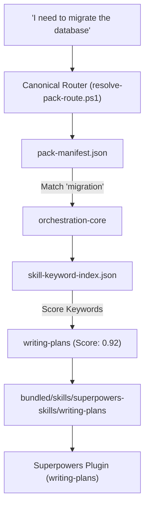
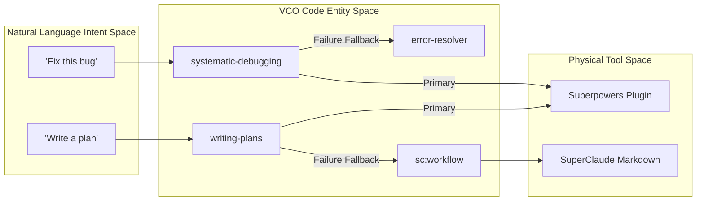

<!-- source: DeepWiki mcp.deepwiki.com · repo foryourhealth111-pixel/Vibe-Skills · page 2.5 Skill Library and Pack Manifest · fetched 2026-10-26 -->

# Skill Library and Pack Manifest

Relevant source files

The following files were used as context for generating this wiki page:

- [bundled/skills/report-generator/SKILL.md](bundled/skills/report-generator/SKILL.md)
- [bundled/skills/vibe/bundled/skills/vibe/config/skills-lock.json](bundled/skills/vibe/bundled/skills/vibe/config/skills-lock.json)
- [bundled/skills/vibe/bundled/skills/vibe/scripts/verify/vibe-generate-skills-lock.ps1](bundled/skills/vibe/bundled/skills/vibe/scripts/verify/vibe-generate-skills-lock.ps1)
- [bundled/skills/vibe/bundled/skills/vibe/scripts/verify/vibe-offline-skills-gate.ps1](bundled/skills/vibe/bundled/skills/vibe/scripts/verify/vibe-offline-skills-gate.ps1)
- [bundled/skills/vibe/bundled/skills/vibe/scripts/verify/vibe-version-packaging-gate.ps1](bundled/skills/vibe/bundled/skills/vibe/scripts/verify/vibe-version-packaging-gate.ps1)
- [bundled/skills/vibe/config/pack-manifest.json](bundled/skills/vibe/config/pack-manifest.json)
- [bundled/skills/vibe/config/skill-keyword-index.json](bundled/skills/vibe/config/skill-keyword-index.json)
- [bundled/skills/vibe/config/skill-routing-rules.json](bundled/skills/vibe/config/skill-routing-rules.json)
- [bundled/skills/vibe/config/skills-lock.json](bundled/skills/vibe/config/skills-lock.json)
- [bundled/skills/vibe/references/fallback-chains.md](bundled/skills/vibe/references/fallback-chains.md)
- [bundled/skills/vibe/references/tool-registry.md](bundled/skills/vibe/references/tool-registry.md)
- [bundled/skills/vibe/scripts/verify/vibe-generate-skills-lock.ps1](bundled/skills/vibe/scripts/verify/vibe-generate-skills-lock.ps1)
- [bundled/skills/vibe/scripts/verify/vibe-offline-skills-gate.ps1](bundled/skills/vibe/scripts/verify/vibe-offline-skills-gate.ps1)
- [bundled/skills/vibe/scripts/verify/vibe-version-packaging-gate.ps1](bundled/skills/vibe/scripts/verify/vibe-version-packaging-gate.ps1)
- [config/pack-manifest.json](config/pack-manifest.json)
- [config/plugins-manifest.codex.json](config/plugins-manifest.codex.json)
- [config/skill-keyword-index.json](config/skill-keyword-index.json)
- [config/skill-routing-rules.json](config/skill-routing-rules.json)
- [config/skills-lock.json](config/skills-lock.json)
- [config/upstream-lock.json](config/upstream-lock.json)
- [references/fallback-chains.md](references/fallback-chains.md)
- [references/tool-registry.md](references/tool-registry.md)
- [scripts/verify/vibe-generate-skills-lock.ps1](scripts/verify/vibe-generate-skills-lock.ps1)
- [scripts/verify/vibe-offline-skills-gate.ps1](scripts/verify/vibe-offline-skills-gate.ps1)
- [scripts/verify/vibe-pack-regression-matrix.ps1](scripts/verify/vibe-pack-regression-matrix.ps1)
- [scripts/verify/vibe-version-packaging-gate.ps1](scripts/verify/vibe-version-packaging-gate.ps1)

This section describes the organization and governance of the Vibe-Skills library, which contains over 340 specialized skills. These skills are grouped into functional "Packs" and managed through a rigorous manifest system to ensure routing stability and execution reliability across different host environments.

## Skill Library Taxonomy

The skill library is stored in the `bundled/skills/` directory. It follows a modular structure where each skill is a self-contained directory containing a `SKILL.md` (or equivalent) definition and supporting logic.

### Core Pack Categories
The library is organized into logical packs defined in the manifest system [bundled/skills/vibe/config/pack-manifest.json:5-135]():

| Pack ID | Priority | Primary Focus | Key Skills |
| :--- | :--- | :--- | :--- |
| `orchestration-core` | 100 | Vibe runtime and multi-agent coordination | `vibe`, `writing-plans`, `subagent-driven-development` |
| `aios-core` | 96 | Agentic Agile and PRD management | `aios-pm`, `aios-sm`, `aios-po`, `aios-dev` |
| `life-sciences` | 80 | Bioinformatics and molecular biology | `scanpy`, `biopython`, `alphafold-database` |
| `scientific-computing` | 85 | Data science and ML engineering | `scikit-learn`, `shap`, `ml-data-leakage-guard` |
| `web-scraping` | 90 | Targeted data extraction | `scrapling`, `playwright` |

**Sources:** [bundled/skills/vibe/config/pack-manifest.json:5-135](), [config/pack-manifest.json:5-135]()

## Pack Manifest Structure

The `pack-manifest.json` file is the central authority for how the Canonical Router groups skills and assigns priorities.

### Data Schema
Each pack entry in the manifest includes:
*   **id**: Unique identifier for the pack.
*   **priority**: Integer used by the router to resolve overlapping keyword matches.
*   **grade_allow**: List of execution grades (M, L, XL) supported by the pack [bundled/skills/vibe/config/pack-manifest.json:9-13]().
*   **task_allow**: Functional tasks (planning, coding, review, etc.) the pack can handle [bundled/skills/vibe/config/pack-manifest.json:14-20]().
*   **trigger_keywords**: A list of Natural Language strings that trigger pack selection [bundled/skills/vibe/config/pack-manifest.json:21-49]().
*   **skill_candidates**: The specific skills within the library that belong to this pack [bundled/skills/vibe/config/pack-manifest.json:50-78]().
*   **defaults_by_task**: The preferred skill to use for a specific task if no more specific match is found [bundled/skills/vibe/config/pack-manifest.json:79-85]().

**Sources:** [bundled/skills/vibe/config/pack-manifest.json:1-86]()

## Skill Keyword Index and Routing Rules

The `skill-keyword-index.json` provides a fine-grained mapping between natural language intent and specific code entities.

### Scoring Logic
The index uses weighted matching to select the best skill candidate [config/skill-keyword-index.json:4-10]():
*   **keyword_match**: 0.85 weight.
*   **name_match**: 0.15 weight.
*   **fallback_threshold**: 0.15 (scores below this revert to the first candidate or legacy matrix).

### Routing Flow: Intent to Code Entity
The following diagram illustrates how a user's natural language request is transformed into a specific skill execution.

**Diagram: Intent-to-Skill Resolution Pipeline**

**Sources:** [config/skill-keyword-index.json:1-20](), [bundled/skills/vibe/config/pack-manifest.json:21-30]()

## Skill-Lock Mechanism

To ensure the integrity of the 340+ skill library, Vibe-Skills employs a `skills-lock.json` mechanism. This acts as a Bill of Materials (BOM) for the library.

### Lock Content
The lock file records the state of every skill in the repository [config/skills-lock.json:7-31]():
*   **relative_path**: Location within the `bundled/skills/` taxonomy.
*   **skill_md_hash**: SHA-256 hash of the `SKILL.md` file to detect unauthorized logic changes.
*   **dir_hash**: Recursive hash of the entire skill directory to ensure asset integrity.
*   **file_count / bytes**: Physical footprint verification.

### Verification Gates
The lock is enforced by `vibe-generate-skills-lock.ps1` and checked during CI by `vibe-offline-skills-gate.ps1`. Any modification to a skill without updating the lock results in a governance failure.

**Sources:** [config/skills-lock.json:1-31](), [scripts/verify/vibe-generate-skills-lock.ps1]()

## Tool Registry and Fallback Chains

Skills often depend on external tools or plugins. The `tool-registry.md` tracks the status and capabilities of these integrations.

### Fallback Hierarchy
When a primary skill or tool fails (e.g., an MCP server is offline), the system follows a defined degradation path [references/fallback-chains.md:8-16]():

| Task Type | Grade | Primary Tool | Fallback Tool |
| :--- | :--- | :--- | :--- |
| Planning | L | `superpowers:brainstorming` | `sc:brainstorm` |
| Coding | M | `everything-claude-code:tdd-guide` | `superpowers:test-driven-development` |
| Debugging | M | `superpowers:systematic-debugging` | `error-resolver` |

**Diagram: Tool Capability and Fallback Mapping**

**Sources:** [references/tool-registry.md:1-56](), [references/fallback-chains.md:1-62]()

---

