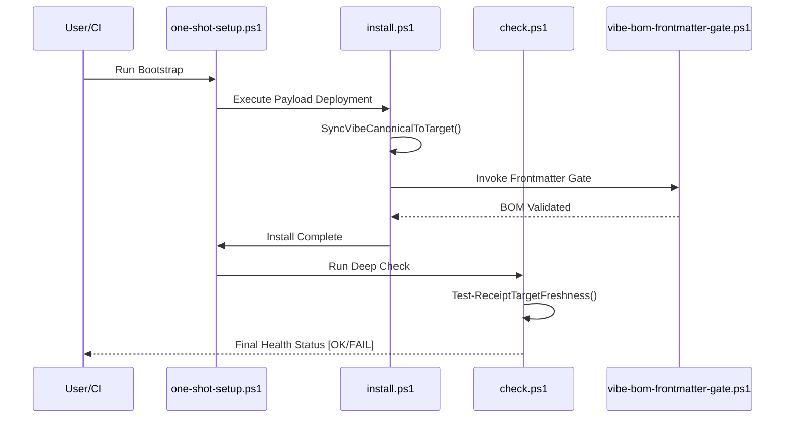

<!-- source: DeepWiki mcp.deepwiki.com · repo foryourhealth111-pixel/Vibe-Skills · page 3 Installation and Deployment · fetched 2026-10-26 -->

# Installation and Deployment

<details>
<summary>Relevant source files</summary>

The following files were used as context for generating this wiki page:

- [adapters/index.json](adapters/index.json)
- [check.ps1](check.ps1)
- [check.sh](check.sh)
- [docs/deployment.md](docs/deployment.md)
- [docs/install/README.md](docs/install/README.md)
- [docs/install/custom-skill-governance-rules.md](docs/install/custom-skill-governance-rules.md)
- [docs/install/custom-workflow-onboarding.md](docs/install/custom-workflow-onboarding.md)
- [docs/install/host-plugin-policy.en.md](docs/install/host-plugin-policy.en.md)
- [docs/install/host-plugin-policy.md](docs/install/host-plugin-policy.md)
- [docs/one-shot-setup.md](docs/one-shot-setup.md)
- [install.ps1](install.ps1)
- [install.sh](install.sh)
- [scripts/bootstrap/one-shot-setup.ps1](scripts/bootstrap/one-shot-setup.ps1)
- [scripts/bootstrap/one-shot-setup.sh](scripts/bootstrap/one-shot-setup.sh)
- [scripts/common/vibe-governance-helpers.ps1](scripts/common/vibe-governance-helpers.ps1)
- [scripts/install/Install-VgoAdapter.ps1](scripts/install/Install-VgoAdapter.ps1)
- [scripts/install/install_vgo_adapter.py](scripts/install/install_vgo_adapter.py)

</details>


VibeSkills is designed for high-portability across diverse AI agent environments. The installation system uses a "truth-first" approach where a central canonical repository governs the deployment of payloads into specific host directories. This ensures that while different agents (like Cursor or Claude Code) have different directory structures, the core VibeSkills logic remains consistent and verifiable.

### System Overview

The deployment lifecycle transitions from a raw repository state to a "Host-Governed" state through a multi-stage process involving environment detection, adapter selection, and payload materialization.

#### Core Deployment Concepts
- **One-Shot Setup**: A bootstrap process that handles environment preparation and initial installation.
- **Host Adapters**: Metadata and logic that map the VibeSkills payload to host-specific paths (e.g., `~/.codeium/windsurf`).
- **Distribution Lanes**: Profile-based installation modes (`minimal` vs `full`) that determine the depth of the skill library deployed.
- **Truth Boundaries**: Strict separation between official repo-managed files and user-local configurations (API keys, custom workflows).

### Deployment Flow: Repository to Host

The following diagram illustrates how the installation scripts move logic from the `Vibe-Skills` repository into the active agent environment.

**VibeSkills Deployment Architecture**
```mermaid
graph TD
    subgraph "Source Space (Repository)"
        [one-shot-setup.ps1] --> [install.ps1]
        [install.ps1] --> [adapters/index.json]
        [install.ps1] --> [bundled/skills]
    end

    subgraph "Adapter Logic"
        [Resolve-VgoAdapter.ps1] --> [HostId_Resolution]
        [HostId_Resolution] --> |"codex"| D1[".codex/"]
        [HostId_Resolution] --> |"claude-code"| D2[".claude/"]
        [HostId_Resolution] --> |"windsurf"| D3[".codeium/windsurf/"]
        [HostId_Resolution] --> |"cursor"| D4[".cursor/"]
    end

    subgraph "Target Space (Host Runtime)"
        D1 --> [TargetRoot/skills/vibe]
        D2 --> [TargetRoot/skills/vibe]
        D3 --> [TargetRoot/skills/vibe]
        D4 --> [TargetRoot/skills/vibe]
        [TargetRoot/skills/vibe] --> [check.ps1]
    end

    [check.ps1] -.-> |"Verification"| [runtime-freshness-receipt.json]
```
Sources: [scripts/bootstrap/one-shot-setup.ps1:138-140](), [install.ps1:180-185](), [check.ps1:132-136](), [docs/deployment.md:46-55]()

---

### One-Shot Setup and Bootstrap Scripts
The entry point for most users is the "one-shot" bootstrap script. These scripts (`one-shot-setup.ps1` for Windows/pwsh and `one-shot-setup.sh` for Linux/macOS) automate the detection of the `HostId`, resolve the `TargetRoot`, and invoke the underlying `install` and `check` routines. 

The bootstrap also handles "API Key Seeding" for the Codex environment, persisting keys into the host's `settings.json` to ensure immediate online readiness.

For details, see [One-Shot Setup and Bootstrap Scripts](#3.1).

Sources: [scripts/bootstrap/one-shot-setup.ps1:1-13](), [scripts/bootstrap/one-shot-setup.sh:37-50](), [docs/install/README.md:18-23]()

---

### Host Adapters and Distribution Lanes
VibeSkills identifies hosts using a `HostId` (e.g., `codex`, `claude-code`, `cursor`, `windsurf`). Each host has an associated adapter defined in `adapters/index.json` that dictates the `bootstrap_mode` (e.g., `governed` for Codex vs `runtime-core` for Windsurf).

Installation is further governed by **Profiles**:
| Profile | Description |
| :--- | :--- |
| `minimal` | Deploys the governance foundation and core router only. |
| `full` | Deploys the full 340+ skill library and optional workflow extras. |

For details, see [Host Adapters and Distribution Lanes](#3.2).

Sources: [install.ps1:2-5](), [docs/install/README.md:25-37](), [docs/install/host-plugin-policy.en.md:24-50]()

---

### Custom Workflow and Skill Onboarding
To maintain the "Truth-First" principle, user-added skills are not placed directly into the official `skills/vibe` directory. Instead, they are onboarded via a `custom-workflows.json` manifest located in the host's `config/` directory. This allows the `Canonical Router` to discover user skills without them being overwritten during a VibeSkills update.

For details, see [Custom Workflow and Skill Onboarding](#3.3).

Sources: [docs/install/custom-workflow-onboarding.md:14-26](), [docs/install/custom-workflow-onboarding.md:108-115]()

---

### MCP (Model Context Protocol) Integration
VibeSkills leverages MCP to extend agent capabilities. During installation, the system can materialize host-specific MCP configurations (like `mcp_config.json` for Windsurf or `servers.active.json` for Codex). This process maps repository templates to active host profiles, enabling tools like GitHub integration or advanced web scraping.

For details, see [MCP (Model Context Protocol) Integration](#3.4).

Sources: [scripts/bootstrap/one-shot-setup.ps1:105-108](), [docs/install/host-plugin-policy.en.md:48-49]()

---

### Verification and Health Checks
Post-installation, the `check.ps1` (or `check.sh`) script performs a "Deep Health Check". It verifies the `runtime-freshness-receipt.json` to ensure the deployed payload matches the expected version and profile.

**Installation Verification Sequence**

Sources: [install.ps1:72-123](), [check.ps1:132-192](), [scripts/common/vibe-governance-helpers.ps1:151-167]()

---

### Recommended Deployment Commands

#### Windows (PowerShell)
```powershell
# Full installation for Codex
pwsh -File .\scripts\bootstrap\one-shot-setup.ps1 -HostId codex -Profile full
# Deep health check
pwsh -File .\check.ps1 -HostId codex -Profile full -Deep
```

#### Linux / macOS (Bash)
```bash
# Full installation for Windsurf
bash ./scripts/bootstrap/one-shot-setup.sh --host windsurf --profile full
# Deep health check
bash ./check.sh --host windsurf --profile full --deep
```
Sources: [docs/deployment.md:18-44]()

---

