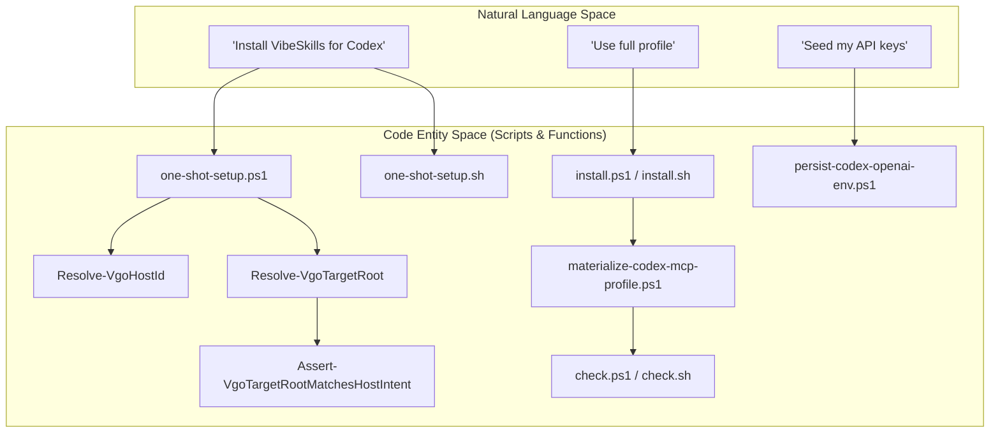
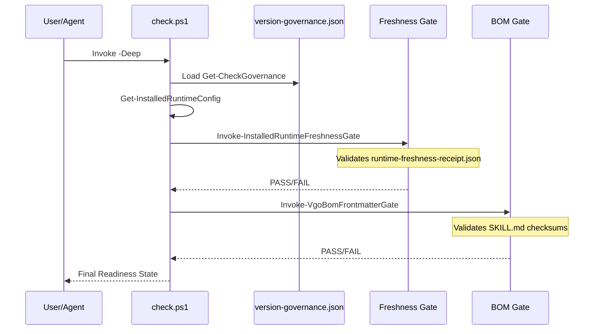

<!-- source: DeepWiki mcp.deepwiki.com · repo foryourhealth111-pixel/Vibe-Skills · page 3.1 One-Shot Setup and Bootstrap Scripts · fetched 2026-10-26 -->

# One-Shot Setup and Bootstrap Scripts

Relevant source files

The following files were used as context for generating this wiki page:

- [adapters/index.json](adapters/index.json)
- [check.ps1](check.ps1)
- [check.sh](check.sh)
- [docs/deployment.md](docs/deployment.md)
- [docs/install/README.en.md](docs/install/README.en.md)
- [docs/install/configuration-guide.en.md](docs/install/configuration-guide.en.md)
- [docs/install/full-featured-install-prompts.en.md](docs/install/full-featured-install-prompts.en.md)
- [docs/install/full-featured-install-prompts.md](docs/install/full-featured-install-prompts.md)
- [docs/install/host-plugin-policy.en.md](docs/install/host-plugin-policy.en.md)
- [docs/install/host-plugin-policy.md](docs/install/host-plugin-policy.md)
- [docs/install/installation-rules.en.md](docs/install/installation-rules.en.md)
- [docs/install/installation-rules.md](docs/install/installation-rules.md)
- [docs/install/prompts/framework-only-install.en.md](docs/install/prompts/framework-only-install.en.md)
- [docs/install/prompts/framework-only-install.md](docs/install/prompts/framework-only-install.md)
- [docs/install/prompts/framework-only-update.en.md](docs/install/prompts/framework-only-update.en.md)
- [docs/install/prompts/framework-only-update.md](docs/install/prompts/framework-only-update.md)
- [docs/install/prompts/full-version-install.en.md](docs/install/prompts/full-version-install.en.md)
- [docs/install/prompts/full-version-install.md](docs/install/prompts/full-version-install.md)
- [docs/install/prompts/full-version-update.en.md](docs/install/prompts/full-version-update.en.md)
- [docs/install/prompts/full-version-update.md](docs/install/prompts/full-version-update.md)
- [docs/one-shot-setup.md](docs/one-shot-setup.md)
- [install.ps1](install.ps1)
- [install.sh](install.sh)
- [scripts/bootstrap/one-shot-setup.ps1](scripts/bootstrap/one-shot-setup.ps1)
- [scripts/bootstrap/one-shot-setup.sh](scripts/bootstrap/one-shot-setup.sh)
- [scripts/common/vibe-governance-helpers.ps1](scripts/common/vibe-governance-helpers.ps1)
- [scripts/install/Install-VgoAdapter.ps1](scripts/install/Install-VgoAdapter.ps1)
- [scripts/install/install_vgo_adapter.py](scripts/install/install_vgo_adapter.py)

The VibeSkills repository provides a "one-shot" bootstrap mechanism designed to automate the transition from a fresh clone to a fully governed execution environment. This process handles host identification, payload deployment, and environmental seeding across Windows and Linux platforms with strict parity.

## Bootstrap Overview

The bootstrap sequence is managed by two primary entry points: `one-shot-setup.ps1` for Windows/PowerShell environments and `one-shot-setup.sh` for Linux/Bash environments. These scripts coordinate the deployment of the Vibe Core Orchestrator (VCO) into specific AI agent "Host Roots" (e.g., `.codex`, `.claude`, `.cursor`).

### Key Parameters
- **Profile**: `minimal` (governance only) or `full` (includes 340+ skills and workflows) [scripts/bootstrap/one-shot-setup.ps1:2-3]().
- **HostId**: Target agent selection (`codex`, `claude-code`, `cursor`, `windsurf`) [scripts/bootstrap/one-shot-setup.ps1:4]().
- **TargetRoot**: Custom filesystem path for the agent's home directory [scripts/bootstrap/one-shot-setup.ps1:5]().
- **Seeding Keys**: Optional parameters for `OpenAIApiKey` and `ArkApiKey` to prepopulate agent settings [scripts/bootstrap/one-shot-setup.ps1:10-12]().

### Cross-Platform Parity
While the codebase is PowerShell-first, the `one-shot-setup.sh` script provides a high-fidelity bridge for Linux users. It detects the presence of `pwsh` to determine if the system can enter the "authoritative full-featured lane" or must remain in a "degraded-but-supported" state [docs/install/full-featured-install-prompts.en.md:34-39]().

## Logic Flow: From Natural Language to Code Execution

The following diagram maps the conceptual bootstrap stages to the specific code entities that implement them.

### Bootstrap Logic Mapping

**Sources:** [scripts/bootstrap/one-shot-setup.ps1:55-70](), [scripts/bootstrap/one-shot-setup.sh:37-50](), [scripts/bootstrap/one-shot-setup.ps1:143-150]().

## Implementation Details

### 1. Host and Target Resolution
The bootstrap process begins by resolving the `HostId` and ensuring the `TargetRoot` is valid for that host.
- `Resolve-VgoHostId`: Normalizes inputs like "claude" to the canonical `claude-code` [scripts/common/vibe-governance-helpers.ps1:211-230]().
- `Assert-VgoTargetRootMatchesHostIntent`: A safety gate that prevents installing `codex` payloads into a `.cursor` directory [scripts/bootstrap/one-shot-setup.sh:105-168]().

### 2. Payload Deployment
The `install.ps1` (or `.sh`) script is invoked to perform the heavy lifting:
- **Vibe Core Sync**: Copies the canonical `skills/vibe` core into the target [install.ps1:180-187]().
- **Skill Materialization**: Depending on the profile, it ensures required skills are present, potentially using external fallbacks if configured [install.ps1:139-179]().
- **Adapter Logic**: Invokes `Install-VgoAdapter.ps1` to configure the specific host-runtime bridge [install.ps1:15-19]().

### 3. MCP and Environment Seeding
For `governed` hosts (primarily `codex`), the bootstrap script performs "One-Shot Seeding":
- **API Keys**: Injects `OPENAI_API_KEY` and `ARK_API_KEY` into the host's `settings.json` via `persist-codex-openai-env.ps1` [scripts/bootstrap/one-shot-setup.ps1:143-164]().
- **MCP Materialization**: Automatically creates the `servers.active.json` profile to enable Model Context Protocol tools [scripts/bootstrap/one-shot-setup.ps1:105]().

## The Deep Health Check Sequence

Post-installation, the system runs `check.ps1` (or `check.sh`) with the `-Deep` flag to verify the integrity of the deployment.

### Health Check Execution Flow

**Sources:** [check.ps1:24-39](), [check.ps1:41-75](), [check.ps1:132-192](), [install.ps1:110-123]().

### Verification Gates
- **Freshness Gate**: Checks the `runtime-freshness-receipt.json` to ensure the installed version matches the repository's expected state [check.ps1:132-146]().
- **BOM Frontmatter Gate**: Validates that all installed skills contain the mandatory metadata and have not been tampered with [install.ps1:110-122]().
- **Coherence Gate**: Ensures that cross-file dependencies and configuration parity are maintained [check.ps1:49]().

## Host Support Matrix

The bootstrap scripts apply different "Bootstrap Modes" based on the `HostId` resolved from `adapters/index.json`.

| HostId | Mode | Default Target Root | Description |
| :--- | :--- | :--- | :--- |
| `codex` | `governed` | `~/.codex` | Full closure; manages settings, MCP, and CLI [docs/install/host-plugin-policy.en.md:24-29](). |
| `claude-code` | `preview` | `~/.claude` | Supported path; does not overwrite host settings [docs/install/host-plugin-policy.en.md:30-36](). |
| `cursor` | `preview` | `~/.cursor` | Guidance-based; host manages its own plugins [docs/install/host-plugin-policy.en.md:37-43](). |
| `windsurf` | `runtime` | `~/.codeium/windsurf` | Integrated with shared runtime payload and global workflows [docs/install/host-plugin-policy.en.md:44-50](). |

**Sources:** [scripts/bootstrap/one-shot-setup.sh:91-103](), [docs/deployment.md:46-55]().

---

