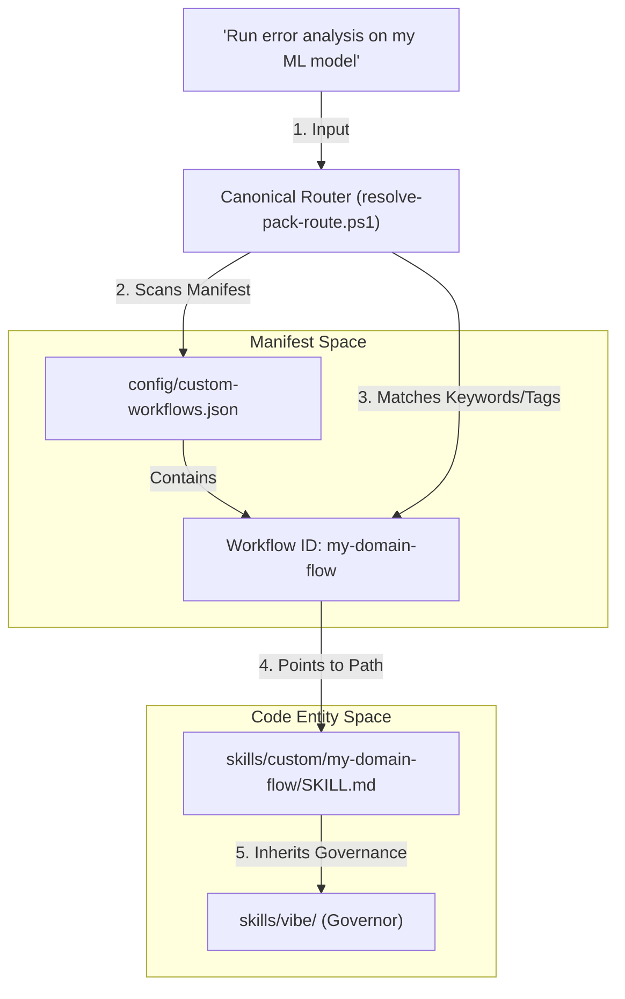
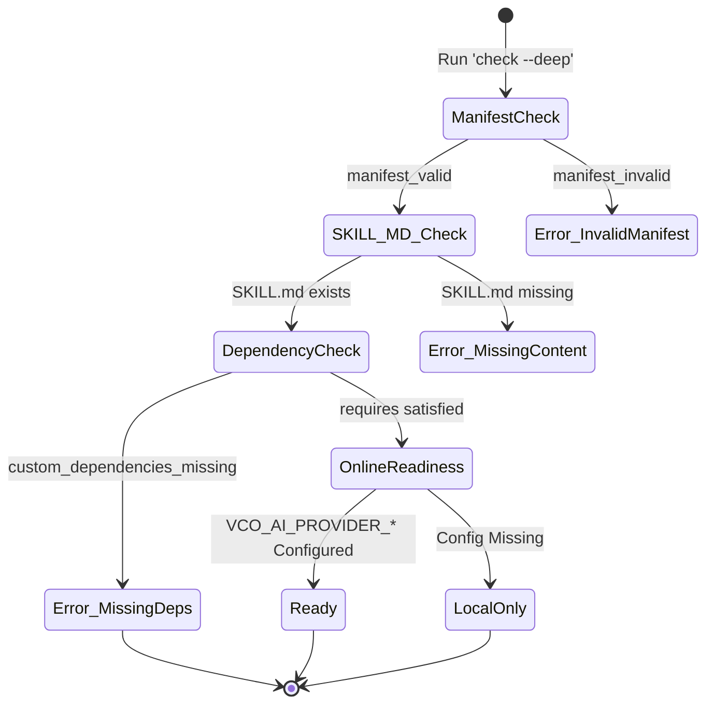

<!-- source: DeepWiki mcp.deepwiki.com · repo foryourhealth111-pixel/Vibe-Skills · page 3.3 Custom Workflow and Skill Onboarding · fetched 2026-10-26 -->

# Custom Workflow and Skill Onboarding

<details>
<summary>Relevant source files</summary>

The following files were used as context for generating this wiki page:

- [docs/install/README.en.md](docs/install/README.en.md)
- [docs/install/README.md](docs/install/README.md)
- [docs/install/configuration-guide.en.md](docs/install/configuration-guide.en.md)
- [docs/install/custom-skill-governance-rules.md](docs/install/custom-skill-governance-rules.md)
- [docs/install/custom-workflow-onboarding.md](docs/install/custom-workflow-onboarding.md)
- [docs/install/installation-rules.en.md](docs/install/installation-rules.en.md)
- [docs/install/prompts/framework-only-install.en.md](docs/install/prompts/framework-only-install.en.md)
- [docs/install/prompts/framework-only-update.en.md](docs/install/prompts/framework-only-update.en.md)
- [docs/install/prompts/full-version-install.en.md](docs/install/prompts/full-version-install.en.md)
- [docs/install/prompts/full-version-update.en.md](docs/install/prompts/full-version-update.en.md)

</details>


This page documents the governed process for extending the Vibe Core Orchestrator (VCO) with custom skills and workflows. It defines the boundary between official managed assets and user-provided extensions, ensuring that new capabilities can be integrated into the Canonical Router without compromising system stability or authority.

## Onboarding Philosophy: Governed Extension

VibeSkills follows a "Truth-First" and "Capability-First" philosophy [docs/install/installation-rules.en.md:1-4](). Custom onboarding is designed to allow expansion while strictly prohibiting system "takeover."

### The "Only One" Rules
To maintain routing integrity, the following invariants are enforced:
1. **One Runtime**: The `vibe` skill remains the sole governor [docs/install/custom-skill-governance-rules.md:9]().
2. **One Route Authority**: The Canonical Router is the only entity permitted to dispatch tasks [docs/install/custom-skill-governance-rules.md:10]().
3. **Explicit Declaration**: No skill is active simply by existing in a directory; it must be declared in a manifest [docs/install/custom-skill-governance-rules.md:11-12]().

## Skill and Workflow Definition

### SKILL.md Format
Every custom skill must reside in its own subdirectory and contain a `SKILL.md` file. This file serves as the contract for the skill, defining its intent, boundaries, and required context [docs/install/custom-workflow-onboarding.md:18-19]().

### Manifest Declaration
Custom workflows are registered via the `custom-workflows.json` manifest. The router reads this file to incorporate custom logic into its scoring and selection process [docs/install/custom-workflow-onboarding.md:20-24]().

**Manifest Schema Example:**
```json
{
  "version": 1,
  "workflows": [
    {
      "id": "my-domain-flow",
      "path": "skills/custom/my-domain-flow",
      "enabled": true,
      "trigger_mode": "advisory",
      "keywords": ["experiment-review", "error-analysis"],
      "intent_tags": ["ml", "research"],
      "preferred_stages": ["deep_interview", "xl_plan"],
      "requires": ["vibe", "writing-plans"],
      "priority": 60,
      "non_goals": ["general chat"]
    }
  ]
}
```
[docs/install/custom-workflow-onboarding.md:28-46]()

### Trigger Modes
The `trigger_mode` determines how the router treats the custom workflow:
*   **`explicit_only`**: Only triggered if the user specifically requests this workflow by ID [docs/install/custom-workflow-onboarding.md:52]().
*   **`advisory`**: (Recommended) The router can suggest this workflow based on intent matching but will not force it [docs/install/custom-workflow-onboarding.md:53-56]().
*   **`auto`**: The router can autonomously select this workflow if confidence scores are sufficiently high [docs/install/custom-workflow-onboarding.md:54]().

**Sources:** [docs/install/custom-workflow-onboarding.md:28-56](), [docs/install/custom-skill-governance-rules.md:75-79]()

---

## Data Flow: From Intent to Custom Execution

The following diagram illustrates how a user's natural language intent is mapped through the Canonical Router to a custom skill defined in the filesystem.

**Natural Language to Code Entity Mapping**

**Sources:** [docs/install/custom-workflow-onboarding.md:15-26](), [docs/install/custom-skill-governance-rules.md:8-12]()

---

## Directory Boundaries and Update Safety

To ensure that custom skills survive VibeSkills updates, a strict boundary is maintained between "Official Managed Surfaces" and "User-Managed Surfaces."

### Surface Boundary Table

| Surface Type | Directory Path | Update Behavior |
| :--- | :--- | :--- |
| **User-Managed** | `skills/custom/` | **Retained**: Update scripts ignore this directory [docs/install/custom-workflow-onboarding.md:92](). |
| **User-Managed** | `config/custom-workflows.json` | **Retained**: Manifests are preserved during updates [docs/install/custom-workflow-onboarding.md:93](). |
| **Official Managed** | `skills/vibe/` | **Overwritten**: Core runtime logic is updated to the latest version [docs/install/custom-workflow-onboarding.md:101](). |
| **Official Managed** | `skills/<official-skill>/` | **Overwritten**: Standard skill packs are refreshed [docs/install/custom-workflow-onboarding.md:102](). |
| **Official Managed** | `scripts/`, `rules/`, `mcp/` | **Overwritten**: Governance scripts and templates are reset [docs/install/custom-workflow-onboarding.md:103-104](). |

**Sources:** [docs/install/custom-workflow-onboarding.md:88-115](), [docs/install/custom-skill-governance-rules.md:23-40]()

---

## Dependency and Readiness Governance

Custom workflows often depend on official skills (e.g., `writing-plans`). These must be explicitly declared in the `requires` field [docs/install/custom-workflow-onboarding.md:40]().

### Verification Lifecycle
The system uses `check --deep` to verify the health of custom integrations [docs/install/custom-workflow-onboarding.md:132]().

**Verification State Machine**

**Sources:** [docs/install/custom-workflow-onboarding.md:130-135](), [docs/install/custom-skill-governance-rules.md:61-73](), [docs/install/configuration-guide.md:192-200]()

### Readiness States
*   **`lane_complete`**: All official and custom dependencies met [docs/install/custom-skill-governance-rules.md:104]().
*   **`custom_dependencies_missing`**: The workflow exists, but its `requires` list contains skills not present in the current `profile` (e.g., switching from `full` to `minimal`) [docs/install/custom-skill-governance-rules.md:108](), [docs/install/custom-workflow-onboarding.md:139-144]().
*   **`governance_ai_online_ready`**: Requires `VCO_AI_PROVIDER_URL`, `VCO_AI_PROVIDER_API_KEY`, and `VCO_AI_PROVIDER_MODEL` to be set in the host's local environment [docs/install/configuration-guide.md:198]().

## Priority Hierarchy
When multiple skills match an intent, the router applies a fixed priority order to ensure core governance is never bypassed:
1.  **Explicit User Choice**: Overrides all logic [docs/install/custom-workflow-onboarding.md:67]().
2.  **Canonical `vibe`**: The core governor [docs/install/custom-workflow-onboarding.md:68]().
3.  **Official Workflow Core**: Standard high-priority skills [docs/install/custom-workflow-onboarding.md:69]().
4.  **Admitted Custom Workflows**: User-defined extensions [docs/install/custom-workflow-onboarding.md:70]().
5.  **Domain Packs / Overlays**: Specialized advisory layers [docs/install/custom-workflow-onboarding.md:71]().

**Sources:** [docs/install/custom-workflow-onboarding.md:65-72](), [docs/install/custom-skill-governance-rules.md:131-138]()

---

