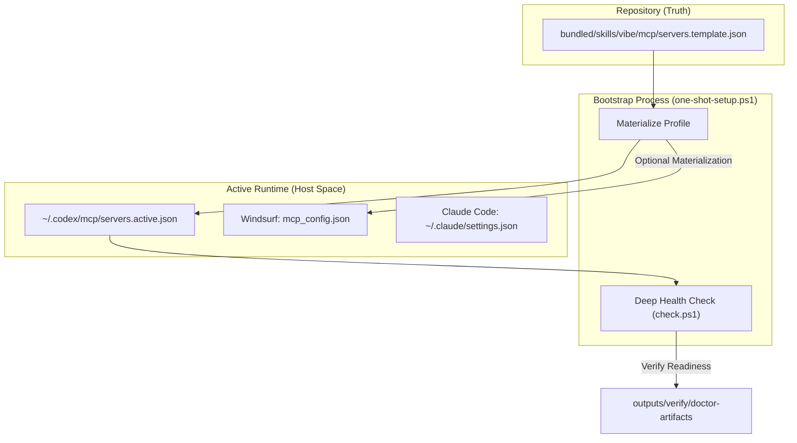
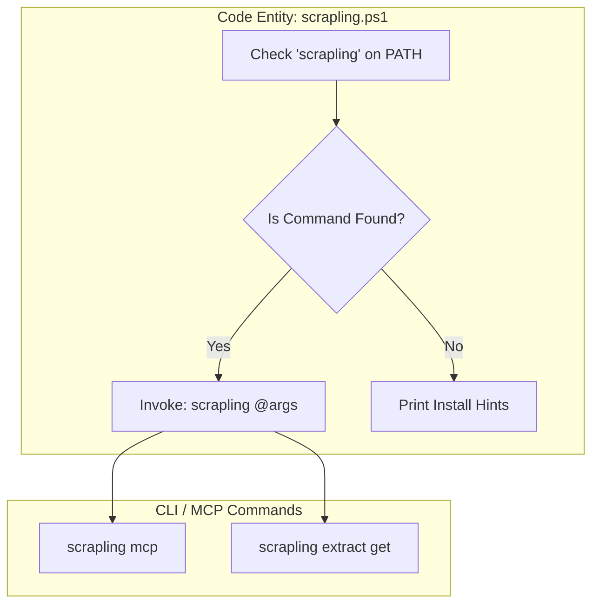

<!-- source: DeepWiki mcp.deepwiki.com · repo foryourhealth111-pixel/Vibe-Skills · page 3.4 MCP (Model Context Protocol) Integration · fetched 2026-10-26 -->

# MCP (Model Context Protocol) Integration

Relevant source files

The following files were used as context for generating this wiki page:

- [bundled/skills/scrapling/SKILL.md](bundled/skills/scrapling/SKILL.md)
- [bundled/skills/scrapling/scripts/scrapling.ps1](bundled/skills/scrapling/scripts/scrapling.ps1)
- [bundled/skills/vibe/mcp/servers.template.json](bundled/skills/vibe/mcp/servers.template.json)
- [bundled/skills/vibe/scripts/verify/vibe-pack-regression-matrix.ps1](bundled/skills/vibe/scripts/verify/vibe-pack-regression-matrix.ps1)
- [docs/deployment.md](docs/deployment.md)
- [docs/install/host-plugin-policy.en.md](docs/install/host-plugin-policy.en.md)
- [docs/install/host-plugin-policy.md](docs/install/host-plugin-policy.md)
- [docs/one-shot-setup.md](docs/one-shot-setup.md)

This page documents the integration of the Model Context Protocol (MCP) within the VibeSkills ecosystem. It covers the architectural distinction between server templates and active profiles, the materialization process during setup, and the specific plugin-backed and CLI-backed surfaces supported by the runtime.

## 1. Architectural Overview

VibeSkills treats MCP servers as extensible tool surfaces that bridge the gap between the LLM's reasoning and external environments (e.g., GitHub, local scrapers, or specialized APIs). The integration is designed to be host-agnostic while providing specific optimizations for supported hosts like `codex`, `claude-code`, `cursor`, and `windsurf` [docs/install/host-plugin-policy.en.md:9-15]().

### 1.1 Template vs. Active Profile
The system maintains a clear boundary between "shipped truth" and "active runtime configuration":
*   **Server Templates**: Located in [bundled/skills/vibe/mcp/servers.template.json:1-35](), these define the available MCP servers, their execution modes (`stdio` or `plugin`), and required arguments.
*   **Active Profiles**: During installation, the system materializes an active configuration to `~/.codex/mcp/servers.active.json` [docs/one-shot-setup.md:59-59](). This file represents the subset of servers actually enabled and configured for the current host environment.

### 1.2 Data Flow: From Template to Runtime
The following diagram illustrates how MCP configurations move from the repository into the active host environment.

**MCP Materialization Pipeline**

**Sources:** [bundled/skills/vibe/mcp/servers.template.json:1-35](), [docs/one-shot-setup.md:55-62](), [docs/deployment.md:46-55]().

---

## 2. Supported MCP Surfaces

VibeSkills categorizes MCP servers into two primary execution modes: `plugin` (host-native extensions) and `stdio` (CLI-based sub-processes).

### 2.1 Plugin-Backed Surfaces
These servers are expected to be managed or provided by the host's native plugin ecosystem. VibeSkills identifies them but does not typically overwrite their internal settings to avoid breaking host stability [docs/install/host-plugin-policy.en.md:37-42]().

| Server ID | Mode | Purpose |
| :--- | :--- | :--- |
| `github` | `plugin` | Integration with GitHub repositories, PRs, and Issues [bundled/skills/vibe/mcp/servers.template.json:3-7](). |
| `context7` | `plugin` | Context-aware retrieval and indexing [bundled/skills/vibe/mcp/servers.template.json:8-11](). |
| `serena` | `plugin` | Specialized agentic workflow support [bundled/skills/vibe/mcp/servers.template.json:12-15](). |

### 2.2 CLI-Backed (stdio) Surfaces
These servers run as independent processes communicating via standard I/O. They are often installed via `npm` or `pip` during the bootstrap phase.

| Server ID | Command | Mode | Notes |
| :--- | :--- | :--- | :--- |
| `scrapling` | `scrapling mcp` | `stdio` | Requires `python -m pip install "scrapling[ai]"` [bundled/skills/vibe/mcp/servers.template.json:16-24](). |
| `claude-flow` | `claude-flow mcp start` | `stdio` | Installed via `npm` during setup [bundled/skills/vibe/mcp/servers.template.json:25-33](), [docs/one-shot-setup.md:72-72](). |

---

## 3. Deep Dive: Scrapling Integration

`scrapling` is a primary example of a "full-profile" MCP surface that provides high-fidelity web scraping capabilities.

### 3.1 Execution and Verification
The system uses a wrapper script `scrapling.ps1` to ensure the environment is ready before attempting to invoke the MCP server.

**Scrapling Skill Readiness Flow**

**Sources:** [bundled/skills/scrapling/scripts/scrapling.ps1:1-28](), [bundled/skills/scrapling/SKILL.md:107-122]().

### 3.2 Implementation Details
*   **Skill Contract**: Defined in [bundled/skills/scrapling/SKILL.md:1-4](), it prioritizes CSS selector-based extraction to minimize token bloat.
*   **Routing Logic**: The `vibe-pack-regression-matrix.ps1` validates that scraping prompts are correctly routed to the `web-scraping` pack, which contains the `scrapling` skill [bundled/skills/vibe/scripts/verify/vibe-pack-regression-matrix.ps1:63-65]().

---

## 4. Materialization and Readiness

The `one-shot-setup.ps1` script performs the heavy lifting of MCP integration.

### 4.1 Setup Sequence
1.  **Dependency Check**: Verifies `node`, `npm`, and `python` availability [docs/one-shot-setup.md:40-44]().
2.  **CLI Installation**: Attempts to install `claude-flow` via npm and `scrapling[ai]` via pip [docs/one-shot-setup.md:51-54, 82-82]().
3.  **Profile Materialization**: Writes the `servers.active.json` based on the selected profile (`minimal` vs `full`) [docs/one-shot-setup.md:59-59]().
4.  **Deep Doctor**: Executes `check.ps1 -Deep` to verify if the MCP endpoints are responsive [docs/one-shot-setup.md:120-127]().

### 4.2 Readiness States
The `check.ps1` script classifies the MCP integration into three states [docs/one-shot-setup.md:128-136]():
*   **`fully_ready`**: All `stdio` servers are on PATH and `plugin` servers are noted.
*   **`manual_actions_pending`**: Core logic is installed, but specific secrets (like `OPENAI_API_KEY`) or host-side MCP registrations are missing [docs/one-shot-setup.md:141-155]().
*   **`core_install_incomplete`**: The foundation (scripts/templates) failed to deploy.

**Sources:** [docs/one-shot-setup.md:128-155](), [docs/deployment.md:1-31]().

---

