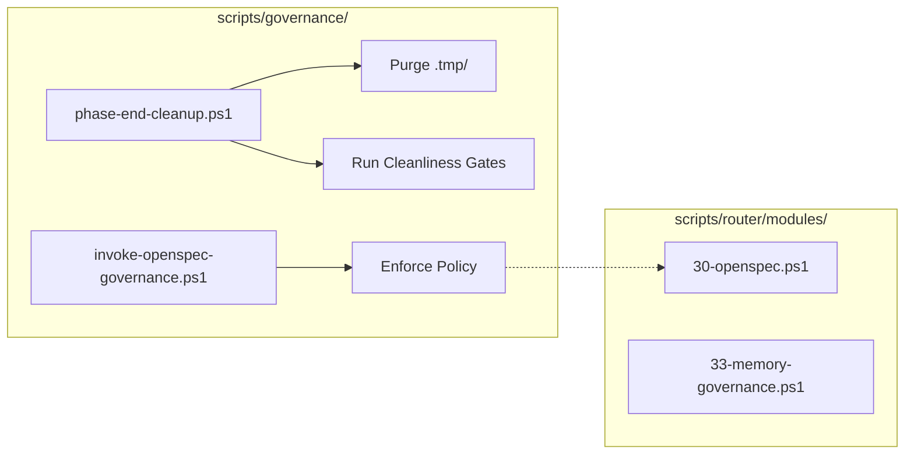

<!-- source: DeepWiki mcp.deepwiki.com · repo foryourhealth111-pixel/Vibe-Skills · page 4 Governance and Verification System · fetched 2026-10-26 -->

# Governance and Verification System

<details>
<summary>Relevant source files</summary>

The following files were used as context for generating this wiki page:

- [bundled/skills/vibe/bundled/skills/vibe/config/version-governance.json](bundled/skills/vibe/bundled/skills/vibe/config/version-governance.json)
- [bundled/skills/vibe/bundled/skills/vibe/references/changelog.md](bundled/skills/vibe/bundled/skills/vibe/references/changelog.md)
- [bundled/skills/vibe/bundled/skills/vibe/references/release-ledger.jsonl](bundled/skills/vibe/bundled/skills/vibe/references/release-ledger.jsonl)
- [bundled/skills/vibe/config/version-governance.json](bundled/skills/vibe/config/version-governance.json)
- [bundled/skills/vibe/docs/releases/README.md](bundled/skills/vibe/docs/releases/README.md)
- [bundled/skills/vibe/references/index.md](bundled/skills/vibe/references/index.md)
- [bundled/skills/vibe/references/release-ledger.jsonl](bundled/skills/vibe/references/release-ledger.jsonl)
- [config/version-governance.json](config/version-governance.json)
- [docs/releases/README.md](docs/releases/README.md)
- [references/index.md](references/index.md)
- [references/release-ledger.jsonl](references/release-ledger.jsonl)
- [scripts/router/resolve-pack-route.ps1](scripts/router/resolve-pack-route.ps1)
- [scripts/verify/README.md](scripts/verify/README.md)
- [scripts/verify/vibe-config-parity-gate.ps1](scripts/verify/vibe-config-parity-gate.ps1)

</details>


The **Governance and Verification System** provides the structural integrity for the Vibe-Skills repository. It ensures that the distributed skill library, the core orchestrator (VCO), and the various mirror sites remain synchronized, version-consistent, and verified against a battery of automated gates. This system transitions the repository from a collection of scripts into a governed, release-ready platform.

### System Overview Diagram

This diagram illustrates how governance policies in the "Natural Language Space" (contracts and policies) are enforced upon the "Code Entity Space" (scripts and configs).

```mermaid
graph TD
    subgraph "Natural Language Space (Policies)"
        [unified-task-contract.md]
        [mirror-topology.md]
        [release-evidence-bundle-contract.md]
    end

    subgraph "Governance Control Plane"
        VGO["config/version-governance.json"]
        LEDGER["references/release-ledger.jsonl"]
    end

    subgraph "Code Entity Space (Verification & Execution)"
        GATES["scripts/verify/*.ps1"]
        SYNC["scripts/governance/sync-bundled-vibe.ps1"]
        DOCTOR["vibe-bootstrap-doctor-gate.ps1"]
    end

    [unified-task-contract.md] -.-> VGO
    [mirror-topology.md] -.-> VGO
    VGO --> GATES
    VGO --> SYNC
    GATES --> LEDGER
    DOCTOR --> LEDGER
```
**Sources:** [config/version-governance.json:1-135](), [references/index.md:1-25](), [scripts/verify/README.md:1-60]()

---

## 4.1 Version Governance and Release Lifecycle
The lifecycle is anchored by `config/version-governance.json`, which defines the source-of-truth hierarchy and the mirror topology [config/version-governance.json:9-46](). Every release is recorded in an append-only `references/release-ledger.jsonl` [references/release-ledger.jsonl:1-30](), ensuring a traceable history of version promotions.

**Key Components:**
*   **Mirror Topology:** Defines `canonical`, `bundled`, and `nested_bundled` targets with specific parity policies (e.g., `authoritative` vs `full`) [config/version-governance.json:14-46]().
*   **Execution Context Lock:** Prevents scripts from running if they are detected under a mirror root instead of the canonical root to avoid "stale execution" [config/version-governance.json:47-50]().
*   **Freshness Receipts:** A mechanism where the installed runtime validates its own version against the repository state [config/version-governance.json:90-96]().

For details, see [Version Governance and Release Lifecycle](#4.1).

**Sources:** [config/version-governance.json:1-135](), [references/release-ledger.jsonl:1-30]()

---

## 4.2 Verification Gates
Verification gates are automated scripts located in `scripts/verify/` that act as quality checkpoints. They are categorized into "Gate Families" such as Runtime Integrity, Cleanliness, and Routing Core [scripts/verify/README.md:58-66]().

| Gate Script | Responsibility |
| :--- | :--- |
| `vibe-config-parity-gate.ps1` | Ensures JSON configs in `config/` match those in `bundled/skills/vibe/config/` [scripts/verify/vibe-config-parity-gate.ps1:184-200](). |
| `vibe-version-consistency-gate.ps1` | Validates metadata across `version-governance.json`, changelogs, and maintenance markers [scripts/verify/README.md:93-93](). |
| `vibe-repo-cleanliness-gate.ps1` | Blocks local noise and uncommitted artifacts from entering the release stream [scripts/verify/README.md:95-95](). |
| `vibe-routing-stability-gate.ps1` | Reports on `route_stability` and `misroute_rate` to ensure intent resolution hasn't drifted [scripts/verify/README.md:90-90](). |

For details, see [Verification Gates](#4.2).

**Sources:** [scripts/verify/README.md:28-96](), [scripts/verify/vibe-config-parity-gate.ps1:1-175]()

---

## 4.3 Governance Scripts and Policies
This subsystem handles the active management of the repository's standards. It includes OpenSpec policy enforcement, upstream auditing, and phase-end cleanup procedures.

**Governance Flow:**

**Sources:** [scripts/verify/README.md:35-56](), [scripts/router/resolve-pack-route.ps1:18-50]()

*   **Phase-End Cleanup:** A standardized sequence to purge temporary files and rerun hygiene gates before a batch goal is closed [scripts/verify/README.md:35-51]().
*   **OpenSpec Governance:** Managed via `openspec-policy.json` and enforced during routing [scripts/router/resolve-pack-route.ps1:29-29]().

For details, see [Governance Scripts and Policies](#4.3).

---

## 4.4 Contribution Rules and Change Control
The repository employs a zoned contribution model to protect the "Control Plane" while encouraging skill additions. Changes are classified (Class A through D) based on their impact on the core orchestrator or the mirror topology.

*   **Z0 Frozen Control Plane:** Core logic and governance schemas.
*   **Z1 Guarded Governance:** Configuration and threshold changes.
*   **Z3 Preferred Contribution:** New skills and documentation.

For details, see [Contribution Rules and Change Control](#4.4).

**Sources:** [references/index.md:9-15](), [scripts/verify/README.md:62-62]()

---

