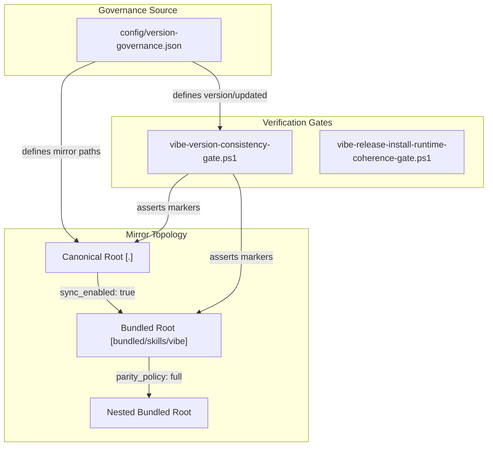

<!-- source: DeepWiki mcp.deepwiki.com · repo foryourhealth111-pixel/Vibe-Skills · page 4.1 Version Governance and Release Lifecycle · fetched 2026-10-26 -->

# Version Governance and Release Lifecycle

<details>
<summary>Relevant source files</summary>

The following files were used as context for generating this wiki page:

- [bundled/skills/vibe/bundled/skills/vibe/config/version-governance.json](bundled/skills/vibe/bundled/skills/vibe/config/version-governance.json)
- [bundled/skills/vibe/bundled/skills/vibe/docs/releases/README.md](bundled/skills/vibe/bundled/skills/vibe/docs/releases/README.md)
- [bundled/skills/vibe/bundled/skills/vibe/references/changelog.md](bundled/skills/vibe/bundled/skills/vibe/references/changelog.md)
- [bundled/skills/vibe/bundled/skills/vibe/references/release-ledger.jsonl](bundled/skills/vibe/bundled/skills/vibe/references/release-ledger.jsonl)
- [bundled/skills/vibe/config/version-governance.json](bundled/skills/vibe/config/version-governance.json)
- [bundled/skills/vibe/docs/releases/README.md](bundled/skills/vibe/docs/releases/README.md)
- [bundled/skills/vibe/references/release-ledger.jsonl](bundled/skills/vibe/references/release-ledger.jsonl)
- [bundled/skills/vibe/scripts/verify/vibe-version-consistency-gate.ps1](bundled/skills/vibe/scripts/verify/vibe-version-consistency-gate.ps1)
- [config/version-governance.json](config/version-governance.json)
- [docs/brand/github-branding-copy.md](docs/brand/github-branding-copy.md)
- [docs/plans/2026-03-20-readme-en-detail-and-github-branding-copy-plan.md](docs/plans/2026-03-20-readme-en-detail-and-github-branding-copy-plan.md)
- [docs/plans/README.md](docs/plans/README.md)
- [docs/releases/README.md](docs/releases/README.md)
- [docs/requirements/2026-03-20-readme-en-detail-and-github-branding-copy.md](docs/requirements/2026-03-20-readme-en-detail-and-github-branding-copy.md)
- [docs/requirements/README.md](docs/requirements/README.md)
- [references/release-ledger.jsonl](references/release-ledger.jsonl)
- [scripts/verify/vibe-version-consistency-gate.ps1](scripts/verify/vibe-version-consistency-gate.ps1)

</details>


This section documents the mechanisms used to ensure version consistency, mirror integrity, and release reliability across the VibeSkills repository. The system relies on a central governance configuration, an append-only ledger, and a multi-stage verification process that must be satisfied before any release is considered authoritative.

## 1. Version Governance Configuration

The `version-governance.json` file is the central authority for the repository's topology and versioning state. It defines how the "Canonical" source of truth relates to various mirrors and how the runtime environment should be validated.

### 1.1 Mirror Topology
VibeSkills employs a **Mirror Topology** to maintain consistency across different distribution surfaces. The configuration defines three primary roles:
*   **Canonical**: The absolute source of truth (usually the repository root).
*   **Mirror**: A full copy of the canonical truth, synchronized automatically.
*   **Nested Mirror**: A recursive mirror (e.g., `vibe` within `vibe`) used for specific packaging requirements.

The `parity_policy` ensures that mirrors do not drift from the canonical source:
*   `authoritative`: The source against which others are compared.
*   `full`: Requires bit-for-bit parity with the source.

### 1.2 Execution Context Lock
To prevent accidental execution from unverified or "dirty" environments, the governance policy enforces an **Execution Context Lock**.
*   `require_outer_git_root`: Ensures the script is running within a valid Git repository [config/version-governance.json:48-48]().
*   `fail_if_script_path_is_under_mirror_root`: Prevents execution of scripts located inside a mirror directory to ensure the operator is always working on the canonical source [config/version-governance.json:49-49]().

**Version Governance Data Flow**
The following diagram illustrates how `version-governance.json` drives the system's integrity.

Title: Version Governance Data Flow

Sources: [config/version-governance.json:14-46](), [scripts/verify/vibe-version-consistency-gate.ps1:27-40]()

## 2. Release Ledger and History

The release history is maintained in an append-only format to provide a tamper-evident audit trail of all version transitions.

### 2.1 Release Ledger (`release-ledger.jsonl`)
The ledger is a JSONL (JSON Lines) file where each entry represents a version cut. It records:
*   `version`: The SemVer-compliant version string.
*   `git_head`: The specific commit hash associated with the release.
*   `updated`: The ISO date of the release.
*   `actor`: The entity (human or bot) that performed the cut [references/release-ledger.jsonl:1-10]().

### 2.2 Version Consistency Gate
The `vibe-version-consistency-gate.ps1` script performs automated validation of the ledger against other version markers in the repository:
1.  **Maintenance Files**: Checks `SKILL.md` and other markers for matching version/date strings [scripts/verify/vibe-version-consistency-gate.ps1:56-78]().
2.  **Changelog**: Verifies that `references/changelog.md` contains a header matching the current release [scripts/verify/vibe-version-consistency-gate.ps1:80-94]().
3.  **Ledger Tail**: Ensures the last entry in the ledger matches the `version-governance.json` [scripts/verify/vibe-version-consistency-gate.ps1:96-121]().

Sources: [references/release-ledger.jsonl:1-30](), [scripts/verify/vibe-version-consistency-gate.ps1:35-121]()

## 3. Release Lifecycle and Cut Process

The release process is governed by a strict lifecycle that transitions from requirements to verified proof bundles.

### 3.1 Requirement-to-Plan Traceability
Every release must originate from a frozen requirement document in `docs/requirements/`. Execution plans in `docs/plans/` must explicitly trace back to these requirements rather than raw chat history [docs/requirements/README.md:1-10]().

### 3.2 The Release Cut Command
Operators perform a release cut using the canonical command:
```powershell
pwsh -NoProfile -ExecutionPolicy Bypass -File .\scripts\governance\release-cut.ps1 -RunGates
```
This command triggers the "Stop-Ship" gate families, including topology integrity, runtime coherence, and fallback truth honesty [docs/releases/README.md:51-66]().

### 3.3 Freshness Receipts and Proof Bundles
Upon installation, the system generates a **Freshness Receipt** (`runtime-freshness-receipt.json`). This receipt is a signed contract proving that the installed runtime matches the versioned truth [config/version-governance.json:92-96]().

A **Proof Bundle** is the final artifact of a release, containing:
*   Execution manifests.
*   Per-unit receipts.
*   Command logs.
*   A tracked proof manifest verified by `vibe-benchmark-autonomous-proof-gate.ps1` [bundled/skills/vibe/bundled/skills/vibe/references/changelog.md:48-53]().

**Release Lifecycle Implementation**
This diagram maps the release lifecycle stages to specific codebase entities.

Title: Release Lifecycle to Code Entity Mapping

```mermaid
graph LR
    subgraph "NL Space: Requirements"
        REQ["Frozen Requirement Document"]
    end

    subgraph "Code Entity Space: Execution"
        PLAN["docs/plans/*.md"]
        CUT["scripts/governance/release-cut.ps1"]
        VGO["Get-VgoGovernanceContext"]
    end

    subgraph "Code Entity Space: Verification"
        GATE["vibe-version-consistency-gate.ps1"]
        BOM["vibe-bom-frontmatter-gate.ps1"]
        PROOF["vibe-benchmark-autonomous-proof-gate.ps1"]
    end

    subgraph "Output: Release Truth"
        LEDGER["references/release-ledger.jsonl"]
        RECEIPT["runtime-freshness-receipt.json"]
    end

    REQ --> PLAN
    PLAN --> CUT
    CUT --> VGO
    VGO --> GATE
    GATE --> BOM
    BOM --> PROOF
    PROOF --> LEDGER
    LEDGER --> RECEIPT
```

Sources: [docs/requirements/README.md:1-10](), [docs/releases/README.md:51-66](), [scripts/verify/vibe-version-consistency-gate.ps1:27-30](), [config/version-governance.json:92-96]()

## 4. Governance Policies

| Policy | Description | File Path |
| :--- | :--- | :--- |
| **Presence Policy** | Defines if a file/mirror is required or optional. | [config/version-governance.json:23]() |
| **Parity Policy** | Determines if a mirror must be a `full` bitwise match. | [config/version-governance.json:25]() |
| **Runtime Markers** | List of 25+ critical files required for a valid runtime. | [config/version-governance.json:98-125]() |
| **No-Silent-Fallback** | Forbids fallback to degraded modes without explicit approval. | [config/version-governance.json:7-8]() |

Sources: [config/version-governance.json:1-135]()

---

