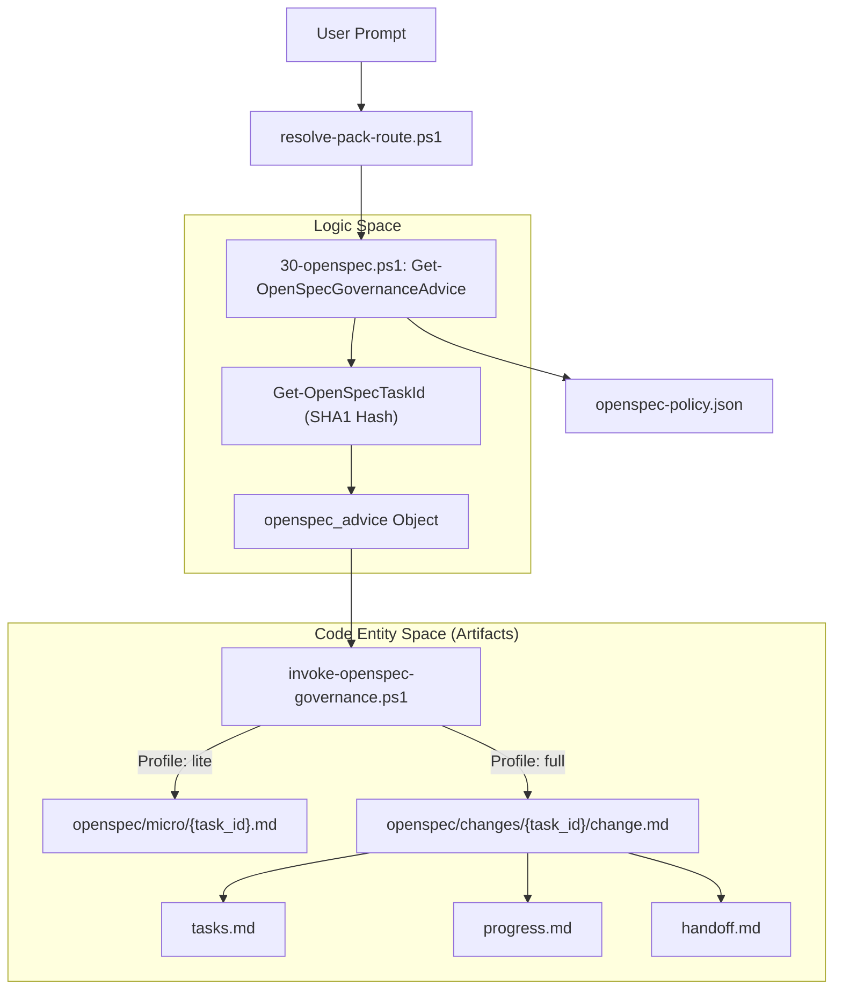
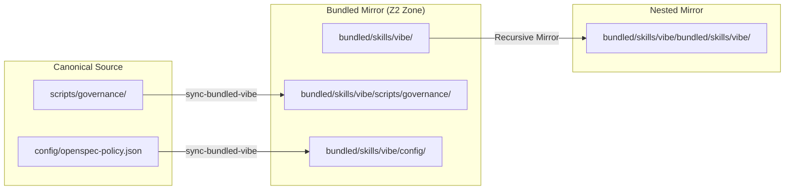

<!-- source: DeepWiki mcp.deepwiki.com · repo foryourhealth111-pixel/Vibe-Skills · page 4.3 Governance Scripts and Policies · fetched 2026-10-26 -->

# Governance Scripts and Policies

Relevant source files

The following files were used as context for generating this wiki page:

- [bundled/skills/vibe/bundled/skills/vibe/config/plugins-manifest.upstream.json](bundled/skills/vibe/bundled/skills/vibe/config/plugins-manifest.upstream.json)
- [bundled/skills/vibe/bundled/skills/vibe/scripts/governance/audit-upstream.ps1](bundled/skills/vibe/bundled/skills/vibe/scripts/governance/audit-upstream.ps1)
- [bundled/skills/vibe/config/openspec-policy.json](bundled/skills/vibe/config/openspec-policy.json)
- [bundled/skills/vibe/config/plugins-manifest.upstream.json](bundled/skills/vibe/config/plugins-manifest.upstream.json)
- [bundled/skills/vibe/scripts/governance/audit-upstream.ps1](bundled/skills/vibe/scripts/governance/audit-upstream.ps1)
- [bundled/skills/vibe/scripts/governance/invoke-openspec-governance.ps1](bundled/skills/vibe/scripts/governance/invoke-openspec-governance.ps1)
- [bundled/skills/vibe/scripts/router/modules/30-openspec.ps1](bundled/skills/vibe/scripts/router/modules/30-openspec.ps1)
- [bundled/skills/vibe/scripts/verify/vibe-openspec-governance-gate.ps1](bundled/skills/vibe/scripts/verify/vibe-openspec-governance-gate.ps1)
- [config/openspec-policy.json](config/openspec-policy.json)
- [config/phase-cleanup-policy.json](config/phase-cleanup-policy.json)
- [config/plugins-manifest.upstream.json](config/plugins-manifest.upstream.json)
- [docs/openspec-vco-integration.md](docs/openspec-vco-integration.md)
- [protocols/runtime.md](protocols/runtime.md)
- [scripts/governance/audit-upstream.ps1](scripts/governance/audit-upstream.ps1)
- [scripts/governance/invoke-openspec-governance.ps1](scripts/governance/invoke-openspec-governance.ps1)
- [scripts/governance/phase-end-cleanup.ps1](scripts/governance/phase-end-cleanup.ps1)
- [scripts/governance/publish-openspec-soft-rollout.ps1](scripts/governance/publish-openspec-soft-rollout.ps1)
- [scripts/governance/set-openspec-rollout.ps1](scripts/governance/set-openspec-rollout.ps1)
- [scripts/router/modules/30-openspec.ps1](scripts/router/modules/30-openspec.ps1)
- [scripts/verify/fixtures/README.md](scripts/verify/fixtures/README.md)
- [scripts/verify/vibe-openspec-governance-gate.ps1](scripts/verify/vibe-openspec-governance-gate.ps1)

The Governance subsystem provides the mechanisms for enforcing architectural standards, auditing upstream dependencies, and maintaining workspace hygiene. These processes are driven by a set of PowerShell scripts and JSON-defined policies that integrate directly with the Canonical Router and the 6-stage governed runtime.

## OpenSpec Governance

OpenSpec governance ensures that complex tasks (especially planning) are preceded by structured requirement documentation. This is implemented as a post-route governance layer that can advise or require the creation of "Lite Cards" or "Full Skeletons" based on the task grade and type [scripts/router/modules/30-openspec.ps1:25-32]().

### Policy Configuration (`openspec-policy.json`)
The behavior is governed by `config/openspec-policy.json`, which defines rollout modes, grade-to-profile mappings, and enforcement levels [config/openspec-policy.json:1-11]().

| Key | Description |
| :--- | :--- |
| `mode` | `off`, `soft` (confirm required for scope), or `strict` (mandatory) [config/openspec-policy.json:4](). |
| `profile_by_grade` | Maps execution grades (M, L, XL) to OpenSpec profiles (`lite` or `full`) [config/openspec-policy.json:7-11](). |
| `m_lite` | Configuration for micro-specs, including `required_fields` and `auto_create` [config/openspec-policy.json:24-36](). |
| `full` | Configuration for full specs, defining `specs_dir` and `changes_dir` [config/openspec-policy.json:37-44](). |
| `exemptions` | Whitelists for skills or trivial prompt patterns that bypass governance [config/openspec-policy.json:73-87](). |

### Implementation Logic
The logic is split between the router module for advice generation and a standalone invoker for artifact materialization.

1.  **Advice Generation**: `Get-OpenSpecGovernanceAdvice` calculates a `task_id` (SHA1 hash of grade, type, and prompt) and determines if the task is applicable based on the policy [scripts/router/modules/30-openspec.ps1:25-134]().
2.  **Governance Invocation**: `invoke-openspec-governance.ps1` consumes this advice. If `WriteArtifacts` is enabled, it materializes the required files [scripts/governance/invoke-openspec-governance.ps1:1-12]().

### OpenSpec Entity Flow
This diagram illustrates how Natural Language prompts are processed through the OpenSpec governance logic into Code Entities (files).

**Diagram: OpenSpec Governance Flow**

**Sources:** [scripts/router/modules/30-openspec.ps1:3-48](), [scripts/governance/invoke-openspec-governance.ps1:158-206](), [config/openspec-policy.json:1-44]()

## Upstream Audit System

The `audit-upstream.ps1` script manages the integrity of external dependencies. It compares the state of local mirrors against the authoritative `plugins-manifest.upstream.json` and remote GitHub/NPM sources [scripts/governance/audit-upstream.ps1:1-11]().

### Key Functions
*   **`Try-GitLsRemoteHead`**: Queries remote repositories to find the current HEAD SHA and branch without cloning [scripts/governance/audit-upstream.ps1:103-125]().
*   **`Try-GitLsRemoteLatestTag`**: Parses remote tags to identify the latest SemVer-compliant release [scripts/governance/audit-upstream.ps1:127-156]().
*   **`Get-MirrorStateText`**: Checks if a plugin is present in the local mirror and validates its current SHA against the expected head [scripts/governance/audit-upstream.ps1:186-222]().

### Manifest Structure (`plugins-manifest.upstream.json`)
The manifest categorizes plugins into `core`, `recommended`, and `external`, defining their roles and required SHAs for the VibeSkills ecosystem [config/plugins-manifest.upstream.json:3-128]().

**Sources:** [scripts/governance/audit-upstream.ps1:1-222](), [config/plugins-manifest.upstream.json:1-130]()

## Phase-End Cleanup

To prevent workspace clutter and "skill sleep," the system enforces a cleanup protocol at the end of each 6-stage runtime phase. This is controlled by `config/phase-cleanup-policy.json` [config/phase-cleanup-policy.json:1-5]().

### Cleanup Steps
The policy defines a sequence of mandatory actions [config/phase-cleanup-policy.json:16-24]():
1.  **Snapshotting**: Protecting document assets (PDF, DOCX, etc.) [config/phase-cleanup-policy.json:25-32]().
2.  **Quarantine**: Moving temporary documents to `outputs/runtime/process-health/quarantine/` [config/phase-cleanup-policy.json:41]().
3.  **Artifact Removal**: Deleting non-essential temporary files.
4.  **Process Audit**: Running `Invoke-NodeProcessAudit.ps1` to find zombie processes [config/phase-cleanup-policy.json:21-52]().
5.  **Receipt Generation**: Writing a `cleanup-receipt.json` to the session directory [config/phase-cleanup-policy.json:6]().

**Sources:** [config/phase-cleanup-policy.json:1-57](), [scripts/governance/phase-end-cleanup.ps1]()

## Mirroring and Sync Pipeline

The `sync-bundled-vibe` pipeline (part of the release lifecycle) ensures that the `vibe` skill and its associated governance scripts are mirrored correctly across the repository's nested structure.

**Diagram: Mirror Topology and Sync**

This mirroring ensures that when the `vibe` skill is deployed as a standalone package, it carries its own governance logic, maintaining the "truth-first" principle regardless of the host environment [scripts/verify/vibe-openspec-governance-gate.ps1:5-7]().

**Sources:** [scripts/verify/vibe-openspec-governance-gate.ps1:5-7](), [bundled/skills/vibe/scripts/governance/audit-upstream.ps1:1-14]()

---

