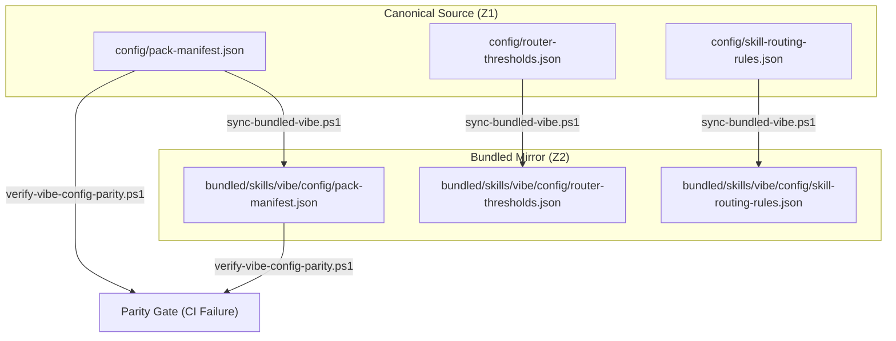
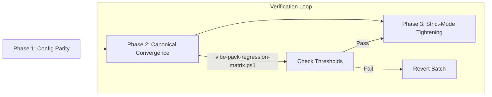

<!-- source: DeepWiki mcp.deepwiki.com · repo foryourhealth111-pixel/Vibe-Skills · page 4.4 Contribution Rules and Change Control · fetched 2026-10-26 -->

# Contribution Rules and Change Control

Relevant source files

The following files were used as context for generating this wiki page:

- [.internal/vibe-maintenance-checklist.md](.internal/vibe-maintenance-checklist.md)
- [LICENSE](LICENSE)
- [NOTICE](NOTICE)
- [THIRD_PARTY_LICENSES.md](THIRD_PARTY_LICENSES.md)
- [bundled/skills/vibe/docs/docs-information-architecture.md](bundled/skills/vibe/docs/docs-information-architecture.md)
- [bundled/skills/vibe/docs/releases/v2.3.31.md](bundled/skills/vibe/docs/releases/v2.3.31.md)
- [bundled/skills/vibe/references/fixtures/external-corpus/external-corpus-gate.md](bundled/skills/vibe/references/fixtures/external-corpus/external-corpus-gate.md)
- [bundled/skills/vibe/references/fixtures/external-corpus/vco-suggestions.md](bundled/skills/vibe/references/fixtures/external-corpus/vco-suggestions.md)
- [third_party/licenses/README.md](third_party/licenses/README.md)

The Vibe-Skills repository operates under a strict governance model designed to prevent "skill sleep," configuration drift, and unauthorized control plane modifications. This page outlines the contribution zones, change classifications, and the mandatory verification pipeline required for any modification to the canonical or bundled assets.

## 1. Contribution Zones and Guardrails

The repository is partitioned into four logical zones (Z0-Z3) that dictate the level of scrutiny and the specific PR templates required for changes. These zones align with the repository's "truth-first" design principle [1.1]().

| Zone | Name | Scope | Governance Level |
| :--- | :--- | :--- | :--- |
| **Z0** | **Frozen Control Plane** | `core/`, `scripts/common/`, `schemas/` | **Frozen**: Only emergency fixes or major version upgrades. Requires full architect review. |
| **Z1** | **Guarded Governance** | `config/`, `rules/`, `scripts/verify/` | **Guarded**: Changes to routing rules, thresholds, or verification gates. Requires regression matrix proof. |
| **Z2** | **Guarded Mirror** | `bundled/skills/vibe/` | **Guarded**: Must maintain 100% parity with canonical sources. Managed via `sync-bundled-vibe.ps1`. |
| **Z3** | **Preferred Contribution** | `bundled/skills/` (non-vibe), `docs/`, `tests/` | **Open**: New skills, documentation improvements, and additional test cases. |

### Data Flow for Zone Parity
The system enforces strict parity between the root configuration and the bundled vibe skill configuration [bundled/skills/vibe/docs/docs-information-architecture.md:52-57]().

**Sources:** [.internal/vibe-maintenance-checklist.md:64-69](), [bundled/skills/vibe/docs/docs-information-architecture.md:52-57]()

## 2. Change Classifications (A/B/C/D)

All contributions must be categorized into one of four classes, which determine the mandatory "Proof Run" requirements.

*   **Class A (Architectural):** Changes to the 6-stage state machine or `resolve-pack-route.ps1`. Requires full `vibe-routing-stability-gate.ps1 -Strict` [scripts/verify/vibe-routing-stability-gate.ps1]().
*   **Class B (Behavioral):** Updates to `skill-routing-rules.json` or keyword indices. Requires `vibe-pack-regression-matrix.ps1` [.internal/vibe-maintenance-checklist.md:42-43]().
*   **Class C (Content):** New skills or documentation. Requires `vibe-pack-routing-smoke.ps1` and frontmatter validation [.internal/vibe-maintenance-checklist.md:155]().
*   **Class D (Dependency/Maintenance):** License updates or third-party lockfile changes. Requires `vibe-openspec-governance-gate.ps1` [.internal/vibe-maintenance-checklist.md:44]().

**Sources:** [.internal/vibe-maintenance-checklist.md:37-55](), [.internal/vibe-maintenance-checklist.md:152-167]()

## 3. The Rules Directory (`rules/`)

The `rules/` directory contains the executable and declarative constraints for the ecosystem. These are enforced by both the LLM during runtime and the CI/CD pipeline during contribution.

### 3.1 Coding Style and Security
*   **Universalization-First:** Code in `core/` must be host-neutral and adhere to the `skill-contract.v1` schema [5.1]().
*   **Security Guardrails:** All skills must respect the `anti-proxy-goal-drift` protocols [2.3]().
*   **Third-Party Disclosure:** Any new dependency must be added to `config/upstream-lock.json` and disclosed in `THIRD_PARTY_LICENSES.md` if `disclosure_required: true` [THIRD_PARTY_LICENSES.md:9-13]().

### 3.2 Git Workflow and Hooks
*   **Commit Provenance:** Commits must maintain origin records for any vendored code [THIRD_PARTY_LICENSES.md:59-60]().
*   **Pre-Commit Gates:** Contributors are encouraged to run `vibe-routing-stability-gate.ps1` locally before pushing behavioral changes [.internal/vibe-maintenance-checklist.md:39-45]().

**Sources:** [THIRD_PARTY_LICENSES.md:9-20](), [THIRD_PARTY_LICENSES.md:59-60]()

## 4. Verification Requirements and Proof Runs

A "Proof Run" is a documented execution of the verification suite that must be attached to a PR.

### Mandatory Thresholds for Routing Changes
If a contribution affects the Canonical Router, it must not violate the following thresholds compared to the baseline [.internal/vibe-maintenance-checklist.md:107-113]():

| Metric | Threshold (Max Deviation) |
| :--- | :--- |
| `route_stability` | Drop $\le$ 0.02 |
| `misroute_rate` | Increase $\le$ 0.02 absolute |
| `fallback_rate` | Increase $\le$ 0.05 absolute |
| `confirm_required_rate` | Increase $\le$ 0.10 absolute |
| `deterministic_mismatch` | Must be 0 |

### Implementation Flow for Routing Hardening
The maintenance checklist defines a low-risk rollout sequence for hardening routing discipline [.internal/vibe-maintenance-checklist.md:56-120]().

**Sources:** [.internal/vibe-maintenance-checklist.md:56-120](), [.internal/vibe-maintenance-checklist.md:168-182]()

## 5. Escalation and Stop Conditions

Governance enforcement includes automated "Stop Conditions" that block the release cycle [bundled/skills/vibe/docs/releases/v2.3.31.md:8-11]().

1.  **Parity Mismatch:** Any difference between `config/` and `bundled/skills/vibe/config/` (after normalization) blocks the merge [.internal/vibe-maintenance-checklist.md:82-84]().
2.  **OpenSpec Violation:** If an OpenSpec advice layer fails to preserve the selected route (`preserve_routing_assignment=false`) when strict mode is active [.internal/vibe-maintenance-checklist.md:166]().
3.  **Undeclared Upstream:** Detection of third-party code without a corresponding entry in `config/upstream-lock.json` [bundled/skills/vibe/docs/releases/v2.3.31.md:10]().
4.  **Zombie Nodes:** Failure of the `node-zombie-gate.ps1` (detecting orphaned skill processes) [4.2]().

**Sources:** [.internal/vibe-maintenance-checklist.md:82-84](), [.internal/vibe-maintenance-checklist.md:161-167](), [bundled/skills/vibe/docs/releases/v2.3.31.md:8-11]()

---

