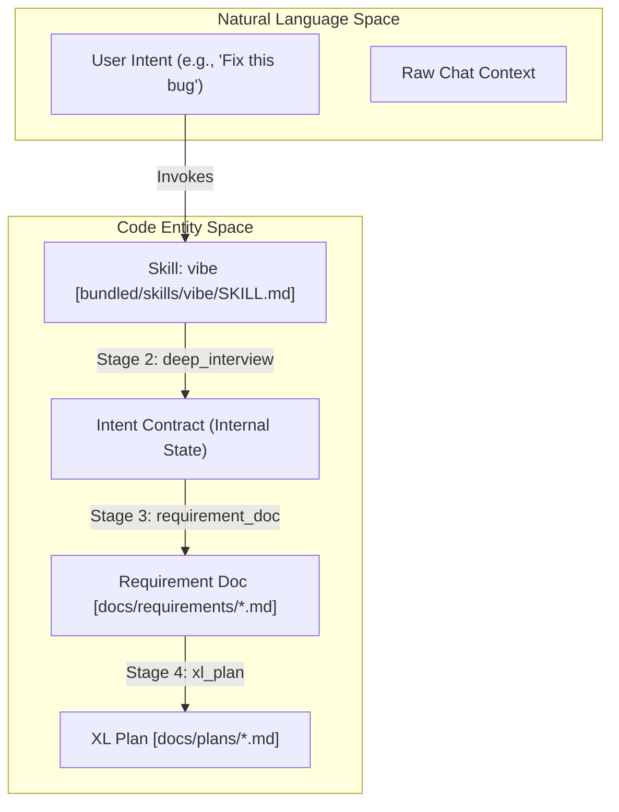
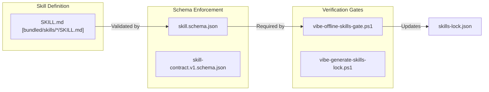

<!-- source: DeepWiki mcp.deepwiki.com · repo foryourhealth111-pixel/Vibe-Skills · page 5 Skill Contracts and Schemas · fetched 2026-10-26 -->

# Skill Contracts and Schemas

Relevant source files

The following files were used as context for generating this wiki page:

- [bundled/skills/report-generator/SKILL.md](bundled/skills/report-generator/SKILL.md)
- [bundled/skills/vibe/bundled/skills/vibe/SKILL.md](bundled/skills/vibe/bundled/skills/vibe/SKILL.md)
- [bundled/skills/vibe/bundled/skills/vibe/config/skills-lock.json](bundled/skills/vibe/bundled/skills/vibe/config/skills-lock.json)
- [bundled/skills/vibe/bundled/skills/vibe/scripts/verify/vibe-generate-skills-lock.ps1](bundled/skills/vibe/bundled/skills/vibe/scripts/verify/vibe-generate-skills-lock.ps1)
- [bundled/skills/vibe/bundled/skills/vibe/scripts/verify/vibe-offline-skills-gate.ps1](bundled/skills/vibe/bundled/skills/vibe/scripts/verify/vibe-offline-skills-gate.ps1)
- [bundled/skills/vibe/bundled/skills/vibe/scripts/verify/vibe-version-packaging-gate.ps1](bundled/skills/vibe/bundled/skills/vibe/scripts/verify/vibe-version-packaging-gate.ps1)
- [bundled/skills/vibe/config/skills-lock.json](bundled/skills/vibe/config/skills-lock.json)
- [bundled/skills/vibe/scripts/verify/vibe-generate-skills-lock.ps1](bundled/skills/vibe/scripts/verify/vibe-generate-skills-lock.ps1)
- [bundled/skills/vibe/scripts/verify/vibe-offline-skills-gate.ps1](bundled/skills/vibe/scripts/verify/vibe-offline-skills-gate.ps1)
- [bundled/skills/vibe/scripts/verify/vibe-version-packaging-gate.ps1](bundled/skills/vibe/scripts/verify/vibe-version-packaging-gate.ps1)
- [config/skills-lock.json](config/skills-lock.json)
- [scripts/verify/vibe-generate-skills-lock.ps1](scripts/verify/vibe-generate-skills-lock.ps1)
- [scripts/verify/vibe-offline-skills-gate.ps1](scripts/verify/vibe-offline-skills-gate.ps1)
- [scripts/verify/vibe-version-packaging-gate.ps1](scripts/verify/vibe-version-packaging-gate.ps1)

This section provides an overview of the Vibe Code Orchestrator (VCO) host-neutral skill contract system and the JSON schemas that enforce its structural integrity. The system is designed to ensure that skills remain portable across different AI host environments (e.g., Cursor, Windsurf, Claude Code) while maintaining a strict governance lifecycle.

## Overview of the Contract System

The skill contract system shifts the definition of an AI "skill" from a collection of host-specific prompts to a structured, versioned entity. At the heart of this system is the `core/` directory, which houses the foundational contracts that define how the orchestrator behaves regardless of the environment it is running in.

### From Natural Language to Code Entities

The following diagram illustrates how natural language intents provided by a user are transformed into governed code entities within the Vibe ecosystem.

**Intent-to-Entity Mapping**

Sources: [bundled/skills/vibe/bundled/skills/vibe/SKILL.md:46-53](), [bundled/skills/vibe/bundled/skills/vibe/SKILL.md:102-116]()

## Core Skill Contracts (core/)

The `core/` directory contains the first wave of host-neutral skill contracts. These contracts define the "rules of engagement" for complex tasks like Systematic Debugging or Subagent Driven Development. By centralizing these in `core/`, the system ensures that the logic for a "TDD Guide" remains consistent whether executed in a terminal-based agent or a GUI-based IDE.

Key features of the core contracts include:
*   **Universalization-First Extraction**: Principles that prevent host-specific "leaks" into the skill logic.
*   **Standardized Format**: Utilization of the `skill-contract.v1` JSON format for machine-readable definitions.

For details, see [Core Skill Contracts (core/)](#5.1).

Sources: [bundled/skills/vibe/bundled/skills/vibe/SKILL.md:8-10](), [bundled/skills/vibe/bundled/skills/vibe/SKILL.md:154-167]()

## JSON Schemas

The `schemas/` directory provides the structural guardrails for the entire repository. These schemas are used by verification gates to ensure that every skill added to the library follows the required frontmatter invariants and contract specifications.

### Schema Hierarchy and Verification

The system uses several specialized schemas to validate different aspects of the codebase:
*   `skill.schema.json`: Validates the `SKILL.md` frontmatter.
*   `skill-contract.v1.schema.json`: Enforces the structure of host-neutral contracts.
*   `host-capability.schema.json`: Defines what a specific host (e.g., Windsurf) is allowed to do.

**Verification Flow**

Sources: [bundled/skills/vibe/bundled/skills/vibe/scripts/verify/vibe-offline-skills-gate.ps1:130-144](), [scripts/verify/vibe-generate-skills-lock.ps1:132-139]()

### The Skills Lock Mechanism
The `skills-lock.json` file acts as a manifest of truth, recording hashes and metadata for all 340+ skills in the library. This prevents "skill sleep" and unauthorized modifications to the skill library.

| Key | Description |
| :--- | :--- |
| `skill_count` | Total number of registered skills (e.g., 340) |
| `dir_hash` | SHA256 hash of the skill directory contents |
| `skill_md_hash` | Hash of the `SKILL.md` file specifically |

For details, see [JSON Schemas](#5.2).

Sources: [config/skills-lock.json:1-14](), [scripts/verify/vibe-generate-skills-lock.ps1:112-129]()

---

