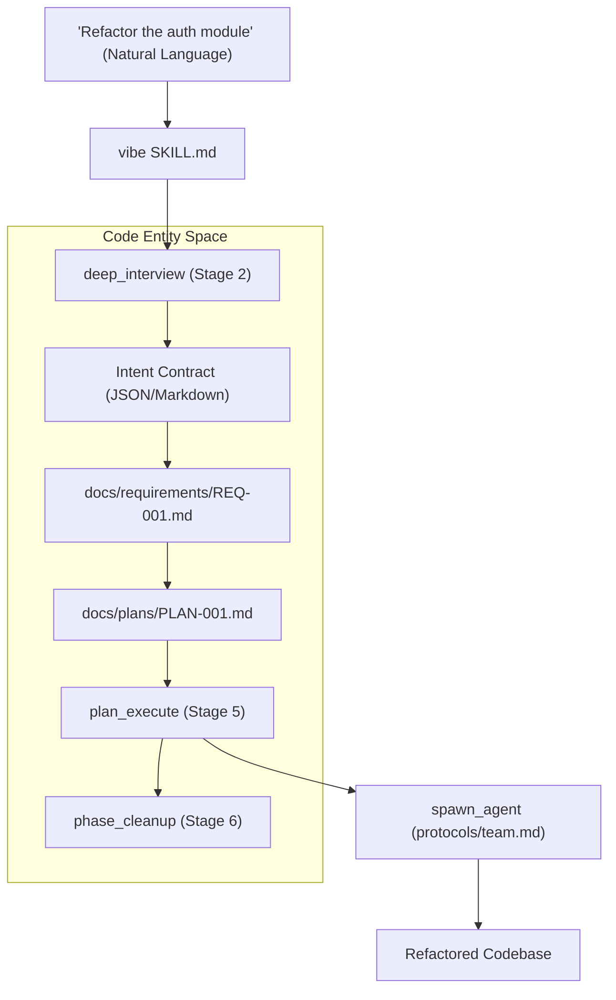
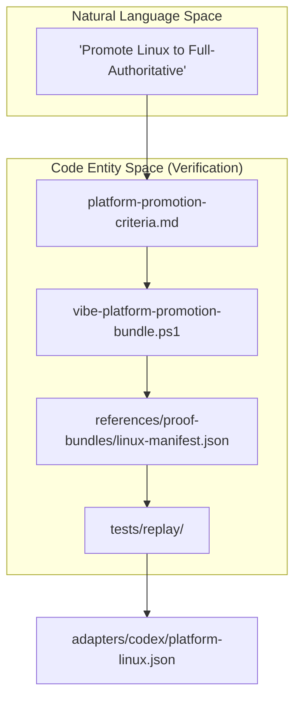

<!-- source: DeepWiki mcp.deepwiki.com · repo foryourhealth111-pixel/Vibe-Skills · page 5.1 Core Skill Contracts (core/) · fetched 2026-10-26 -->

# Core Skill Contracts (core/)

Relevant source files

The following files were used as context for generating this wiki page:

- [adapters/codex/platform-linux.json](adapters/codex/platform-linux.json)
- [bundled/skills/vibe/bundled/skills/vibe/SKILL.md](bundled/skills/vibe/bundled/skills/vibe/SKILL.md)
- [bundled/skills/vibe/bundled/skills/vibe/config/platform-support-policy.json](bundled/skills/vibe/bundled/skills/vibe/config/platform-support-policy.json)
- [bundled/skills/vibe/bundled/skills/vibe/docs/status/platform-promotion-baseline-2026-03-13.md](bundled/skills/vibe/bundled/skills/vibe/docs/status/platform-promotion-baseline-2026-03-13.md)
- [bundled/skills/vibe/bundled/skills/vibe/docs/universalization/linux-full-authoritative-contract.md](bundled/skills/vibe/bundled/skills/vibe/docs/universalization/linux-full-authoritative-contract.md)
- [bundled/skills/vibe/bundled/skills/vibe/docs/universalization/platform-install-matrix.md](bundled/skills/vibe/bundled/skills/vibe/docs/universalization/platform-install-matrix.md)
- [bundled/skills/vibe/bundled/skills/vibe/docs/universalization/platform-parity-contract.md](bundled/skills/vibe/bundled/skills/vibe/docs/universalization/platform-parity-contract.md)
- [bundled/skills/vibe/bundled/skills/vibe/docs/universalization/platform-promotion-criteria.md](bundled/skills/vibe/bundled/skills/vibe/docs/universalization/platform-promotion-criteria.md)
- [bundled/skills/vibe/bundled/skills/vibe/docs/universalization/platform-support-matrix.md](bundled/skills/vibe/bundled/skills/vibe/docs/universalization/platform-support-matrix.md)
- [docs/universalization/distribution-lanes.md](docs/universalization/distribution-lanes.md)
- [docs/universalization/install-matrix.md](docs/universalization/install-matrix.md)

The `core/` directory contains the first wave of host-neutral skill contracts. These contracts are designed to be "universalization-first," meaning they define the behavior, requirements, and state transitions of a skill in a way that is independent of any specific AI host (e.g., Codex, Claude Code, Windsurf) [docs/universalization/distribution-lanes.md:31-36]().

## Purpose and Scope

The primary goal of the `core/` contracts is to provide a "truth-first" definition of AI capabilities. Instead of skills being redefined for every new adapter, the `core/` directory acts as the canonical source for how a skill should behave across the entire Vibe-Skills ecosystem [docs/universalization/distribution-lanes.md:1-8]().

Key principles include:
*   **Host-Neutrality:** Contracts use a standardized JSON format (`skill-contract.v1`) that any compliant host adapter can consume [bundled/skills/vibe/bundled/skills/vibe/SKILL.md:8-10]().
*   **Extraction-First:** Skills are designed to be extracted from specific implementations into universal definitions [docs/universalization/distribution-lanes.md:8-14]().
*   **Governance-Enforced:** Every core skill must adhere to the 6-stage governed runtime machine if it involves complex execution [bundled/skills/vibe/bundled/skills/vibe/SKILL.md:44-57]().

---

## The Vibe Governed Runtime Contract

The `vibe` skill is the flagship contract within the core library. It defines the "Governed Runtime," a fixed state machine that ensures AI tasks are performed with high rigor, traceability, and mandatory verification [bundled/skills/vibe/bundled/skills/vibe/SKILL.md:1-4]().

### The 6-Stage State Machine
Any task invoked via the `vibe` contract must progress through these mandatory stages:

| Stage | Name | Responsibility |
| :--- | :--- | :--- |
| 1 | `skeleton_check` | Validates repo shape, active branches, and prerequisites [bundled/skills/vibe/bundled/skills/vibe/SKILL.md:98-101](). |
| 2 | `deep_interview` | Produces a structured intent contract (goals, constraints, non-goals) [bundled/skills/vibe/bundled/skills/vibe/SKILL.md:102-113](). |
| 3 | `requirement_doc` | Freezes a single requirement document under `docs/requirements/` [bundled/skills/vibe/bundled/skills/vibe/SKILL.md:117-122](). |
| 4 | `xl_plan` | Generates a multi-step execution plan under `docs/plans/` [bundled/skills/vibe/bundled/skills/vibe/SKILL.md:123-135](). |
| 5 | `plan_execute` | Executes the plan using the appropriate internal grade (M, L, or XL) [bundled/skills/vibe/bundled/skills/vibe/SKILL.md:136-142](). |
| 6 | `phase_cleanup` | Removes temporary artifacts and emits a cleanup receipt [bundled/skills/vibe/bundled/skills/vibe/SKILL.md:143-153](). |

### Logic Flow: Natural Language to Governed Execution
The following diagram illustrates how a user's natural language intent is transformed into a governed code execution via the `vibe` contract entities.

**Vibe Intent Transformation**

Sources: [bundled/skills/vibe/bundled/skills/vibe/SKILL.md:102-153](), [bundled/skills/vibe/bundled/skills/vibe/SKILL.md:187-196]()

---

## Universalization and Distribution Lanes

The `core/` directory is part of the `core` distribution lane. This lane represents the highest level of abstraction, containing only contracts and schemas without host-specific implementation details [docs/universalization/distribution-lanes.md:28-36]().

### Distribution Truth Matrix
The relationship between core contracts and host-specific platforms is governed by a strict truth contract to prevent "overclaiming" capability [docs/universalization/distribution-lanes.md:10-14]().

| Lane | Meaning | Claim Level |
| :--- | :--- | :--- |
| `core` | Universal contracts and schemas | Contract-only [docs/universalization/distribution-lanes.md:31]() |
| `official-runtime` | Tier-1 reference implementation (Windows/PS) | Full-authoritative [docs/universalization/distribution-lanes.md:30]() |
| `host-codex` | Strongest host adapter | Supported-with-constraints [docs/universalization/distribution-lanes.md:32]() |
| `generic` | Neutral contract consumer | Advisory-only [docs/universalization/distribution-lanes.md:36]() |

### Platform Support and Promotion
Core contracts are platform-agnostic, but their verification depends on the platform. A "Full-Authoritative" claim requires synchronized evidence across contracts, replays, and fresh-machine runs [bundled/skills/vibe/bundled/skills/vibe/docs/universalization/platform-promotion-criteria.md:15-20]().

**Platform Promotion Workflow**

Sources: [bundled/skills/vibe/bundled/skills/vibe/docs/universalization/platform-promotion-criteria.md:21-61](), [adapters/codex/platform-linux.json:21-26](), [bundled/skills/vibe/bundled/skills/vibe/docs/status/platform-promotion-baseline-2026-03-13.md:25-31]()

---

## Implementation Details: Internal Execution Grades

While the user only interacts with the `vibe` entry point, the core contract internally selects an "Execution Grade" based on task complexity [bundled/skills/vibe/bundled/skills/vibe/SKILL.md:22-26]().

*   **M (Single-Agent):** Tightly scoped work, narrow execution [bundled/skills/vibe/bundled/skills/vibe/SKILL.md:77]().
*   **L (Staged):** Requires design → plan → approval → subagent execution → two-stage review [bundled/skills/vibe/bundled/skills/vibe/SKILL.md:78-93]().
*   **XL (Multi-Agent):** Parallelizable work using the `team.md` protocol (`spawn_agent`, `send_input`, `wait`, `close_agent`) [bundled/skills/vibe/bundled/skills/vibe/SKILL.md:79-94]().

### Protocol Mapping
Core contracts reference specific protocol files to define behavior in different phases:
*   `protocols/runtime.md`: Ownership of stages [bundled/skills/vibe/bundled/skills/vibe/SKILL.md:190]().
*   `protocols/think.md`: Planning and research [bundled/skills/vibe/bundled/skills/vibe/SKILL.md:191]().
*   `protocols/do.md`: Coding and verification [bundled/skills/vibe/bundled/skills/vibe/SKILL.md:192]().
*   `protocols/team.md`: Multi-agent coordination [bundled/skills/vibe/bundled/skills/vibe/SKILL.md:194]().

Sources: [bundled/skills/vibe/bundled/skills/vibe/SKILL.md:73-96](), [bundled/skills/vibe/bundled/skills/vibe/SKILL.md:186-196]()

---

