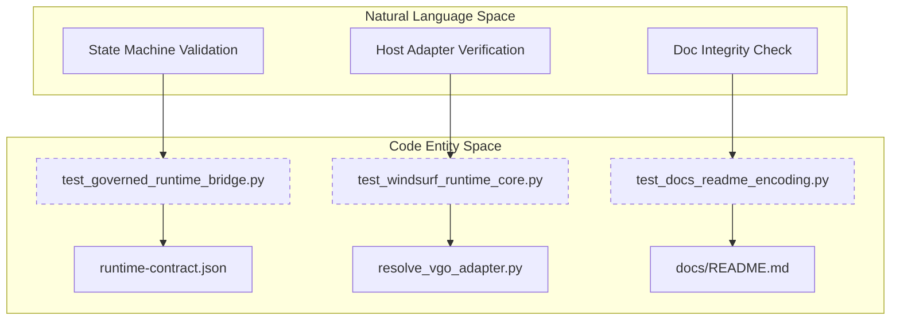
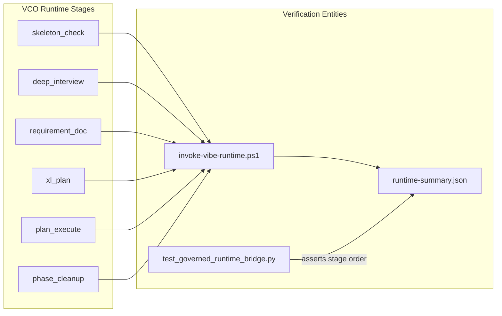

<!-- source: DeepWiki mcp.deepwiki.com · repo foryourhealth111-pixel/Vibe-Skills · page 6 Testing Infrastructure · fetched 2026-10-26 -->

# Testing Infrastructure

Relevant source files

The following files were used as context for generating this wiki page:

- [bundled/skills/vibe/bundled/skills/vibe/scripts/runtime/invoke-vibe-runtime.ps1](bundled/skills/vibe/bundled/skills/vibe/scripts/runtime/invoke-vibe-runtime.ps1)
- [bundled/skills/vibe/docs/README.md](bundled/skills/vibe/docs/README.md)
- [bundled/skills/vibe/scripts/runtime/invoke-vibe-runtime.ps1](bundled/skills/vibe/scripts/runtime/invoke-vibe-runtime.ps1)
- [docs/README.md](docs/README.md)
- [scripts/runtime/invoke-vibe-runtime.ps1](scripts/runtime/invoke-vibe-runtime.ps1)
- [tests/runtime_neutral/test_docs_readme_encoding.py](tests/runtime_neutral/test_docs_readme_encoding.py)
- [tests/runtime_neutral/test_governed_runtime_bridge.py](tests/runtime_neutral/test_governed_runtime_bridge.py)
- [tests/runtime_neutral/test_windsurf_runtime_core.py](tests/runtime_neutral/test_windsurf_runtime_core.py)

The Vibe-Skills repository utilizes a multi-layered testing infrastructure designed to ensure the stability of the **Vibe Core Orchestrator (VCO)** across different host environments and operating systems. The suite ranges from low-level Python unit tests for core logic to complex PowerShell-driven replay simulations that validate the 6-stage governed runtime.

### Test Suite Architecture

The testing infrastructure is split into two primary domains: `tests/runtime_neutral/` for cross-platform logic validation and `tests/replay/` for execution-path verification.

#### Runtime-Neutral Tests
The `tests/runtime_neutral/` directory contains Python-based tests that validate the core configuration and logic without requiring a specific AI host. Key validations include:
*   **Governed Runtime Bridge**: Ensures the `runtime-contract.json` correctly defines the 6-stage state machine (`skeleton_check` through `phase_cleanup`) [tests/runtime_neutral/test_governed_runtime_bridge.py:14-21]().
*   **Adapter Registry**: Verifies that host adapters (e.g., Windsurf) are correctly resolved and their installation modes (like `runtime-core`) are respected [tests/runtime_neutral/test_windsurf_runtime_core.py:16-37]().
*   **Documentation Integrity**: Validates that critical files like `docs/README.md` maintain correct encoding and content for both human and machine readability [tests/runtime_neutral/test_docs_readme_encoding.py:11-31]().

For details, see [Runtime-Neutral Tests](#6.1).

#### Replay and Retro Tests
The `tests/replay/` suite focuses on high-fidelity simulations of agent behavior. It uses fixtures to mock host responses and validates the output against expected "gold" standards.
*   **Sub-suites**: Includes `degrade` (failure mode handling), `install` (setup verification), and `route` (Canonical Router logic).
*   **Retro Outputs**: Execution artifacts are stored in `outputs/retro/`, where Context Evidence Reports (CER) are generated to compare current runs against baselines, highlighting deltas in safety gates or smoke tests.

For details, see [Replay Tests and Retro Outputs](#6.2).

### CI/CD Integration

The testing infrastructure is orchestrated via GitHub Actions in `.github/workflows/vco-gates.yml`. Because much of the VCO runtime relies on PowerShell (`.ps1`) for host-native integration, the CI environment utilizes `windows-latest` runners to ensure full compatibility with the governed runtime scripts.

For details, see [CI/CD Pipeline](#6.3).

### Testing Space Mapping

The following diagrams illustrate the relationship between high-level testing concepts and the specific code entities that implement them.

#### Logic to Entity Mapping
This diagram bridges the gap between natural language test requirements and the Python/PowerShell entities responsible for verification.

**Sources:** [tests/runtime_neutral/test_governed_runtime_bridge.py:82-123](), [tests/runtime_neutral/test_windsurf_runtime_core.py:16-37](), [tests/runtime_neutral/test_docs_readme_encoding.py:11-31]()

#### Runtime Execution Verification
This diagram maps the 6-stage governed runtime process to the testing infrastructure that validates its closure.

**Sources:** [scripts/runtime/invoke-vibe-runtime.ps1:72-78](), [tests/runtime_neutral/test_governed_runtime_bridge.py:124-170](), [bundled/skills/vibe/scripts/runtime/invoke-vibe-runtime.ps1:120-127]()

### Summary Table: Test Categories

| Category | Location | Primary Language | Purpose |
| :--- | :--- | :--- | :--- |
| **Runtime Neutral** | `tests/runtime_neutral/` | Python | Logic, config, and adapter validation. |
| **Replay Suite** | `tests/replay/` | PowerShell / Fixtures | End-to-end execution simulation. |
| **Verification Gates**| `scripts/verify/` | PowerShell | CI-enforced safety and parity checks. |
| **Retro Comparison**| `outputs/retro/` | JSON / Markdown | Regression analysis and CER generation. |

**Sources:** [docs/README.md:51-53](), [tests/runtime_neutral/test_governed_runtime_bridge.py:83-104](), [scripts/runtime/invoke-vibe-runtime.ps1:144-145]()

---

