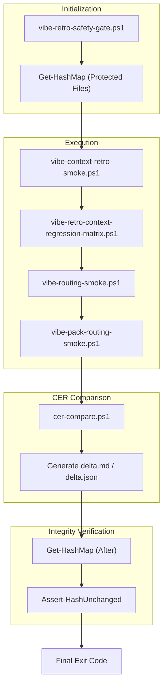
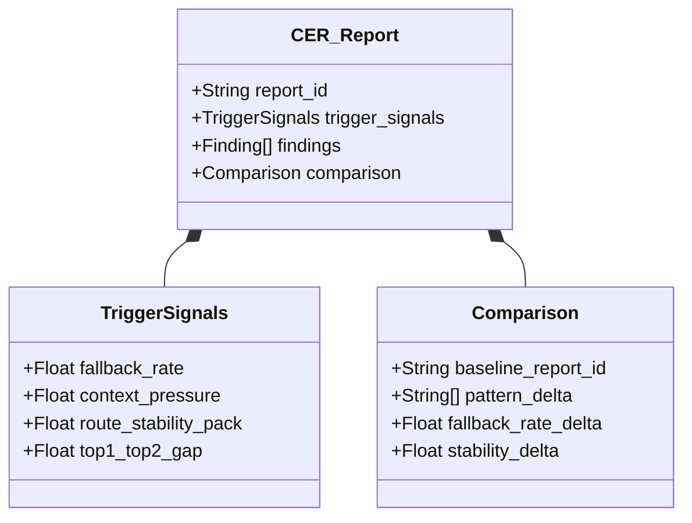

<!-- source: DeepWiki mcp.deepwiki.com · repo foryourhealth111-pixel/Vibe-Skills · page 6.2 Replay Tests and Retro Outputs · fetched 2026-10-26 -->

# Replay Tests and Retro Outputs

Relevant source files

The following files were used as context for generating this wiki page:

- [bundled/skills/vibe/bundled/skills/vibe/references/proof-bundles/linux-full-authoritative-candidate/manifest.json](bundled/skills/vibe/bundled/skills/vibe/references/proof-bundles/linux-full-authoritative-candidate/manifest.json)
- [bundled/skills/vibe/references/proof-bundles/linux-full-authoritative-candidate/manifest.json](bundled/skills/vibe/references/proof-bundles/linux-full-authoritative-candidate/manifest.json)
- [bundled/skills/vibe/templates/cer-report.json.template](bundled/skills/vibe/templates/cer-report.json.template)
- [bundled/skills/vibe/templates/cer-report.md.template](bundled/skills/vibe/templates/cer-report.md.template)
- [bundled/skills/vibe/templates/cer-report.schema.json](bundled/skills/vibe/templates/cer-report.schema.json)
- [outputs/retro/compare/safety-gate/baseline-cer.json](outputs/retro/compare/safety-gate/baseline-cer.json)
- [outputs/retro/compare/safety-gate/current-cer.json](outputs/retro/compare/safety-gate/current-cer.json)
- [outputs/retro/compare/safety-gate/delta.json](outputs/retro/compare/safety-gate/delta.json)
- [outputs/retro/compare/safety-gate/delta.md](outputs/retro/compare/safety-gate/delta.md)
- [outputs/retro/compare/smoke-temp/baseline-smoke.json](outputs/retro/compare/smoke-temp/baseline-smoke.json)
- [outputs/retro/compare/smoke-temp/current-smoke.json](outputs/retro/compare/smoke-temp/current-smoke.json)
- [outputs/retro/compare/smoke-temp/delta-smoke.json](outputs/retro/compare/smoke-temp/delta-smoke.json)
- [outputs/retro/compare/smoke-temp/delta-smoke.md](outputs/retro/compare/smoke-temp/delta-smoke.md)
- [references/proof-bundles/linux-full-authoritative-candidate/manifest.json](references/proof-bundles/linux-full-authoritative-candidate/manifest.json)
- [scripts/verify/vibe-retro-safety-gate.ps1](scripts/verify/vibe-retro-safety-gate.ps1)
- [templates/cer-report.json.template](templates/cer-report.json.template)
- [templates/cer-report.md.template](templates/cer-report.md.template)
- [templates/cer-report.schema.json](templates/cer-report.schema.json)

The VibeSkills testing infrastructure extends beyond unit and integration tests into **Replay Tests** and **Retro Outputs**. These systems are designed to validate the stability of the Canonical Router and the Governed Runtime by replaying historical context, comparing current performance against established baselines, and generating **Context Evidence Reports (CER)** to identify regressions in routing logic or context handling.

## 1. Replay Test Infrastructure

The `tests/replay/` directory contains sub-suites that validate the system's behavior against fixed historical data (fixtures) and platform-specific constraints. This ensures that changes to the router or skill manifests do not degrade existing capabilities.

### Directory Structure and Sub-Suites

| Sub-Suite | Purpose | Key Artifacts |
|:---|:---|:---|
| `fixtures/` | Static JSON data representing known-good states for routing and capabilities. | `host-capability-matrix.json` [references/proof-bundles/linux-full-authoritative-candidate/manifest.json:74-74]() |
| `degrade/` | Validates M/L/XL fallback chains when tools or context are constrained. | — |
| `install/` | Replays installation sequences to ensure idempotent behavior. | — |
| `platform/` | Validates platform-specific logic (e.g., Linux pwsh vs. Windows). | — |
| `route/` | Replays intent strings to verify consistent skill/pack selection. | — |

### Platform Promotion and Proof Bundles
Replay tests are critical for **Platform Promotion**. For example, promoting Linux to "full-authoritative" status requires a frozen proof bundle that includes replay sync against the `host-capability-matrix.json` fixture [references/proof-bundles/linux-full-authoritative-candidate/manifest.json:73-76]().

## 2. Retro Outputs and CER System

The `outputs/retro/` directory serves as the landing zone for comparison artifacts generated during verification gates. The primary artifact is the **Context Evidence Report (CER)**, which provides a structured delta between a baseline run and the current execution.

### The CER Data Flow
The system compares two states: **Baseline** (known good) and **Current** (test run).

#### CER Logical Mapping
| System Concept | Code Entity / File |
|:---|:---|
| **Baseline Report** | `baseline-cer.json` [outputs/retro/compare/safety-gate/baseline-cer.json:1-14]() |
| **Current Report** | `current-cer.json` [outputs/retro/compare/safety-gate/current-cer.json:1-29]() |
| **Comparison Logic** | `cer-compare.ps1` [scripts/verify/vibe-retro-safety-gate.ps1:134-149]() |
| **JSON Delta** | `delta.json` [outputs/retro/compare/safety-gate/delta.json:1-31]() |
| **Markdown Report** | `delta.md` [outputs/retro/compare/safety-gate/delta.md:1-28]() |

### CER Metrics and Trigger Signals
The CER tracks specific "trigger signals" that indicate the health of the routing and context management systems [outputs/retro/compare/smoke-temp/current-smoke.json:3-9]():

*   **`fallback_rate`**: Frequency of the router falling back to legacy or broader skill packs.
*   **`context_pressure`**: A measure of how close the current session is to token limits.
*   **`route_stability`**: Consistency of pack and skill selection across multiple identical prompts.
*   **`top1_top2_gap`**: The scoring margin between the primary and secondary route candidates (higher is better for separability).

**Sources:** [outputs/retro/compare/smoke-temp/current-smoke.json:1-26](), [outputs/retro/compare/safety-gate/delta.json:1-31](), [scripts/verify/vibe-retro-safety-gate.ps1:95-132]()

## 3. Retro Safety Gate

The `vibe-retro-safety-gate.ps1` script orchestrates the execution of multiple smoke tests and performs the final CER comparison. It also enforces a **file integrity check** to ensure that "protected files" (configs, protocols, skills) are not inadvertently modified during the test run.

### Execution Workflow: `vibe-retro-safety-gate.ps1`

Title: Retro Safety Gate Sequence

### Protected File Integrity
The safety gate tracks the SHA256 hashes of critical files before and after the test suite runs to prevent side-effect mutations:
*   `SKILL.md` [scripts/verify/vibe-retro-safety-gate.ps1:78-78]()
*   All `.json` files in `config/` [scripts/verify/vibe-retro-safety-gate.ps1:79-79]()
*   All `.md` files in `protocols/` and `references/` [scripts/verify/vibe-retro-safety-gate.ps1:80-81]()

**Sources:** [scripts/verify/vibe-retro-safety-gate.ps1:40-64](), [scripts/verify/vibe-retro-safety-gate.ps1:83-155]()

## 4. CER Template System

The CER system uses a templating mechanism to ensure consistency across different report types (Smoke, Safety, Regression).

### Template Artifacts
*   **JSON Templates**: `cer-report.json.template` defines the structure for machine-readable data.
*   **Markdown Templates**: `cer-report.md.template` defines the human-readable summary, including interpretation guides for deltas (e.g., "Negative fallback_rate delta is better") [outputs/retro/compare/smoke-temp/delta-smoke.md:23-27]().
*   **Schema**: `cer-report.schema.json` enforces the presence of `trigger_signals`, `findings`, and `comparison` blocks.

### Pattern Findings
Reports include a `findings` array that identifies specific failure or success patterns, such as `CF-2` or `CF-3` [outputs/retro/compare/smoke-temp/current-smoke.json:10-14](). The `pattern_delta` then tracks which patterns were added or removed between runs [outputs/retro/compare/smoke-temp/delta-smoke.json:6-10]().

Title: CER Entity Relationship

**Sources:** [outputs/retro/compare/smoke-temp/current-smoke.json:1-26](), [outputs/retro/compare/smoke-temp/delta-smoke.md:1-28](), [templates/cer-report.schema.json]()

---

