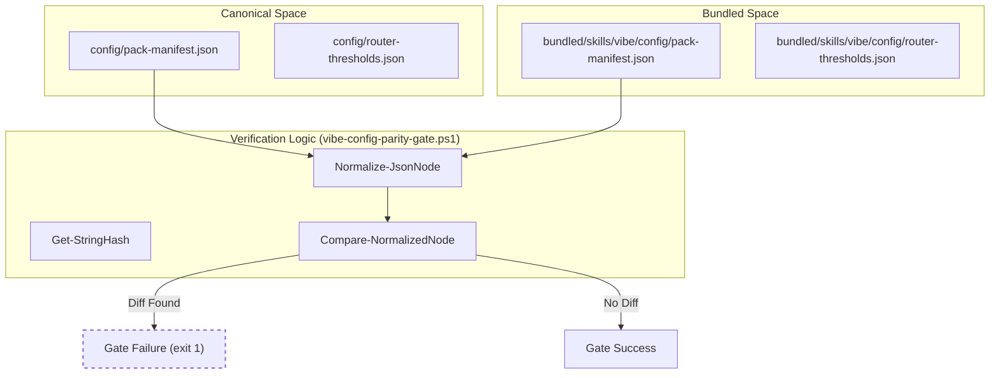
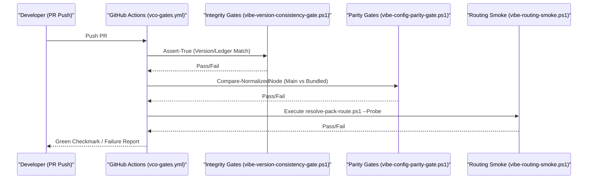

<!-- source: DeepWiki mcp.deepwiki.com · repo foryourhealth111-pixel/Vibe-Skills · page 6.3 CI/CD Pipeline · fetched 2026-10-26 -->

# CI/CD Pipeline

Relevant source files

The following files were used as context for generating this wiki page:

- [bundled/skills/report-generator/SKILL.md](bundled/skills/report-generator/SKILL.md)
- [bundled/skills/vibe/bundled/skills/vibe/config/skills-lock.json](bundled/skills/vibe/bundled/skills/vibe/config/skills-lock.json)
- [bundled/skills/vibe/bundled/skills/vibe/scripts/verify/vibe-generate-skills-lock.ps1](bundled/skills/vibe/bundled/skills/vibe/scripts/verify/vibe-generate-skills-lock.ps1)
- [bundled/skills/vibe/bundled/skills/vibe/scripts/verify/vibe-offline-skills-gate.ps1](bundled/skills/vibe/bundled/skills/vibe/scripts/verify/vibe-offline-skills-gate.ps1)
- [bundled/skills/vibe/bundled/skills/vibe/scripts/verify/vibe-version-packaging-gate.ps1](bundled/skills/vibe/bundled/skills/vibe/scripts/verify/vibe-version-packaging-gate.ps1)
- [bundled/skills/vibe/config/skills-lock.json](bundled/skills/vibe/config/skills-lock.json)
- [bundled/skills/vibe/references/index.md](bundled/skills/vibe/references/index.md)
- [bundled/skills/vibe/scripts/verify/vibe-generate-skills-lock.ps1](bundled/skills/vibe/scripts/verify/vibe-generate-skills-lock.ps1)
- [bundled/skills/vibe/scripts/verify/vibe-offline-skills-gate.ps1](bundled/skills/vibe/scripts/verify/vibe-offline-skills-gate.ps1)
- [bundled/skills/vibe/scripts/verify/vibe-version-consistency-gate.ps1](bundled/skills/vibe/scripts/verify/vibe-version-consistency-gate.ps1)
- [bundled/skills/vibe/scripts/verify/vibe-version-packaging-gate.ps1](bundled/skills/vibe/scripts/verify/vibe-version-packaging-gate.ps1)
- [config/skills-lock.json](config/skills-lock.json)
- [references/index.md](references/index.md)
- [scripts/router/resolve-pack-route.ps1](scripts/router/resolve-pack-route.ps1)
- [scripts/verify/README.md](scripts/verify/README.md)
- [scripts/verify/vibe-config-parity-gate.ps1](scripts/verify/vibe-config-parity-gate.ps1)
- [scripts/verify/vibe-generate-skills-lock.ps1](scripts/verify/vibe-generate-skills-lock.ps1)
- [scripts/verify/vibe-offline-skills-gate.ps1](scripts/verify/vibe-offline-skills-gate.ps1)
- [scripts/verify/vibe-version-consistency-gate.ps1](scripts/verify/vibe-version-consistency-gate.ps1)
- [scripts/verify/vibe-version-packaging-gate.ps1](scripts/verify/vibe-version-packaging-gate.ps1)

The VibeSkills CI/CD pipeline, defined in `.github/workflows/vco-gates.yml`, enforces the "Truth-First" design principle by running a suite of verification gates on every Pull Request and push to the `main` branch. These gates ensure that the canonical repository, bundled distributions, and runtime configurations remain synchronized and free of regression.

### Pipeline Requirements and Environment

The pipeline is optimized for the PowerShell-centric nature of the VCO (Vibe Core Orchestrator) and requires a Windows environment to ensure full compatibility with the orchestration scripts.

*   **Runner Requirement**: `windows-latest`. This is mandatory as the majority of verification gates and the router itself are implemented in PowerShell (`pwsh`) [scripts/router/resolve-pack-route.ps1:1-15]().
*   **Execution Context**: The pipeline validates the relationship between the **Canonical Root** (the source of truth), the **Bundled Distribution** (`bundled/skills/vibe`), and the **Nested Bundled** mirrors [scripts/verify/vibe-config-parity-gate.ps1:177-183]().

### Gate Execution Order

Verification follows a "Cleanup-First" canonical run order. This ensures that basic integrity is checked before expensive or complex routing logic is validated.

1.  **Runtime Integrity / Packaging**: Validates versioning, frontmatter, and configuration parity [scripts/verify/README.md:60-60]().
2.  **Cleanliness and Mirror Hygiene**: Checks for repository noise, artifact leakage, and synchronization between mirrors [scripts/verify/README.md:61-61]().
3.  **Routing Smoke and Stability**: Executes task-based routing probes to ensure the `resolve-pack-route.ps1` logic remains deterministic [scripts/verify/README.md:63-63]().

#### Natural Language to Code Entity: Gate Families
The following diagram maps high-level verification goals to the specific PowerShell entities executed within the CI environment.

| Goal | Code Entity (Script) | Purpose |
| :--- | :--- | :--- |
| **Config Parity** | `vibe-config-parity-gate.ps1` | Compares JSON structures between main and bundled folders [scripts/verify/vibe-config-parity-gate.ps1:184-195](). |
| **Version Sync** | `vibe-version-consistency-gate.ps1` | Matches `version-governance.json` against changelogs and ledgers [scripts/verify/vibe-version-consistency-gate.ps1:36-41](). |
| **Offline Safety** | `vibe-offline-skills-gate.ps1` | Ensures all required skills are physically present and match hashes in `skills-lock.json` [scripts/verify/vibe-offline-skills-gate.ps1:126-144](). |
| **Cleanliness** | `vibe-repo-cleanliness-gate.ps1` | Blocks PRs containing temporary runtime artifacts or un-governed files [scripts/verify/README.md:95-95](). |

Sources: [scripts/verify/README.md:28-34](), [scripts/verify/README.md:58-69](), [scripts/verify/vibe-config-parity-gate.ps1:177-195](), [scripts/verify/vibe-version-consistency-gate.ps1:36-41]()

### Data Flow: Configuration Verification

The `vibe-config-parity-gate.ps1` is a critical component of the CI pipeline. It performs a deep, structural comparison of configuration files to prevent drift between the development environment and the shipped bundles.

**Configuration Verification Logic**

Sources: [scripts/verify/vibe-config-parity-gate.ps1:24-56](), [scripts/verify/vibe-config-parity-gate.ps1:85-150](), [scripts/verify/vibe-config-parity-gate.ps1:184-195]()

### Version and Ledger Integrity

The `vibe-version-consistency-gate.ps1` ensures that every release is documented across four distinct surfaces. If any of these surfaces do not match the `version-governance.json` file, the CI build fails.

*   **Version Markers**: Checks `maintenance_files` (e.g., `README.md`) for correct version and update date strings [scripts/verify/vibe-version-consistency-gate.ps1:56-78]().
*   **Changelog**: Validates that the `changelog.md` contains a header corresponding to the current version [scripts/verify/vibe-version-consistency-gate.ps1:80-89]().
*   **Release Ledger**: Confirms the last entry in `release-ledger.jsonl` matches the current metadata [scripts/verify/vibe-version-consistency-gate.ps1:96-121]().

Sources: [scripts/verify/vibe-version-consistency-gate.ps1:36-54](), [scripts/verify/vibe-version-consistency-gate.ps1:123-134]()

### Interpreting Gate Failures

Gate failures in the CI pipeline provide specific error codes and artifacts to aid remediation:

| Failure Mode | Script Responsible | Interpretation / Fix |
| :--- | :--- | :--- |
| **Hash Mismatch** | `vibe-offline-skills-gate.ps1` | A skill's content changed without updating `skills-lock.json`. Run `vibe-generate-skills-lock.ps1` [scripts/verify/vibe-offline-skills-gate.ps1:221-238](). |
| **Parity Failure** | `vibe-config-parity-gate.ps1` | Configs in `config/` and `bundled/skills/vibe/config/` have diverged. Sync them via `phase-end-cleanup.ps1` [scripts/verify/vibe-config-parity-gate.ps1:108-118](). |
| **Zombie Process** | `vibe-node-zombie-gate.ps1` | A previous test run left orphaned Node.js processes. This indicates a failure in the VCO process lifecycle management [scripts/verify/README.md:69-69](). |
| **BOM/Frontmatter**| `vibe-bom-frontmatter-gate.ps1` | Files are missing mandatory metadata headers or have incorrect UTF-8 BOM encoding [scripts/verify/README.md:60-60](). |

### Verification Flow Diagram
The following diagram illustrates the transition from the "Natural Language Space" (Developer Intent) to the "Code Entity Space" (Automated Gates) during a PR lifecycle.

Sources: [scripts/verify/vibe-version-consistency-gate.ps1:7-20](), [scripts/verify/vibe-config-parity-gate.ps1:85-150](), [scripts/router/resolve-pack-route.ps1:1-15](), [scripts/verify/README.md:28-34]()

---

