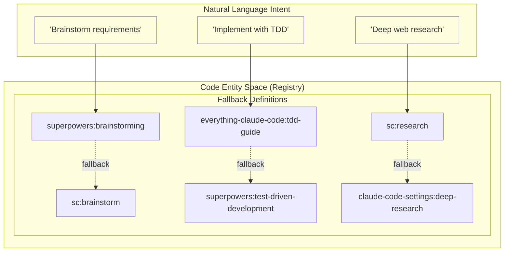
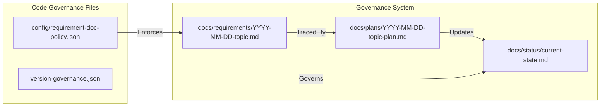

<!-- source: DeepWiki mcp.deepwiki.com · repo foryourhealth111-pixel/Vibe-Skills · page 7 Reference Materials · fetched 2026-10-26 -->

# Reference Materials

Relevant source files

The following files were used as context for generating this wiki page:

- [bundled/skills/vibe/references/fallback-chains.md](bundled/skills/vibe/references/fallback-chains.md)
- [bundled/skills/vibe/references/tool-registry.md](bundled/skills/vibe/references/tool-registry.md)
- [config/plugins-manifest.codex.json](config/plugins-manifest.codex.json)
- [config/upstream-lock.json](config/upstream-lock.json)
- [docs/brand/github-branding-copy.md](docs/brand/github-branding-copy.md)
- [docs/plans/2026-03-20-readme-en-detail-and-github-branding-copy-plan.md](docs/plans/2026-03-20-readme-en-detail-and-github-branding-copy-plan.md)
- [docs/plans/README.md](docs/plans/README.md)
- [docs/requirements/2026-03-20-readme-en-detail-and-github-branding-copy.md](docs/requirements/2026-03-20-readme-en-detail-and-github-branding-copy.md)
- [docs/requirements/README.md](docs/requirements/README.md)
- [references/fallback-chains.md](references/fallback-chains.md)
- [references/tool-registry.md](references/tool-registry.md)

This page provides a high-level overview of the Vibe-Skills reference architecture, including the tool registry, fallback mechanisms, and the rigorous governance system that manages requirements and execution plans. These materials serve as the "truth source" for the orchestrator's capabilities and the project's evolution.

## Tool Registry and Fallback Chains

The Vibe Core Orchestrator (VCO) maintains a centralized registry of 21 integrated tools, categorized by type (Plugin, MCP Server, Native Runtime, etc.) and verification status [references/tool-registry.md:7-29](). This registry defines the API surface and state locations for every capability available to the agentic workflows.

To ensure system resilience, VCO implements multi-level **Fallback Chains**. If a primary tool fails due to an MCP connection error, timeout, or missing plugin, the system automatically degrades to a secondary tool or direct LLM reasoning [references/fallback-chains.md:107-118]().

| Task Grade | Primary Path | Fallback Path |
| :--- | :--- | :--- |
| **M/L Grade** | 2-Level (Primary -> Fallback) | Direct Reasoning [references/fallback-chains.md:8-8]() |
| **XL Grade** | 3-Level (Native Team -> Degraded XL -> Sequential L) | Direct Reasoning [references/fallback-chains.md:9-9]() |

For details, see [Tool Registry and Fallback Chains](#7.1).

### System Tool Mapping (Natural Language to Code)

The following diagram maps high-level functional requirements to the specific code entities and plugins defined in the registry.

**Diagram: Functional Mapping to Code Entities**

Sources: [references/tool-registry.md:42-56](), [references/fallback-chains.md:20-54]()

---

## Plans, Requirements, and Change History

Vibe-Skills operates under a "Governed Runtime" model where every execution must be traceable. This is managed through two primary directories:

1.  **docs/requirements/**: Stores frozen requirement documents for every governed `vibe` run. Execution plans must trace back to these documents rather than raw chat history [docs/requirements/README.md:1-10]().
2.  **docs/plans/**: Contains dated execution plans, staged programs, and triage notes [docs/plans/README.md:5-13]().

The relationship between these entities is strictly hierarchical: **Requirement -> Plan -> Execution**.

For details, see [Plans, Requirements, and Change History](#7.2).

### Governance Traceability

**Diagram: Requirement-to-Plan Traceability**

Sources: [docs/requirements/README.md:12-18](), [docs/plans/README.md:15-21]()

---

## Proof Bundles and Platform Promotion

The project utilizes **Proof Bundles** to maintain cross-platform parity and ensure "no-regression" during migrations (e.g., from Windows-centric PowerShell to Linux-neutral environments) [docs/plans/README.md:45-49]().

*   **Proof Bundles**: Authoritative evidence of runtime behavior, including `linux-full-authoritative-candidate` and `official-runtime-baseline` [docs/plans/README.md:42-46]().
*   **Platform Promotion**: A structured process where a platform (like Linux) is promoted to "authoritative" status only after meeting strict evidence criteria [docs/plans/README.md:47-47]().

For details, see [Proof Bundles and Platform Promotion](#7.3).

---

## Child Pages

*   [Tool Registry and Fallback Chains](#7.1) — Detailed breakdown of the 21 integrated tools and specific M/L/XL degradation paths.
*   [Plans, Requirements, and Change History](#7.2) — Deep dive into the requirement-to-plan traceability and wave horizons.
*   [Proof Bundles and Platform Promotion](#7.3) — Documentation on platform parity contracts and the universalization matrix.

Sources: [docs/plans/README.md:1-85](), [docs/requirements/README.md:1-38](), [references/tool-registry.md:1-29](), [references/fallback-chains.md:1-105]()

---

