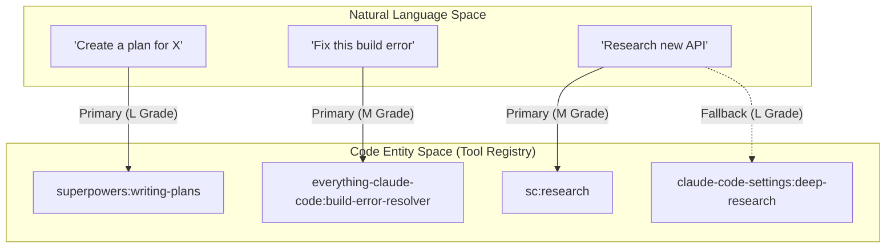
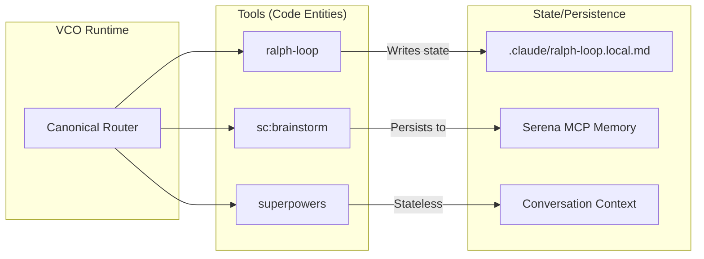

<!-- source: DeepWiki mcp.deepwiki.com · repo foryourhealth111-pixel/Vibe-Skills · page 7.1 Tool Registry and Fallback Chains · fetched 2026-10-26 -->

# Tool Registry and Fallback Chains

Relevant source files

The following files were used as context for generating this wiki page:

- [bundled/skills/vibe/bundled/skills/vibe/config/plugins-manifest.upstream.json](bundled/skills/vibe/bundled/skills/vibe/config/plugins-manifest.upstream.json)
- [bundled/skills/vibe/bundled/skills/vibe/scripts/governance/audit-upstream.ps1](bundled/skills/vibe/bundled/skills/vibe/scripts/governance/audit-upstream.ps1)
- [bundled/skills/vibe/config/plugins-manifest.upstream.json](bundled/skills/vibe/config/plugins-manifest.upstream.json)
- [bundled/skills/vibe/references/fallback-chains.md](bundled/skills/vibe/references/fallback-chains.md)
- [bundled/skills/vibe/references/tool-registry.md](bundled/skills/vibe/references/tool-registry.md)
- [bundled/skills/vibe/scripts/governance/audit-upstream.ps1](bundled/skills/vibe/scripts/governance/audit-upstream.ps1)
- [config/plugins-manifest.codex.json](config/plugins-manifest.codex.json)
- [config/plugins-manifest.upstream.json](config/plugins-manifest.upstream.json)
- [config/upstream-lock.json](config/upstream-lock.json)
- [references/fallback-chains.md](references/fallback-chains.md)
- [references/tool-registry.md](references/tool-registry.md)
- [scripts/governance/audit-upstream.ps1](scripts/governance/audit-upstream.ps1)

This page documents the 21 integrated execution tools within the Vibe Core Orchestrator (VCO) and the degradation protocols used to maintain system availability during tool or environment failures.

## Tool Registry

The Tool Registry defines the complete set of execution tools, their hook types, state locations, and current verification status. VCO categorizes tools into Plugins (hooks + skills), Commands (markdown-based), MCP Servers, and Native Runtimes [references/tool-registry.md:7-29]().

### Integrated Tools Overview

| # | Tool | Type | Hook Types | State Location | Verified |
|---|------|------|------------|----------------|----------|
| 1 | Superpowers | Plugin | SessionStart | Stateless | ✅ |
| 2 | SuperClaude | Commands | None | Serena MCP memory | ⚠️ Partial |
| 3 | Ralph-loop | Plugin | Stop | .claude/ralph-loop.local.md | ✅ |
| 4 | Claude-code-settings | Plugin | None | .specify/, .kiro/ | ✅ |
| 5 | Everything-claude-code | Plugin | SessionStart, Pre/PostToolUse | ~/.claude/sessions/ | ✅ |
| 6 | Claude-flow (ruflo) | MCP Server | Pre/PostToolUse, Stop | .claude-flow/ | ⚠️ MCP依赖 |
| 7 | Codex native team | Native API | None | Session runtime | ✅ |
| 18 | Docling MCP | Provider | None | Canonical config | ✅ |

**Sources:** [references/tool-registry.md:7-29](), [bundled/skills/vibe/references/tool-registry.md:7-29]()

### Core Tool Details

#### 1. Superpowers (`obra/superpowers`)
A design-first requirements discovery and execution plugin. It enforces a "hard-gate" on brainstorming, preventing implementation before design approval [references/tool-registry.md:42-60]().
*   **Key Skills**: `brainstorming`, `writing-plans`, `subagent-driven-development` [references/tool-registry.md:48-55]().
*   **State Policy**: Stateless; context resides entirely in the conversation [references/tool-registry.md:60]().

#### 2. SuperClaude Framework
A collection of pure markdown command files stored in `~/.claude/commands/sc/` [references/tool-registry.md:73-75]().
*   **Key Commands**: `sc:brainstorm`, `sc:design`, `sc:implement`, `sc:research` [references/tool-registry.md:78-87]().
*   **Limitation**: Despite documentation claims, it registers no technical hooks and relies on Serena MCP for state persistence [references/tool-registry.md:91-94]().

#### 3. Ralph-loop
Provides continuous iteration loops. It features a `compat` engine (local state file) and an `open` engine (delegates to external CLI) [references/tool-registry.md:99-115]().
*   **VCO Policy**: Ralph-loop is mutually exclusive with active XL team orchestration [references/tool-registry.md:116]().

**Sources:** [references/tool-registry.md:42-118](), [config/upstream-lock.json:5-57]()

## Fallback Chains

Fallback chains provide degradation paths when primary tools are unavailable due to MCP connection errors, timeouts, or missing plugins [references/fallback-chains.md:1-16]().

### M/L Grade Fallback Logic (2-Level)

For Medium (M) and Large (L) execution grades, VCO follows a Primary → Fallback → Direct Reasoning path [references/fallback-chains.md:8]().

| Task Type | Grade | Primary Tool | Fallback Tool |
|-----------|-------|--------------|---------------|
| Planning | M | `sc:design` | `everything-claude-code:planner` |
| Planning | L | `superpowers:brainstorming` | `sc:brainstorm` |
| Coding | M | `everything-claude-code:tdd-guide` | `superpowers:test-driven-development` |
| Debugging | M | `superpowers:systematic-debugging` | `everything-claude-code:build-error-resolver` |
| Research | L | `claude-code-settings:deep-research` | `sc:research` |

**Sources:** [references/fallback-chains.md:18-62](), [bundled/skills/vibe/references/fallback-chains.md:18-62]()

### XL Grade Fallback Logic (3-Level)

Extra-Large (XL) tasks utilize multi-agent orchestration. If the preferred collaboration backend fails, the system degrades to native APIs, then to sequential L-grade tools [references/fallback-chains.md:105-118]().

#### XL Degradation Path
1.  **Level 1**: Codex native team + `ruflo` (preferred collaboration).
2.  **Level 1 (Degraded)**: Codex native team only (local `state_store`).
3.  **Level 2**: Sequential L-grade execution (`superpowers` subagent system).
4.  **Level 3**: Direct single-agent Claude reasoning.

**Sources:** [references/fallback-chains.md:107-118](), [bundled/skills/vibe/references/fallback-chains.md:107-118]()

## Data Flow and Tool Association

The following diagrams map the relationship between natural language intent and the specific code entities (skills/commands) defined in the registry.

### Intent-to-Skill Mapping (Code Entity Space)

**Sources:** [references/tool-registry.md:48-87](), [references/fallback-chains.md:20-54]()

### Tool Execution and State Flow

This diagram illustrates how tools interact with the filesystem and MCP backends as defined in the registry state locations.

**Sources:** [references/tool-registry.md:7-13](), [references/tool-registry.md:60-113]()

## Configuration and Manifests

### Plugin Manifests
VCO maintains two manifest types to manage tool availability:
*   **config/plugins-manifest.codex.json**: Defines optional tools and their installation modes (e.g., `manual-codex`, `scripted`) [config/plugins-manifest.codex.json:1-51]().
*   **config/plugins-manifest.upstream.json**: Tracks upstream repository metadata, including `observed_head_sha` and `decision_class` (e.g., `admit`, `defer`) [config/plugins-manifest.upstream.json:4-53]().

### Upstream Governance
The `scripts/governance/audit-upstream.ps1` script is used to verify that the local mirrors of tools like `superpowers` or `ralph-loop` match the expected upstream state [scripts/governance/audit-upstream.ps1:1-125](). It compares the `observed_head_sha` in `config/upstream-lock.json` against the live repository [config/upstream-lock.json:27-51]().

**Sources:** [config/plugins-manifest.codex.json:1-53](), [config/plugins-manifest.upstream.json:1-53](), [scripts/governance/audit-upstream.ps1:1-125](), [config/upstream-lock.json:1-110]()

---

