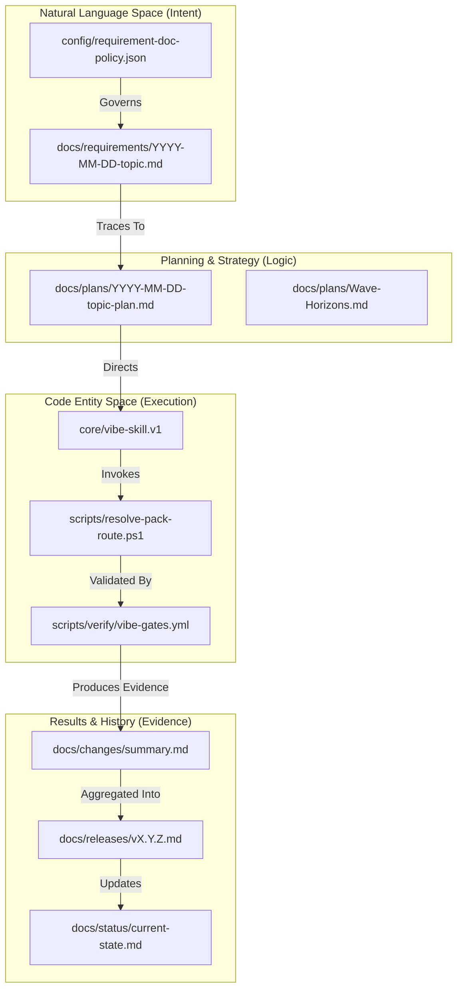

<!-- source: DeepWiki mcp.deepwiki.com · repo foryourhealth111-pixel/Vibe-Skills · page 7.2 Plans, Requirements, and Change History · fetched 2026-10-26 -->

# Plans, Requirements, and Change History

<details>
<summary>Relevant source files</summary>

The following files were used as context for generating this wiki page:

- [bundled/skills/vibe/bundled/skills/vibe/config/ruc-nlpir-runtime.json](bundled/skills/vibe/bundled/skills/vibe/config/ruc-nlpir-runtime.json)
- [bundled/skills/vibe/bundled/skills/vibe/docs/releases/v2.3.28.md](bundled/skills/vibe/bundled/skills/vibe/docs/releases/v2.3.28.md)
- [bundled/skills/vibe/bundled/skills/vibe/docs/status/README.md](bundled/skills/vibe/bundled/skills/vibe/docs/status/README.md)
- [bundled/skills/vibe/bundled/skills/vibe/protocols/team.md](bundled/skills/vibe/bundled/skills/vibe/protocols/team.md)
- [bundled/skills/vibe/bundled/skills/vibe/scripts/ruc-nlpir/preflight.ps1](bundled/skills/vibe/bundled/skills/vibe/scripts/ruc-nlpir/preflight.ps1)
- [bundled/skills/vibe/config/ruc-nlpir-runtime.json](bundled/skills/vibe/config/ruc-nlpir-runtime.json)
- [bundled/skills/vibe/docs/releases/v2.3.28.md](bundled/skills/vibe/docs/releases/v2.3.28.md)
- [bundled/skills/vibe/docs/status/README.md](bundled/skills/vibe/docs/status/README.md)
- [bundled/skills/vibe/scripts/ruc-nlpir/preflight.ps1](bundled/skills/vibe/scripts/ruc-nlpir/preflight.ps1)
- [config/ruc-nlpir-runtime.json](config/ruc-nlpir-runtime.json)
- [docs/brand/github-branding-copy.md](docs/brand/github-branding-copy.md)
- [docs/changes/2026-03-23-documentation-governance-final-summary.md](docs/changes/2026-03-23-documentation-governance-final-summary.md)
- [docs/changes/2026-03-23-install-docs-deduplication-summary.md](docs/changes/2026-03-23-install-docs-deduplication-summary.md)
- [docs/changes/2026-03-23-prompts-refactor-summary.md](docs/changes/2026-03-23-prompts-refactor-summary.md)
- [docs/changes/2026-03-23-readme-restructure-plan.md](docs/changes/2026-03-23-readme-restructure-plan.md)
- [docs/changes/2026-03-23-readme-restructure-summary.md](docs/changes/2026-03-23-readme-restructure-summary.md)
- [docs/install/configuration-guide.md](docs/install/configuration-guide.md)
- [docs/plans/2026-03-20-readme-en-detail-and-github-branding-copy-plan.md](docs/plans/2026-03-20-readme-en-detail-and-github-branding-copy-plan.md)
- [docs/plans/README.md](docs/plans/README.md)
- [docs/releases/v2.3.28.md](docs/releases/v2.3.28.md)
- [docs/requirements/2026-03-20-readme-en-detail-and-github-branding-copy.md](docs/requirements/2026-03-20-readme-en-detail-and-github-branding-copy.md)
- [docs/requirements/README.md](docs/requirements/README.md)
- [docs/status/README.md](docs/status/README.md)
- [scripts/ruc-nlpir/preflight.ps1](scripts/ruc-nlpir/preflight.ps1)

</details>


This page documents the VibeSkills governance system for managing development lifecycle artifacts. It explains the relationship between frozen requirements, execution plans, change summaries, and release notes, ensuring that every code change is traceable to a governed intent.

## The Governance Lifecycle

VibeSkills utilizes a strictly decoupled documentation strategy where intent (Requirements) is separated from implementation strategy (Plans), and results (Changes/Releases) are separated from the current live truth (Status).

### Requirement-to-Plan Traceability
Every governed `vibe` run follows a mandatory flow:
1.  **Requirement Document**: A frozen baseline in `docs/requirements/` that defines the "What" and "Why" [docs/requirements/README.md:3-10]().
2.  **Execution Plan**: A dated program in `docs/plans/` that defines the "How", including staged implementation orders and triage notes [docs/plans/README.md:7-13]().

Plans must explicitly trace back to a requirement document rather than raw chat history to prevent scope creep [docs/requirements/README.md:8-10]().

### Data Flow Diagram: Intent to Execution
The following diagram illustrates how natural language requirements are transformed into code entities through the governance system.

**Figure 1: Governance Data Flow**

**Sources**: [docs/requirements/README.md:1-20](), [docs/plans/README.md:1-21](), [docs/status/README.md:1-23]()

---

## Managed Directories

### 1. Requirements (`docs/requirements/`)
Stores the frozen baseline for every governed run.
*   **Filename Contract**: `YYYY-MM-DD-<topic>.md` [docs/requirements/README.md:12-14]().
*   **Key Rule**: Execution cannot widen scope without updating the frozen requirement [docs/requirements/README.md:10-10]().
*   **Benchmark Mode**: Must record inferred assumptions explicitly when operating autonomously [docs/requirements/README.md:9-9]().

### 2. Plans (`docs/plans/`)
Stores dated execution entry points and historical planning context.
*   **Wave Horizons**: High-level continuation plans (e.g., Wave 121-140) that group multiple tasks into strategic blocks [docs/plans/README.md:74-85]().
*   **Closure Reports**: Historical context for completed batches (e.g., Batch 0-9) [docs/plans/README.md:67-73]().

### 3. Change Summaries (`docs/changes/`)
Provides post-execution summaries of specific refactoring or governance projects.
*   **Example**: The "README Structure Optimization" project summarized structural improvements, token consumption logic, and the insertion of the Mermaid routing diagram [docs/changes/2026-03-23-readme-restructure-summary.md:9-30]().
*   **Impact Metrics**: Often includes quantitative data, such as line count reductions or duplication percentage drops [docs/changes/2026-03-23-prompts-refactor-summary.md:24-42]().

### 4. Release Notes (`docs/releases/`)
Canonical version history and migration guides.
*   **Structure**: Includes Highlights, Detailed Domain Explanations (e.g., Scholarly Publishing), and Migration Notes [docs/releases/v2.3.28.md:9-107]().
*   **Verification Requirement**: Suggests specific scripts to run after upgrade, such as `vibe-version-consistency-gate.ps1` [docs/releases/v2.3.28.md:111-114]().

**Sources**: [docs/requirements/README.md:1-38](), [docs/plans/README.md:1-89](), [docs/changes/2026-03-23-prompts-refactor-summary.md:1-43](), [docs/releases/v2.3.28.md:1-115]()

---

## Implementation of Change Control

VibeSkills uses "Execution Grades" within plans to denote the complexity of a task.

| Grade | Scope | Governance Level |
| :--- | :--- | :--- |
| **S** | Hotfix / Documentation typo | Minimal |
| **M** | Single skill update / Minor refactor | Standard (Plan + Requirement) |
| **L** | Multi-skill orchestration / New Pack | High (Proof Bundle required) |
| **XL** | Core Router / Protocol change | Maximum (Committee Review) |

**Sources**: [docs/plans/2026-03-20-readme-en-detail-and-github-branding-copy-plan.md:5-5]()

### Traceability Mapping: Code to Docs
This diagram maps codebase logic to the governance files that authorize them.

**Figure 2: Traceability Map**
```mermaid
classDiagram
    class RequirementDocument {
        +String topic
        +Date frozenDate
        +checkPolicy()
    }
    class ExecutionPlan {
        +Grade internalGrade
        +List waves
        +verifyCommands()
    }
    class SkillContract {
        +String skillName
        +String outputContract
    }
    class RouterConfig {
        +File packManifest
        +File routingRules
    }

    RequirementDocument "1" -- "1" ExecutionPlan : Traces
    ExecutionPlan "1" -- "n" SkillContract : Implements
    SkillContract "n" -- "1" RouterConfig : Registered In
    
    %% Code Entity Links
    RouterConfig ..> "config/pack-manifest.json"
    RequirementDocument ..> "docs/requirements/"
    ExecutionPlan ..> "docs/plans/"
    SkillContract ..> "bundled/skills/*/SKILL.md"
```
**Sources**: [docs/plans/2026-03-20-readme-en-detail-and-github-branding-copy-plan.md:5-13](), [docs/releases/v2.3.28.md:35-60]()

---

## Release Truth and Status
While `docs/plans/` and `docs/requirements/` handle the *process*, the `docs/status/` directory represents the *result*.

*   **`current-state.md`**: The single source of truth for the live repository state [docs/plans/README.md:63-66]().
*   **`non-regression-proof-bundle.md`**: The contract ensuring that the current release maintains all previous capabilities [docs/plans/README.md:65-65]().

**Sources**: [docs/plans/README.md:15-21](), [docs/plans/README.md:63-66]()

---

