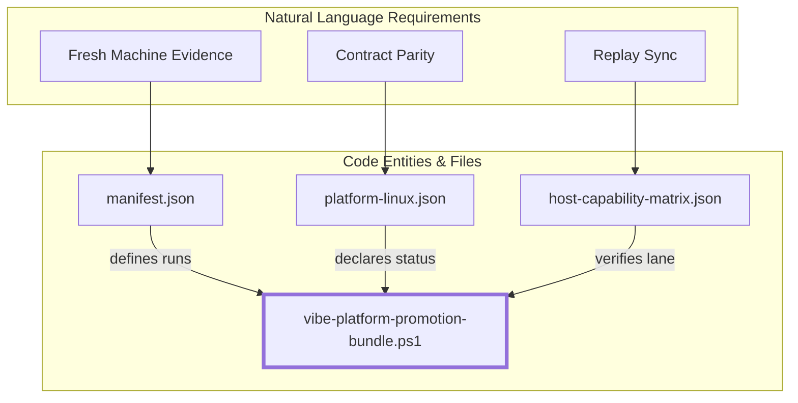
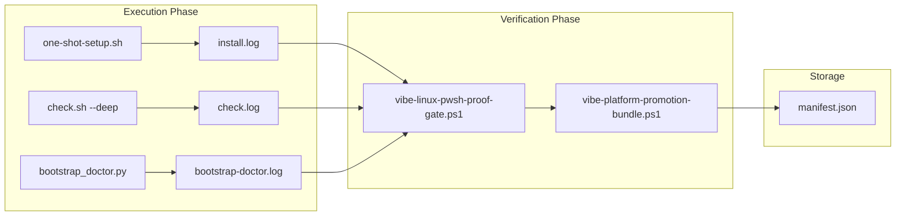

<!-- source: DeepWiki mcp.deepwiki.com · repo foryourhealth111-pixel/Vibe-Skills · page 7.3 Proof Bundles and Platform Promotion · fetched 2026-10-26 -->

# Proof Bundles and Platform Promotion

Relevant source files

The following files were used as context for generating this wiki page:

- [adapters/codex/platform-linux.json](adapters/codex/platform-linux.json)
- [bundled/skills/vibe/bundled/skills/vibe/config/platform-support-policy.json](bundled/skills/vibe/bundled/skills/vibe/config/platform-support-policy.json)
- [bundled/skills/vibe/bundled/skills/vibe/docs/status/linux-pwsh-fresh-machine-evidence-ledger-2026-03-13.md](bundled/skills/vibe/bundled/skills/vibe/docs/status/linux-pwsh-fresh-machine-evidence-ledger-2026-03-13.md)
- [bundled/skills/vibe/bundled/skills/vibe/docs/status/platform-promotion-baseline-2026-03-13.md](bundled/skills/vibe/bundled/skills/vibe/docs/status/platform-promotion-baseline-2026-03-13.md)
- [bundled/skills/vibe/bundled/skills/vibe/docs/universalization/linux-full-authoritative-contract.md](bundled/skills/vibe/bundled/skills/vibe/docs/universalization/linux-full-authoritative-contract.md)
- [bundled/skills/vibe/bundled/skills/vibe/docs/universalization/platform-install-matrix.md](bundled/skills/vibe/bundled/skills/vibe/docs/universalization/platform-install-matrix.md)
- [bundled/skills/vibe/bundled/skills/vibe/docs/universalization/platform-parity-contract.md](bundled/skills/vibe/bundled/skills/vibe/docs/universalization/platform-parity-contract.md)
- [bundled/skills/vibe/bundled/skills/vibe/docs/universalization/platform-promotion-criteria.md](bundled/skills/vibe/bundled/skills/vibe/docs/universalization/platform-promotion-criteria.md)
- [bundled/skills/vibe/bundled/skills/vibe/docs/universalization/platform-support-matrix.md](bundled/skills/vibe/bundled/skills/vibe/docs/universalization/platform-support-matrix.md)
- [bundled/skills/vibe/bundled/skills/vibe/references/proof-bundles/linux-full-authoritative-candidate/README.md](bundled/skills/vibe/bundled/skills/vibe/references/proof-bundles/linux-full-authoritative-candidate/README.md)
- [bundled/skills/vibe/bundled/skills/vibe/references/proof-bundles/linux-full-authoritative-candidate/manifest.json](bundled/skills/vibe/bundled/skills/vibe/references/proof-bundles/linux-full-authoritative-candidate/manifest.json)
- [bundled/skills/vibe/docs/status/linux-pwsh-fresh-machine-evidence-ledger-2026-03-13.md](bundled/skills/vibe/docs/status/linux-pwsh-fresh-machine-evidence-ledger-2026-03-13.md)
- [bundled/skills/vibe/references/proof-bundles/linux-full-authoritative-candidate/README.md](bundled/skills/vibe/references/proof-bundles/linux-full-authoritative-candidate/README.md)
- [bundled/skills/vibe/references/proof-bundles/linux-full-authoritative-candidate/manifest.json](bundled/skills/vibe/references/proof-bundles/linux-full-authoritative-candidate/manifest.json)
- [docs/status/linux-pwsh-fresh-machine-evidence-ledger-2026-03-13.md](docs/status/linux-pwsh-fresh-machine-evidence-ledger-2026-03-13.md)
- [references/proof-bundles/linux-full-authoritative-candidate/README.md](references/proof-bundles/linux-full-authoritative-candidate/README.md)
- [references/proof-bundles/linux-full-authoritative-candidate/manifest.json](references/proof-bundles/linux-full-authoritative-candidate/manifest.json)

The Vibe-Skills repository utilizes a rigorous **Proof Bundle** system to govern the promotion of platform support labels (e.g., moving from `supported-with-constraints` to `full-authoritative`). This system ensures that platform claims are backed by frozen, reproducible evidence from "fresh-machine" runs rather than just documentation or manual testing [references/proof-bundles/linux-full-authoritative-candidate/README.md:17-26]().

## Platform Promotion Framework

Platform promotion is governed by the principle that contract, replay fixtures, fresh-machine evidence, and public documentation must all remain synchronized [bundled/skills/vibe/bundled/skills/vibe/docs/universalization/platform-promotion-criteria.md:15-21](). A platform cannot be promoted based on implementation alone; it requires a verified "Proof Bundle" [bundled/skills/vibe/bundled/skills/vibe/docs/universalization/platform-promotion-criteria.md:40-51]().

### Promotion Criteria and Status Labels
The system defines specific status labels for platform lanes:
*   **full-authoritative**: The highest tier, currently held only by Windows [bundled/skills/vibe/bundled/skills/vibe/docs/universalization/linux-full-authoritative-contract.md:17-21]().
*   **supported-with-constraints**: The current status for Linux with `pwsh` available [adapters/codex/platform-linux.json:1-4]().
*   **degraded-but-supported**: The status for Linux environments lacking `pwsh` [adapters/codex/platform-linux.json:17-19]().
*   **not-yet-proven**: Platforms without a verified proof baseline [bundled/skills/vibe/bundled/skills/vibe/docs/universalization/platform-promotion-criteria.md:95-101]().

### Platform State Transition Logic
The following diagram maps the natural language promotion requirements to the code entities and files that enforce them.

**Diagram: Platform Promotion Logic Flow**

Sources: [references/proof-bundles/linux-full-authoritative-candidate/manifest.json:10-33](), [adapters/codex/platform-linux.json:21-32](), [bundled/skills/vibe/bundled/skills/vibe/docs/universalization/platform-promotion-criteria.md:83-87]()

---

## Proof Bundles

A Proof Bundle is a directory containing a `manifest.json` and a collection of log files and receipts from specific execution runs [references/proof-bundles/linux-full-authoritative-candidate/README.md:7-16](). These artifacts are intentionally tracked in Git to ensure that a clean clone can reproduce the promotion truth without local residue [references/proof-bundles/linux-full-authoritative-candidate/README.md:40-49]().

### Bundle Manifest Structure
The `manifest.json` (e.g., in `linux-full-authoritative-candidate`) acts as the source of truth for the evidence state [references/proof-bundles/linux-full-authoritative-candidate/manifest.json:1-12]().

| Key | Description |
| :--- | :--- |
| `bundle_id` | Unique identifier for the proof set [references/proof-bundles/linux-full-authoritative-candidate/manifest.json:3-3]() |
| `target_status` | The status the lane is attempting to reach [references/proof-bundles/linux-full-authoritative-candidate/manifest.json:11-11]() |
| `required_gates` | Scripts that must pass to validate the bundle [references/proof-bundles/linux-full-authoritative-candidate/manifest.json:20-28]() |
| `frozen_runs` | Detailed records of environment-specific executions [references/proof-bundles/linux-full-authoritative-candidate/manifest.json:34-35]() |

### The Linux Evidence Ledger
The Linux promotion candidate requires two independent fresh-machine runs: one in WSL and one in Docker [docs/status/linux-pwsh-fresh-machine-evidence-ledger-2026-03-13.md:9-15](). Each run must capture:
*   `environment.log`: Host environment summary [references/proof-bundles/linux-full-authoritative-candidate/manifest.json:41-41]().
*   `install.log`: Output from `one-shot-setup.sh` [references/proof-bundles/linux-full-authoritative-candidate/manifest.json:42-42]().
*   `bootstrap-doctor.log`: Parity check results [references/proof-bundles/linux-full-authoritative-candidate/manifest.json:44-44]().
*   `runtime-freshness-receipt.json`: Verification of the installed runtime [references/proof-bundles/linux-full-authoritative-candidate/manifest.json:48-48]().

**Diagram: Evidence Collection and Verification**

Sources: [docs/status/linux-pwsh-fresh-machine-evidence-ledger-2026-03-13.md:11-14](), [references/proof-bundles/linux-full-authoritative-candidate/manifest.json:20-28](), [adapters/codex/platform-linux.json:21-26]()

---

## Universalization and Parity

Universalization is the process of ensuring the Vibe Core Orchestrator (VCO) operates identically across platforms. This is documented through several matrices and contracts.

### Platform Support Matrix
The support matrix defines the current "Truth Boundary" for all lanes.
*   **Windows**: Reference authority lane [bundled/skills/vibe/bundled/skills/vibe/docs/universalization/linux-full-authoritative-contract.md:19-19]().
*   **Linux + pwsh**: Frozen evidence exists, but status remains `supported-with-constraints` until a formal promotion sync [bundled/skills/vibe/bundled/skills/vibe/docs/universalization/linux-full-authoritative-contract.md:13-15]().
*   **Linux without pwsh**: Explicitly `degraded-but-supported` [adapters/codex/platform-linux.json:36-37]().

### Promotion Stop Rules
To prevent "documentation-first" claims, promotion must stop if any of the following occur:
1.  **Windows Regression**: If the reference lane fails, no other lane can promote [bundled/skills/vibe/bundled/skills/vibe/docs/universalization/linux-full-authoritative-contract.md:59-59]().
2.  **Silent Skips**: If a platform-specific failure (like missing `pwsh`) results in a silent skip instead of an explicit "degraded" error [bundled/skills/vibe/bundled/skills/vibe/docs/universalization/linux-full-authoritative-contract.md:61-61]().
3.  **Drift**: If the frozen evidence baseline in the Proof Bundle is modified or lost [bundled/skills/vibe/bundled/skills/vibe/docs/universalization/linux-full-authoritative-contract.md:63-63]().

### Governance Gates
The promotion process is enforced by specific verification scripts:
*   `vibe-platform-support-contract-gate.ps1`: Ensures `platform-linux.json` matches the intended status [references/proof-bundles/linux-full-authoritative-candidate/manifest.json:21-21]().
*   `vibe-linux-pwsh-proof-gate.ps1`: Validates the existence and content of the Linux log files [references/proof-bundles/linux-full-authoritative-candidate/manifest.json:26-26]().
*   `vibe-platform-promotion-bundle.ps1`: The final gate that checks synchronization across docs, fixtures, and contracts [bundled/skills/vibe/bundled/skills/vibe/docs/universalization/platform-promotion-criteria.md:83-87]().

Sources: [bundled/skills/vibe/bundled/skills/vibe/docs/universalization/linux-full-authoritative-contract.md:55-64](), [adapters/codex/platform-linux.json:27-32](), [references/proof-bundles/linux-full-authoritative-candidate/manifest.json:20-28]()

---

