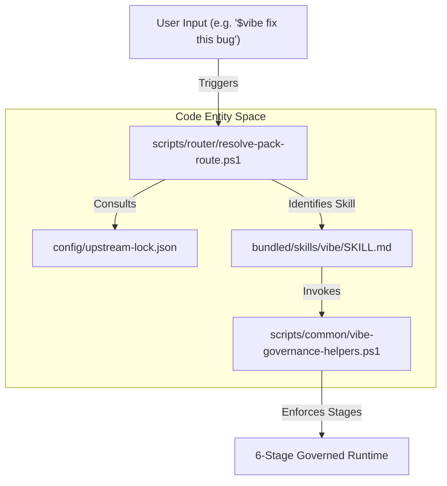
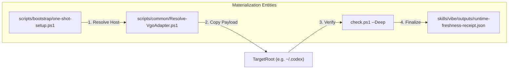

<!-- source: DeepWiki mcp.deepwiki.com · repo foryourhealth111-pixel/Vibe-Skills · page 8 Glossary · fetched 2026-10-26 -->

# Glossary

Relevant source files

The following files were used as context for generating this wiki page:

- [README.en.md](README.en.md)
- [README.md](README.md)
- [SKILL.md](SKILL.md)
- [adapters/index.json](adapters/index.json)
- [bundled/skills/vibe/SKILL.md](bundled/skills/vibe/SKILL.md)
- [bundled/skills/vibe/bundled/skills/vibe/config/version-governance.json](bundled/skills/vibe/bundled/skills/vibe/config/version-governance.json)
- [bundled/skills/vibe/bundled/skills/vibe/references/changelog.md](bundled/skills/vibe/bundled/skills/vibe/references/changelog.md)
- [bundled/skills/vibe/bundled/skills/vibe/references/release-ledger.jsonl](bundled/skills/vibe/bundled/skills/vibe/references/release-ledger.jsonl)
- [bundled/skills/vibe/config/version-governance.json](bundled/skills/vibe/config/version-governance.json)
- [bundled/skills/vibe/docs/releases/README.md](bundled/skills/vibe/docs/releases/README.md)
- [bundled/skills/vibe/protocols/team.md](bundled/skills/vibe/protocols/team.md)
- [bundled/skills/vibe/references/changelog.md](bundled/skills/vibe/references/changelog.md)
- [bundled/skills/vibe/references/fallback-chains.md](bundled/skills/vibe/references/fallback-chains.md)
- [bundled/skills/vibe/references/index.md](bundled/skills/vibe/references/index.md)
- [bundled/skills/vibe/references/release-ledger.jsonl](bundled/skills/vibe/references/release-ledger.jsonl)
- [bundled/skills/vibe/references/team-templates.md](bundled/skills/vibe/references/team-templates.md)
- [bundled/skills/vibe/references/tool-registry.md](bundled/skills/vibe/references/tool-registry.md)
- [bundled/skills/vibe/scripts/verify/README.md](bundled/skills/vibe/scripts/verify/README.md)
- [bundled/skills/vibe/scripts/verify/vibe-keyword-precision-audit.ps1](bundled/skills/vibe/scripts/verify/vibe-keyword-precision-audit.ps1)
- [bundled/skills/vibe/scripts/verify/vibe-pack-routing-smoke.ps1](bundled/skills/vibe/scripts/verify/vibe-pack-routing-smoke.ps1)
- [bundled/skills/vibe/scripts/verify/vibe-trigger-keyword-hygiene-gate.ps1](bundled/skills/vibe/scripts/verify/vibe-trigger-keyword-hygiene-gate.ps1)
- [check.ps1](check.ps1)
- [check.sh](check.sh)
- [config/plugins-manifest.codex.json](config/plugins-manifest.codex.json)
- [config/upstream-lock.json](config/upstream-lock.json)
- [config/version-governance.json](config/version-governance.json)
- [docs/cold-start-install-paths.en.md](docs/cold-start-install-paths.en.md)
- [docs/cold-start-install-paths.md](docs/cold-start-install-paths.md)
- [docs/deployment.md](docs/deployment.md)
- [docs/install/host-plugin-policy.en.md](docs/install/host-plugin-policy.en.md)
- [docs/install/host-plugin-policy.md](docs/install/host-plugin-policy.md)
- [docs/install/manual-copy-install.en.md](docs/install/manual-copy-install.en.md)
- [docs/install/manual-copy-install.md](docs/install/manual-copy-install.md)
- [docs/install/one-click-install-release-copy.en.md](docs/install/one-click-install-release-copy.en.md)
- [docs/install/one-click-install-release-copy.md](docs/install/one-click-install-release-copy.md)
- [docs/install/recommended-full-path.en.md](docs/install/recommended-full-path.en.md)
- [docs/install/recommended-full-path.md](docs/install/recommended-full-path.md)
- [docs/one-shot-setup.md](docs/one-shot-setup.md)
- [docs/releases/README.md](docs/releases/README.md)
- [install.ps1](install.ps1)
- [install.sh](install.sh)
- [protocols/team.md](protocols/team.md)
- [references/changelog.md](references/changelog.md)
- [references/fallback-chains.md](references/fallback-chains.md)
- [references/index.md](references/index.md)
- [references/release-ledger.jsonl](references/release-ledger.jsonl)
- [references/team-templates.md](references/team-templates.md)
- [references/tool-registry.md](references/tool-registry.md)
- [scripts/bootstrap/one-shot-setup.ps1](scripts/bootstrap/one-shot-setup.ps1)
- [scripts/bootstrap/one-shot-setup.sh](scripts/bootstrap/one-shot-setup.sh)
- [scripts/common/vibe-governance-helpers.ps1](scripts/common/vibe-governance-helpers.ps1)
- [scripts/install/Install-VgoAdapter.ps1](scripts/install/Install-VgoAdapter.ps1)
- [scripts/install/install_vgo_adapter.py](scripts/install/install_vgo_adapter.py)
- [scripts/router/resolve-pack-route.ps1](scripts/router/resolve-pack-route.ps1)
- [scripts/verify/README.md](scripts/verify/README.md)
- [scripts/verify/vibe-config-parity-gate.ps1](scripts/verify/vibe-config-parity-gate.ps1)

This glossary defines the technical terms, architectural concepts, and domain-specific abbreviations used throughout the VibeSkills codebase. It serves as a reference for onboarding engineers to understand the "Vibe-native" language and how these concepts map to specific implementation files and functions.

## Core Architectural Concepts

### VCO (Vibe Core Orchestrator)
The industrial-grade runtime framework that powers VibeSkills. It is not merely a collection of scripts but a governed environment that manages skill execution, multi-agent coordination, and state transitions.
[README.md:104-116](), [README.en.md:54-61]()

### Canonical Router
The central decision-making component responsible for intent recognition and skill matching. It ensures that user tasks are routed to the most appropriate skill without conflict.
[README.md:151-168](), [scripts/router/resolve-pack-route.ps1:1-50]()

### Governed Runtime
A fixed execution model enforced by the `vibe` skill, consisting of six mandatory stages: `skeleton_check`, `deep_interview`, `requirement_doc`, `xl_plan`, `plan_execute`, and `phase_cleanup`.
[README.md:170-176](), [references/changelog.md:54-60]()

### Execution Grades (M/L/XL)
The classification of task complexity which determines the orchestration strategy:
*   **M (Medium):** Narrow scope, single agent, fast response.
*   **L (Large):** Medium complexity requiring multi-stage planning and review.
*   **XL (Extra Large):** High complexity, parallel execution, multi-agent "Team" protocol.
[README.md:202-214]()

### Team Protocol
A multi-agent coordination standard used in XL execution to manage agent spawning, input/output synchronization, and lifecycle management.
[protocols/team.md:1-20]()

### Skill Contract
A host-neutral definition of a skill's capabilities, requirements, and governance rules. It ensures that skills behave consistently across different AI hosts (Codex, Windsurf, etc.).
[README.md:131-141](), [SKILL.md:1-30]()

---

## Technical Terms & Abbreviations

| Term | Definition | Implementation Pointer |
| :--- | :--- | :--- |
| **HostId** | Unique identifier for the AI environment (e.g., `codex`, `cursor`, `windsurf`). | `check.ps1:4-5`, `check.sh:28-41` |
| **Profile** | Installation variant, usually `full` (all skills) or `minimal` (core framework). | `check.ps1:2-3`, `scripts/bootstrap/one-shot-setup.ps1` |
| **TargetRoot** | The filesystem path where VibeSkills is installed for a specific host. | `check.ps1:15`, `docs/install/manual-copy-install.md:21-26` |
| **Freshness Receipt** | A JSON artifact proving a successful installation and passing health checks. | `check.ps1:46`, `scripts/verify/vibe-installed-runtime-freshness-gate.ps1` |
| **CER** | Context Evidence Report; a summary of execution and verification for auditing. | `tests/replay/README.md` |
| **VCO_AI_PROVIDER** | Environment variables for the governance-AI online layer (different from base provider). | `docs/install/recommended-full-path.md:97-98` |

**Sources:** [README.md:202-214](), [check.ps1:1-17](), [docs/install/manual-copy-install.md:21-26](), [docs/install/recommended-full-path.md:91-118]()

---

## Implementation Data Flow

### From Intent to Execution
The following diagram bridges the "Natural Language Space" (User Intent) to the "Code Entity Space" (VCO Components).

**Diagram: Intent Routing and Execution Flow**

**Sources:** [README.md:155-168](), [scripts/router/resolve-pack-route.ps1:1-20](), [check.ps1:11-17](), [config/upstream-lock.json:1-10]()

---

## Installation & Environment Taxonomy

### Host Adapters
Adapters translate VCO commands into host-specific actions. Each supported host has a specific directory and configuration mapping.

| Host Name | Directory Mapping | Installation Mode |
| :--- | :--- | :--- |
| **Codex** | `~/.codex` | Governed |
| **Claude Code** | `~/.claude` | Preview Guidance |
| **Cursor** | `~/.cursor` | Preview Guidance |
| **Windsurf** | `~/.codeium/windsurf` | Runtime Adapter |

**Sources:** [docs/install/one-click-install-release-copy.md:23-30](), [docs/install/recommended-full-path.md:10-17](), [check.sh:43-55]()

### Bootstrap Lifecycle
The transition from a raw repository to a functional "AI OS" on a host machine.

**Diagram: System Materialization Flow**

**Sources:** [scripts/bootstrap/one-shot-setup.ps1:1-50](), [check.ps1:1-17](), [check.ps1:132-146](), [docs/install/recommended-full-path.md:22-72]()

---

## Governance & Verification Terms

### Verification Gates
Automated scripts located in `scripts/verify/` that act as quality hurdles for releases and installations.
*   **Config Parity Gate:** Ensures consistency between bundled and canonical configurations. [scripts/verify/vibe-config-parity-gate.ps1]()
*   **BOM Frontmatter Gate:** Validates metadata in skill files. [check.ps1:48]()
*   **Freshness Gate:** Confirms the installed runtime matches the repository version. [check.ps1:47]()

### Release Ledger
An append-only record (`references/release-ledger.jsonl`) of all versions, providing a traceable history of changes and governance approvals.
[references/release-ledger.jsonl:1-10](), [references/changelog.md:1-9]()

### Truth-First Design
A design principle where the codebase and its documentation must reflect the actual state of implementation, avoiding "aspirational" documentation that doesn't match code behavior.
[README.md:92-98](), [docs/install/one-click-install-release-copy.md:43-49]()

**Sources:** [references/changelog.md:1-25](), [check.ps1:41-75](), [docs/install/one-click-install-release-copy.md:43-49]()