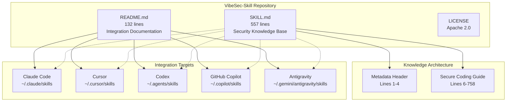
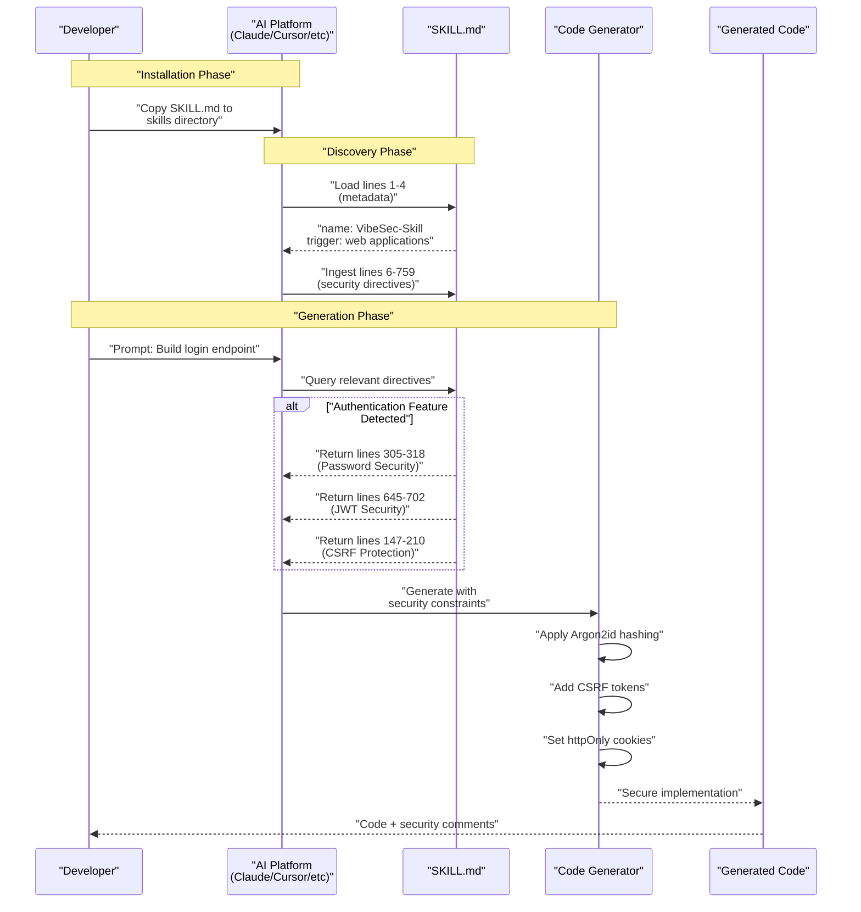
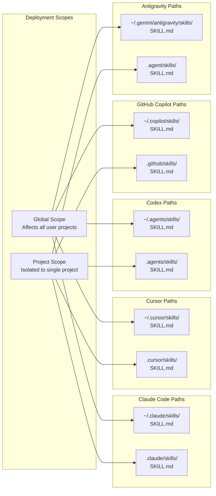
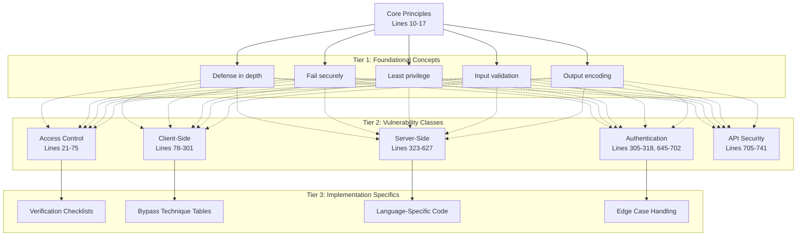
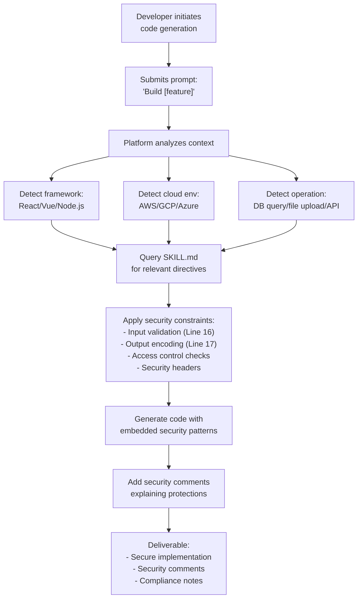

<!-- source: DeepWiki mcp.deepwiki.com · repo BehiSecc/VibeSec-Skill · page 1 Overview · fetched 2026-10-26 -->

# Overview

Relevant source files

The following files were used as context for generating this wiki page:

- [README.md](README.md)
- [SKILL.md](SKILL.md)

## Purpose and Scope

This document provides a technical overview of VibeSec-Skill, a declarative security knowledge base designed for AI-assisted code generation platforms. VibeSec-Skill is a passive knowledge injection system that teaches AI models to generate security-conscious code by consuming structured security directives during the code generation process.

For platform-specific installation procedures, see [Installation & Integration](#2). For detailed security domain coverage, see [Client-Side Security](#6), [Server-Side Security](#7), [Access Control & Authorization](#5), [Authentication & Session Security](#8), and [API Security](#9). For the complete taxonomy of addressed vulnerabilities, see [Complete Vulnerability Coverage](#11).

**Sources:** [README.md:1-18](), [SKILL.md:1-10]()

---

## System Classification

VibeSec-Skill is a **declarative security framework** that operates as contextual knowledge rather than executable code. The system consists of:

- A static knowledge artifact (`SKILL.md`) consumed by AI models
- Platform-agnostic deployment instructions (`README.md`)
- No runtime components or active security scanners

The architecture differs from traditional security tools in that it prevents vulnerabilities at generation time rather than detecting them post-generation.

**Sources:** [README.md:1-23](), [SKILL.md:1-10]()

---

## Repository Structure

**Sources:** [README.md:37-73](), [SKILL.md:1-759]()

---

## Core Components

### SKILL.md - Security Knowledge Base

The primary artifact is `SKILL.md`, a 557-line structured document containing security directives organized into discrete domains:

| Domain | Line Range | Coverage |
|--------|------------|----------|
| Core Principles | [SKILL.md:10-17]() | 5 foundational security concepts |
| Access Control Issues | [SKILL.md:21-75]() | IDOR, privilege escalation, UUID requirements |
| Cross-Site Scripting (XSS) | [SKILL.md:80-144]() | Input sources, output encoding, CSP directives |
| Cross-Site Request Forgery (CSRF) | [SKILL.md:147-210]() | Token validation, SameSite cookies, edge cases |
| Secret Exposure | [SKILL.md:213-256]() | Client-side secret prevention, exposure vectors |
| Open Redirect | [SKILL.md:259-301]() | Allowlist validation, bypass techniques, IDN attacks |
| Password Security | [SKILL.md:305-318]() | Requirements, hashing algorithms |
| Server-Side Request Forgery (SSRF) | [SKILL.md:323-391]() | IP bypass techniques, DNS rebinding, metadata protection |
| Insecure File Upload | [SKILL.md:394-454]() | Magic bytes, polyglot files, validation requirements |
| SQL Injection | [SKILL.md:457-499]() | Parameterized queries, injection points |
| XML External Entity (XXE) | [SKILL.md:502-568]() | Parser configuration, language-specific prevention |
| Path Traversal | [SKILL.md:571-627]() | Canonicalization, input sanitization |
| Security Headers | [SKILL.md:630-641]() | CSP, HSTS, X-Frame-Options |
| JWT Security | [SKILL.md:645-702]() | Algorithm validation, token storage |
| API Security | [SKILL.md:705-741]() | Mass assignment, GraphQL protections |

The metadata header ([SKILL.md:1-4]()) contains the skill name, description, and trigger conditions that AI platforms use for skill discovery and activation.

**Sources:** [SKILL.md:1-759]()

### README.md - Integration Layer

The `README.md` file functions as the deployment documentation, providing:

- Problem statement ([README.md:1-18]()): Describes "vibe coding" vulnerabilities
- Installation instructions ([README.md:37-73]()): Platform-specific directory paths
- Coverage taxonomy ([README.md:78-89]()): Vulnerability categories
- Usage workflow ([README.md:101-113]()): Prompt patterns
- Coverage statistics ([README.md:31-32]()): 60-70% of common vulnerabilities

**Sources:** [README.md:1-132]()

---

## Knowledge Consumption Model

The consumption model operates in three phases:

1. **Installation**: Developer copies `SKILL.md` to platform-specific directory
2. **Discovery**: AI platform loads skill metadata and ingests directive content
3. **Generation**: Platform queries relevant directives based on prompt context and applies security constraints during code synthesis

**Sources:** [README.md:37-73](), [README.md:101-113](), [SKILL.md:1-4]()

---

## Platform Integration Architecture

VibeSec-Skill supports five AI platforms through a uniform directory-based deployment pattern:

Each platform follows identical deployment semantics:
- **Global scope**: Skill applies to all projects for the user
- **Project scope**: Skill applies only to the containing project directory

The dual-scope pattern enables both organizational security standards enforcement (global) and project-specific customization (local).

**Sources:** [README.md:37-73]()

---

## Security Directive Structure

The `SKILL.md` file employs a hierarchical knowledge organization:

Each directive follows a consistent structure:
1. **Vulnerability description**: What the issue is
2. **Attack scenarios**: Where it occurs
3. **Prevention methods**: How to mitigate
4. **Implementation examples**: Code patterns (pseudocode or language-specific)
5. **Verification checklist**: Validation steps

**Sources:** [SKILL.md:10-17](), [SKILL.md:21-759]()

---

## Vulnerability Coverage Statistics

The system addresses **60-70% of common web application vulnerabilities** in its open-source form ([README.md:31-32]()):

| Category | Vulnerability Types | Prevention Mechanisms |
|----------|---------------------|----------------------|
| **Access Control** | IDOR, Privilege Escalation, Horizontal/Vertical Access, Mass Assignment | UUID enforcement, ownership verification, token revocation |
| **Client-Side** | XSS (Stored/Reflected/DOM), CSRF, Secret Exposure, Open Redirect | Output encoding, CSP, CSRF tokens, allowlist validation |
| **Server-Side** | SSRF, SQL Injection, XXE, Path Traversal, File Upload | Parameterized queries, IP validation, entity disabling, canonicalization, magic bytes |
| **Authentication** | Weak Passwords, Session Management, JWT Vulnerabilities | Argon2id/bcrypt, httpOnly cookies, algorithm validation |
| **API Security** | Mass Assignment, GraphQL Attacks | Field whitelisting, query depth/complexity limits |

The skill includes specialized coverage for:
- **Framework-aware patterns**: React, Vue, Node.js, Python, Java, .NET ([README.md:95]())
- **Cloud-aware protections**: AWS, GCP, Azure metadata endpoints ([README.md:96]())
- **Bypass technique databases**: DNS rebinding, polyglot files, Unicode tricks ([README.md:94]())

**Sources:** [README.md:78-97](), [README.md:31-32]()

---

## Operational Workflow

The system implements a security-first code generation workflow:

The workflow emphasizes **proactive prevention** over reactive detection, embedding security controls during the generation phase rather than validating code post-generation.

**Sources:** [README.md:101-113](), [SKILL.md:10-17](), [README.md:71-97]()

---

## License and Distribution

VibeSec-Skill is distributed under the Apache License 2.0, permitting:
- Commercial and private use
- Modification and distribution
- Patent grant from contributors

See [License](#12) for complete terms.

**Sources:** [LICENSE:1-202](), [README.md:1-132]()

---

