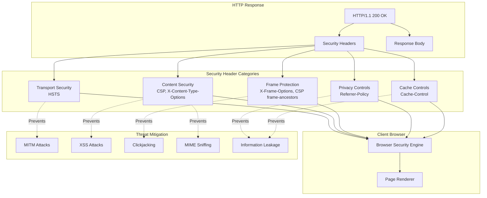
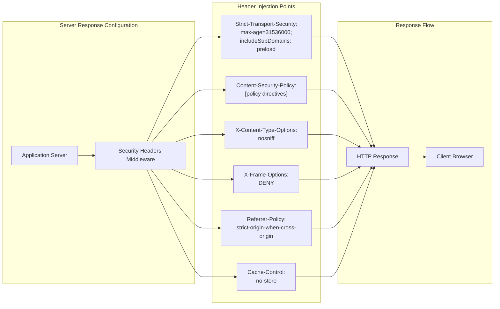
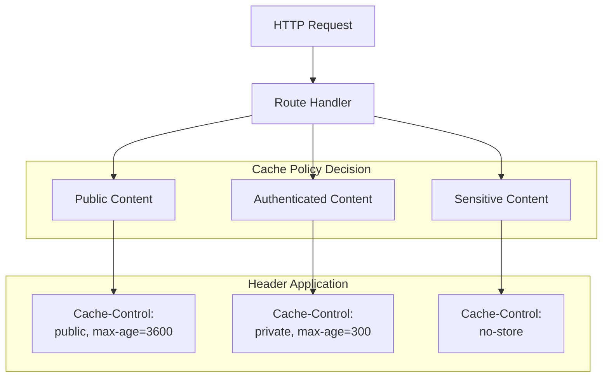
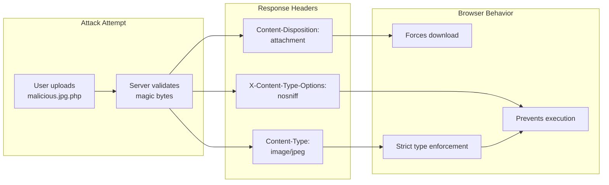

<!-- source: DeepWiki mcp.deepwiki.com · repo BehiSecc/VibeSec-Skill · page 10 Security Headers Reference · fetched 2026-10-26 -->

# Security Headers Reference

<details>
<summary>Relevant source files</summary>

The following files were used as context for generating this wiki page:

- [SKILL.md](SKILL.md)

</details>


## Purpose and Scope

This document provides a comprehensive reference for HTTP security headers that should be included in web application responses to protect against common attack vectors. Security headers are HTTP response headers that instruct browsers to enable additional security protections, preventing vulnerabilities such as XSS, clickjacking, MIME sniffing attacks, and man-in-the-middle attacks.

For broader XSS protection strategies beyond CSP, see [Cross-Site Scripting (XSS) Prevention](#6.1). For authentication-related headers including cookie security, see [Authentication & Session Security](#8). For file upload security headers, see [Insecure File Upload Prevention](#7.5).

**Sources:** [SKILL.md:630-642]()

---

## Security Headers in the Defense Architecture



This diagram illustrates how security headers act as a defense layer between the server response and browser rendering engine. Each header category addresses specific threat classes by instructing the browser to enforce security policies.

**Sources:** [SKILL.md:630-642](), [SKILL.md:119-144]()

---

## Complete Security Headers Implementation

The following headers should be included in all HTTP responses to establish comprehensive browser-level security:



**Sources:** [SKILL.md:630-642]()

---

## Strict-Transport-Security (HSTS)

### Purpose

Forces browsers to communicate with the server exclusively over HTTPS, preventing protocol downgrade attacks and cookie hijacking via man-in-the-middle attacks.

### Configuration

```
Strict-Transport-Security: max-age=31536000; includeSubDomains; preload
```

### Directive Breakdown

| Directive | Value | Purpose |
|-----------|-------|---------|
| `max-age` | `31536000` (1 year in seconds) | Duration the browser remembers to enforce HTTPS |
| `includeSubDomains` | flag | Applies policy to all subdomains |
| `preload` | flag | Allows inclusion in browser HSTS preload lists |

### Implementation Requirements

- Only send HSTS header over HTTPS connections (browsers ignore it over HTTP)
- Start with shorter `max-age` during testing (e.g., 300 seconds)
- Increase to 1 year (`31536000`) for production
- Ensure all subdomains support HTTPS before using `includeSubDomains`
- Submit to HSTS preload list at hstspreload.org for maximum protection

### Common Pitfalls

- Sending header over HTTP (ignored by browsers)
- Using excessively long `max-age` before verifying all services work over HTTPS
- Not accounting for subdomains when using `includeSubDomains`
- Forgetting to renew certificates before expiration (users cannot bypass)

**Sources:** [SKILL.md:635]()

---

## Content-Security-Policy (CSP)

### Purpose

Mitigates XSS, data injection, and clickjacking attacks by declaring allowed sources for content types (scripts, styles, images, etc.). CSP provides the strongest defense-in-depth protection against XSS vulnerabilities.

### Complete Policy Example

```
Content-Security-Policy: 
  default-src 'self';
  script-src 'self';
  style-src 'self' 'unsafe-inline';
  img-src 'self' data: https:;
  font-src 'self';
  connect-src 'self' https://api.yourdomain.com;
  frame-ancestors 'none';
  base-uri 'self';
  form-action 'self';
```

### Directive Reference

| Directive | Purpose | Recommended Value |
|-----------|---------|------------------|
| `default-src` | Fallback for unspecified directives | `'self'` |
| `script-src` | JavaScript source allowlist | `'self'` (avoid `'unsafe-inline'`, `'unsafe-eval'`) |
| `style-src` | CSS source allowlist | `'self' 'unsafe-inline'` (use nonces for inline styles when possible) |
| `img-src` | Image source allowlist | `'self' data: https:` |
| `font-src` | Font source allowlist | `'self'` |
| `connect-src` | XMLHttpRequest/fetch/WebSocket allowlist | `'self' https://api.yourdomain.com` |
| `frame-ancestors` | Embedding restrictions (replaces X-Frame-Options) | `'none'` or specific domains |
| `base-uri` | Restricts `<base>` tag URLs | `'self'` |
| `form-action` | Form submission target allowlist | `'self'` |

### Advanced CSP Patterns

**Nonce-Based Inline Scripts:**
```
Content-Security-Policy: script-src 'self' 'nonce-{random-value}'
```
Use unique cryptographic nonce for each request to allow specific inline scripts.

**Hash-Based Inline Scripts:**
```
Content-Security-Policy: script-src 'self' 'sha256-{hash-of-script}'
```
Allow specific inline scripts by their SHA-256 hash.

**Violation Reporting:**
```
Content-Security-Policy: ...; report-uri /csp-report
```
Monitor CSP violations to detect attacks and misconfigurations.

### Critical Security Requirements

- **Never use `'unsafe-inline'` for `script-src`** - defeats XSS protection
- **Never use `'unsafe-eval'` for `script-src`** - allows `eval()`, `Function()` execution
- Use nonces or hashes for inline scripts when necessary
- Test policy in report-only mode first: `Content-Security-Policy-Report-Only`
- Gradually tighten policy based on violation reports

**Sources:** [SKILL.md:119-135](), [SKILL.md:636]()

---

## X-Content-Type-Options

### Purpose

Prevents MIME type sniffing attacks by instructing browsers to strictly follow the declared `Content-Type` header rather than attempting to detect content type from file contents.

### Configuration

```
X-Content-Type-Options: nosniff
```

### Attack Prevention

| Attack Vector | Without Header | With `nosniff` |
|---------------|----------------|----------------|
| MIME confusion | Browser interprets `.txt` file as JavaScript if it contains script | Browser strictly enforces `Content-Type: text/plain`, prevents execution |
| Polyglot files | File valid as both image and script executes | Execution prevented if `Content-Type` is image |
| Uploaded malicious files | User uploads `script.jpg` containing JavaScript | Only processed as image, script ignored |

### Implementation Context

The `X-Content-Type-Options: nosniff` header is particularly critical in three scenarios:

1. **File upload endpoints** - prevents uploaded files from being executed as unintended types
2. **User-generated content** - ensures user content is rendered, not executed
3. **API responses** - prevents JSON responses from being interpreted as HTML/script

### Integration with Other Headers

For file uploads, combine with proper `Content-Type` and `Content-Disposition`:

```
Content-Type: image/jpeg
Content-Disposition: attachment; filename="upload.jpg"
X-Content-Type-Options: nosniff
```

**Sources:** [SKILL.md:142](), [SKILL.md:431](), [SKILL.md:450]()

---

## X-Frame-Options

### Purpose

Prevents clickjacking attacks by controlling whether the page can be embedded in `<frame>`, `<iframe>`, `<embed>`, or `<object>` elements.

### Configuration Options

```
X-Frame-Options: DENY
```

| Value | Behavior | Use Case |
|-------|----------|----------|
| `DENY` | Page cannot be framed by any site | Maximum protection for sensitive pages |
| `SAMEORIGIN` | Page can only be framed by same origin | Allow internal embedding (e.g., help widgets) |

### Modern Alternative: CSP frame-ancestors

The `frame-ancestors` CSP directive provides more granular control and supersedes `X-Frame-Options`:

```
Content-Security-Policy: frame-ancestors 'none';
```

Equivalent values:
- `frame-ancestors 'none'` ≈ `X-Frame-Options: DENY`
- `frame-ancestors 'self'` ≈ `X-Frame-Options: SAMEORIGIN`
- `frame-ancestors https://trusted.com` - allows specific domains

### Implementation Strategy

For maximum compatibility, send both headers:

```
X-Frame-Options: DENY
Content-Security-Policy: frame-ancestors 'none'; [other directives]
```

Modern browsers prioritize CSP `frame-ancestors`, while legacy browsers fall back to `X-Frame-Options`.

**Sources:** [SKILL.md:143](), [SKILL.md:128]()

---

## Referrer-Policy

### Purpose

Controls how much referrer information (URL of previous page) is sent with requests, preventing information leakage through the `Referer` header.

### Configuration

```
Referrer-Policy: strict-origin-when-cross-origin
```

### Policy Options

| Policy | Behavior | Security Level |
|--------|----------|----------------|
| `no-referrer` | Never send `Referer` | Maximum privacy |
| `strict-origin` | Send origin only, HTTPS→HTTP sends nothing | High privacy |
| `strict-origin-when-cross-origin` | Full URL for same-origin, origin for cross-origin, nothing for HTTPS→HTTP | **Recommended balance** |
| `same-origin` | Send full URL to same origin only | High privacy |
| `origin` | Send origin only | Moderate privacy |
| `no-referrer-when-downgrade` | Send unless HTTPS→HTTP (browser default) | Minimal protection |
| `unsafe-url` | Always send full URL | Not recommended |

### Use Cases

**Sensitive Applications:**
```
Referrer-Policy: no-referrer
```
Use for applications handling sensitive data (medical, financial) where URL parameters may contain PII.

**General Web Applications:**
```
Referrer-Policy: strict-origin-when-cross-origin
```
Provides good balance between analytics/functionality and privacy.

### Information Leakage Prevention

The `Referer` header can leak:
- Session tokens in URL parameters
- User IDs and resource identifiers
- Internal application structure
- Search queries and filters

**Sources:** [SKILL.md:639]()

---

## Cache-Control for Sensitive Pages

### Purpose

Prevents browsers and intermediate proxies from caching sensitive information, ensuring authenticated or personalized content is not stored and potentially exposed.

### Configuration

```
Cache-Control: no-store
```

### Directive Options

| Directive | Effect | Use Case |
|-----------|--------|----------|
| `no-store` | Never cache response | Sensitive pages (account settings, payments) |
| `no-cache` | Cache but revalidate before use | Pages that change frequently but can be cached |
| `private` | Browser can cache, proxies cannot | User-specific content |
| `max-age=0` | Cache expires immediately | Deprecated, use `no-store` |

### Implementation Patterns



### Sensitive Page Identification

Apply `Cache-Control: no-store` to:

- Login pages
- Account settings
- Payment forms
- Personal data displays
- Admin panels
- API endpoints returning user-specific data
- Pages with CSRF tokens

### Additional Cache Headers

For comprehensive cache prevention, combine with:

```
Cache-Control: no-store
Pragma: no-cache
Expires: 0
```

**Sources:** [SKILL.md:640]()

---

## Cookie Security Headers

While not standalone headers, cookie security attributes are configured via the `Set-Cookie` header and are critical for session security.

### Secure Cookie Configuration

```
Set-Cookie: session=abc123; Secure; HttpOnly; SameSite=Strict; Path=/; Max-Age=3600
```

### Cookie Attribute Reference

| Attribute | Purpose | Recommended Value |
|-----------|---------|-------------------|
| `Secure` | Only send over HTTPS | Always set in production |
| `HttpOnly` | Prevent JavaScript access | Always set for session cookies |
| `SameSite` | CSRF protection | `Strict` or `Lax` |
| `Path` | Limit cookie scope | Most specific path possible |
| `Max-Age` | Cookie lifetime in seconds | As short as practical |
| `Domain` | Cookie domain scope | Omit or set to specific subdomain |

### SameSite Options

| Value | Behavior | Use Case |
|-------|----------|----------|
| `Strict` | Cookie never sent cross-site | Maximum CSRF protection (may break OAuth flows) |
| `Lax` | Cookie sent on top-level navigation GET | Good balance (recommended for most apps) |
| `None` | Cookie sent cross-site (requires `Secure`) | Third-party contexts only |

### Implementation Example from SKILL.md

The skill document provides this secure cookie pattern for JWT tokens:

```javascript
res.cookie('token', token, {
  httpOnly: true,  // Prevent XSS access
  secure: true,    // HTTPS only
  sameSite: 'strict'  // CSRF protection
});
```

**Sources:** [SKILL.md:176-182](), [SKILL.md:677-682]()

---

## File Upload Response Headers

File upload responses require special header combinations to prevent content injection and execution attacks.

### Secure File Upload Header Pattern

```
Content-Type: image/jpeg
Content-Disposition: attachment; filename="upload.jpg"
X-Content-Type-Options: nosniff
```

### Header Purposes

| Header | Purpose | Value |
|--------|---------|-------|
| `Content-Type` | Declare actual file type | Match validated file type exactly |
| `Content-Disposition` | Force download vs inline display | `attachment` forces download |
| `X-Content-Type-Options` | Prevent MIME sniffing | `nosniff` prevents execution |

### Attack Prevention



### Additional File Upload Protections

1. **Serve from separate domain:** Isolate uploaded content on `uploads.yourdomain.com`
2. **Disable execution:** Set restrictive file permissions (non-executable)
3. **Random filenames:** Use UUID-based names, discard original filename
4. **Outside webroot:** Store uploads in directory not directly accessible via HTTP

**Sources:** [SKILL.md:448-453]()

---

## Implementation Verification Checklist

### Server Configuration Verification

- [ ] All responses include `Strict-Transport-Security` header with `max-age` ≥ 31536000
- [ ] All responses include `X-Content-Type-Options: nosniff`
- [ ] All responses include `X-Frame-Options: DENY` or CSP `frame-ancestors`
- [ ] CSP configured with `default-src 'self'` baseline
- [ ] CSP avoids `'unsafe-inline'` and `'unsafe-eval'` for scripts
- [ ] `Referrer-Policy` set to `strict-origin-when-cross-origin` or stricter
- [ ] Sensitive pages include `Cache-Control: no-store`

### Cookie Configuration Verification

- [ ] Session cookies have `HttpOnly` flag
- [ ] Session cookies have `Secure` flag (production)
- [ ] Session cookies have `SameSite=Strict` or `SameSite=Lax`
- [ ] Cookie `Path` attribute set to most specific path
- [ ] Cookie `Max-Age` or `Expires` limits lifetime

### File Upload Headers Verification

- [ ] Uploaded files served with correct `Content-Type`
- [ ] File responses include `X-Content-Type-Options: nosniff`
- [ ] Sensitive file downloads use `Content-Disposition: attachment`
- [ ] Uploaded content served from separate domain or path

### Testing Methods

**Header Scanner:**
```bash
curl -I https://yourdomain.com | grep -i "security\|content-security\|x-frame\|x-content"
```

**Browser DevTools:**
1. Open Network tab
2. Load application page
3. Inspect response headers for any request
4. Verify all security headers present

**Automated Scanning:**
- Use SecurityHeaders.com for automated analysis
- Run OWASP ZAP or similar scanner
- Monitor CSP violation reports

**Sources:** [SKILL.md:630-642]()

---

## Header Priority and Conflicts

### CSP vs Legacy Headers

When both CSP and legacy headers are present:

| Legacy Header | CSP Equivalent | Browser Behavior |
|---------------|----------------|------------------|
| `X-Frame-Options` | `frame-ancestors` | CSP takes precedence in modern browsers |
| `X-Content-Type-Options` | No CSP equivalent | Both needed, serve different purposes |

### Recommendation

Send both CSP and legacy headers for maximum compatibility:

```
X-Frame-Options: DENY
Content-Security-Policy: frame-ancestors 'none'; default-src 'self'; ...
```

Modern browsers prioritize CSP directives, while older browsers fall back to legacy headers.

**Sources:** [SKILL.md:119-144]()

---

## Common Misconfigurations and Pitfalls

### CSP Mistakes

| Misconfiguration | Impact | Fix |
|-----------------|--------|-----|
| `script-src 'unsafe-inline'` | Defeats XSS protection | Use nonces/hashes for inline scripts |
| `default-src *` | Allows any source | Use `'self'` or specific domains |
| Missing `base-uri` | Allows `<base>` tag injection | Add `base-uri 'self'` |
| Overly permissive `connect-src` | Allows data exfiltration | Limit to specific API domains |

### HSTS Mistakes

| Misconfiguration | Impact | Fix |
|-----------------|--------|-----|
| Sent over HTTP | Header ignored | Only send over HTTPS |
| `max-age` too short | Minimal protection window | Use 31536000 (1 year) |
| `includeSubDomains` without verification | Breaks subdomains on HTTP | Verify all subdomains support HTTPS first |

### Cookie Security Mistakes

| Misconfiguration | Impact | Fix |
|-----------------|--------|-----|
| Missing `HttpOnly` | XSS can steal session | Always set `HttpOnly` for session cookies |
| Missing `Secure` in production | MITM attacks possible | Set `Secure` flag |
| `SameSite=None` without need | Enables CSRF | Use `Strict` or `Lax` |
| Storing sensitive data in cookies | Information exposure | Use session IDs only, store data server-side |

**Sources:** [SKILL.md:119-144](), [SKILL.md:630-642](), [SKILL.md:176-182]()

---

