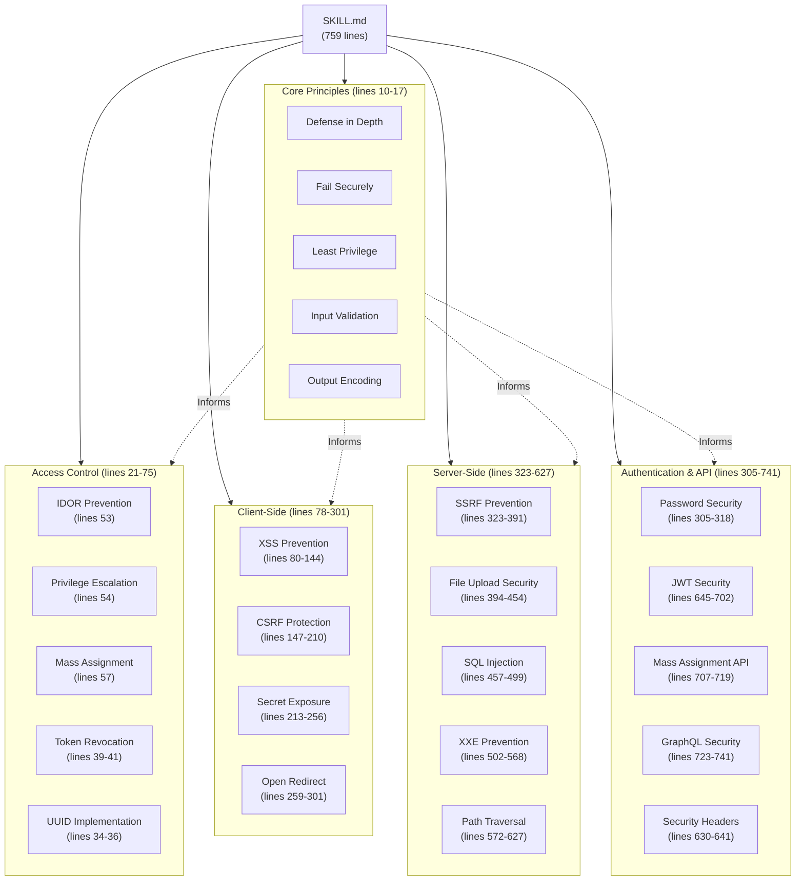
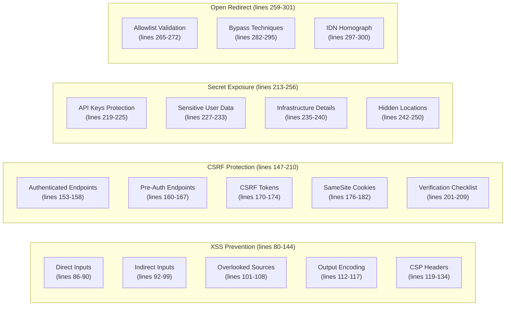
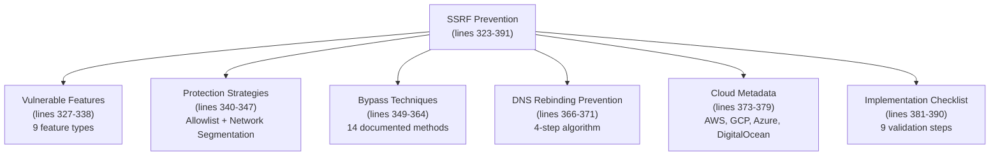
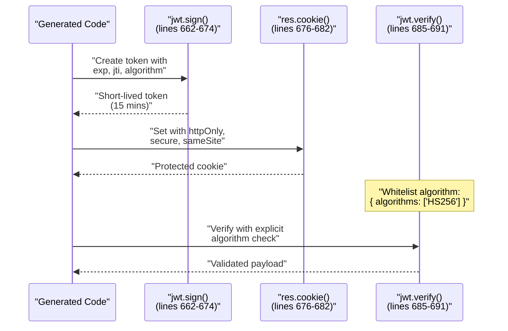
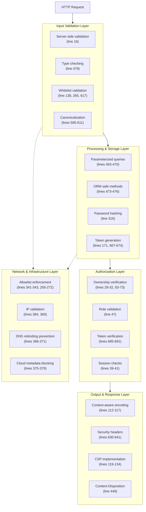
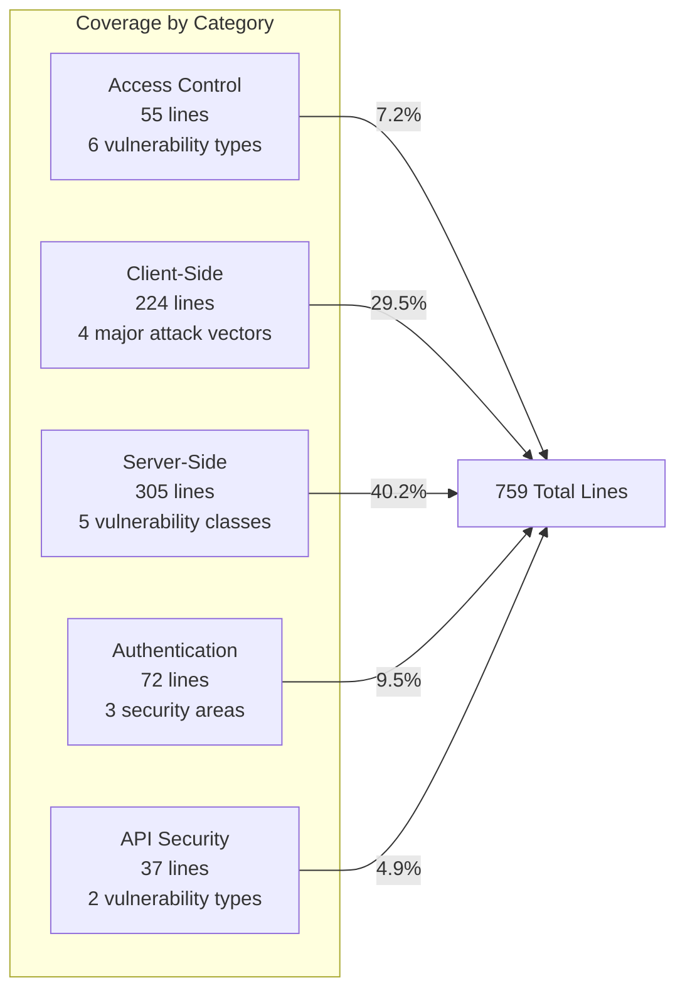

<!-- source: DeepWiki mcp.deepwiki.com · repo BehiSecc/VibeSec-Skill · page 11 Complete Vulnerability Coverage · fetched 2026-10-26 -->

# Complete Vulnerability Coverage

Relevant source files

The following files were used as context for generating this wiki page:

- [README.md](README.md)
- [SKILL.md](SKILL.md)

## Purpose and Scope

This document provides a comprehensive reference matrix of all vulnerability types covered by VibeSec-Skill. It organizes vulnerabilities by category, maps them to specific sections in the `SKILL.md` knowledge base, and presents coverage statistics and protection mechanisms.

For detailed implementation guidance on specific vulnerability classes, see:
- Access control patterns: [Access Control & Authorization](#5)
- Client-side vulnerabilities: [Client-Side Security](#6) and sub-pages
- Server-side vulnerabilities: [Server-Side Security](#7) and sub-pages
- Authentication mechanisms: [Authentication & Session Security](#8)
- API-specific concerns: [API Security](#9)

**Sources:** [README.md:78-98](), [SKILL.md:1-759]()

---

## Complete Vulnerability Coverage Matrix

VibeSec-Skill provides security guidance across 5 major categories, covering 20+ distinct vulnerability types with specific prevention patterns, bypass technique documentation, and implementation checklists.

| Category | Vulnerability Type | Coverage Depth | SKILL.md Location | Prevention Approach |
|----------|-------------------|----------------|-------------------|---------------------|
| **Access Control** | IDOR (Insecure Direct Object Reference) | Comprehensive | [SKILL.md:53]() | UUID usage, ownership verification |
| | Privilege Escalation | Comprehensive | [SKILL.md:54]() | Server-side role validation |
| | Horizontal Access Control | Comprehensive | [SKILL.md:55]() | User ownership checks |
| | Vertical Access Control | Comprehensive | [SKILL.md:56]() | Role-based authorization |
| | Mass Assignment | Comprehensive | [SKILL.md:57]() | Field whitelisting |
| | Token Revocation | Comprehensive | [SKILL.md:39-41]() | Session invalidation, revocation lists |
| **Client-Side** | Stored XSS | Comprehensive | [SKILL.md:80-144]() | Output encoding, CSP |
| | Reflected XSS | Comprehensive | [SKILL.md:80-144]() | Context-aware escaping |
| | DOM-based XSS | Comprehensive | [SKILL.md:80-144]() | Safe DOM manipulation |
| | CSRF (Cross-Site Request Forgery) | Comprehensive | [SKILL.md:147-210]() | CSRF tokens, SameSite cookies |
| | Secret Key Exposure | Comprehensive | [SKILL.md:213-256]() | Environment variables, server-side API calls |
| | Open Redirect | Comprehensive | [SKILL.md:259-301]() | Allowlist validation, bypass prevention |
| **Server-Side** | SSRF (Server-Side Request Forgery) | Comprehensive | [SKILL.md:323-391]() | Allowlist, DNS validation, IP filtering |
| | SQL Injection | Comprehensive | [SKILL.md:457-499]() | Parameterized queries, ORM usage |
| | XXE (XML External Entity) | Comprehensive | [SKILL.md:502-568]() | Disable external entities, DTD processing |
| | Path Traversal | Comprehensive | [SKILL.md:572-627]() | Canonicalization, indirect references |
| | Insecure File Upload | Comprehensive | [SKILL.md:394-454]() | Magic byte validation, polyglot detection |
| **Authentication** | Weak Password Storage | Comprehensive | [SKILL.md:305-318]() | Argon2id, bcrypt, scrypt |
| | JWT Security | Comprehensive | [SKILL.md:645-702]() | Algorithm validation, expiration |
| | Session Management | Moderate | [SKILL.md:39-41, 176-183]() | HttpOnly cookies, token rotation |
| **API Security** | Mass Assignment | Comprehensive | [SKILL.md:707-719]() | Whitelist allowed fields |
| | GraphQL Abuse | Comprehensive | [SKILL.md:723-741]() | Query depth/complexity limits, introspection |

**Sources:** [SKILL.md:21-741](), [README.md:82-88]()

---

## Vulnerability to SKILL.md Section Mapping

The following diagram maps each vulnerability class to its corresponding section in the `SKILL.md` knowledge base, showing how the 759-line security directive is organized:

**Sources:** [SKILL.md:10-17](), [SKILL.md:21-75](), [SKILL.md:78-301](), [SKILL.md:323-627](), [SKILL.md:305-741]()

---

## Coverage Depth by Category

### Access Control Coverage

The access control section spans [SKILL.md:21-75]() and provides comprehensive coverage with specific implementation patterns.

| Aspect | Coverage Detail | Lines |
|--------|----------------|-------|
| Authorization Checks | 5-point checklist with verification steps | [SKILL.md:43-49]() |
| UUID Implementation | Explicit UUIDv4 requirement, exception handling | [SKILL.md:34-36]() |
| Account Lifecycle | Token revocation, session invalidation patterns | [SKILL.md:39-41]() |
| Implementation Pattern | Pseudocode for secure resource access | [SKILL.md:61-74]() |
| Common Pitfalls | 5 vulnerability patterns with descriptions | [SKILL.md:51-57]() |

**Protection Mechanisms:**
- User ownership verification at data layer ([SKILL.md:29-32]())
- UUIDv4 for non-guessable resource identifiers ([SKILL.md:34-36]())
- Organization membership validation ([SKILL.md:31]())
- Parent resource ownership checks ([SKILL.md:49]())
- Return `404` instead of `403` to prevent enumeration ([SKILL.md:71]())

**Sources:** [SKILL.md:21-75]()

---

### Client-Side Coverage

Client-side vulnerabilities span [SKILL.md:78-301]() across four major attack vectors.

**XSS Coverage Statistics:**
- 15+ input sources documented ([SKILL.md:84-108]())
- 4 context-specific encoding methods ([SKILL.md:112-117]())
- 11-directive CSP template ([SKILL.md:121-130]())
- Input sanitization libraries referenced ([SKILL.md:136-139]())

**CSRF Coverage Statistics:**
- 12 endpoint types requiring protection ([SKILL.md:151-167]())
- 3 protection mechanisms detailed ([SKILL.md:169-187]())
- 9 edge cases and common mistakes ([SKILL.md:189-198]())
- 7-point verification checklist ([SKILL.md:203-209]())

**Sources:** [SKILL.md:78-301]()

---

### Server-Side Coverage

Server-side vulnerabilities span [SKILL.md:323-627]() with the most extensive coverage in VibeSec-Skill.

| Vulnerability | Line Range | Key Features | Bypass Techniques Covered |
|---------------|------------|--------------|---------------------------|
| **SSRF** | [SKILL.md:323-391]() | 9 vulnerable features, cloud metadata protection | 14 IP/DNS bypass methods ([SKILL.md:349-364]()) |
| **File Upload** | [SKILL.md:394-454]() | Magic bytes reference, polyglot detection | 12 bypass techniques ([SKILL.md:416-431]()) |
| **SQL Injection** | [SKILL.md:457-499]() | Parameterized queries, ORM patterns | 8 injection points documented ([SKILL.md:483-492]()) |
| **XXE** | [SKILL.md:502-568]() | 5 language-specific prevention code examples | 10 vulnerable scenarios ([SKILL.md:506-520]()) |
| **Path Traversal** | [SKILL.md:572-627]() | Canonicalization algorithm, indirect references | Input sanitization patterns ([SKILL.md:614-618]()) |

**SSRF Deep Coverage:**

**File Upload Coverage Highlights:**
- Magic bytes reference table for 6 file types ([SKILL.md:433-442]())
- 12 attack types with prevention strategies ([SKILL.md:416-431]())
- 5-step secure upload handling pattern ([SKILL.md:444-453]())

**Sources:** [SKILL.md:323-627]()

---

### Authentication & API Coverage

Authentication and API security span [SKILL.md:305-318]() and [SKILL.md:645-741]().

**Password Security:**
- Minimum requirements defined ([SKILL.md:307-312]())
- Storage algorithms: `Argon2id`, `bcrypt`, `scrypt` ([SKILL.md:316]())
- Forbidden algorithms: `MD5`, `SHA1`, plain `SHA256` ([SKILL.md:317]())

**JWT Security Coverage:**

| Vulnerability Type | Prevention | Code Location |
|-------------------|------------|---------------|
| `alg: none` attack | Reject `none` algorithm | [SKILL.md:653]() |
| Algorithm confusion | Explicit algorithm specification | [SKILL.md:654, 686]() |
| Weak HMAC secrets | 256+ bit random secrets | [SKILL.md:655]() |
| Missing expiration | Always set `exp` claim | [SKILL.md:656, 670]() |
| Token in localStorage | HttpOnly, Secure, SameSite cookies | [SKILL.md:657, 676-682]() |

**JWT Implementation Pattern:**

**API Security:**
- Mass assignment field whitelisting ([SKILL.md:707-719]())
- GraphQL introspection disabling ([SKILL.md:727]())
- Query depth limiting ([SKILL.md:728, 737]())
- Query complexity enforcement ([SKILL.md:729, 738]())
- Batching attack prevention ([SKILL.md:730]())

**Sources:** [SKILL.md:305-318](), [SKILL.md:645-702](), [SKILL.md:705-741]()

---

## Protection Mechanism Taxonomy

VibeSec-Skill organizes protection mechanisms into distinct categories based on where they are applied in the application stack:

**Sources:** [SKILL.md:10-17](), [SKILL.md:112-144](), [SKILL.md:463-499](), [SKILL.md:630-641]()

---

## Coverage Statistics

### Overall Coverage Metrics

| Metric | Value | Source |
|--------|-------|--------|
| Total Vulnerability Classes | 20+ | [README.md:82-88]() |
| Total Directive Lines | 759 | [SKILL.md:1-759]() |
| Common Vulnerability Coverage | 60-70% | [README.md:31-32]() |
| Major Categories | 5 | [README.md:82-88]() |
| Code Examples Provided | 15+ | Throughout [SKILL.md]() |
| Bypass Techniques Documented | 40+ | Various sections |
| Implementation Checklists | 8 | Various sections |

**Sources:** [README.md:31-32](), [README.md:82-88](), [SKILL.md:1-759]()

---

### Category-Level Coverage

**Line Distribution:**
- **Server-Side Security**: 305 lines (40.2%) - [SKILL.md:323-627]()
- **Client-Side Security**: 224 lines (29.5%) - [SKILL.md:78-301]()
- **Authentication**: 72 lines (9.5%) - [SKILL.md:305-318, 645-702]()
- **Access Control**: 55 lines (7.2%) - [SKILL.md:21-75]()
- **API Security**: 37 lines (4.9%) - [SKILL.md:705-741]()
- **Core Principles & Headers**: 66 lines (8.7%) - [SKILL.md:10-17, 630-641, 744-759]()

**Sources:** [SKILL.md:1-759]()

---

### Advanced Coverage Features

VibeSec-Skill includes coverage of advanced security concerns beyond basic vulnerability prevention:

| Advanced Feature | Description | Location |
|-----------------|-------------|----------|
| **Bypass Technique Documentation** | Specific attack bypasses attackers use | Throughout SKILL.md |
| **Edge Cases** | URL fragments, DNS rebinding, polyglot files | [SKILL.md:94-108, 359, 409, 425]() |
| **Framework-Aware Patterns** | React, Vue, Node.js, Python, Java, .NET | [SKILL.md:117, 525-558]() |
| **Cloud-Aware Protection** | AWS, GCP, Azure metadata endpoints | [SKILL.md:375-379]() |
| **Language-Specific Examples** | Java, Python, PHP, Node.js, .NET code | [SKILL.md:525-558]() |
| **Security Header Templates** | Production-ready CSP, HSTS, etc. | [SKILL.md:119-134, 630-641]() |
| **Verification Checklists** | Actionable steps for each vulnerability | [SKILL.md:43-49, 201-209, 381-390, etc.]() |

**Sources:** [README.md:91-97](), [SKILL.md:various]()

---

## Premium Version Comparison

The free VibeSec-Skill covers 60-70% of common vulnerabilities. For comprehensive coverage, a premium version is available:

| Aspect | Free Version (This Repository) | Premium Version |
|--------|-------------------------------|-----------------|
| Coverage | 60-70% of common vulnerabilities | Comprehensive coverage |
| Vulnerability Classes | 20+ documented | Extended vulnerability taxonomy |
| Availability | GitHub repository | [vibesec.sh](https://vibesec.sh/) |
| Line Count | 759 lines | Extended knowledge base |
| Use Case | Individual projects, learning | Enterprise, production systems |

**Sources:** [README.md:31-32]()

---

## Cross-References to Detailed Pages

For implementation details on specific vulnerability classes covered in this matrix:

- **Access Control Implementation**: See [Access Control & Authorization](#5) for detailed patterns on IDOR prevention, privilege escalation checks, and authorization verification.

- **XSS Prevention Details**: See [Cross-Site Scripting (XSS) Prevention](#6.1) for comprehensive input source cataloging, context-specific encoding, and CSP configuration.

- **CSRF Protection Patterns**: See [Cross-Site Request Forgery (CSRF) Protection](#6.2) for token implementation, SameSite cookie configuration, and edge case handling.

- **SSRF Implementation Guide**: See [Server-Side Request Forgery (SSRF) Prevention](#7.1) for allowlist patterns, DNS rebinding prevention, and cloud metadata protection.

- **SQL Injection Prevention**: See [SQL Injection Prevention](#7.2) for parameterized query patterns and injection point identification.

- **File Upload Security**: See [Insecure File Upload Prevention](#7.5) for magic byte validation, polyglot detection, and secure handling practices.

- **JWT Implementation**: See [JWT Security](#8.2) for algorithm validation, token signing patterns, and secure cookie configuration.

- **API Security Patterns**: See [API Security](#9) for mass assignment prevention and GraphQL query limiting.

**Sources:** [README.md:1-132](), [SKILL.md:1-759]()

---

