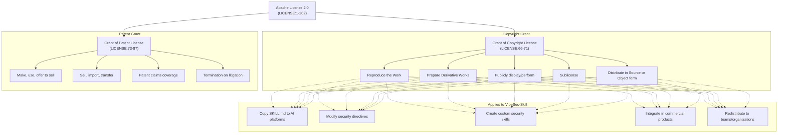
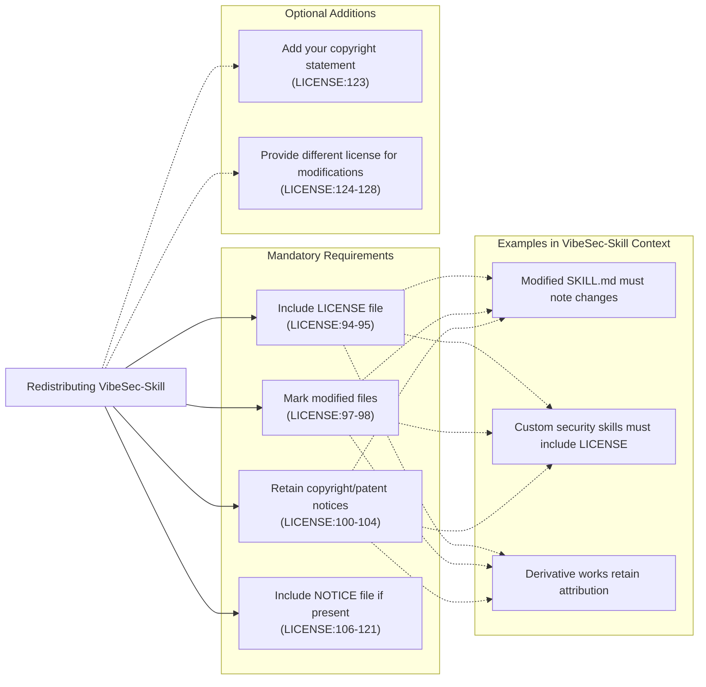
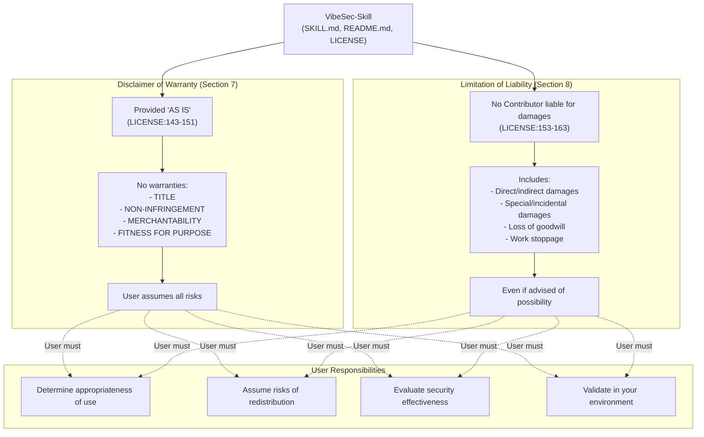
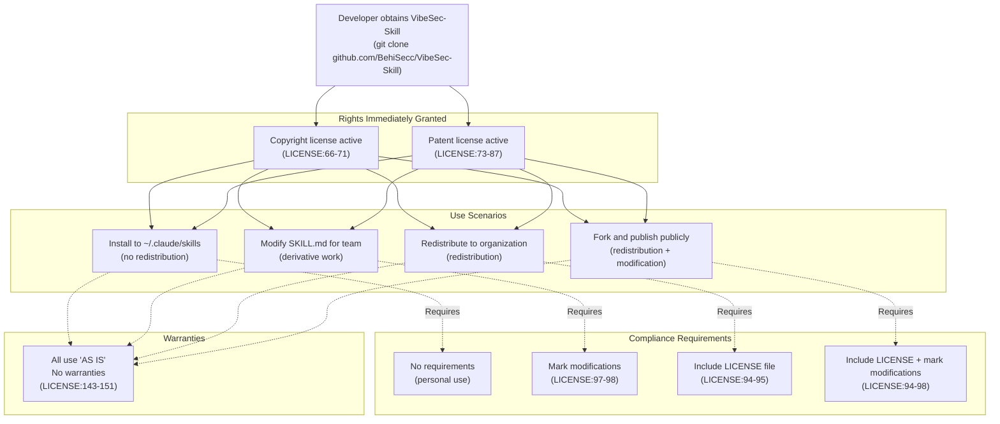

<!-- source: DeepWiki mcp.deepwiki.com · repo BehiSecc/VibeSec-Skill · page 12 License · fetched 2026-10-26 -->

# License

<details>
<summary>Relevant source files</summary>

The following files were used as context for generating this wiki page:

- [LICENSE](LICENSE)

</details>


This document describes the licensing terms under which VibeSec-Skill is distributed. The project uses the Apache License 2.0, which defines the legal rights and obligations for using, modifying, and redistributing the codebase and its derivative works.

For information about the project's capabilities and usage, see [Overview](#1). For installation procedures, see [Installation & Integration](#2).

**Sources:** [LICENSE:1-202]()

---

## License Overview

VibeSec-Skill is distributed under the Apache License, Version 2.0, dated January 2004. This is a permissive open-source license approved by the Apache Software Foundation and the Open Source Initiative (OSI).

The license is located at [LICENSE:1-202]() and applies to all files in the repository, including:
- `SKILL.md` - the primary security knowledge base
- `README.md` - integration documentation
- All associated documentation and configuration files

**Sources:** [LICENSE:1-3]()

---

## Key Definitions

The Apache License 2.0 defines several terms that establish the scope of the licensing agreement:

| Term | Definition | Practical Meaning |
|------|------------|-------------------|
| **License** | Terms and conditions defined in sections 1-9 | The entire Apache 2.0 license text |
| **Licensor** | Copyright owner granting the license | BehiSecc (repository owner) |
| **Work** | The work of authorship made available under the license | VibeSec-Skill repository contents |
| **You/Your** | Individual or Legal Entity exercising permissions | Users, developers, organizations using VibeSec-Skill |
| **Source** form | Preferred form for making modifications | Markdown files (`SKILL.md`, `README.md`) |
| **Derivative Works** | Works based on or derived from the Work | Modified versions of `SKILL.md`, custom security skills, forks |
| **Contribution** | Work intentionally submitted for inclusion | Pull requests, patches, additions to the repository |

**Sources:** [LICENSE:7-65]()

---

## Grant of Rights

The Apache License 2.0 provides two primary grants to users:

### Diagram: License Grants and User Rights



**Sources:** [LICENSE:66-87]()

### Copyright License (Section 2)

The license grants perpetual, worldwide, non-exclusive, no-charge, royalty-free, irrevocable copyright license to:

- **Reproduce** - Make copies of `SKILL.md`, `README.md`, and other files
- **Prepare Derivative Works** - Modify security directives, create domain-specific variants
- **Publicly display/perform** - Share the skill publicly (e.g., in corporate wikis, training materials)
- **Sublicense** - Grant permissions to downstream users
- **Distribute** - Share the Work in source or compiled/processed forms

**Sources:** [LICENSE:66-71]()

### Patent License (Section 3)

The license grants perpetual, worldwide, non-exclusive, no-charge, royalty-free patent license to:

- **Make, have made, use** - Implement the security guidance in code
- **Offer to sell, sell, import, transfer** - Commercialize implementations

**Important limitation:** If you initiate patent litigation alleging that VibeSec-Skill infringes patents, your patent license terminates immediately.

**Sources:** [LICENSE:73-87]()

---

## Redistribution Requirements

When redistributing VibeSec-Skill or derivative works, you must comply with specific conditions:

### Diagram: Redistribution Compliance Checklist



**Sources:** [LICENSE:89-128]()

### Section 4: Redistribution Conditions

| Requirement | Description | VibeSec-Skill Application |
|-------------|-------------|---------------------------|
| **(a) Include License** | Provide copy of `LICENSE` file | Must include [LICENSE:1-202]() with any distribution |
| **(b) Mark Modifications** | State changes in modified files | Add comments to modified `SKILL.md` indicating changes |
| **(c) Retain Notices** | Preserve copyright, patent, trademark notices | Keep original attributions in distributed files |
| **(d) Include NOTICE** | Include NOTICE file if present | VibeSec-Skill currently has no NOTICE file |

**Additional permissions:**
- You may add your own copyright statement to modifications [LICENSE:123]()
- You may apply different license terms to your modifications, provided overall distribution complies with Apache 2.0 [LICENSE:124-128]()

**Sources:** [LICENSE:89-128]()

---

## Contribution Terms

Any contributions submitted to VibeSec-Skill are governed by specific terms:

### Section 5: Submission of Contributions

By default, any contribution intentionally submitted for inclusion (e.g., pull requests adding security directives to `SKILL.md`) is under the Apache 2.0 license terms, without additional conditions.

This means:
- Pull requests to improve `SKILL.md` are licensed under Apache 2.0
- Suggestions for new security patterns are contributed under Apache 2.0
- No separate Contributor License Agreement (CLA) is required

**Exception:** Separate license agreements with the licensor supersede this default.

**Sources:** [LICENSE:130-136]()

---

## Trademark Restrictions

### Section 6: Trademarks

The Apache 2.0 license **does not grant permission** to use:
- Trade names of the licensor
- Trademarks
- Service marks
- Product names

**Permitted use:** Reasonable and customary use to describe the origin of the Work (e.g., "Based on VibeSec-Skill" in derivative works).

**Implications:**
- Cannot claim official affiliation without permission
- Cannot use "VibeSec" or related marks in product names without authorization
- Can reference VibeSec-Skill when describing software origins

**Sources:** [LICENSE:138-141]()

---

## Warranties and Liability

The Apache License 2.0 includes important disclaimers that limit the licensor's legal exposure:

### Diagram: Legal Protections and User Responsibilities



**Sources:** [LICENSE:143-163]()

### Section 7: Disclaimer of Warranty

VibeSec-Skill is provided **"AS IS"** without warranties of any kind, including:
- **No warranty of TITLE** - No guarantee of ownership rights
- **No warranty of NON-INFRINGEMENT** - No guarantee it doesn't violate patents/copyrights
- **No warranty of MERCHANTABILITY** - No guarantee it's fit for sale/use
- **No warranty of FITNESS FOR A PARTICULAR PURPOSE** - No guarantee it meets specific security needs

**Critical implication:** While `SKILL.md` provides security guidance, users must independently verify its effectiveness for their specific use cases. The license disclaims any guarantee that following the directives prevents vulnerabilities.

**Sources:** [LICENSE:143-151]()

### Section 8: Limitation of Liability

Contributors are **not liable** for damages arising from VibeSec-Skill use, including:
- Direct, indirect, special, incidental, or consequential damages
- Loss of goodwill, work stoppage, computer failure
- Any commercial damages or losses

This applies even if contributors were advised of potential damages.

**Practical meaning:** If security vulnerabilities occur despite using VibeSec-Skill guidance, the project maintainers are not legally liable.

**Sources:** [LICENSE:153-163]()

---

## Accepting Additional Liability

### Section 9: Warranty and Liability Obligations

When redistributing VibeSec-Skill or derivative works, you may:
- Offer support, warranty, or indemnity to downstream users
- Charge fees for such services

**Requirements if you accept additional obligations:**
- Act only on your own behalf (not on behalf of other contributors)
- Indemnify, defend, and hold harmless all other contributors from liability incurred due to your additional warranties

**Example scenario:** An organization creates a commercial "VibeSec-Pro" service based on `SKILL.md`, offers security guarantees to customers, and charges fees. That organization must indemnify the original VibeSec-Skill contributors if customers sue based on those guarantees.

**Sources:** [LICENSE:165-174]()

---

## Practical Implications for VibeSec-Skill Users

### Use Case Analysis

| Use Case | Permitted | Requirements | Notes |
|----------|-----------|--------------|-------|
| **Copy SKILL.md to ~/.claude/skills** | ✓ Yes | None | Standard installation per [Installation & Integration](#2) |
| **Modify security directives in SKILL.md** | ✓ Yes | Mark modifications [LICENSE:97-98]() | Document changes in comments |
| **Create industry-specific variant (e.g., SKILL-healthcare.md)** | ✓ Yes | Include LICENSE, mark as modified | Derivative work permitted |
| **Integrate into commercial AI product** | ✓ Yes | Include LICENSE, retain attributions | No royalties required |
| **Sell consulting services using VibeSec-Skill** | ✓ Yes | Indemnify contributors if offering warranties [LICENSE:165-174]() | You accept liability for your services |
| **Redistribute to enterprise teams** | ✓ Yes | Include LICENSE with distribution | Internal corporate use permitted |
| **Use "VibeSec" trademark in product name** | ✗ No (without permission) | N/A - trademark not granted [LICENSE:138-141]() | Describe origin only |
| **Remove copyright notices** | ✗ No | Must retain [LICENSE:100-104]() | Violation of license terms |

**Sources:** [LICENSE:66-174]()

---

## License Application Workflow

### Diagram: How Apache 2.0 Applies to VibeSec-Skill Lifecycle



**Sources:** [LICENSE:66-151]()

---

## License Text Location and Format

The complete Apache License 2.0 text is stored in [LICENSE:1-202](). The file structure is:

```
LICENSE
├── Header: Apache License Version 2.0 [LICENSE:1-3]()
├── Terms and Conditions [LICENSE:5-176]()
│   ├── Section 1: Definitions [LICENSE:7-65]()
│   ├── Section 2: Copyright Grant [LICENSE:66-71]()
│   ├── Section 3: Patent Grant [LICENSE:73-87]()
│   ├── Section 4: Redistribution [LICENSE:89-128]()
│   ├── Section 5: Contributions [LICENSE:130-136]()
│   ├── Section 6: Trademarks [LICENSE:138-141]()
│   ├── Section 7: Warranty Disclaimer [LICENSE:143-151]()
│   ├── Section 8: Liability Limitation [LICENSE:153-163]()
│   └── Section 9: Additional Liability [LICENSE:165-174]()
└── Appendix: Application Instructions [LICENSE:178-201]()
```

The appendix [LICENSE:178-201]() provides boilerplate text for applying the license to new works. VibeSec-Skill does not currently include this boilerplate in individual files, as the repository-level LICENSE file applies to all contents.

**Sources:** [LICENSE:1-202]()

---

## Comparison to Other Licenses

The Apache 2.0 license was chosen for VibeSec-Skill for specific reasons:

| Feature | Apache 2.0 | MIT | GPL 3.0 |
|---------|-----------|-----|---------|
| **Patent Grant** | ✓ Explicit [LICENSE:73-87]() | ✗ Silent | ✓ Explicit |
| **Copyleft** | ✗ Permissive | ✗ Permissive | ✓ Strong copyleft |
| **Commercial Use** | ✓ Unrestricted | ✓ Unrestricted | ✓ With GPL compatibility |
| **Modification Marking** | ✓ Required [LICENSE:97-98]() | ✗ Not required | ✓ Required |
| **Trademark Protection** | ✓ Explicit [LICENSE:138-141]() | ✗ Silent | ✗ Silent |

**Why Apache 2.0 for VibeSec-Skill:**
- **Patent protection** - Ensures users can implement security patterns without patent concerns
- **Permissive redistribution** - Allows integration into commercial AI platforms without copyleft restrictions
- **Modification tracking** - Requires marking changes to `SKILL.md`, preventing confusion between original and modified security guidance
- **Trademark control** - Prevents unauthorized use of VibeSec brand while allowing derivative works

**Sources:** [LICENSE:1-202]()

---

## Summary of Key Obligations

### For Users

When using VibeSec-Skill under Apache 2.0:

**You may:**
- Use `SKILL.md` in any AI platform (commercial or personal)
- Modify security directives for your needs
- Create derivative security skills
- Redistribute to teams, organizations, or publicly
- Charge for services based on VibeSec-Skill

**You must:**
- Include `LICENSE` file when redistributing [LICENSE:94-95]()
- Mark any modifications to files [LICENSE:97-98]()
- Retain copyright and attribution notices [LICENSE:100-104]()

**You cannot:**
- Use VibeSec trademarks without permission [LICENSE:138-141]()
- Hold contributors liable for damages [LICENSE:153-163]()
- Remove copyright notices from distributed files [LICENSE:100-104]()

**You accept:**
- All warranties are disclaimed - use at your own risk [LICENSE:143-151]()
- You're responsible for validating security effectiveness
- No guarantee VibeSec-Skill prevents all vulnerabilities

**Sources:** [LICENSE:66-174]()

---

## Full License Text

The complete, legally binding Apache License 2.0 text is available at [LICENSE:1-202](). This wiki page provides a summary for technical understanding; the LICENSE file text controls in case of any discrepancy.

**Official Apache License 2.0:** http://www.apache.org/licenses/LICENSE-2.0

**Sources:** [LICENSE:1-202]()