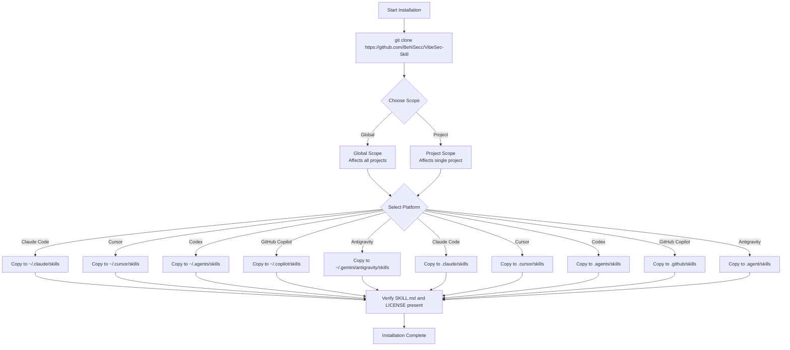
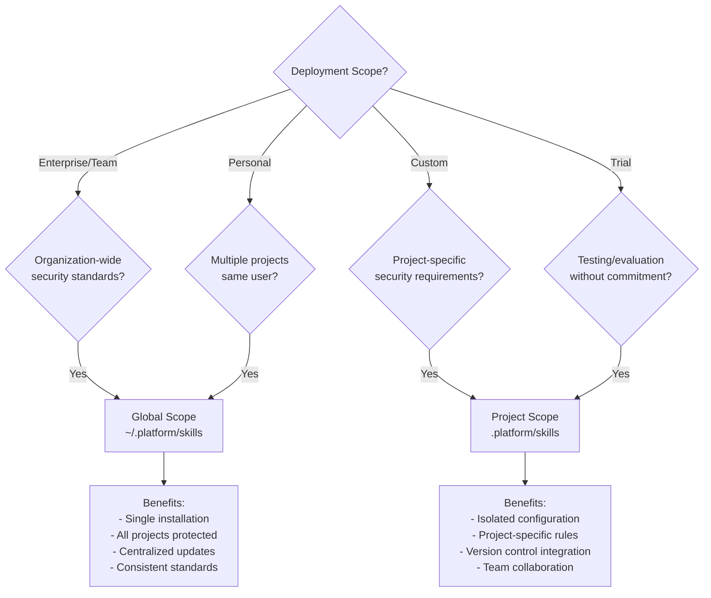
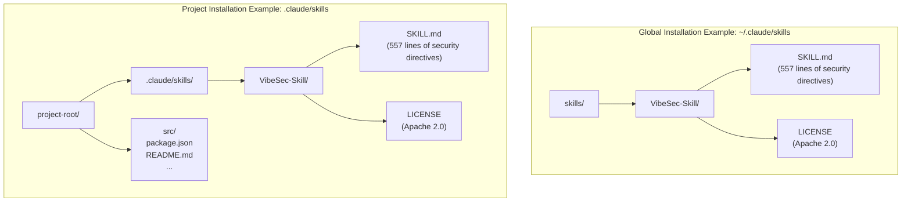
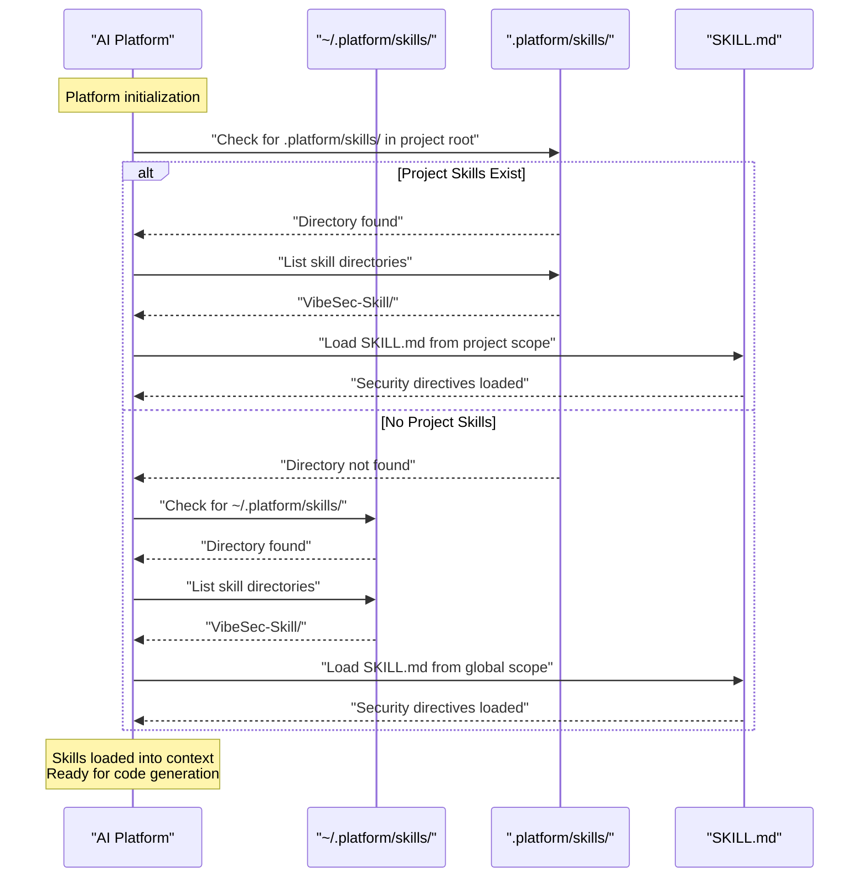

<!-- source: DeepWiki mcp.deepwiki.com · repo BehiSecc/VibeSec-Skill · page 2 Installation & Integration · fetched 2026-10-26 -->

# Installation & Integration

<details>
<summary>Relevant source files</summary>

The following files were used as context for generating this wiki page:

- [README.md](README.md)

</details>


## Purpose and Scope

This document provides comprehensive installation instructions for deploying VibeSec-Skill across all supported AI platforms. It covers platform-specific installation paths, global versus project-scoped deployment strategies, directory structure requirements, and verification procedures. For information about how the skill operates after installation, see [How VibeSec-Skill Works](#3). For an overview of what VibeSec-Skill is and its capabilities, see [Overview](#1).

## Prerequisites

Before installing VibeSec-Skill, ensure you have:

- **Git**: Version control system to clone the repository
- **AI Platform**: At least one of the supported platforms (Claude Code, Cursor, Codex, GitHub Copilot, or Antigravity) installed and configured
- **File System Access**: Permissions to create directories in your home directory (`~`) or project root
- **Command Line Interface**: Terminal or command prompt access

**Sources:** [README.md:35-73]()

## Supported Platforms

VibeSec-Skill integrates with five AI coding platforms, each following a standardized installation pattern:

| Platform | Global Path | Project Path |
|----------|-------------|--------------|
| Claude Code | `~/.claude/skills` | `.claude/skills` |
| Cursor | `~/.cursor/skills` | `.cursor/skills` |
| Codex | `~/.agents/skills` | `.agents/skills` |
| GitHub Copilot | `~/.copilot/skills` | `.github/skills` |
| Antigravity | `~/.gemini/antigravity/skills` | `.agent/skills` |

**Sources:** [README.md:37-73]()

## Installation Workflow

### Installation Process Flow



**Sources:** [README.md:37-73]()

## Platform-Specific Installation

### Claude Code

**Global Installation:**
```bash
# Clone repository
git clone https://github.com/BehiSecc/VibeSec-Skill

# Create skills directory if it doesn't exist
mkdir -p ~/.claude/skills

# Copy VibeSec-Skill to global directory
cp -r VibeSec-Skill ~/.claude/skills/
```

**Project-Specific Installation:**
```bash
# Navigate to your project root
cd /path/to/your/project

# Clone repository
git clone https://github.com/BehiSecc/VibeSec-Skill

# Create project skills directory
mkdir -p .claude/skills

# Copy VibeSec-Skill to project directory
cp -r VibeSec-Skill .claude/skills/
```

**Sources:** [README.md:37-42]()

### Cursor

**Global Installation:**
```bash
# Clone repository
git clone https://github.com/BehiSecc/VibeSec-Skill

# Create skills directory if it doesn't exist
mkdir -p ~/.cursor/skills

# Copy VibeSec-Skill to global directory
cp -r VibeSec-Skill ~/.cursor/skills/
```

**Project-Specific Installation:**
```bash
# Navigate to your project root
cd /path/to/your/project

# Clone repository
git clone https://github.com/BehiSecc/VibeSec-Skill

# Create project skills directory
mkdir -p .cursor/skills

# Copy VibeSec-Skill to project directory
cp -r VibeSec-Skill .cursor/skills/
```

**Sources:** [README.md:44-49]()

### Codex

**Global Installation:**
```bash
# Clone repository
git clone https://github.com/BehiSecc/VibeSec-Skill

# Create skills directory if it doesn't exist
mkdir -p ~/.agents/skills

# Copy VibeSec-Skill to global directory
cp -r VibeSec-Skill ~/.agents/skills/
```

**Project-Specific Installation:**
```bash
# Navigate to your project root
cd /path/to/your/project

# Clone repository
git clone https://github.com/BehiSecc/VibeSec-Skill

# Create project skills directory
mkdir -p .agents/skills

# Copy VibeSec-Skill to project directory
cp -r VibeSec-Skill .agents/skills/
```

**Sources:** [README.md:51-57]()

### GitHub Copilot

**Global Installation:**
```bash
# Clone repository
git clone https://github.com/BehiSecc/VibeSec-Skill

# Create skills directory if it doesn't exist
mkdir -p ~/.copilot/skills

# Copy VibeSec-Skill to global directory
cp -r VibeSec-Skill ~/.copilot/skills/
```

**Project-Specific Installation:**
```bash
# Navigate to your project root
cd /path/to/your/project

# Clone repository
git clone https://github.com/BehiSecc/VibeSec-Skill

# Create project skills directory
mkdir -p .github/skills

# Copy VibeSec-Skill to project directory
cp -r VibeSec-Skill .github/skills/
```

**Sources:** [README.md:59-65]()

### Antigravity

**Global Installation:**
```bash
# Clone repository
git clone https://github.com/BehiSecc/VibeSec-Skill

# Create skills directory if it doesn't exist
mkdir -p ~/.gemini/antigravity/skills

# Copy VibeSec-Skill to global directory
cp -r VibeSec-Skill ~/.gemini/antigravity/skills/
```

**Project-Specific Installation:**
```bash
# Navigate to your project root
cd /path/to/your/project

# Clone repository
git clone https://github.com/BehiSecc/VibeSec-Skill

# Create project skills directory
mkdir -p .agent/skills

# Copy VibeSec-Skill to project directory
cp -r VibeSec-Skill .agent/skills/
```

**Sources:** [README.md:67-73]()

## Global vs Project Scope

### Scope Selection Decision Tree



### Global Scope Characteristics

**Installation Location:** User home directory (`~/.platform/skills`)

**Behavior:**
- Applies to all projects for the current user
- Requires one-time installation per platform
- Updates affect all projects simultaneously
- Suitable for organizational security standards

**Use Cases:**
- Enforcing company-wide security policies
- Personal development environment with consistent security practices
- Multi-project development where all projects require the same security baseline

**Sources:** [README.md:37-73]()

### Project Scope Characteristics

**Installation Location:** Project root directory (`.platform/skills`)

**Behavior:**
- Applies only to the specific project
- Can be version-controlled with project code
- Enables project-specific security configurations
- Allows different security profiles per project

**Use Cases:**
- Projects with unique security requirements
- Team collaboration with shared security configuration
- Testing VibeSec-Skill before global deployment
- Projects requiring different security coverage levels

**Sources:** [README.md:37-73]()

### Scope Precedence

When both global and project-scoped installations exist, the behavior depends on the AI platform's skill loading mechanism. Most platforms follow this precedence:

1. **Project scope** takes priority (if `.platform/skills` exists in project root)
2. **Global scope** applies as fallback (if no project scope exists)
3. **Merged configuration** may occur in some platforms (both scopes loaded)

## Directory Structure After Installation

### Installed Directory Layout



### Required Files

After successful installation, the following files must be present in the skills directory:

| File | Size | Purpose |
|------|------|---------|
| `SKILL.md` | ~557 lines | Primary security knowledge base containing all vulnerability prevention directives |
| `LICENSE` | Standard | Apache 2.0 license terms |

**Sources:** [README.md:37-73]()

## Platform-Specific Directory Structures

### Claude Code Directory Structure

```
Global:
~/.claude/
└── skills/
    └── VibeSec-Skill/
        ├── SKILL.md
        └── LICENSE

Project:
project-root/
├── .claude/
│   └── skills/
│       └── VibeSec-Skill/
│           ├── SKILL.md
│           └── LICENSE
├── src/
├── package.json
└── ...
```

### Cursor Directory Structure

```
Global:
~/.cursor/
└── skills/
    └── VibeSec-Skill/
        ├── SKILL.md
        └── LICENSE

Project:
project-root/
├── .cursor/
│   └── skills/
│       └── VibeSec-Skill/
│           ├── SKILL.md
│           └── LICENSE
├── src/
├── package.json
└── ...
```

### Codex Directory Structure

```
Global:
~/.agents/
└── skills/
    └── VibeSec-Skill/
        ├── SKILL.md
        └── LICENSE

Project:
project-root/
├── .agents/
│   └── skills/
│       └── VibeSec-Skill/
│           ├── SKILL.md
│           └── LICENSE
├── src/
├── package.json
└── ...
```

### GitHub Copilot Directory Structure

```
Global:
~/.copilot/
└── skills/
    └── VibeSec-Skill/
        ├── SKILL.md
        └── LICENSE

Project:
project-root/
├── .github/
│   └── skills/
│       └── VibeSec-Skill/
│           ├── SKILL.md
│           └── LICENSE
├── src/
├── package.json
└── ...
```

### Antigravity Directory Structure

```
Global:
~/.gemini/
└── antigravity/
    └── skills/
        └── VibeSec-Skill/
            ├── SKILL.md
            └── LICENSE

Project:
project-root/
├── .agent/
│   └── skills/
│       └── VibeSec-Skill/
│           ├── SKILL.md
│           └── LICENSE
├── src/
├── package.json
└── ...
```

**Sources:** [README.md:37-73]()

## Verification

### Post-Installation Verification Steps

After installation, verify the skill is correctly deployed:

**Step 1: Verify Directory Structure**
```bash
# For global Claude installation:
ls -la ~/.claude/skills/VibeSec-Skill

# For project-specific Cursor installation:
ls -la .cursor/skills/VibeSec-Skill

# Expected output should show:
# SKILL.md
# LICENSE
```

**Step 2: Verify File Contents**
```bash
# Check SKILL.md exists and contains security directives
head -n 20 ~/.claude/skills/VibeSec-Skill/SKILL.md

# Expected output should show security principles section
```

**Step 3: Verify Skill Discovery by AI Platform**

Test the skill integration by prompting your AI platform:

```markdown
"I'm building a web app with user authentication. Please follow secure coding practices."
```

**Expected Behavior:**
- AI should reference security principles from the skill
- Generated code should include security headers, input validation, and authorization checks
- AI may explicitly mention following VibeSec guidelines

**Step 4: Check for Skill Loading Logs (Platform-Specific)**

Some platforms provide logs indicating skill discovery. Check platform-specific documentation for log locations.

**Sources:** [README.md:101-113]()

## File Discovery Mechanism



**Sources:** [README.md:37-73]()

## Troubleshooting Common Installation Issues

### Issue: Skill Not Discovered by AI Platform

**Symptoms:**
- AI does not apply security directives
- No reference to VibeSec in generated code
- Security headers and validation missing

**Solutions:**
1. Verify directory path matches platform requirements exactly
2. Check for typos in directory names (`.claude` vs `.Clause`)
3. Ensure `SKILL.md` file is present and readable
4. Restart AI platform to trigger skill rediscovery
5. Check platform-specific configuration files for skill directory overrides

### Issue: Permission Denied When Creating Skills Directory

**Symptoms:**
```
mkdir: cannot create directory '~/.claude/skills': Permission denied
```

**Solutions:**
1. Check file system permissions on home directory
2. Use `sudo` only if directory is system-protected (generally not recommended)
3. Verify you're not installing in a protected system directory
4. Check disk space availability

### Issue: Multiple VibeSec Versions Conflict

**Symptoms:**
- Inconsistent security behavior across projects
- Outdated security directives applied

**Solutions:**
1. Remove old global installation before installing new version
2. Check for multiple skill directories in project hierarchy
3. Use project-scoped installation to override global version
4. Document which version is deployed where

### Issue: Skills Directory Not Version Controlled

**Symptoms:**
- Team members have different security configurations
- Skills lost during repository cloning

**Solutions:**
1. For project scope, ensure `.platform/skills` is committed to version control
2. Add `.platform/skills/` to `.gitignore` if you want local-only installation
3. Document installation requirements in project README
4. Consider using git submodules for skill versioning

**Sources:** [README.md:37-73]()

## Integration Validation

### Validation Test Cases

After installation, run these validation tests to confirm integration:

**Test 1: Access Control Implementation**
```markdown
Prompt: "Create an API endpoint to update user profile"

Expected Output Should Include:
- UUID-based resource identification
- Authorization check before data access
- Current user validation
```

**Test 2: Input Validation**
```markdown
Prompt: "Create a file upload handler"

Expected Output Should Include:
- File type validation
- Magic byte verification
- Size limit enforcement
- Sanitized filename handling
```

**Test 3: Security Headers**
```markdown
Prompt: "Create an HTTP response handler"

Expected Output Should Include:
- Content-Security-Policy header
- X-Frame-Options header
- Strict-Transport-Security header
```

If these security patterns are not automatically included, review the troubleshooting section.

**Sources:** [README.md:101-113]()

## Next Steps

After successful installation and verification:

1. Review [How VibeSec-Skill Works](#3) to understand the operational model
2. Examine [Core Security Principles](#4) to understand the foundational concepts
3. Reference specific vulnerability prevention pages (pages 5-10) for detailed guidance
4. Test the skill with your actual development workflows

For advanced configuration and customization, the `SKILL.md` file can be modified to add project-specific security requirements, though this is generally not recommended as it may complicate updates.

**Sources:** [README.md:35-73](), [README.md:101-113]()

---

