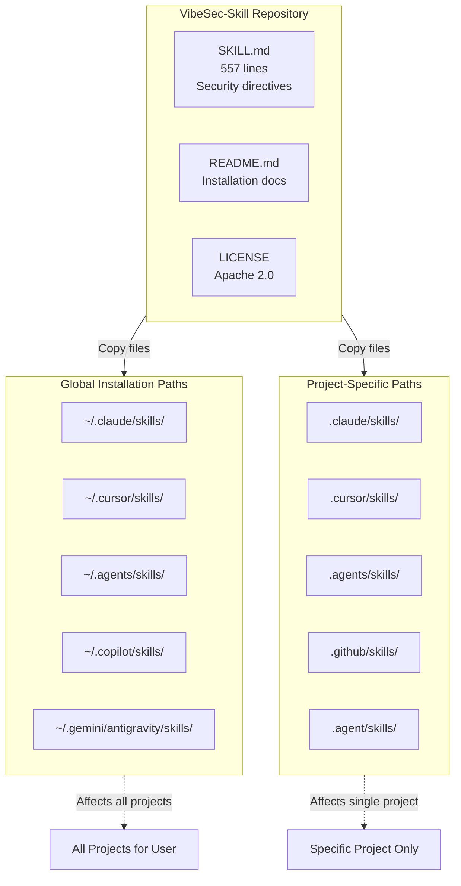
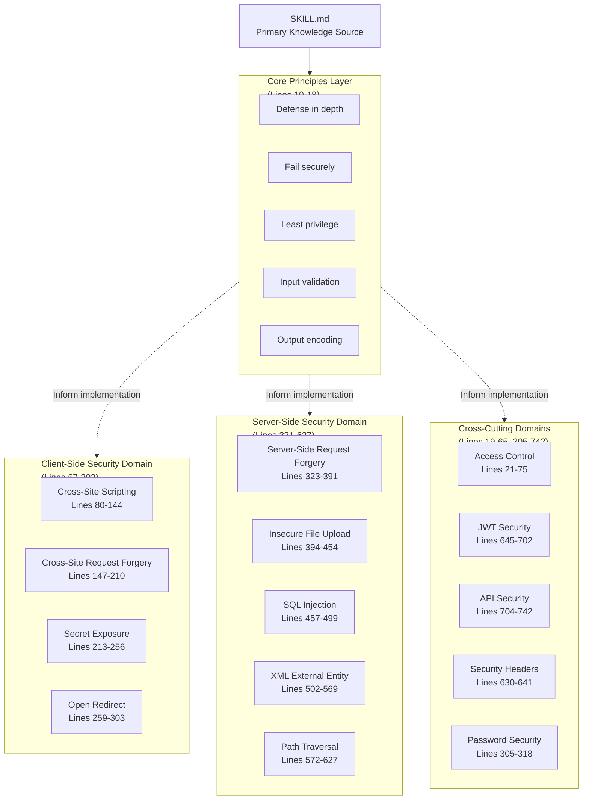
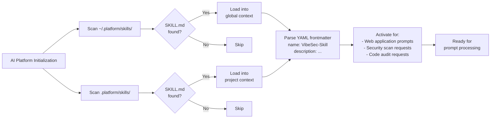
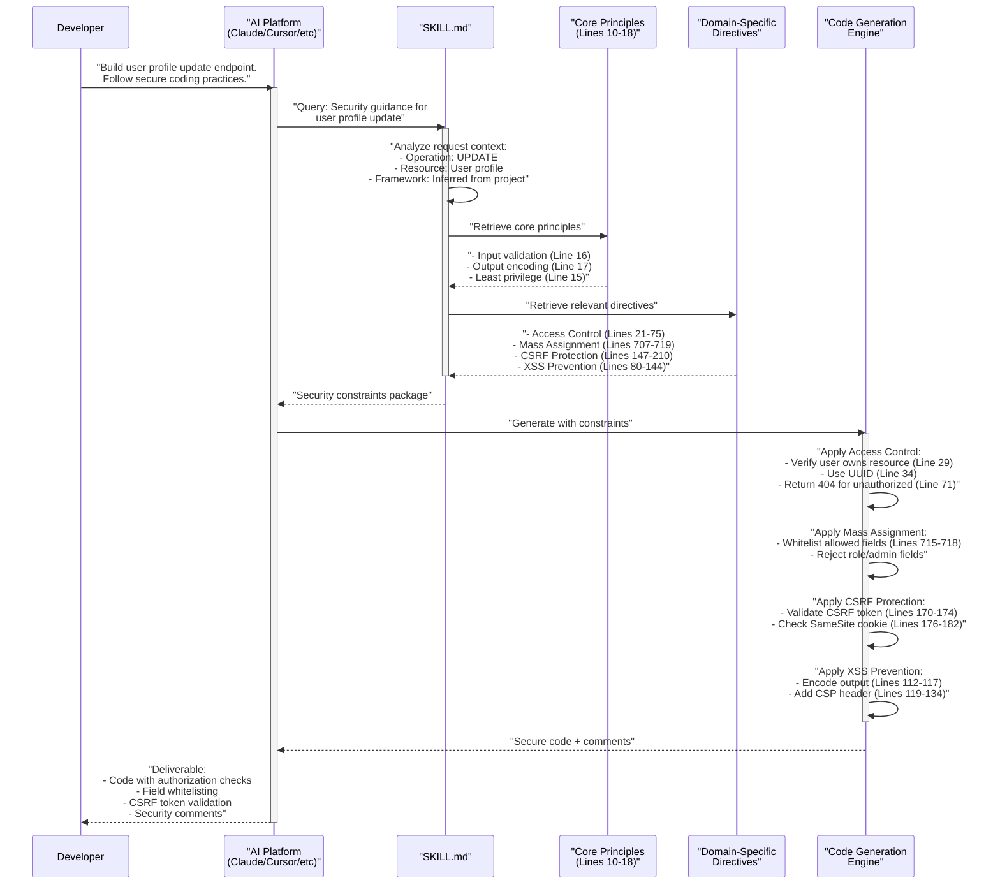
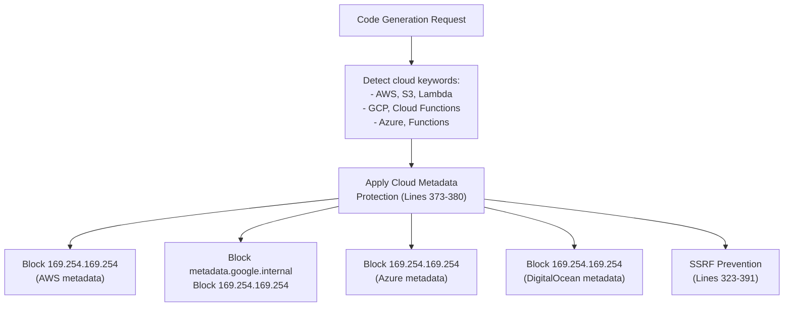
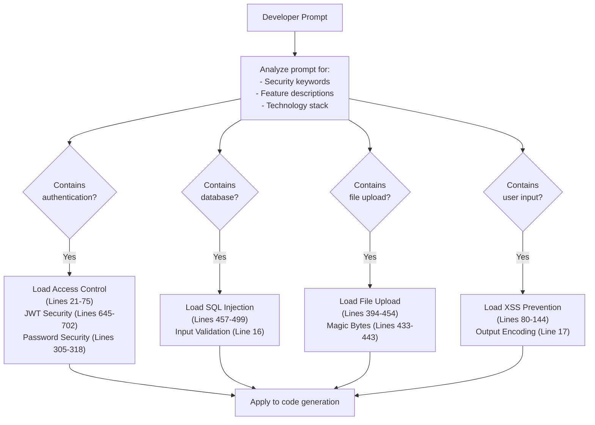

<!-- source: DeepWiki mcp.deepwiki.com · repo BehiSecc/VibeSec-Skill · page 3 How VibeSec-Skill Works · fetched 2026-10-26 -->

# How VibeSec-Skill Works

<details>
<summary>Relevant source files</summary>

The following files were used as context for generating this wiki page:

- [README.md](README.md)
- [SKILL.md](SKILL.md)

</details>


## Purpose and Scope

This page explains the internal architecture, operational workflow, and code generation mechanisms of VibeSec-Skill. It covers how the system integrates with AI platforms, loads security knowledge from `SKILL.md`, and influences code generation through contextual security directive injection.

For information about installing VibeSec-Skill across different platforms, see [Installation & Integration](#2). For details on the specific security vulnerabilities addressed, see [Complete Vulnerability Coverage](#11). For the foundational security concepts, see [Core Security Principles](#4).

**Sources:** [README.md:1-83](), [SKILL.md:1-10]()

---

## System Architecture Overview

VibeSec-Skill operates as a passive knowledge injection system with three core components:

| Component | File | Role | Importance Score |
|-----------|------|------|------------------|
| **Security Knowledge Base** | `SKILL.md` | 557-line declarative security directive document consumed by AI models | 9.77 |
| **Integration Guide** | `README.md` | Multi-platform installation instructions and usage documentation | 8.97 |
| **Legal Documentation** | `LICENSE` | Apache 2.0 license terms | 1.97 |

The system does not execute code or perform active scanning. Instead, it provides AI models with comprehensive security knowledge that influences code generation at the prompt-response phase.

### File Structure and Platform Integration



**Sources:** [README.md:29-73](), [README.md:37-71]()

---

## Knowledge Injection Mechanism

VibeSec-Skill uses a declarative knowledge structure defined in `SKILL.md`. The file begins with YAML frontmatter that instructs AI platforms how to consume the skill:

```yaml
---
name: VibeSec-Skill
description: This skill helps Claude write secure web applications. Use this when working on any web application or when a user requests a scan or audit to ensure security best practices are followed.
---
```

### Knowledge Architecture Hierarchy



**Sources:** [SKILL.md:1-18](), [SKILL.md:10-17](), [SKILL.md:67-303](), [SKILL.md:321-627](), [SKILL.md:19-75](), [SKILL.md:305-742]()

---

## Integration with AI Platforms

### Discovery and Loading Process

When an AI platform starts, it follows this discovery sequence:

1. **Directory Scanning**: Platform scans designated skills directories (global and project-specific)
2. **File Loading**: Reads `SKILL.md` content into model context
3. **Metadata Parsing**: Extracts YAML frontmatter to determine when to activate the skill
4. **Context Injection**: Loads the 557 lines of security directives as available knowledge



### Platform-Specific Directory Mappings

| Platform | Global Path | Project Path | Configuration |
|----------|-------------|--------------|---------------|
| Claude Code | `~/.claude/skills/` | `.claude/skills/` | Automatic discovery |
| Cursor | `~/.cursor/skills/` | `.cursor/skills/` | Automatic discovery |
| Codex | `~/.agents/skills/` | `.agents/skills/` | Automatic discovery |
| GitHub Copilot | `~/.copilot/skills/` | `.github/skills/` | Automatic discovery |
| Antigravity | `~/.gemini/antigravity/skills/` | `.agent/skills/` | Automatic discovery |

**Sources:** [README.md:37-42](), [README.md:44-49](), [README.md:51-56](), [README.md:59-64](), [README.md:67-72](), [SKILL.md:1-4]()

---

## Operational Workflow

### Prompt-to-Secure-Code Generation Flow



**Sources:** [README.md:76-83](), [README.md:104-113](), [SKILL.md:10-18](), [SKILL.md:21-75](), [SKILL.md:707-719](), [SKILL.md:147-210](), [SKILL.md:80-144]()

---

## Context-Aware Code Generation

VibeSec-Skill applies different security directives based on detected context. The AI model analyzes three dimensions:

### 1. Framework Detection

The skill includes framework-specific patterns referenced throughout the directives:

| Framework | Directive References | Example Line Numbers |
|-----------|---------------------|---------------------|
| React | JSX escaping | [SKILL.md:117]() |
| Vue | Template escaping (`{{ }}`) | [SKILL.md:117]() |
| Node.js | `libxmljs` configuration | [SKILL.md:547-551]() |
| Python | `lxml` parser settings | [SKILL.md:534-539]() |
| Java | `DocumentBuilderFactory` | [SKILL.md:526-532]() |
| PHP | `libxml_disable_entity_loader` | [SKILL.md:542-545]() |
| .NET | `XmlReaderSettings` | [SKILL.md:554-558]() |

### 2. Cloud Environment Detection

Cloud-specific protections are activated when cloud services are detected:



### 3. Operation Type Categorization

Different security directives apply based on operation type:

| Operation Type | Triggered Directives | Line References |
|----------------|---------------------|-----------------|
| **Database Query** | SQL Injection Prevention | [SKILL.md:457-499]() |
| **File Upload** | File Upload Security | [SKILL.md:394-454]() |
| **URL Redirection** | Open Redirect Prevention | [SKILL.md:259-303]() |
| **XML Processing** | XXE Prevention | [SKILL.md:502-569]() |
| **File Path Operations** | Path Traversal Prevention | [SKILL.md:572-627]() |
| **External URL Fetch** | SSRF Prevention | [SKILL.md:323-391]() |
| **User Input Rendering** | XSS Prevention | [SKILL.md:80-144]() |
| **State-Changing Endpoints** | CSRF Protection | [SKILL.md:147-210]() |
| **Resource Access** | Access Control | [SKILL.md:21-75]() |
| **JWT Operations** | JWT Security | [SKILL.md:645-702]() |

**Sources:** [README.md:91-97](), [SKILL.md:373-380](), [SKILL.md:117](), [SKILL.md:526-558]()

---

## Security Directive Application

### Directive Retrieval Logic

When the AI model processes a prompt, it retrieves relevant directives through content analysis:



### Directive Organization Structure

Directives in `SKILL.md` are organized hierarchically for efficient retrieval:

1. **Overview Statement** (Lines 8-18): Establishes security mindset and core principles
2. **Vulnerability Categories** (Lines 19-742): Organized by attack vector
3. **Implementation Patterns** (Embedded throughout): Pseudocode and code examples
4. **Checklists** (Embedded throughout): Verification steps for each category

Example directive structure for Access Control:

```
Lines 21-23: Problem statement
Lines 25-42: Core requirements
Lines 44-50: Authorization checks checklist
Lines 52-58: Common pitfalls
Lines 60-74: Implementation pattern (pseudocode)
```

### Code Generation Influence Points

The skill influences code generation at five key points:

| Influence Point | Mechanism | Example Directive |
|----------------|-----------|-------------------|
| **Variable Naming** | Suggests security-conscious naming | `ownerId`, `orgId` instead of `id` |
| **Function Structure** | Injects authorization checks | Resource access verification pattern (Lines 60-74) |
| **Library Selection** | Recommends secure libraries | `DOMPurify` for HTML (Line 137), `Argon2id` for passwords (Line 316) |
| **Configuration** | Generates secure defaults | CSP headers (Lines 119-134), `SameSite=Strict` cookies (Lines 176-182) |
| **Comments** | Adds security annotations | Explains why specific patterns are used |

**Sources:** [SKILL.md:21-75](), [SKILL.md:60-74](), [SKILL.md:137](), [SKILL.md:316](), [SKILL.md:119-134](), [SKILL.md:176-182]()

---

## Edge Case and Bypass Prevention

VibeSec-Skill includes comprehensive bypass technique databases that AI models reference during code generation. These are organized in tabular format for efficient lookup:

### Example: SSRF Bypass Techniques Table

The skill maintains attack technique reference tables, such as IP and DNS bypass methods (Lines 349-365):

| Technique | Example | Prevention Reference |
|-----------|---------|---------------------|
| Decimal IP | `http://2130706433` | IP validation (Lines 368-371) |
| DNS rebinding | Attacker DNS returns internal IP | Double-resolution check (Lines 366-371) |
| Cloud metadata | `169.254.169.254` | Explicit blocklist (Lines 373-380) |

### Example: File Upload Bypass Techniques Table

File upload attack vectors are documented with prevention methods (Lines 416-432):

| Attack | Description | Prevention |
|--------|-------------|------------|
| Extension bypass | `shell.php.jpg` | Allowlist validation |
| Null byte | `shell.php%00.jpg` | Null byte sanitization |
| Magic byte injection | Prepend valid magic bytes | Full structure validation |

These tables are directly referenced during code generation when the AI detects relevant operations.

**Sources:** [SKILL.md:349-365](), [SKILL.md:366-371](), [SKILL.md:373-380](), [SKILL.md:416-432](), [README.md:92-94]()

---

## Security Header Injection

When generating HTTP response code, the skill automatically includes security headers based on the Security Headers Checklist (Lines 630-641):

```
Strict-Transport-Security: max-age=31536000; includeSubDomains; preload
Content-Security-Policy: [context-specific policy]
X-Content-Type-Options: nosniff
X-Frame-Options: DENY
Referrer-Policy: strict-origin-when-cross-origin
Cache-Control: no-store (for sensitive pages)
```

The CSP directive is context-aware, referencing the detailed policy structure from Lines 119-134 that specifies `default-src`, `script-src`, `style-src`, and other directives.

**Sources:** [SKILL.md:630-641](), [SKILL.md:119-134]()

---

## Verification and Validation

The skill includes embedded checklists that AI models use to validate generated code. These appear as interactive checkbox lists:

### Example: Authorization Checks Checklist (Lines 44-50)

```
- [ ] Verify user owns the resource on every request
- [ ] Check organization membership for multi-tenant apps
- [ ] Validate role permissions for role-based actions
- [ ] Re-validate permissions after any privilege change
- [ ] Check parent resource ownership
```

### Example: CSRF Protection Checklist (Lines 201-210)

```
- [ ] Token is cryptographically random
- [ ] Token is tied to user session
- [ ] Token is validated server-side on all state-changing requests
- [ ] Missing token = rejected request
- [ ] Token regenerated on authentication state change
- [ ] SameSite cookie attribute is set
- [ ] Secure and HttpOnly flags on session cookies
```

AI models reference these checklists to ensure generated code includes all required security controls.

**Sources:** [SKILL.md:44-50](), [SKILL.md:201-210](), [SKILL.md:382-391](), [SKILL.md:560-568](), [SKILL.md:621-626](), [SKILL.md:695-702]()

---

## Coverage Metrics

VibeSec-Skill addresses 60-70% of common web application vulnerabilities in its free version. The vulnerability taxonomy is documented in the README:

| Category | Vulnerability Count | Coverage |
|----------|-------------------|----------|
| Access Control | 5 classes | IDOR, Privilege Escalation, Horizontal/Vertical Access, Mass Assignment, Token Revocation |
| Client-Side | 4 classes | XSS (3 types), CSRF, Secret Exposure, Open Redirect |
| Server-Side | 5 classes | SSRF, SQL Injection, XXE, Path Traversal, Insecure File Upload |
| Authentication | 4 areas | Password Security, Session Management, Account Lifecycle, JWT |
| API Security | 2 areas | Mass Assignment, GraphQL |

The premium version at vibesec.sh provides extended coverage beyond this baseline.

**Sources:** [README.md:78-89](), [README.md:31-32]()

---

## Operational Characteristics

### Memory and Context Requirements

- **File Size**: `SKILL.md` is 557 lines, approximately 22KB of text
- **Context Window**: Loaded entirely into AI model context when skill is active
- **Activation Trigger**: Prompts mentioning "web application", "security", "scan", or "audit"

### Scope Precedence

When both global and project-specific skills are present:

1. **Project scope takes precedence** for conflicting directives
2. **Global scope provides fallback** when project scope is absent
3. **Directives merge** when both scopes contain complementary guidance

### Performance Impact

- **No runtime overhead**: Skill does not execute during application runtime
- **Generation-time only**: All security logic applied during code generation phase
- **No dependencies**: Does not require installation of additional packages in target project

**Sources:** [SKILL.md:1-557](), [README.md:37-72](), [SKILL.md:1-4]()

---

