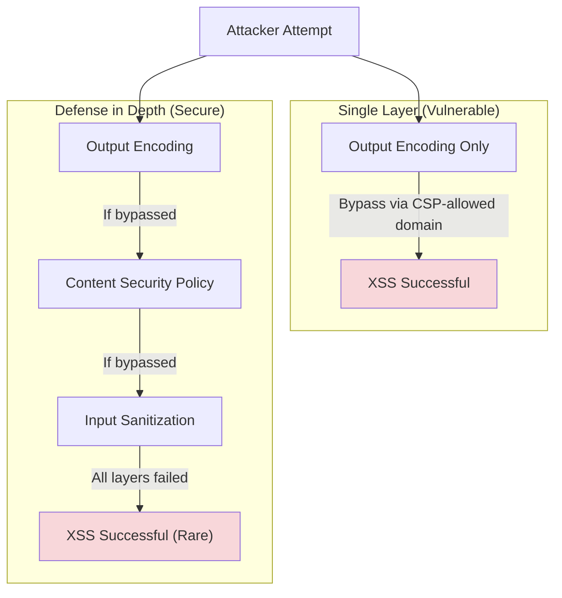
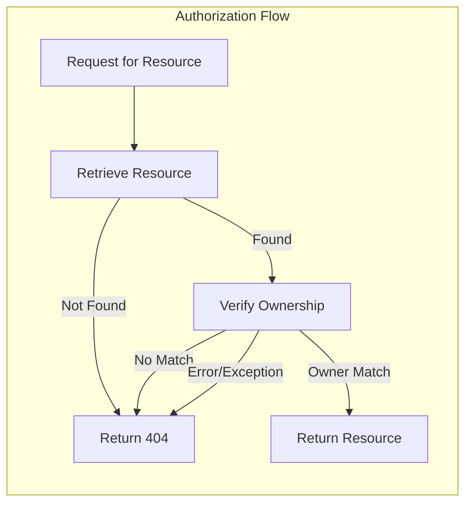
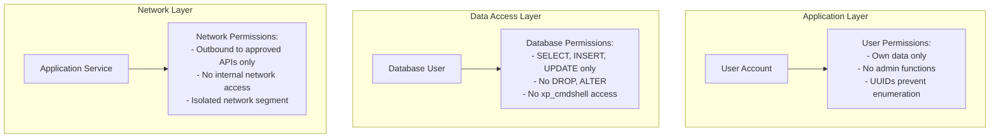
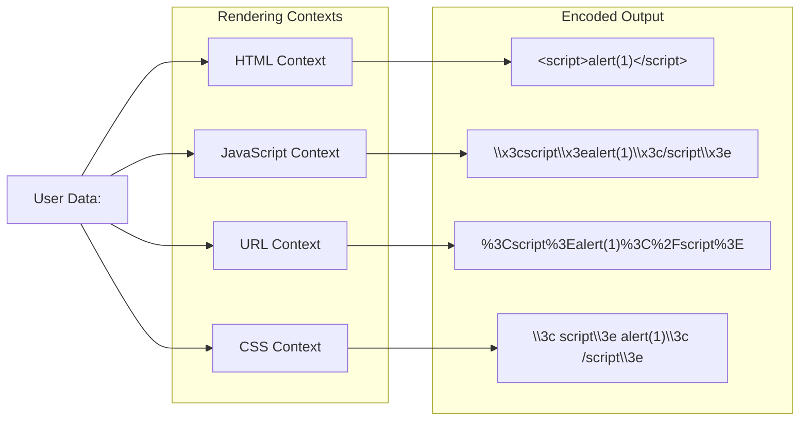
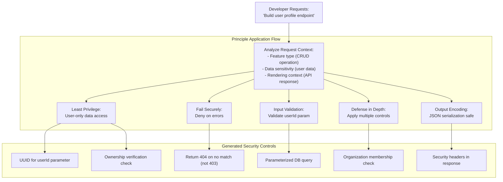

<!-- source: DeepWiki mcp.deepwiki.com · repo BehiSecc/VibeSec-Skill · page 4 Core Security Principles · fetched 2026-10-26 -->

# Core Security Principles

<details>
<summary>Relevant source files</summary>

The following files were used as context for generating this wiki page:

- [SKILL.md](SKILL.md)

</details>


## Purpose and Scope

This document defines the five foundational security principles that underpin all VibeSec-Skill security directives. These principles form the philosophical and architectural basis for every security recommendation provided to AI code generation platforms. Each principle is applied across all vulnerability domains—from access control to file uploads—creating a coherent security philosophy that AI models use to generate secure code.

For specific implementations of these principles across vulnerability categories, see:
- Access control applications: [Access Control & Authorization](#5)
- Client-side applications: [Client-Side Security](#6)
- Server-side applications: [Server-Side Security](#7)
- Authentication applications: [Authentication & Session Security](#8)

---

## The Five Core Principles

VibeSec-Skill operates on five fundamental security principles that inform all 557 lines of security directives in `SKILL.md`. These principles are not independent—they reinforce each other to create layered security.

### Principle 1: Defense in Depth

**Definition:** Never rely on a single security control. Implement multiple layers of security so that if one control fails, others still provide protection.

**Application Pattern:**

| Security Domain | Primary Control | Secondary Control | Tertiary Control |
|----------------|----------------|-------------------|------------------|
| XSS Prevention | Output encoding | Content Security Policy | Input sanitization |
| CSRF Protection | CSRF tokens | SameSite cookies | Origin/Referer validation |
| File Upload Security | Magic byte validation | Extension allowlist | Content-type verification |
| SSRF Prevention | Domain allowlist | IP validation | Network segmentation |
| Access Control | User ownership check | Organization membership check | Role permission validation |

**Why Multiple Layers Matter:**



**Sources:** [SKILL.md:13](), [SKILL.md:110-144]() (XSS defense layers), [SKILL.md:169-183]() (CSRF defense layers)

---

### Principle 2: Fail Securely

**Definition:** When something fails, fail closed (deny access). Never default to allowing access when an error occurs.

**Implementation Pattern:**



**Code Reference Pattern:**

The authorization pattern in [SKILL.md:61-74]() demonstrates fail-secure design:

```
function getResource(resourceId, currentUser):
    resource = database.find(resourceId)
    
    if resource is null:
        return 404  # Fail secure: deny if not found
    
    if resource.ownerId != currentUser.id:
        if not currentUser.hasOrgAccess(resource.orgId):
            return 404  # Fail secure: deny if no permission
    
    return resource
```

**Failure Scenarios and Responses:**

| Failure Scenario | Insecure Default | Secure Default (Fail Closed) |
|-----------------|------------------|------------------------------|
| Database connection lost during auth check | Allow access (assume authorized) | Deny access, return 503 |
| CSRF token validation throws exception | Skip validation | Reject request |
| File extension validation error | Allow upload | Reject upload |
| DNS resolution timeout in SSRF check | Proceed with request | Abort request |
| JWT signature verification error | Trust claims | Reject token |

**Sources:** [SKILL.md:14](), [SKILL.md:61-74]() (authorization pattern), [SKILL.md:685-691]() (JWT verification)

---

### Principle 3: Least Privilege

**Definition:** Grant the minimum permissions necessary for functionality. Users, processes, and services should only access what they absolutely need.

**Application Across Layers:**



**Least Privilege Checklist from SKILL.md:**

| Security Domain | Least Privilege Implementation |
|----------------|-------------------------------|
| Access Control | Users access only their own data; UUIDs prevent ID enumeration [SKILL.md:29-36]() |
| Account Lifecycle | Immediate token revocation on role change [SKILL.md:38-41]() |
| SQL Injection | Database user has minimum required permissions; dangerous functions disabled [SKILL.md:496-498]() |
| File Upload | Uploaded files stored with non-executable permissions [SKILL.md:455]() |
| JWT | Short-lived tokens (15 mins); refresh token rotation [SKILL.md:670]() |
| Mass Assignment | Whitelist only necessary updateable fields [SKILL.md:715-719]() |

**Sources:** [SKILL.md:15](), [SKILL.md:29-36](), [SKILL.md:496-498](), [SKILL.md:670](), [SKILL.md:715-719]()

---

### Principle 4: Input Validation

**Definition:** Never trust user input. Validate everything server-side, regardless of client-side validation.

**Input Source Taxonomy:**

```mermaid
graph TB
    subgraph "Direct User Input"
        D1["Form Fields"]
        D2["File Uploads"]
        D3["Rich Text Editors"]
        D4["Search Queries"]
    end
    
    subgraph "Indirect User Input"
        I1["URL Parameters"]
        I2["HTTP Headers (Referer, User-Agent)"]
        I3["Third-Party API Data"]
        I4["WebSocket Messages"]
        I5["PostMessage Data"]
        I6["LocalStorage Values"]
    end
    
    subgraph "Overlooked Input Sources"
        O1["Error Messages with User Data"]
        O2["PDF/Document Generators"]
        O3["Email Templates"]
        O4["Log Viewers"]
        O5["JSON Responses as HTML"]
        O6["SVG File Uploads"]
        O7["Markdown Rendering"]
    end
    
    subgraph "Validation Layer"
        V["Server-Side Validation:<br/>- Type validation<br/>- Format validation<br/>- Range validation<br/>- Semantic validation"]
    end
    
    D1 & D2 & D3 & D4 --> V
    I1 & I2 & I3 & I4 & I5 & I6 --> V
    O1 & O2 & O3 & O4 & O5 & O6 & O7 --> V
```



**Validation Requirements by Input Type:**

| Input Category | Validation Method | Code Reference |
|---------------|-------------------|----------------|
| SQL Query Parameters | Parameterized queries; type validation | [SKILL.md:463-492]() |
| File Paths | Canonicalization; base directory validation | [SKILL.md:595-612]() |
| File Uploads | Extension allowlist; magic byte validation; size limits | [SKILL.md:398-415]() |
| URLs for Redirection | Domain allowlist; protocol validation | [SKILL.md:265-272]() |
| URLs for SSRF | IP validation; cloud metadata blocking; DNS rebinding checks | [SKILL.md:368-391]() |
| XML Documents | Disable external entities; disable DTD processing | [SKILL.md:562-568]() |
| GraphQL Queries | Depth limiting; complexity analysis; batch size limits | [SKILL.md:725-740]() |

**Sources:** [SKILL.md:16](), [SKILL.md:84-109]() (input source taxonomy), [SKILL.md:749]() (validation principle)

---

### Principle 5: Output Encoding

**Definition:** Encode data appropriately for the context it's rendered in. The same data requires different encoding when displayed in HTML vs JavaScript vs URLs vs CSS.

**Context-Specific Encoding Matrix:**



**Framework-Specific Encoding Mechanisms:**

| Framework/Context | Automatic Encoding | Manual Encoding Required |
|------------------|-------------------|-------------------------|
| React JSX | `{userInput}` auto-escapes HTML | `dangerouslySetInnerHTML` needs manual sanitization |
| Vue.js | `{{ userInput }}` auto-escapes HTML | `v-html` directive needs manual sanitization |
| HTML Entity Encoding | `<` → `&lt;`, `>` → `&gt;` | Apply to all untrusted data in HTML context |
| JavaScript String Escaping | Escape quotes, backslashes, newlines | Use when embedding data in `<script>` tags |
| URL Encoding | Encode special characters for query params | Apply to all untrusted data in URLs |
| CSS Escaping | Escape hex values for CSS injection | Required for user data in style attributes |

**Output Encoding Enforcement Pattern:**

The XSS prevention section [SKILL.md:112-118]() defines the encoding requirements:

1. **HTML context:** HTML entity encode (`<` → `&lt;`)
2. **JavaScript context:** JavaScript escape
3. **URL context:** URL encode
4. **CSS context:** CSS escape
5. **Framework escaping:** Use framework's built-in escaping (React's JSX, Vue's `{{ }}`)

**Sources:** [SKILL.md:17](), [SKILL.md:112-118]() (context-specific encoding), [SKILL.md:753]() (encoding principle)

---

## Principle Interaction and Cascading Effects

These five principles do not operate independently—they reinforce each other to create comprehensive security coverage.

```mermaid
graph TB
    subgraph "Core Principles"
        DepthInDepth["Defense in Depth:<br/>Multiple security layers"]
        FailSecure["Fail Securely:<br/>Deny on error"]
        LeastPriv["Least Privilege:<br/>Minimum access"]
        InputVal["Input Validation:<br/>Never trust input"]
        OutputEnc["Output Encoding:<br/>Context-aware encoding"]
    end
    
    subgraph "XSS Prevention Example"
        XSS1["Layer 1: Input Validation<br/>(Sanitize dangerous patterns)"]
        XSS2["Layer 2: Output Encoding<br/>(Context-specific escaping)"]
        XSS3["Layer 3: CSP Headers<br/>(Block inline scripts)"]
        
        InputVal -.->|Informs| XSS1
        OutputEnc -.->|Informs| XSS2
        DepthInDepth -.->|Requires| XSS3
    end
    
    subgraph "Access Control Example"
        AC1["Verify User Ownership<br/>(Least Privilege)"]
        AC2["Return 404 on Failure<br/>(Fail Securely)"]
        AC3["Check Org + Role + Resource<br/>(Defense in Depth)"]
        
        LeastPriv -.->|Informs| AC1
        FailSecure -.->|Informs| AC2
        DepthInDepth -.->|Requires| AC3
    end
    
    subgraph "File Upload Example"
        FU1["Validate Input Type<br/>(Input Validation)"]
        FU2["Check Extension + Magic Bytes + Content<br/>(Defense in Depth)"]
        FU3["Reject on Any Validation Failure<br/>(Fail Securely)"]
        FU4["Store with No Execute Permissions<br/>(Least Privilege)"]
        
        InputVal -.->|Informs| FU1
        DepthInDepth -.->|Requires| FU2
        FailSecure -.->|Informs| FU3
        LeastPriv -.->|Informs| FU4
    end
```



**Sources:** [SKILL.md:10-17]() (principle definitions), [SKILL.md:80-144]() (XSS multi-layer), [SKILL.md:21-75]() (access control), [SKILL.md:394-455]() (file upload)

---

## Principle Application Across SKILL.md Domains

The following table maps each principle to specific sections of `SKILL.md` where it is the primary guiding principle:

| Principle | Primary Application Domains | Line References |
|-----------|----------------------------|----------------|
| **Defense in Depth** | XSS (encoding + CSP + sanitization)<br/>CSRF (tokens + SameSite + Origin validation)<br/>File Uploads (extension + magic bytes + content) | [SKILL.md:110-144]()<br/>[SKILL.md:169-210]()<br/>[SKILL.md:398-455]() |
| **Fail Securely** | Access Control (404 on no match)<br/>JWT Verification (reject on error)<br/>SSRF (abort on validation failure) | [SKILL.md:61-74]()<br/>[SKILL.md:685-691]()<br/>[SKILL.md:382-391]() |
| **Least Privilege** | Access Control (UUIDs, user-only data)<br/>SQL Injection (minimal DB permissions)<br/>Account Lifecycle (token revocation)<br/>JWT (short-lived tokens) | [SKILL.md:29-41]()<br/>[SKILL.md:496-498]()<br/>[SKILL.md:670]()<br/>[SKILL.md:715-719]() |
| **Input Validation** | SQL Injection (parameterized queries)<br/>Path Traversal (canonicalization)<br/>SSRF (IP/DNS validation)<br/>File Upload (type/content validation)<br/>GraphQL (depth/complexity limits) | [SKILL.md:463-492]()<br/>[SKILL.md:595-627]()<br/>[SKILL.md:349-391]()<br/>[SKILL.md:398-415]()<br/>[SKILL.md:725-740]() |
| **Output Encoding** | XSS (context-specific encoding)<br/>Open Redirect (URL validation)<br/>Security Headers (CSP, nosniff) | [SKILL.md:112-144]()<br/>[SKILL.md:259-302]()<br/>[SKILL.md:630-642]() |

---

## How Principles Inform Code Generation

When an AI model generates code using VibeSec-Skill, these principles are applied through a decision tree that determines which security controls to implement:



**Sources:** [SKILL.md:10-17]() (principles), [SKILL.md:747-758]() (general security principles applied during generation)

---

## Principle Coverage Statistics

The following table quantifies how extensively each principle is covered across `SKILL.md`:

| Principle | Direct References | Implicit Applications | Total Directive Count |
|-----------|------------------|----------------------|---------------------|
| Defense in Depth | 1 explicit statement | 15+ multi-layer security sections | ~90 directives |
| Fail Securely | 1 explicit statement | 8+ failure handling patterns | ~35 directives |
| Least Privilege | 1 explicit statement | 12+ permission minimization sections | ~55 directives |
| Input Validation | 1 explicit statement | 25+ validation requirement sections | ~180 directives |
| Output Encoding | 1 explicit statement | 8+ encoding context sections | ~65 directives |

**Calculation Method:** Directive counts include all specific security requirements, checklists, code examples, and prevention strategies that implement each principle across [SKILL.md:1-557]().

**Sources:** [SKILL.md:10-17]() (explicit statements), [SKILL.md:19-757]() (directive distribution)

---

## Relationship to OWASP Top 10

VibeSec-Skill's five principles provide comprehensive coverage of the OWASP Top 10 vulnerabilities:

| OWASP Category | Covered by Principle(s) | Implementation Section |
|----------------|------------------------|----------------------|
| A01: Broken Access Control | Least Privilege, Fail Securely | [Access Control & Authorization](#5) |
| A02: Cryptographic Failures | Least Privilege (secure storage) | [Password Security](#8.1) |
| A03: Injection | Input Validation, Output Encoding | [SQL Injection Prevention](#7.2), [XSS Prevention](#6.1) |
| A04: Insecure Design | Defense in Depth, Fail Securely | All sections (architectural principle) |
| A05: Security Misconfiguration | Defense in Depth (security headers) | [Security Headers Reference](#10) |
| A06: Vulnerable Components | Defense in Depth | [SKILL.md:758]() (dependency updates) |
| A07: Authentication Failures | Fail Securely, Least Privilege | [Authentication & Session Security](#8) |
| A08: Data Integrity Failures | Input Validation, Fail Securely | [JWT Security](#8.2) |
| A09: Logging Failures | Fail Securely (no stack trace exposure) | [SKILL.md:756]() (error handling) |
| A10: SSRF | Input Validation, Defense in Depth | [SSRF Prevention](#7.1) |

**Sources:** [SKILL.md:10-17]() (principles), entire `SKILL.md` structure (OWASP coverage)

---

## Principle Violation Examples

Understanding violations helps AI models recognize insecure patterns to avoid:

| Principle Violated | Insecure Code Pattern | Line Reference | Secure Alternative Reference |
|-------------------|----------------------|----------------|----------------------------|
| Defense in Depth | Output encoding only, no CSP | N/A (anti-pattern) | [SKILL.md:119-135]() |
| Fail Securely | Return 200 on validation error | N/A (anti-pattern) | [SKILL.md:66-71]() |
| Least Privilege | Database user has DROP permissions | N/A (anti-pattern) | [SKILL.md:496]() |
| Input Validation | String concatenation in SQL | [SKILL.md:466]() (vulnerable example) | [SKILL.md:469-470]() |
| Output Encoding | Raw user input in HTML | N/A (anti-pattern) | [SKILL.md:113]() |

**Sources:** [SKILL.md:466]() (vulnerable SQL example), [SKILL.md:61-74]() (secure patterns), [SKILL.md:110-144]() (XSS patterns)

---

