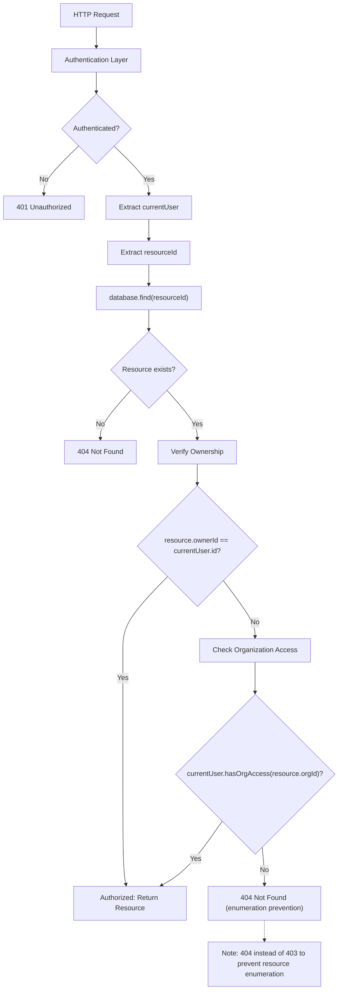
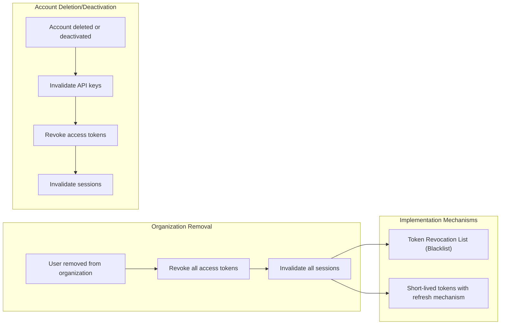
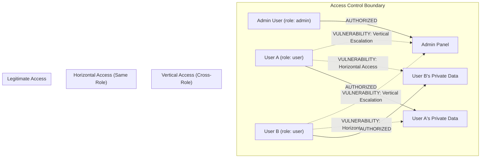
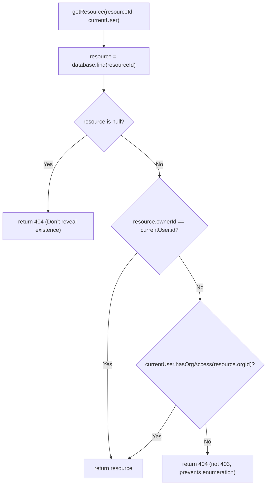
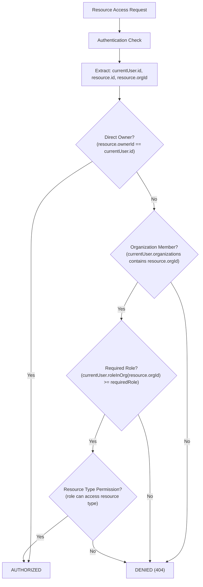
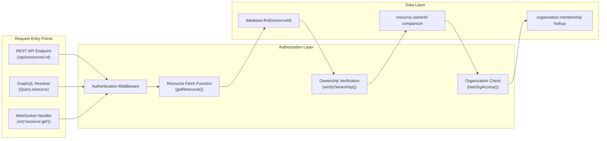

<!-- source: DeepWiki mcp.deepwiki.com · repo BehiSecc/VibeSec-Skill · page 5 Access Control & Authorization · fetched 2026-10-26 -->

# Access Control & Authorization

<details>
<summary>Relevant source files</summary>

The following files were used as context for generating this wiki page:

- [SKILL.md](SKILL.md)

</details>


## Purpose and Scope

This document covers access control and authorization vulnerabilities and secure implementation patterns as defined in VibeSec-Skill. Authorization ensures that authenticated users can only access resources and perform actions they are explicitly permitted to access.

This page focuses specifically on resource-level authorization checks, ownership verification, and object reference security. For authentication mechanisms and session security, see [Authentication & Session Security](#8). For API-specific authorization concerns including mass assignment, see [API Security](#9).

**Sources:** [SKILL.md:21-76]()

---

## Authorization Architecture Overview

The following diagram illustrates how authorization checks integrate into the request processing flow:



**Sources:** [SKILL.md:59-74]()

---

## Core Authorization Requirements

### User-Level Authorization

Every data point and action requiring authentication must enforce user-level authorization checks. The security model requires three fundamental verifications:

| Requirement | Description | Enforcement Point |
|-------------|-------------|-------------------|
| **Ownership Verification** | Each user must only access/modify their own data | Data layer (not route level) |
| **No Cross-User Access** | No user should access data from other users or organizations | Every request |
| **Parent Resource Verification** | Check ownership of parent resources (e.g., verify post ownership when accessing comments) | Nested resource access |

The authorization check must occur at the **data layer**, not merely at the route level, to prevent bypass through parameter manipulation or API misuse.

**Sources:** [SKILL.md:27-32]()

---

### UUID-Based Resource Identification

Sequential integer IDs enable enumeration attacks where attackers can iterate through ID values to discover and access resources. VibeSec-Skill mandates non-guessable identifiers:

**Requirements:**
- Use UUIDv4 or similar non-guessable identifiers for all resources
- Exception: Sequential IDs only permitted when explicitly requested by user
- Apply to all resource types: users, documents, transactions, sessions, etc.

**Rationale:** Sequential IDs (1, 2, 3...) make IDOR attacks trivial. An attacker who gains access to resource `123` can immediately test `122`, `124`, etc. UUIDs (`550e8400-e29b-41d4-a716-446655440000`) prevent this enumeration vector.

**Sources:** [SKILL.md:34-36]()

---

### Account Lifecycle Handling

Token and session invalidation must occur immediately upon account state changes:



**Implementation Requirements:**
- **Organization removal**: Immediately revoke all access tokens and sessions when user is removed from organization
- **Account deletion/deactivation**: Invalidate all active sessions and API keys
- **Token management**: Implement token revocation lists OR short-lived tokens with refresh mechanisms

**Sources:** [SKILL.md:38-41]()

---

## Authorization Verification Checklist

The following verification steps must be performed for every protected resource access:

| Check | Description | Failure Consequence |
|-------|-------------|---------------------|
| **Resource ownership verification** | Verify user owns the resource on every request | IDOR vulnerability |
| **Organization membership** | Check organization membership for multi-tenant applications | Horizontal privilege escalation |
| **Role permission validation** | Validate role permissions for role-based actions | Vertical privilege escalation |
| **Post-privilege-change re-validation** | Re-validate permissions after any privilege change | Stale authorization |
| **Parent resource ownership** | Check parent resource ownership for nested resources | Indirect IDOR |

**Critical Principle:** Never trust client-side data for authorization decisions. Always fetch and verify resource ownership from the authoritative data store.

**Sources:** [SKILL.md:43-49]()

---

## Common Authorization Vulnerabilities

### IDOR (Insecure Direct Object Reference)

IDOR occurs when an application exposes direct references to internal objects (database keys, filenames) without verifying the requesting user has permission to access them.

**Vulnerable Pattern:**
```
GET /api/invoices/12345
```

If the server retrieves invoice `12345` without verifying the authenticated user owns or has access to this invoice, any user can access arbitrary invoices by changing the ID parameter.

**Prevention:** Always verify the requesting user has permission to access the requested resource ID. See [Implementation Pattern](#implementation-pattern) below.

**Sources:** [SKILL.md:53]()

---

### Privilege Escalation

Privilege escalation vulnerabilities occur when authorization checks can be bypassed or role information is manipulated.

**Vertical Privilege Escalation:**
- Regular user accessing admin functionality
- User account upgrading to admin role through parameter manipulation
- Validation: Never trust role information from client-side requests

**Horizontal Privilege Escalation:**
- User A accessing User B's resources with the same privilege level
- Example: User modifying another user's profile, accessing another user's private documents
- Prevention: Verify ownership on every resource access, not just role

**Critical Rule:** Validate role changes server-side. Never trust role information from client-side requests or tokens without server-side verification.

**Sources:** [SKILL.md:54-56]()

---

### Horizontal vs. Vertical Access Control Failures

The following diagram illustrates the distinction between horizontal and vertical access control failures:



**Horizontal Access Control Failure:** User A accessing User B's resources, where both have the same privilege level. Both are regular users, but User A should not access User B's data.

**Vertical Access Control Failure:** Regular user accessing admin functionality or resources that require elevated privileges.

**Sources:** [SKILL.md:55-56]()

---

### Mass Assignment

Mass assignment vulnerabilities occur when applications blindly accept request body fields without filtering, allowing users to modify fields they shouldn't control (e.g., `role`, `isAdmin`, `accountBalance`).

**Vulnerable Pattern:**
```javascript
User.update(req.body)
```

If the request body contains `{ name: "Alice", role: "admin" }`, the application updates both name and role, allowing privilege escalation.

**Secure Pattern:**
```javascript
const allowed = ['name', 'email', 'avatar']
const updates = pick(req.body, allowed)
User.update(updates)
```

**Prevention Requirements:**
- Explicitly whitelist allowed fields for each endpoint
- Never accept unfiltered request bodies
- Define separate field sets for different privilege levels
- Apply to all ORMs and frameworks

For detailed mass assignment prevention patterns, see [API Security](#9).

**Sources:** [SKILL.md:57](), [SKILL.md:707-722]()

---

## Implementation Pattern

The following pseudocode demonstrates the secure resource access pattern required by VibeSec-Skill:



**Implementation Code Pattern:**

[SKILL.md:61-74]() provides the following pseudocode template:

```
function getResource(resourceId, currentUser):
    resource = database.find(resourceId)
    
    if resource is null:
        return 404  # Don't reveal if resource exists
    
    if resource.ownerId != currentUser.id:
        if not currentUser.hasOrgAccess(resource.orgId):
            return 404  # Return 404, not 403, to prevent enumeration
    
    return resource
```

**Key Security Decisions:**

| Decision | Rationale |
|----------|-----------|
| Return 404 for non-existent resources | Don't reveal whether resource exists |
| Return 404 (not 403) for unauthorized access | Prevents resource enumeration attacks |
| Check ownership before organization access | Enforce principle of least privilege |
| Perform check at data layer | Cannot be bypassed by route manipulation |

**Enumeration Prevention:** Returning 403 (Forbidden) reveals the resource exists but the user lacks access. Returning 404 prevents attackers from enumerating valid resource IDs.

**Sources:** [SKILL.md:59-74]()

---

## Authorization Flow in Multi-Tenant Applications

Multi-tenant applications require additional organization-level authorization checks:



**Verification Layers for Multi-Tenant Applications:**

1. **Direct Ownership:** `resource.ownerId == currentUser.id`
2. **Organization Membership:** `currentUser.organizations.includes(resource.orgId)`
3. **Role Validation:** User's role within the organization meets minimum requirement
4. **Resource Type Permission:** Role has permission for this resource type

**Sources:** [SKILL.md:43-49]()

---

## Authorization Check Enforcement Points

The following diagram maps authorization checks to code entity types:



**Critical Enforcement Principle:** Authorization checks must occur at the **data layer**, not merely at the routing or middleware layer. This prevents bypass through:
- Direct database access
- Internal API calls that skip routing
- Background jobs accessing resources
- Cached data retrieval

**Sources:** [SKILL.md:27-32](), [SKILL.md:59-74]()

---

## Verification and Testing Checklist

Use the following checklist to verify authorization implementation:

### Ownership Verification
- [ ] User ownership verified on every request (not cached or assumed)
- [ ] Verification uses server-side data source (database, not client tokens)
- [ ] Client-side data never trusted for authorization decisions
- [ ] Parent resource ownership checked for nested resources

### Organization and Role Checks
- [ ] Organization membership checked for multi-tenant applications
- [ ] Role permissions validated for role-based actions
- [ ] Permissions re-validated after privilege changes
- [ ] Role information validated server-side (never trust client claims)

### Resource References
- [ ] UUIDs used instead of sequential IDs (unless explicitly required)
- [ ] 404 returned for both non-existent and unauthorized resources
- [ ] No information leakage in error messages
- [ ] Resource enumeration prevented through consistent responses

### Account Lifecycle
- [ ] Access tokens revoked on organization removal
- [ ] Sessions invalidated on account deletion/deactivation
- [ ] API keys invalidated on account state changes
- [ ] Token revocation list or short-lived tokens implemented

### Mass Assignment Protection
- [ ] Allowed fields explicitly whitelisted per endpoint
- [ ] Sensitive fields (role, isAdmin, etc.) excluded from updates
- [ ] Different field sets for different privilege levels
- [ ] ORM methods use field filtering

**Sources:** [SKILL.md:43-49](), [SKILL.md:51-57]()

---

## Related Security Topics

- **Authentication mechanisms:** See [Authentication & Session Security](#8) for password security, JWT implementation, and session management
- **Session handling:** See [JWT Security](#8.2) for token storage, expiration, and algorithm validation
- **API-specific authorization:** See [API Security](#9) for mass assignment prevention and GraphQL security
- **Security headers:** See [Security Headers Reference](#10) for CORS and access control headers

**Sources:** [SKILL.md:21-76]()

---

