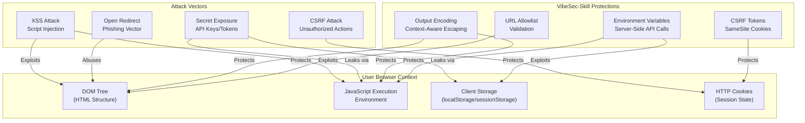
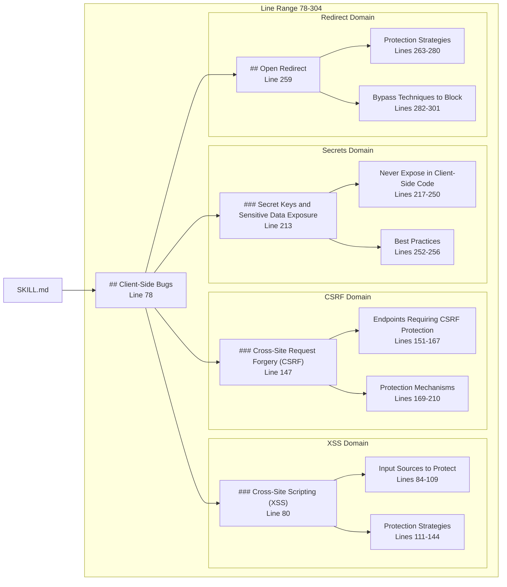
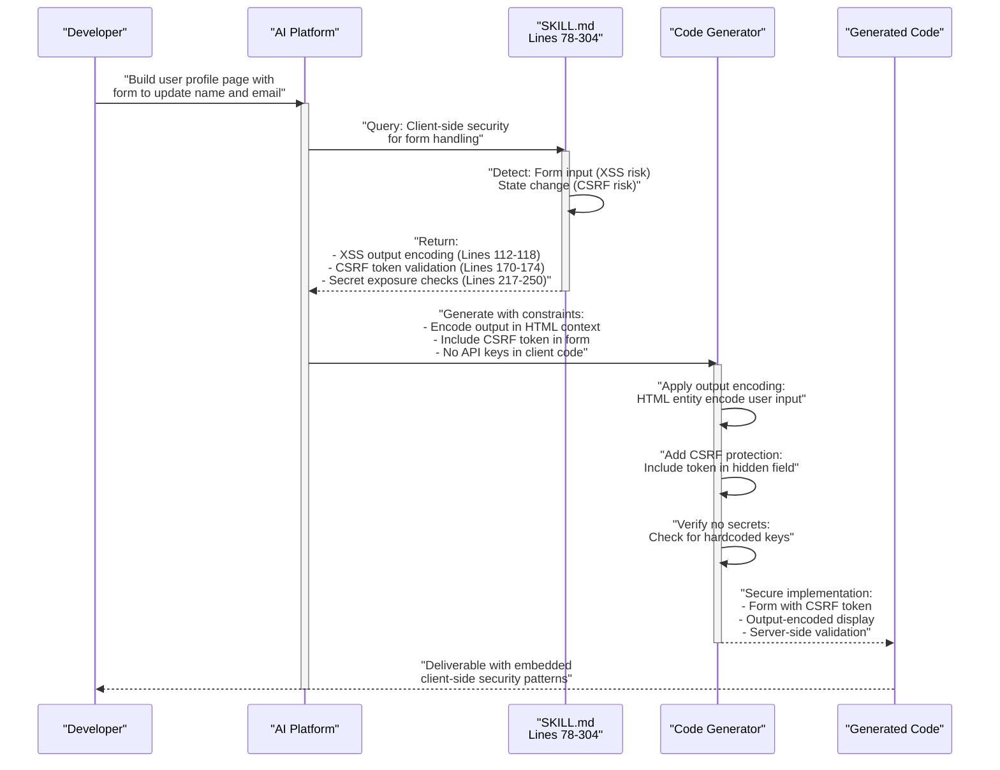

<!-- source: DeepWiki mcp.deepwiki.com · repo BehiSecc/VibeSec-Skill · page 6 Client-Side Security · fetched 2026-10-26 -->

# Client-Side Security

<details>
<summary>Relevant source files</summary>

The following files were used as context for generating this wiki page:

- [SKILL.md](SKILL.md)

</details>


## Purpose and Scope

This page provides an overview of client-side vulnerability prevention in VibeSec-Skill, introducing the four primary attack vectors that target web application clients: Cross-Site Scripting (XSS), Cross-Site Request Forgery (CSRF), secret exposure, and open redirect attacks. This material covers security concerns that execute or manifest in the browser context, where user agents process HTML, JavaScript, and other client-side assets.

For server-side vulnerabilities (SSRF, SQL injection, XXE, path traversal, file uploads), see [Server-Side Security](#7). For authentication and session management, see [Authentication & Session Security](#8). For access control and authorization logic that spans both client and server, see [Access Control & Authorization](#5).

**Sources:** [SKILL.md:78-304]()

---

## Client-Side Attack Surface

Client-side security in VibeSec-Skill addresses vulnerabilities that originate from or execute within the user's browser environment. The skill provides directive-based guidance to AI code generation systems, ensuring that generated code implements protection mechanisms at the point of creation rather than requiring post-generation security retrofitting.



**Sources:** [SKILL.md:78-304]()

---

## SKILL.md Architecture for Client-Side Security

The client-side security domain occupies a distinct section in `SKILL.md` under the "Client-Side Bugs" heading, structured as four sequential subsections. This organization allows AI models to retrieve targeted guidance based on the specific vulnerability class being addressed.



**Sources:** [SKILL.md:78-304]()

---

## Four Client-Side Attack Vector Categories

VibeSec-Skill addresses client-side security through four vulnerability categories, each representing a distinct attack pattern with specific prevention directives.

| Attack Vector | Lines in SKILL.md | Primary Impact | Core Prevention Strategy |
|--------------|-------------------|----------------|--------------------------|
| **Cross-Site Scripting (XSS)** | [80-144]() | Execution of attacker-controlled JavaScript in victim's browser | Output encoding (context-aware), Content Security Policy (CSP) |
| **Cross-Site Request Forgery (CSRF)** | [147-210]() | Unauthorized state-changing actions using victim's authenticated session | CSRF tokens, SameSite cookies |
| **Secret Exposure** | [213-256]() | Disclosure of API keys, credentials, or sensitive data in client-side code | Environment variables, server-side API proxying |
| **Open Redirect** | [259-302]() | Redirect users to attacker-controlled domains for phishing | URL allowlist validation, relative URLs only |

### Cross-Site Scripting (XSS)

XSS vulnerabilities allow attackers to inject and execute malicious scripts in users' browsers. The skill defines three categories of input sources requiring protection: direct inputs (form fields, search queries, file names), indirect inputs (URL parameters, HTTP headers, third-party API data), and often-overlooked vectors (error messages, PDF generators, email templates). See [Cross-Site Scripting (XSS) Prevention](#6.1) for detailed protection strategies including output encoding rules and CSP configuration.

**Sources:** [SKILL.md:80-144]()

### Cross-Site Request Forgery (CSRF)

CSRF attacks exploit authenticated user sessions to perform unauthorized actions. The skill categorizes vulnerable endpoints into authenticated actions (POST/PUT/PATCH/DELETE requests, settings changes, payment endpoints) and pre-authentication actions (login, signup, password reset). Protection mechanisms include cryptographically random CSRF tokens tied to user sessions, SameSite cookie attributes, and double submit cookie patterns. See [Cross-Site Request Forgery (CSRF) Protection](#6.2) for implementation checklists and edge cases.

**Sources:** [SKILL.md:147-210]()

### Secret Exposure

Secret exposure occurs when sensitive credentials, API keys, or internal infrastructure details appear in client-accessible code. The skill categorizes secrets into three groups: API keys and secrets (third-party keys, database connection strings, JWT signing secrets), sensitive user data (credit card numbers, SSNs, passwords), and infrastructure details (internal IP addresses, database schemas, stack traces). Prevention focuses on environment variable usage and server-side API proxying. See [Secret Exposure & Open Redirect Prevention](#6.3) for hiding locations and detection strategies.

**Sources:** [SKILL.md:213-256]()

### Open Redirect

Open redirect vulnerabilities allow attackers to redirect users to malicious domains, typically for phishing attacks. The skill provides three protection strategies: allowlist validation (restrict to known domains), relative URLs only (accept paths instead of full URLs), and indirect references (use lookup mappings). A comprehensive bypass technique table documents 15 exploitation methods including @ symbol abuse, protocol tricks, Unicode normalization (IDN homograph attacks), and data URLs. See [Secret Exposure & Open Redirect Prevention](#6.3) for bypass prevention.

**Sources:** [SKILL.md:259-302]()

---

## Core Principles Applied to Client-Side Security

The five core security principles defined in [SKILL.md:10-18]() inform all client-side protection directives:

```mermaid
graph TD
    subgraph "Core Principles"
        P1["Defense in Depth<br/>Never rely on single control"]
        P2["Fail Securely<br/>Deny access on failure"]
        P3["Least Privilege<br/>Minimum permissions"]
        P4["Input Validation<br/>Server-side validation"]
        P5["Output Encoding<br/>Context-aware encoding"]
    end
    
    subgraph "Client-Side Application"
        P1 --> C1["XSS: Output Encoding + CSP + Input Sanitization"]
        P1 --> C2["CSRF: Tokens + SameSite + Origin Validation"]
        
        P2 --> C3["XSS: Default CSP denies inline scripts"]
        P2 --> C4["CSRF: Missing token = rejected request"]
        
        P3 --> C5["Secrets: No API keys in client code"]
        P3 --> C6["CSRF: Tokens scoped to sessions"]
        
        P4 --> C7["XSS: Server validates all user input"]
        P4 --> C8["Redirect: Server validates URL format"]
        
        P5 --> C9["XSS: HTML/JS/URL/CSS context-specific"]
        P5 --> C10["Redirect: URL encode user-provided paths"]
    end
```



**Defense in depth** manifests in layered XSS protections (output encoding + CSP + input sanitization) and CSRF defenses (tokens + SameSite + origin validation). **Fail securely** ensures that missing CSRF tokens result in rejected requests and default CSP policies deny inline scripts. **Least privilege** restricts API key access to server-side code only and scopes CSRF tokens to individual user sessions. **Input validation** requires server-side validation of all user input before processing, never trusting client-side checks. **Output encoding** applies context-specific escaping for HTML, JavaScript, URL, and CSS contexts to prevent XSS.

**Sources:** [SKILL.md:10-18](), [SKILL.md:78-304]()

---

## Integration with AI Code Generation Workflow

Client-side security directives in `SKILL.md` integrate into the AI code generation process through context-aware retrieval and constraint application. When a developer prompts an AI platform to generate client-side code, the platform loads relevant sections from `SKILL.md` based on detected frameworks, operation types, and user requirements.



The code generation engine applies client-side security constraints in three phases: **XSS prevention** (context-aware output encoding using framework-native methods like React's JSX auto-escaping), **CSRF protection** (CSRF token generation and validation on state-changing endpoints), and **secret verification** (scanning for hardcoded API keys, credentials, or sensitive data in client-accessible code). The output includes security comments documenting the applied protections.

**Sources:** [SKILL.md:78-304](), [README.md:76-83]()

---

## Client-Side Security Coverage Matrix

The following matrix maps each client-side attack vector to its directive coverage in `SKILL.md`, primary protection mechanisms, and common bypass scenarios addressed.

| Attack Vector | Directive Count | Protection Mechanisms | Bypass Scenarios Addressed |
|--------------|-----------------|----------------------|----------------------------|
| **XSS** | 20+ directives | Output encoding (HTML/JS/URL/CSS), CSP headers, input sanitization, framework escaping | Error message reflection, PDF generators, SVG uploads, markdown rendering, JSON-to-HTML |
| **CSRF** | 15+ directives | CSRF tokens (cryptographically random, session-tied), SameSite cookies (Strict/Lax), double submit cookies | Token presence check, GET with side effects, subdomain token scoping, CORS misconfig |
| **Secret Exposure** | 10+ directives | Environment variables, server-side API calls, secret hiding locations | JavaScript bundles, source maps, HTML comments, hidden fields, SSR hydration data |
| **Open Redirect** | 10+ directives | URL allowlist validation, relative URLs only, indirect reference mapping | @ symbol, protocol tricks, Unicode normalization, DNS rebinding, data URLs, backslash normalization |

**Total directive count**: 60+ client-side specific security directives spanning input validation, output encoding, token generation, secret management, and URL validation.

**Sources:** [SKILL.md:78-304]()

---

## Context-Aware Security Application

Client-side security directives adapt based on framework detection and cloud environment context. The AI platform analyzes the target technology stack and applies framework-specific implementations:

### Framework-Specific XSS Protection

| Framework | Auto-Escaping Mechanism | Manual Encoding Required | CSP Integration |
|-----------|-------------------------|--------------------------|-----------------|
| **React** | JSX expressions (`{variable}`) | `dangerouslySetInnerHTML` usage | Nonce-based CSP for inline scripts |
| **Vue.js** | Template interpolation (`{{ variable }}`) | `v-html` directive usage | CSP with inline event handler restrictions |
| **Angular** | Template binding (`{{variable}}`) | `[innerHTML]` binding | Trusted Types API integration |
| **Express/Node.js** | None (manual required) | All template outputs | Helmet.js CSP middleware |
| **Django** | Template auto-escape (default on) | `` blocks | django-csp package integration |

The skill directs AI platforms to leverage framework-native escaping mechanisms first (e.g., React JSX auto-escaping) before applying manual encoding, ensuring generated code follows framework best practices while maintaining security.

**Sources:** [SKILL.md:112-118](), [README.md:71-75]()

---

## Security Headers for Client-Side Protection

Several HTTP security headers complement client-side vulnerability prevention. These headers are referenced throughout the client-side security directives:

| Header | Purpose | Client-Side Attack Mitigation |
|--------|---------|------------------------------|
| `Content-Security-Policy` | Define trusted content sources | XSS prevention (script-src, style-src directives) |
| `X-Content-Type-Options: nosniff` | Prevent MIME sniffing | XSS via uploaded files, content type confusion |
| `X-Frame-Options: DENY` | Prevent clickjacking | CSRF via clickjacking attack chains |
| `Referrer-Policy: strict-origin-when-cross-origin` | Control referrer information | Secret exposure via referrer leakage |
| `Strict-Transport-Security` | Enforce HTTPS | CSRF protection (SameSite cookie requirement) |

For comprehensive security header configuration, see [Security Headers Reference](#10).

**Sources:** [SKILL.md:119-144](), [SKILL.md:630-642]()

---

## Verification and Testing Guidance

Each client-side attack vector section in `SKILL.md` includes implementation checklists for verification. Example checklist for CSRF protection [SKILL.md:201-210]():

```
- [ ] Token is cryptographically random (use secure random generator)
- [ ] Token is tied to user session
- [ ] Token is validated server-side on all state-changing requests
- [ ] Missing token = rejected request
- [ ] Token regenerated on authentication state change
- [ ] SameSite cookie attribute is set
- [ ] Secure and HttpOnly flags on session cookies
```

These checklists serve dual purposes: guiding AI code generation to include required security controls and providing developers with post-generation verification steps.

**Sources:** [SKILL.md:201-210]()

---

## Relationship to Other Security Domains

Client-side security directives frequently interact with server-side security controls and access control mechanisms:

- **XSS + Access Control**: Output encoding prevents script injection that could bypass client-side authorization checks. Server-side authorization must still verify user permissions regardless of XSS protections.

- **CSRF + Access Control**: CSRF tokens prevent unauthorized state changes, but access control verifies the authenticated user owns the target resource (preventing horizontal privilege escalation via CSRF).

- **Secret Exposure + Server-Side Security**: Moving API keys to server-side prevents direct exposure, but server-side SSRF protections must validate URLs when proxying client requests to third-party APIs.

- **Open Redirect + Server-Side Security**: Redirect validation prevents phishing, but server-side path traversal protections ensure redirect targets don't expose internal file paths.

For server-side vulnerability prevention, see [Server-Side Security](#7). For access control implementation patterns, see [Access Control & Authorization](#5).

**Sources:** [SKILL.md:78-304](), [SKILL.md:21-76](), [SKILL.md:321-628]()

---

