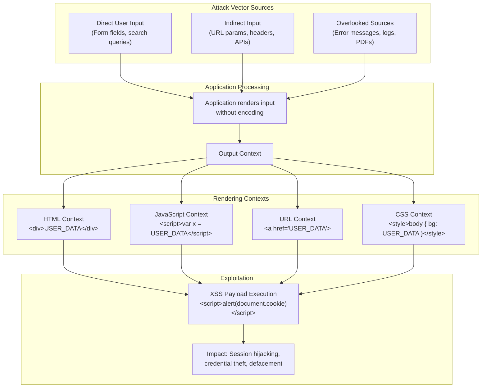
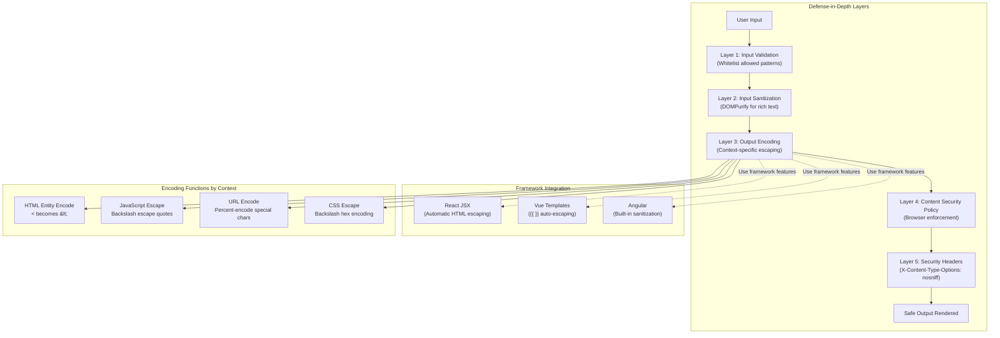
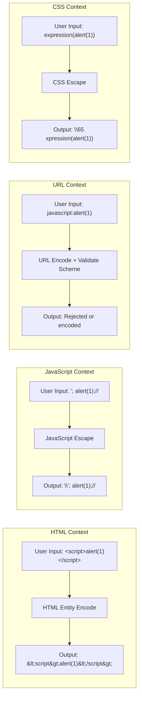
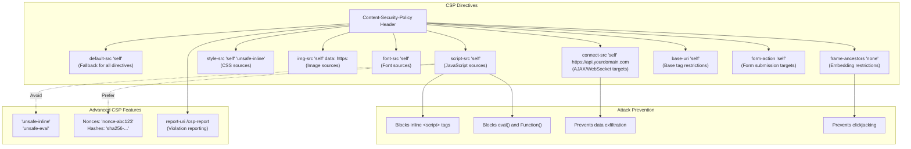
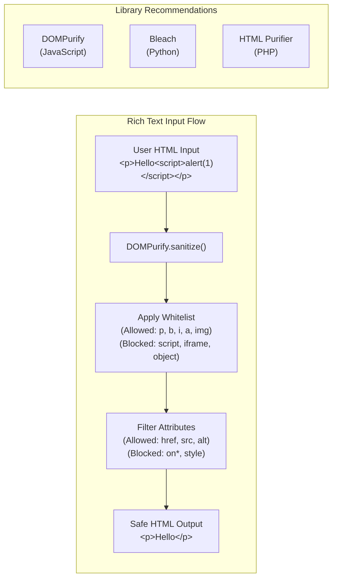

<!-- source: DeepWiki mcp.deepwiki.com · repo BehiSecc/VibeSec-Skill · page 6.1 Cross-Site Scripting (XSS) Prevention · fetched 2026-10-26 -->

# Cross-Site Scripting (XSS) Prevention

<details>
<summary>Relevant source files</summary>

The following files were used as context for generating this wiki page:

- [SKILL.md](SKILL.md)

</details>


## Purpose and Scope

This document provides comprehensive guidance for preventing Cross-Site Scripting (XSS) vulnerabilities in web applications. XSS occurs when user-controllable data is incorporated into web pages without proper sanitization or encoding, allowing attackers to execute malicious scripts in victims' browsers.

This page covers input source identification, context-specific output encoding, Content Security Policy implementation, and input sanitization strategies as defined in the VibeSec-Skill knowledge base. For server-side injection attacks, see [SQL Injection Prevention](#7.2) and [XXE Prevention](#7.3). For secret exposure prevention, see [Secret Exposure & Open Redirect Prevention](#6.3).

**Sources:** [SKILL.md:78-144]()

---

## Overview of XSS Attack Vectors

XSS vulnerabilities arise when applications render user-controllable data without appropriate encoding for the output context. The VibeSec-Skill defines a comprehensive taxonomy of input sources that must be protected, organized into three categories: direct inputs, indirect inputs, and often-overlooked inputs.

### XSS Attack Flow



**Sources:** [SKILL.md:80-109]()

---

## Input Sources Requiring XSS Protection

### Direct Input Sources

These are the most obvious user-controllable inputs that applications process:

| Input Source | Description | Example Vulnerability |
|--------------|-------------|----------------------|
| Form fields | Email, name, bio, comments | User submits `<script>alert(1)</script>` as bio |
| Search queries | Search box input | Search for `"><script>alert(1)</script>` |
| File names | Original filename during upload | Upload file named `file<script>.jpg` |
| Rich text editors | WYSIWYG content | Paste HTML containing `` |

**Sources:** [SKILL.md:86-90]()

### Indirect Input Sources

These sources are less obvious but equally dangerous:

| Input Source | Description | Example Vulnerability |
|--------------|-------------|----------------------|
| URL parameters | Query strings | `?name=<script>alert(1)</script>` |
| URL fragments | Hash values | `#` |
| HTTP headers | Referer, User-Agent if displayed | Custom Referer with XSS payload |
| Third-party API data | External service responses | API returns malicious HTML |
| WebSocket messages | Real-time communication data | Malicious message contains script tags |
| postMessage data | iframe communication | `window.postMessage('<script>...')` |
| LocalStorage/SessionStorage | If rendered to DOM | Stored XSS via storage APIs |

**Sources:** [SKILL.md:92-99]()

### Often Overlooked Input Sources

Critical but frequently forgotten attack vectors:

| Input Source | Description | Example Vulnerability |
|--------------|-------------|----------------------|
| Error messages | Errors reflecting user input | `Error: Invalid username "<script>"` |
| PDF/document generators | HTML-to-PDF converters | PDF containing executable JavaScript |
| Email templates | User data in emails | Email body with unencoded HTML |
| Log viewers | Admin panels displaying logs | Logs containing injected payloads |
| JSON responses as HTML | Improperly rendered JSON | `Content-Type: text/html` for JSON |
| SVG file uploads | SVG with embedded scripts | `<svg onload="alert(1)">` |
| Markdown rendering | If allowing raw HTML | Markdown with `<script>` tags |

**Sources:** [SKILL.md:101-109]()

---

## Protection Strategy Architecture



**Sources:** [SKILL.md:110-144]()

---

## Context-Specific Output Encoding

The VibeSec-Skill mandates different encoding strategies based on where user data is rendered. Each context has specific encoding requirements to prevent script execution.

### Encoding Requirements by Context



### HTML Context Encoding

When rendering user data within HTML elements, convert special characters to HTML entities:

| Character | HTML Entity | Purpose |
|-----------|-------------|---------|
| `<` | `&lt;` | Prevent tag opening |
| `>` | `&gt;` | Prevent tag closing |
| `&` | `&amp;` | Prevent entity injection |
| `"` | `&quot;` | Prevent attribute escaping |
| `'` | `&#x27;` | Prevent attribute escaping |

**Framework Usage:**
- React JSX: Automatically escapes by default
- Vue templates: `{{ }}` syntax auto-escapes
- Angular: Built-in sanitization via `DomSanitizer`

**Sources:** [SKILL.md:112-118]()

### JavaScript Context Encoding

When inserting user data into JavaScript code, use JavaScript-specific escaping:

```
// Context: <script>var name = "USER_INPUT";</script>
// Requirements:
// - Escape quotes (" becomes \")
// - Escape backslashes (\ becomes \\)
// - Escape newlines (\n becomes \\n)
// - Consider using JSON.stringify() for complex data
```

**Sources:** [SKILL.md:114]()

### URL Context Encoding

When user data appears in URLs, apply URL encoding and validate the scheme:

```
// Context: <a href="USER_INPUT">
// Requirements:
// - URL encode special characters
// - Validate URL scheme (http/https only)
// - Reject javascript:, data:, vbscript: schemes
// - Use relative URLs when possible
```

**Sources:** [SKILL.md:115]()

### CSS Context Encoding

When user data appears in CSS, use CSS-specific escaping:

```
// Context: <style>body { background: USER_INPUT; }</style>
// Requirements:
// - CSS escape special characters
// - Reject expression() (IE-specific attack)
// - Validate color/size values against expected formats
```

**Sources:** [SKILL.md:116]()

---

## Content Security Policy (CSP) Implementation

CSP provides a browser-enforced defense layer that restricts resource loading and script execution. The VibeSec-Skill defines a comprehensive CSP configuration.

### CSP Header Structure



### CSP Configuration Template

The skill provides a production-ready CSP header configuration:

```
Content-Security-Policy: 
  default-src 'self';
  script-src 'self';
  style-src 'self' 'unsafe-inline';
  img-src 'self' data: https:;
  font-src 'self';
  connect-src 'self' https://api.yourdomain.com;
  frame-ancestors 'none';
  base-uri 'self';
  form-action 'self';
```

**Key Directives:**

| Directive | Purpose | Configuration |
|-----------|---------|---------------|
| `default-src` | Fallback for unspecified directives | `'self'` (same origin only) |
| `script-src` | JavaScript execution sources | `'self'` (no inline scripts) |
| `style-src` | CSS sources | `'self' 'unsafe-inline'` |
| `img-src` | Image sources | `'self' data: https:` |
| `connect-src` | XHR/Fetch/WebSocket targets | Specific API domains |
| `frame-ancestors` | Embedding restrictions | `'none'` (prevent clickjacking) |
| `base-uri` | Base tag restrictions | `'self'` (prevent base tag injection) |
| `form-action` | Form submission targets | `'self'` (prevent form hijacking) |

**Sources:** [SKILL.md:119-134]()

### CSP Nonces and Hashes

For legitimate inline scripts, use nonces or hashes instead of `'unsafe-inline'`:

**Nonce-based approach:**
```html
<!-- Server generates random nonce per request -->
<script nonce="abc123">
  // Legitimate inline script
</script>
```

**Hash-based approach:**
```
<!-- CSP Header -->
script-src 'self' 'sha256-[hash-of-script-content]'
```

**Violation Reporting:**
```
report-uri /csp-report
```

Configure a reporting endpoint to receive CSP violation notifications for monitoring and debugging.

**Sources:** [SKILL.md:132-134]()

---

## Input Sanitization for Rich Text

When applications must accept HTML input (rich text editors), use established sanitization libraries rather than custom solutions.

### Sanitization Strategy



### DOMPurify Implementation Pattern

For JavaScript applications, the skill recommends DOMPurify:

```javascript
// Whitelist approach for rich text
const cleanHtml = DOMPurify.sanitize(userInput, {
  ALLOWED_TAGS: ['p', 'b', 'i', 'u', 'a', 'ul', 'ol', 'li'],
  ALLOWED_ATTR: ['href', 'title']
});
```

**Sanitization Rules:**
1. Use established libraries (DOMPurify for HTML)
2. Whitelist allowed tags and attributes
3. Strip or encode dangerous patterns
4. Never attempt custom HTML parsing

**Sources:** [SKILL.md:136-140]()

---

## Additional Security Headers

The VibeSec-Skill mandates additional headers that complement XSS defenses:

| Header | Value | Purpose |
|--------|-------|---------|
| `X-Content-Type-Options` | `nosniff` | Prevents MIME-type sniffing |
| `X-Frame-Options` | `DENY` | Prevents clickjacking (redundant with CSP `frame-ancestors`) |

### X-Content-Type-Options: nosniff

This header prevents browsers from MIME-sniffing responses, which could allow an uploaded file to be interpreted as HTML:

```
X-Content-Type-Options: nosniff
```

Without this header, an uploaded image with HTML content might be executed as a script if the browser sniffs it as `text/html`.

**Sources:** [SKILL.md:141-144]()

---

## Complete XSS Prevention Checklist

The following checklist ensures comprehensive XSS protection:

### Input Handling
- [ ] All user inputs identified (direct, indirect, overlooked sources)
- [ ] Rich text sanitized with whitelisting library (DOMPurify, Bleach)
- [ ] File uploads validated for type and content (magic bytes)
- [ ] SVG uploads either blocked or sanitized

### Output Encoding
- [ ] HTML context: HTML entity encoding applied
- [ ] JavaScript context: JavaScript escaping applied
- [ ] URL context: URL encoding + scheme validation applied
- [ ] CSS context: CSS escaping applied
- [ ] Framework auto-escaping features utilized (React JSX, Vue `{{ }}`)

### Content Security Policy
- [ ] CSP header configured with `default-src 'self'`
- [ ] `script-src` set to `'self'` (no `'unsafe-inline'`)
- [ ] `'unsafe-eval'` avoided in production
- [ ] Nonces or hashes used for legitimate inline scripts
- [ ] `frame-ancestors 'none'` set (clickjacking prevention)
- [ ] `base-uri 'self'` set (base tag injection prevention)
- [ ] `report-uri` configured for violation monitoring

### Security Headers
- [ ] `X-Content-Type-Options: nosniff` header set
- [ ] `X-Frame-Options: DENY` header set (or CSP `frame-ancestors`)

### Framework-Specific
- [ ] Framework's built-in escaping features enabled and not bypassed
- [ ] Dangerous methods avoided (`dangerouslySetInnerHTML`, `v-html` without sanitization)
- [ ] Template injection vulnerabilities prevented

**Sources:** [SKILL.md:78-144]()

---

## Integration with Core Security Principles

XSS prevention aligns with VibeSec-Skill's foundational security principles:

| Core Principle | XSS Prevention Application |
|----------------|---------------------------|
| **Defense in Depth** | Multiple layers: input validation, output encoding, CSP, security headers |
| **Fail Securely** | Reject input that fails validation rather than attempting to fix it |
| **Least Privilege** | CSP restricts script sources and capabilities |
| **Input Validation** | Validate all user-controllable data server-side |
| **Output Encoding** | Context-specific encoding for all rendered user data |

For more details on these principles, see [Core Security Principles](#4).

**Sources:** [SKILL.md:10-18](), [SKILL.md:78-144]()

---

