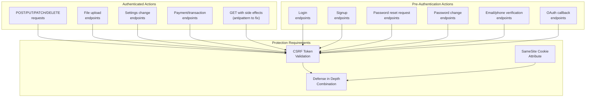
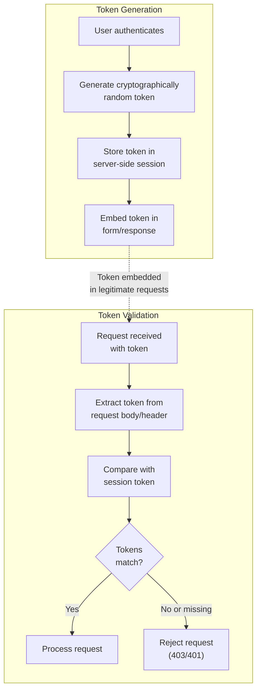
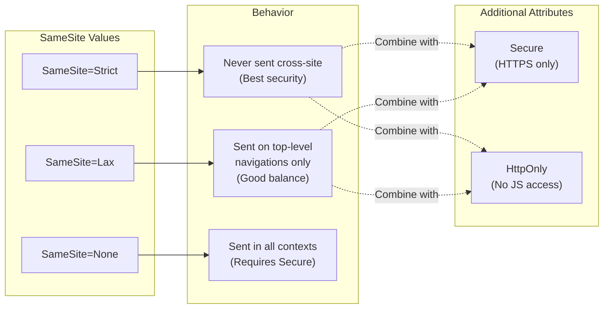
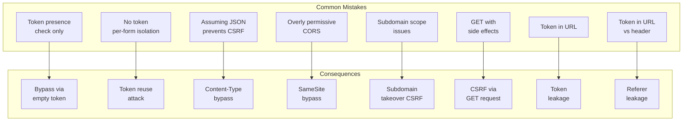
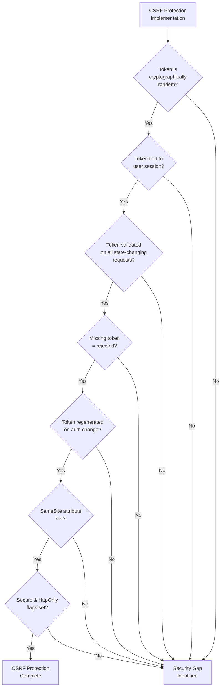
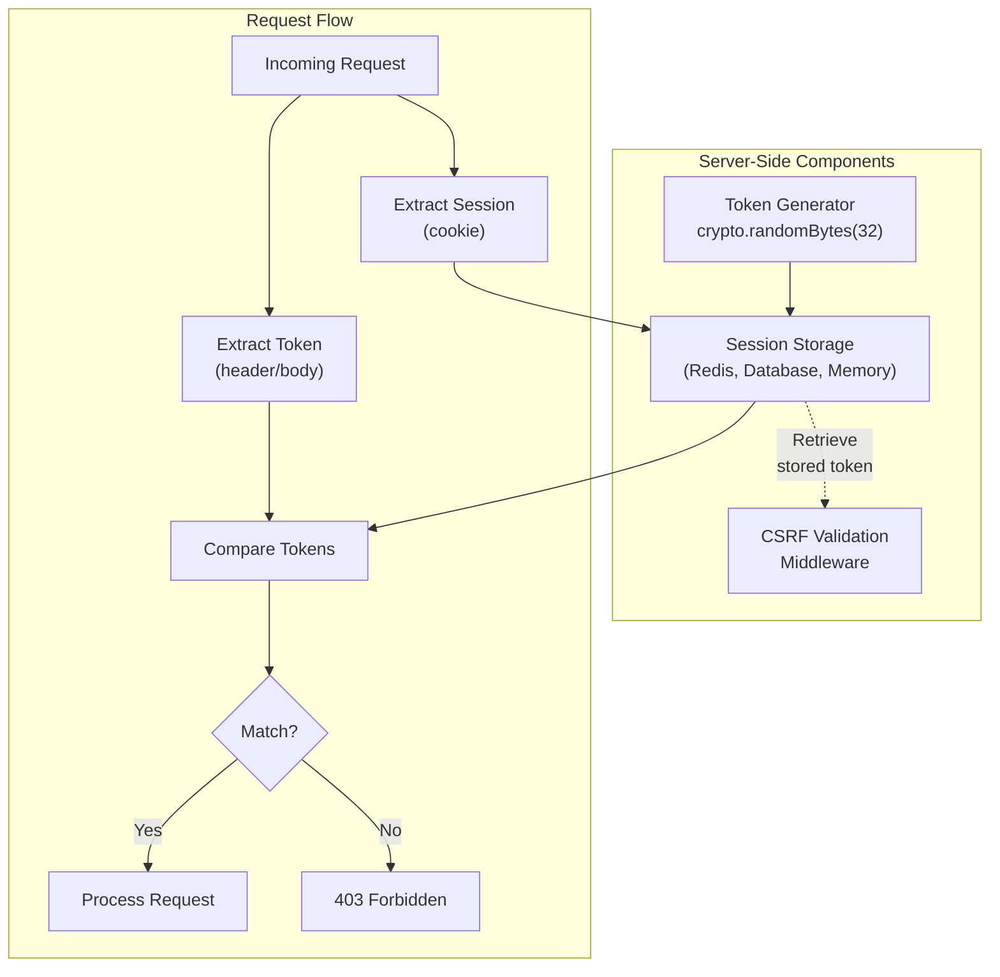
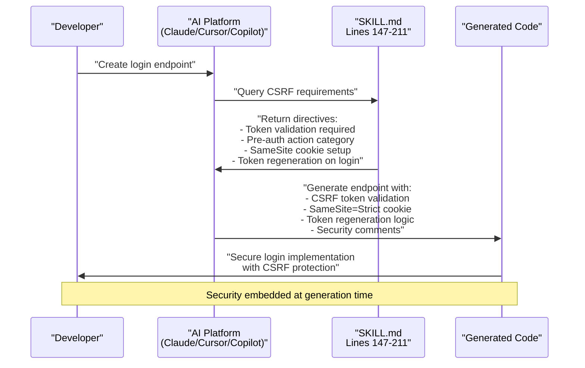

<!-- source: DeepWiki mcp.deepwiki.com · repo BehiSecc/VibeSec-Skill · page 6.2 Cross-Site Request Forgery (CSRF) Protection · fetched 2026-10-26 -->

# Cross-Site Request Forgery (CSRF) Protection

<details>
<summary>Relevant source files</summary>

The following files were used as context for generating this wiki page:

- [SKILL.md](SKILL.md)

</details>


## Purpose and Scope

This document details CSRF (Cross-Site Request Forgery) attack prevention mechanisms as implemented in VibeSec-Skill's secure coding guidance. CSRF vulnerabilities occur when authenticated users are tricked into performing unintended state-changing actions on web applications where they are authenticated. This page covers token-based protection, cookie security attributes, endpoint classification, edge cases, and implementation verification.

For protection against other client-side attacks, see [Cross-Site Scripting (XSS) Prevention](#6.1) and [Secret Exposure & Open Redirect Prevention](#6.3). For server-side security concerns, see [Server-Side Security](#7).

**Sources:** [SKILL.md:147-211]()

---

## CSRF Attack Vector Overview

CSRF exploits the trust that a web application has in an authenticated user's browser. An attacker crafts a malicious request that the victim's browser automatically authenticates using existing session cookies.

### Attack Flow Diagram

```mermaid
sequenceDiagram
    participant Attacker
    participant Victim as "Victim Browser"
    participant App as "Vulnerable Application"
    
    Note over Victim,App: Victim is authenticated
    Victim->>App: "Normal login"
    App->>Victim: "Set-Cookie: session=abc123"
    
    Attacker->>Victim: "Sends malicious link/page<br/><form action=app.com/transfer method=POST>"
    
    Note over Victim: Victim clicks link or<br/>visits attacker page
    
    Victim->>App: "POST /transfer amount=1000&to=attacker<br/>Cookie: session=abc123"
    
    Note over App: Application sees valid session,<br/>executes unauthorized action
    
    App->>Victim: "Transfer completed"
    
    Note over Victim,Attacker: Victim's funds transferred<br/>without consent
```



**Sources:** [SKILL.md:147-149]()

---

## Endpoints Requiring CSRF Protection

VibeSec-Skill categorizes endpoints into two protection tiers: authenticated actions and pre-authentication actions. Both require CSRF protection as they perform state changes.

### State-Changing Endpoint Classification



### Endpoint Categories

| Category | Examples | Risk Without Protection |
|----------|----------|------------------------|
| **Authenticated Actions** | POST/PUT/PATCH/DELETE operations | Unauthorized data modification, privilege escalation |
| **File Uploads** | `/upload`, `/api/files` | Malicious file injection |
| **Settings Changes** | `/settings/profile`, `/api/config` | Account takeover, permission changes |
| **Payment/Transactions** | `/transfer`, `/checkout` | Financial fraud |
| **GET with Side Effects** | `/delete?id=123` (antipattern) | Silent data deletion |
| **Login Endpoints** | `/login`, `/auth/signin` | Login CSRF, session fixation |
| **Signup Endpoints** | `/register`, `/api/signup` | Unwanted account creation |
| **Password Reset** | `/forgot-password`, `/reset` | Password change attacks |
| **OAuth Callbacks** | `/auth/callback?code=xyz` | Authorization code interception |

**Sources:** [SKILL.md:151-167]()

---

## Protection Mechanisms

VibeSec-Skill implements three complementary CSRF protection mechanisms, following the defense-in-depth principle.

### 1. CSRF Token Implementation

CSRF tokens provide cryptographic proof that a request originated from the legitimate application rather than a third-party site.



#### Token Requirements

| Requirement | Implementation | Purpose |
|-------------|----------------|---------|
| **Cryptographic Randomness** | Use secure random generator (e.g., `crypto.randomBytes(32)`) | Prevent token prediction |
| **Session Binding** | Tie token to user session ID | Prevent token reuse across sessions |
| **Server-Side Validation** | Validate on every state-changing request | Enforce protection |
| **Token Regeneration** | Generate new token after login/logout | Prevent session fixation combo attacks |
| **Mandatory Validation** | Missing token = rejected request | Prevent bypass via token omission |

**Sources:** [SKILL.md:170-175]()

---

### 2. SameSite Cookie Attribute

The `SameSite` cookie attribute prevents the browser from sending cookies in cross-site requests, providing automatic CSRF protection at the browser level.



#### Cookie Configuration Syntax

```
Set-Cookie: session=abc123; SameSite=Strict; Secure; HttpOnly
```

| Attribute | Value | Effect |
|-----------|-------|--------|
| `SameSite` | `Strict` | Cookie never sent in cross-site requests (links, forms, etc.) |
| `SameSite` | `Lax` | Cookie sent on top-level GET navigations only (user clicking link) |
| `SameSite` | `None; Secure` | Cookie sent cross-site (requires HTTPS) |
| `Secure` | N/A | Cookie only sent over HTTPS |
| `HttpOnly` | N/A | Cookie inaccessible to JavaScript (`document.cookie`) |

**Defense-in-Depth Guidance:** Always combine SameSite cookies with CSRF tokens. SameSite provides baseline protection but tokens ensure comprehensive defense against bypass scenarios.

**Sources:** [SKILL.md:176-182]()

---

### 3. Double Submit Cookie Pattern

An alternative token-based approach where the CSRF token is stored in both a cookie and request parameter, with the server validating they match.

```mermaid
sequenceDiagram
    participant Client as "Client Application"
    participant Server as "Application Server"
    
    Note over Client,Server: Initial authentication
    
    Server->>Client: "Set-Cookie: csrf_token=random123; SameSite=Lax<br/>Response body: { csrfToken: 'random123' }"
    
    Note over Client: Store token for requests
    
    Client->>Server: "POST /api/transfer<br/>Cookie: csrf_token=random123<br/>X-CSRF-Token: random123"
    
    Server->>Server: "Extract cookie value: random123<br/>Extract header value: random123"
    
    Server->>Server: "Compare values"
    
    alt "Values match"
        Server->>Client: "200 OK - Request processed"
    else "Values don't match or missing"
        Server->>Client: "403 Forbidden - CSRF validation failed"
    end
```

**Implementation Note:** This pattern is useful when session state cannot be maintained server-side (e.g., stateless JWT authentication), but requires careful implementation to avoid security pitfalls.

**Sources:** [SKILL.md:184-186]()

---

## Edge Cases and Common Mistakes

VibeSec-Skill identifies critical edge cases and anti-patterns that developers must avoid when implementing CSRF protection.

### Critical Security Pitfalls



### Edge Case Reference Table

| Edge Case | Vulnerability | Mitigation |
|-----------|--------------|------------|
| **Token Presence Check** | CSRF validation depends on whether token is present (if present, validate; if absent, skip) | Always require token; missing token = rejected request |
| **Token Per Form** | Single token reused across all forms allows token leakage from one form to compromise others | Generate unique tokens per form for sensitive operations |
| **JSON APIs** | Assumption that `Content-Type: application/json` prevents CSRF | Validate `Origin`/`Referer` headers AND use tokens (Flash/older browsers can bypass) |
| **CORS Misconfiguration** | `Access-Control-Allow-Origin: *` with credentials bypasses SameSite | Never use wildcard origin with credentials; validate origin strictly |
| **Subdomain Scope** | CSRF tokens not scoped to subdomains allow subdomain takeover to lead to CSRF | Scope tokens to specific subdomain; validate `Host` header |
| **Flash/PDF Uploads** | Legacy browser plugins (Flash) could bypass SameSite cookies | Validate CSRF tokens even with SameSite (defense in depth) |
| **GET Side Effects** | State changes on GET requests (`/delete?id=123`) are always CSRF-vulnerable | Never perform state changes on GET; use POST/DELETE with CSRF protection |
| **Token Leakage** | CSRF tokens in URLs leak via Referer header, browser history, logs | Use custom headers (`X-CSRF-Token`) or request body; never URL parameters |
| **Token in URL vs Header** | URL parameters expose tokens in logs, Referer, history | Prefer custom headers (`X-CSRF-Token`) over URL parameters |

**Sources:** [SKILL.md:188-199]()

---

## Verification Checklist

VibeSec-Skill provides a comprehensive checklist for CSRF protection implementation verification.

### Implementation Validation Flow



### Checklist Items

The following verification items are extracted from SKILL.md and must all be satisfied:

- [ ] **Token is cryptographically random** — Use secure random generator (e.g., `crypto.randomBytes()`, `secrets.token_hex()`)
- [ ] **Token is tied to user session** — Each session has unique token; tokens are not shared across users
- [ ] **Token is validated server-side on all state-changing requests** — POST, PUT, PATCH, DELETE all require validation
- [ ] **Missing token = rejected request** — No bypass via token omission; validation is mandatory
- [ ] **Token regenerated on authentication state change** — New token generated after login, logout, privilege change
- [ ] **SameSite cookie attribute is set** — `SameSite=Strict` or `SameSite=Lax` on session cookies
- [ ] **Secure and HttpOnly flags on session cookies** — `Secure` (HTTPS-only) and `HttpOnly` (no JavaScript access) enforced

**Sources:** [SKILL.md:201-210]()

---

## Framework-Specific Implementation Examples

While VibeSec-Skill does not provide implementation code directly (it guides AI code generation), the following patterns illustrate how CSRF protection concepts map to common frameworks.

### Token Generation and Validation Pattern



### Cookie Security Configuration Mapping

| Framework/Platform | Cookie Configuration Code Reference |
|-------------------|-------------------------------------|
| **Express.js (Node.js)** | `res.cookie('session', token, { sameSite: 'strict', secure: true, httpOnly: true })` |
| **Django (Python)** | `SESSION_COOKIE_SAMESITE = 'Strict'`, `SESSION_COOKIE_SECURE = True`, `SESSION_COOKIE_HTTPONLY = True` |
| **Laravel (PHP)** | `'same_site' => 'strict'`, `'secure' => true`, `'http_only' => true` in `config/session.php` |
| **ASP.NET Core (C#)** | `options.Cookie.SameSite = SameSiteMode.Strict; options.Cookie.SecurePolicy = CookieSecurePolicy.Always; options.Cookie.HttpOnly = true;` |
| **Rails (Ruby)** | `config.action_dispatch.cookies_same_site_protection = :strict`, `secure: true`, `httponly: true` |

**Sources:** [SKILL.md:170-210]()

---

## Integration with VibeSec-Skill Workflow

CSRF protection guidance is automatically applied when AI platforms consume SKILL.md during code generation.

### Code Generation Integration



The AI platform references SKILL.md sections during code generation to:

1. **Identify endpoint category** — Classify as authenticated action or pre-authentication action
2. **Apply token validation** — Include cryptographic token generation and validation logic
3. **Configure cookies** — Set `SameSite`, `Secure`, `HttpOnly` attributes
4. **Handle edge cases** — Implement mandatory validation, token regeneration, scope checking
5. **Add verification comments** — Document security implementation for code review

**Sources:** [SKILL.md:147-211](), [README.md:76-83]()

---

## Relationship to Core Security Principles

CSRF protection exemplifies VibeSec-Skill's core security principles in practice:

| Core Principle | CSRF Application |
|---------------|------------------|
| **Defense in Depth** | Combine CSRF tokens + SameSite cookies + Origin/Referer validation (never rely on single control) |
| **Fail Securely** | Missing/invalid token = request rejected (403); never process request optimistically |
| **Least Privilege** | Token scoped to specific session; each session has unique token; no token reuse |
| **Input Validation** | Validate token presence, format, cryptographic validity, session binding server-side |
| **Output Encoding** | Not directly applicable to CSRF (relevant to XSS; see [Cross-Site Scripting Prevention](#6.1)) |

**Sources:** [SKILL.md:10-18](), [SKILL.md:147-211]()

---

## Common Vulnerability Patterns Prevented

VibeSec-Skill's CSRF protection addresses the following OWASP Top 10 and common vulnerability patterns:

- **A01:2021 – Broken Access Control** — CSRF enables unauthorized actions; token validation enforces legitimate request origin
- **A07:2021 – Identification and Authentication Failures** — Login CSRF allows attackers to fix victim sessions to attacker accounts
- **CWE-352: Cross-Site Request Forgery (CSRF)** — Direct mitigation through token-based validation
- **Session Fixation** — Token regeneration after authentication prevents session fixation combo attacks
- **Privilege Escalation** — CSRF protection on role change endpoints prevents unauthorized privilege elevation

**Sources:** [SKILL.md:147-211](), [README.md:60-67]()

---

