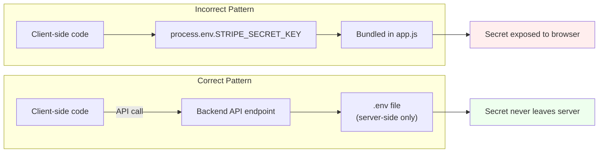
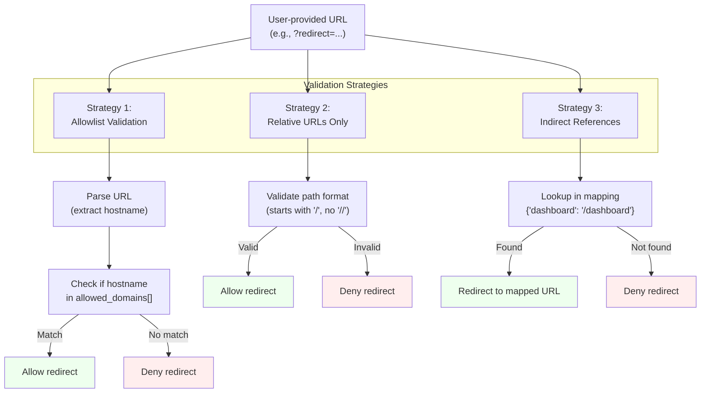
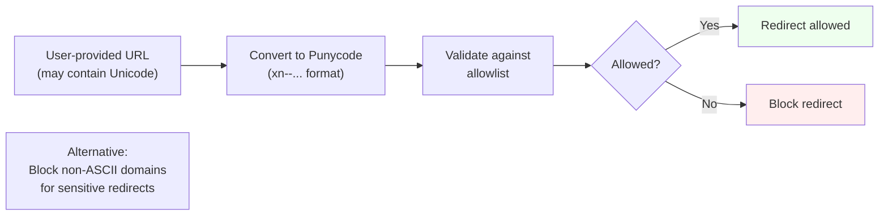

<!-- source: DeepWiki mcp.deepwiki.com · repo BehiSecc/VibeSec-Skill · page 6.3 Secret Exposure & Open Redirect Prevention · fetched 2026-10-26 -->

# Secret Exposure & Open Redirect Prevention

<details>
<summary>Relevant source files</summary>

The following files were used as context for generating this wiki page:

- [SKILL.md](SKILL.md)

</details>


## Purpose and Scope

This page documents prevention strategies for two client-side vulnerability classes: **secret exposure** (sensitive data leaking to client-side code) and **open redirect** (unvalidated URL redirection). These vulnerabilities allow attackers to exfiltrate credentials or phish users by exploiting improper handling of sensitive data and user-controlled URLs.

For related client-side vulnerabilities, see [Cross-Site Scripting (XSS) Prevention](#6.1) and [Cross-Site Request Forgery (CSRF) Protection](#6.2). For server-side concerns like API key management in backend services, see [Server-Side Security](#7).

**Sources:** [SKILL.md:213-302]()

---

## Secret Exposure Prevention

### What Secrets Must Never Be Exposed

The following categories of sensitive information must never be accessible to client-side code or exposed in client-visible artifacts:

| Category | Examples | Risk |
|----------|----------|------|
| **API Keys and Secrets** | Third-party API keys (Stripe, AWS, etc.), Database connection strings, JWT signing secrets, Encryption keys, OAuth client secrets, Internal service URLs/credentials | Credential theft, unauthorized API usage, account takeover |
| **Sensitive User Data** | Full credit card numbers, Social Security Numbers, Passwords (even hashed), Security questions/answers, Full phone numbers (mask: `***-***-1234`), Sensitive PII not needed for display | Privacy breach, identity theft, regulatory violation (PCI-DSS, GDPR) |
| **Infrastructure Details** | Internal IP addresses, Database schemas, Debug information, Stack traces in production, Server software versions | Information disclosure enabling targeted attacks |

**Sources:** [SKILL.md:217-241]()

---

### Where Secrets Can Hide

Secrets often leak through overlooked channels in client-side applications. All of the following must be audited:

```mermaid
graph TB
    subgraph "Client-Side Exposure Vectors"
        JS["JavaScript bundles<br/>(app.js, vendor.js)"]
        SM["Source maps<br/>(.map files)"]
        HTML["HTML comments<br/><!-- ... -->"]
        Forms["Hidden form fields<br/><input type='hidden'>"]
        Attrs["Data attributes<br/>data-api-key=..."]
        Storage["LocalStorage/<br/>SessionStorage"]
        SSR["Initial state in SSR apps<br/>(hydration data)"]
        ENV["Environment variables<br/>(NEXT_PUBLIC_*, REACT_APP_*)"]
    end
    
    subgraph "Attack Surface"
        ViewSource["View Page Source"]
        DevTools["Browser DevTools"]
        NetworkTab["Network Inspector"]
        BundleAnalysis["Bundle Analysis Tools"]
    end
    
    JS --> ViewSource
    SM --> BundleAnalysis
    HTML --> ViewSource
    Forms --> ViewSource
    Attrs --> DevTools
    Storage --> DevTools
    SSR --> ViewSource
    ENV --> BundleAnalysis
    
    ViewSource --> Attacker["Attacker extracts secrets"]
    DevTools --> Attacker
    NetworkTab --> Attacker
    BundleAnalysis --> Attacker
```



**Diagram: Secret Exposure Attack Surface**

**Key exposure channels:**

- **JavaScript bundles** including source maps that may contain unobfuscated secrets
- **HTML comments** often left by developers during debugging
- **Hidden form fields** that pass secrets to client-side JavaScript
- **Data attributes** (`data-*`) on DOM elements
- **LocalStorage/SessionStorage** containing API keys or tokens
- **Initial state/hydration data** in server-side rendered applications (e.g., `window.__INITIAL_STATE__`)
- **Environment variables** exposed via build tools (variables prefixed with `NEXT_PUBLIC_*`, `REACT_APP_*`, `VITE_*`)

**Sources:** [SKILL.md:242-251]()

---

### Prevention Strategies

#### Environment Variable Isolation



**Diagram: Environment Variable Security Pattern**

**Core principles:**

1. **Store secrets in `.env` files** — Never commit `.env` files to version control; use `.env.example` templates
2. **Server-side only API calls** — Any operation requiring secrets must execute on the backend
3. **Prefix conventions** — Understand that build tools expose variables with specific prefixes (`NEXT_PUBLIC_`, `REACT_APP_`, etc.) to client-side code

**Example of vulnerable vs. secure patterns:**

```javascript
// VULNERABLE — Secret exposed in browser bundle
const stripeKey = process.env.STRIPE_SECRET_KEY;
stripe.checkout(stripeKey);

// SECURE — Secret stays on server
// Client calls backend API, backend uses secret
fetch('/api/create-checkout', { method: 'POST' })
  .then(res => res.json())
  .then(session => stripe.redirectToCheckout({ sessionId: session.id }));
```

**Sources:** [SKILL.md:252-256]()

---

## Open Redirect Prevention

### Vulnerable Endpoints

Any endpoint that accepts a URL parameter for redirection is vulnerable to open redirect attacks. Common scenarios include:

- **Post-authentication redirects** — `?next=/dashboard`, `?redirect_uri=...`
- **Logout redirects** — `?return_to=...`
- **Social login callbacks** — OAuth `redirect_uri` parameters
- **Multi-step workflows** — Wizards that redirect between steps
- **Error handlers** — `?error_redirect=...`
- **Marketing campaigns** — Click-through tracking URLs

**Sources:** [SKILL.md:259-263]()

---

### Protection Strategies



**Diagram: Open Redirect Validation Flow**

#### Strategy 1: Allowlist Validation

Maintain a strict list of permitted domains for redirection:

```python
# Pseudocode from SKILL.md:265-272
allowed_domains = ['yourdomain.com', 'app.yourdomain.com']

function isValidRedirect(url):
    parsed = parseUrl(url)
    return parsed.hostname in allowed_domains
```

**Key considerations:**
- Use exact string matching on fully-qualified domain names
- Include all legitimate subdomains explicitly
- Do not use wildcard matching (`*.yourdomain.com`) as it may be vulnerable to bypasses

#### Strategy 2: Relative URLs Only

Accept only path components without schemes or hostnames:

```python
# Accept: /dashboard, /settings/profile
# Reject: https://evil.com, //evil.com

function isValidRedirect(url):
    # Validate path starts with '/' and doesn't contain '//'
    if url.startswith('/') and '//' not in url:
        return True
    return False
```

**Key considerations:**
- Ensure path does not start with `//` (protocol-relative URL)
- Validate no protocol schemes (`http:`, `https:`, `javascript:`)

#### Strategy 3: Indirect References

Use a mapping of keys to actual URLs:

```python
# User provides: ?redirect=dashboard
# Mapping: {'dashboard': '/dashboard', 'settings': '/settings'}

redirect_map = {
    'dashboard': '/dashboard',
    'settings': '/settings/profile',
    'billing': '/account/billing'
}

target_url = redirect_map.get(user_input)
if target_url is None:
    # Invalid redirect key, use default
    target_url = '/dashboard'
```

**Sources:** [SKILL.md:265-280]()

---

### Bypass Techniques to Block

The following table documents open redirect bypass techniques that must be prevented:

| Technique | Example | Why It Works | Prevention |
|-----------|---------|--------------|------------|
| **@ symbol** | `https://legit.com@evil.com` | Browser navigates to `evil.com` with `legit.com` as username | Parse URL properly, validate hostname component only |
| **Subdomain abuse** | `https://legit.com.evil.com` | `evil.com` owns the subdomain | Validate against exact allowed domains, not substring matching |
| **Protocol tricks** | `javascript:alert(1)` | XSS via redirect | Allowlist `http`/`https` schemes only |
| **Double URL encoding** | `%252f%252fevil.com` | Decodes to `//evil.com` after double decode | Normalize once before validation, or reject encoded slashes |
| **Backslash** | `https://legit.com\@evil.com` | Some parsers normalize `\` to `/` | Reject URLs containing backslashes |
| **Null byte** | `https://legit.com%00.evil.com` | Some parsers truncate at null | Sanitize/reject null bytes before validation |
| **Tab/newline** | `https://legit.com%09.evil.com` | Whitespace confusion in parsers | Reject URLs with whitespace characters |
| **Unicode normalization** | `https://legіt.com` (Cyrillic і) | IDN homograph attack (see below) | Convert to Punycode before validation |
| **Data URLs** | `data:text/html,<script>...` | Direct payload execution | Reject `data:` scheme |
| **Protocol-relative** | `//evil.com` | Uses current page's protocol | Reject URLs starting with `//` |
| **Fragment abuse** | `https://legit.com#@evil.com` | Parsed differently by different libraries | Validate full parsed hostname, not raw string |

**Sources:** [SKILL.md:282-296]()

---

### IDN Homograph Attack Protection

Internationalized Domain Names (IDN) allow Unicode characters in domain names, enabling **homograph attacks** where visually similar characters create deceptive URLs.

**Example:**
- Legitimate: `https://paypal.com`
- Malicious: `https://pаypal.com` (Cyrillic 'а' instead of Latin 'a')

#### Protection Strategy



**Diagram: IDN Homograph Attack Prevention**

**Implementation approaches:**

1. **Convert URLs to Punycode before validation** — Punycode represents Unicode domains in ASCII (e.g., `pаypal.com` → `xn--pypal-4ve.com`)
2. **Block non-ASCII domains entirely** for sensitive redirects (post-authentication, payment flows)

**Sources:** [SKILL.md:298-301]()

---

## Implementation Pattern Reference

The following pseudocode demonstrates a complete open redirect validation function combining multiple strategies:

```python
# Pattern combining allowlist and relative URL validation
function validateRedirect(user_provided_url, allowed_domains):
    # Strategy 1: Check if it's a safe relative URL
    if user_provided_url.startswith('/') and '//' not in user_provided_url:
        # Additional check: no protocol schemes
        if ':' not in user_provided_url:
            return user_provided_url
    
    # Strategy 2: Parse and validate against allowlist
    try:
        parsed = parseUrl(user_provided_url)
        
        # Reject non-HTTP(S) schemes
        if parsed.scheme not in ['http', 'https']:
            return None
        
        # Convert to Punycode for IDN protection
        hostname_punycode = toPunycode(parsed.hostname)
        
        # Check against allowlist
        if hostname_punycode in allowed_domains:
            return user_provided_url
    except:
        # Invalid URL format
        return None
    
    # Default: deny redirect
    return None

# Usage
allowed = ['yourdomain.com', 'app.yourdomain.com']
redirect_url = validateRedirect(request.params['redirect'], allowed)

if redirect_url:
    response.redirect(redirect_url)
else:
    response.redirect('/dashboard')  # Safe default
```

**Sources:** [SKILL.md:265-301]()

---

## Verification Checklist

Use this checklist when implementing or reviewing code that handles secrets or redirects:

### Secret Exposure Prevention

- [ ] No API keys, database credentials, or encryption keys in client-side code
- [ ] Environment variables with secrets do not use public prefixes (`NEXT_PUBLIC_*`, `REACT_APP_*`, `VITE_*`)
- [ ] Source maps disabled in production or do not contain sensitive code paths
- [ ] HTML source does not contain comments with credentials or internal URLs
- [ ] LocalStorage/SessionStorage does not store API keys (use httpOnly cookies for tokens)
- [ ] SSR initial state does not include server-side secrets
- [ ] Full credit card numbers, SSNs masked or not sent to client
- [ ] Stack traces and debug information disabled in production
- [ ] Internal IP addresses and infrastructure details not exposed

### Open Redirect Prevention

- [ ] All redirect parameters validated against allowlist or use relative URLs only
- [ ] URL scheme restricted to `http`/`https` only
- [ ] URLs parsed and hostname component validated, not substring matching
- [ ] Protocol-relative URLs (`//evil.com`) rejected
- [ ] JavaScript and data URL schemes blocked
- [ ] Double URL encoding normalized before validation
- [ ] Null bytes, backslashes, and whitespace characters rejected
- [ ] IDN homograph attacks prevented via Punycode conversion or ASCII-only policy
- [ ] Default redirect provided when validation fails (fail closed)
- [ ] No user input directly concatenated into redirect response

**Sources:** [SKILL.md:213-302]()

---

## Related Security Concerns

Secret exposure and open redirect vulnerabilities often interact with other security domains:

- **XSS via open redirect** — `javascript:` protocol redirects execute code; see [Cross-Site Scripting (XSS) Prevention](#6.1)
- **CSRF token leakage** — Tokens in URLs can leak via Referer header on redirects; see [Cross-Site Request Forgery (CSRF) Protection](#6.2)
- **SSRF via redirect chain** — Server-side redirect following can enable SSRF; see [Server-Side Request Forgery (SSRF) Prevention](#7.1)
- **JWT secrets in client code** — Signing secrets must never be client-accessible; see [JWT Security](#8.2)

**Sources:** [SKILL.md:213-302]()

---

