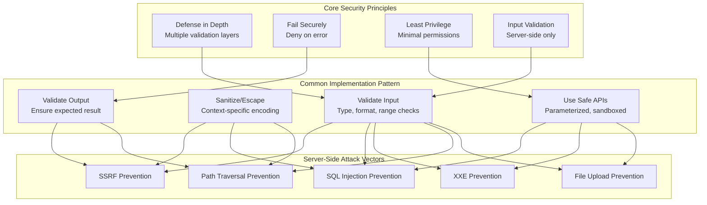
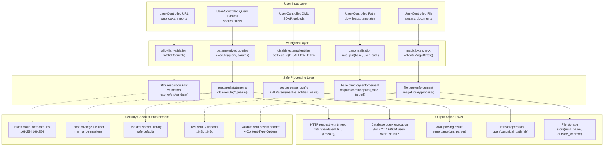

<!-- source: DeepWiki mcp.deepwiki.com · repo BehiSecc/VibeSec-Skill · page 7 Server-Side Security · fetched 2026-10-26 -->

# Server-Side Security

<details>
<summary>Relevant source files</summary>

The following files were used as context for generating this wiki page:

- [SKILL.md](SKILL.md)

</details>


## Purpose and Scope

This page provides an overview of server-side vulnerability prevention in VibeSec-Skill, covering the five primary attack vectors that occur when servers process user-controlled data: Server-Side Request Forgery (SSRF), SQL Injection, XML External Entity (XXE), Path Traversal, and Insecure File Upload.

Server-side vulnerabilities differ from client-side attacks in that they exploit server processing logic rather than browser behavior. These vulnerabilities typically allow attackers to read sensitive files, execute arbitrary code, access internal network resources, or exfiltrate data.

For client-side vulnerability prevention (XSS, CSRF, open redirects), see [Client-Side Security](#6). For access control and authorization issues (IDOR, privilege escalation), see [Access Control & Authorization](#5). For authentication-specific security, see [Authentication & Session Security](#8).

**Sources:** [SKILL.md:321-627]()

---

## Server-Side Attack Surface

Server-side vulnerabilities emerge wherever user input influences server behavior. The five attack vectors covered by VibeSec-Skill represent distinct exploitation paths, but share common characteristics.

### Attack Vector Categories

| Attack Vector | Primary Exploit | Common Entry Points | Impact |
|---------------|-----------------|---------------------|--------|
| **SSRF** | Server makes requests to attacker-controlled URLs | Webhooks, URL previews, PDF generators, import features | Internal network access, cloud metadata theft, port scanning |
| **SQL Injection** | Malicious SQL executed in database queries | Any dynamic query construction with user input | Data exfiltration, authentication bypass, data manipulation |
| **XXE** | XML parser processes malicious external entities | XML uploads, SOAP APIs, document processing | File disclosure, SSRF, denial of service |
| **Path Traversal** | Access files outside intended directory | File download/upload, template selection | Arbitrary file read, configuration disclosure |
| **Insecure Upload** | Upload malicious files that execute on server | File upload endpoints, avatar uploads, document imports | Remote code execution, XSS, denial of service |

**Sources:** [SKILL.md:323-627]()

---

## Common Patterns Across Server-Side Vulnerabilities

Despite their distinct attack mechanisms, all server-side vulnerabilities in VibeSec-Skill follow a common defensive pattern based on the core security principles defined in [SKILL.md:12-17]().

### Shared Defensive Principles



**Diagram: Core Principles Applied to Server-Side Security**

All five server-side attack vectors implement defense in depth through input validation, context-specific sanitization, safe API usage, and output validation. The core principles cascade to create a consistent security model across different vulnerability classes.

**Sources:** [SKILL.md:10-17](), [SKILL.md:321-627]()

---

## The Five Server-Side Attack Vectors

### 1. Server-Side Request Forgery (SSRF)

SSRF occurs when servers make HTTP requests to URLs controlled or influenced by users. Attackers exploit this to access internal network resources, cloud metadata endpoints, or conduct port scanning.

**Vulnerable Features:** Webhooks, URL previews, PDF generators from URLs, image fetching, RSS readers, API integrations with user-provided endpoints, proxy functionality, HTML-to-PDF converters.

**Primary Defenses:**
- Allowlist approved domains
- Network segmentation for URL-fetching services
- DNS resolution with IP validation
- Cloud metadata endpoint blocking

For comprehensive SSRF prevention including DNS rebinding protection and bypass technique coverage, see [Server-Side Request Forgery (SSRF) Prevention](#7.1).

**Sources:** [SKILL.md:323-391]()

### 2. SQL Injection

SQL injection occurs when user input is incorporated into SQL queries without proper parameterization, allowing attackers to execute arbitrary SQL commands.

**Injection Points:** WHERE clauses, ORDER BY, LIMIT/OFFSET, table/column names, INSERT/UPDATE values, IN clauses, LIKE patterns.

**Primary Defenses:**
- Parameterized queries (prepared statements)
- ORM usage with safe methods
- Input validation for data types
- Whitelisting for non-parameterizable elements (ORDER BY, table names)

For detailed SQL injection prevention patterns and ORM-specific guidance, see [SQL Injection Prevention](#7.2).

**Sources:** [SKILL.md:456-499]()

### 3. XML External Entity (XXE)

XXE vulnerabilities arise when XML parsers process external entity references in user-supplied XML, allowing file disclosure, SSRF, and denial of service.

**Vulnerable Scenarios:** SOAP APIs, XML-RPC, XML file uploads, configuration parsing, RSS/Atom feeds, Office documents (DOCX/XLSX/PPTX), SVG files, SAML assertions.

**Primary Defenses:**
- Disable DTD processing
- Disable external entity resolution
- Use JSON instead of XML where possible
- Parser-specific security configurations

For language-specific XXE prevention code examples (Java, Python, PHP, Node.js, .NET), see [XML External Entity (XXE) Prevention](#7.3).

**Sources:** [SKILL.md:501-568]()

### 4. Path Traversal

Path traversal vulnerabilities occur when user input controls file paths, allowing access to files outside intended directories through `../` sequences or encoding variations.

**Vulnerable Patterns:** Direct path concatenation, template selection, file download by name, archive extraction.

**Primary Defenses:**
- Indirect file references (mapping user input to safe paths)
- Path canonicalization with base directory validation
- Input sanitization (remove `..`, absolute path indicators)
- File extension whitelisting

For canonicalization implementation patterns and bypass techniques, see [Path Traversal Prevention](#7.4).

**Sources:** [SKILL.md:570-627]()

### 5. Insecure File Upload

File upload vulnerabilities allow attackers to upload malicious files that execute on the server, inject XSS, or exploit file processing libraries.

**Validation Requirements:** File type validation (extension + magic bytes), file content validation (structure parsing), file size limits, polyglot file detection.

**Common Bypasses:** Extension manipulation (`shell.php.jpg`), null byte injection, MIME type spoofing, magic byte prepending, SVG with JavaScript, XXE via documents, ZIP slip, ImageMagick exploits.

**Primary Defenses:**
- Magic byte validation matching expected type
- File renaming with random UUIDs
- Storage outside webroot
- Restrictive Content-Disposition headers
- CDN/separate domain isolation

For magic bytes reference table and comprehensive bypass prevention, see [Insecure File Upload Prevention](#7.5).

**Sources:** [SKILL.md:393-454]()

---

## Server-Side Security Implementation Architecture

The following diagram illustrates how VibeSec-Skill's server-side security directives map to code-level implementation patterns across different vulnerability classes.



**Diagram: Server-Side Vulnerability Prevention - Code-Level Implementation Pattern**

This diagram maps user input sources to specific validation functions, safe processing APIs, and secure output operations. Function names reflect actual patterns from [SKILL.md:321-627](): `isValidRedirect()` for SSRF allowlist validation, `execute(query, params)` for SQL parameterization, `setFeature(DISALLOW_DTD)` for XXE prevention, `safe_join(base, user_path)` for path traversal canonicalization, and `validateMagicBytes()` for file upload verification. The security checklist layer shows additional defense-in-depth measures specific to each attack vector.

**Sources:** [SKILL.md:266-272](), [SKILL.md:464-471](), [SKILL.md:526-558](), [SKILL.md:600-611](), [SKILL.md:401-409]()

---

## Attack Prevention Flow: From User Input to Secure Execution

The following sequence diagram shows the temporal flow of security validation for server-side operations, demonstrating how VibeSec-Skill directives translate to runtime security checks.

```mermaid
sequenceDiagram
    participant User
    participant Endpoint["API Endpoint<br/>POST /webhook"]
    participant Validator["Input Validator<br/>validateInput()"]
    participant Sanitizer["Sanitizer<br/>sanitize()/escape()"]
    participant SafeAPI["Safe API<br/>parameterize()/allowlist()"]
    participant Backend["Backend Service<br/>Database/FileSystem/Network"]
    participant Logger["Security Logger<br/>logSecurityEvent()"]
    
    User->>Endpoint: "POST {url: 'http://attacker.com'}"
    
    Note over Endpoint: SSRF Prevention Flow
    Endpoint->>Validator: "validate(url)"
    activate Validator
    Validator->>Validator: "check scheme (HTTP/HTTPS only)"
    Validator->>Validator: "resolve DNS"
    Validator->>Validator: "check IP not private/cloud metadata"
    
    alt Invalid Input
        Validator-->>Endpoint: "ValidationError"
        Endpoint-->>User: "400 Bad Request"
        Endpoint->>Logger: "log blocked SSRF attempt"
    else Valid Input
        Validator-->>Endpoint: "validated URL + resolved IP"
        deactivate Validator
        
        Endpoint->>SafeAPI: "makeRequest(url, {timeout, noRedirects})"
        activate SafeAPI
        SafeAPI->>Backend: "HTTP request with IP pinning"
        Backend-->>SafeAPI: "response"
        SafeAPI-->>Endpoint: "safe response"
        deactivate SafeAPI
    end
    
    Note over Endpoint: SQL Injection Prevention Flow
    User->>Endpoint: "GET /users?id=1' OR '1'='1"
    Endpoint->>Validator: "validateType(id, 'integer')"
    activate Validator
    
    alt Non-Integer Input
        Validator-->>Endpoint: "TypeError"
        Endpoint-->>User: "400 Bad Request"
        Endpoint->>Logger: "log SQL injection attempt"
    else Valid Integer
        Validator-->>Endpoint: "validated integer"
        deactivate Validator
        
        Endpoint->>SafeAPI: "db.execute('SELECT * FROM users WHERE id=?', [id])"
        activate SafeAPI
        Note over SafeAPI: Parameterized query prevents SQL injection
        SafeAPI->>Backend: "prepared statement"
        Backend-->>SafeAPI: "query result"
        SafeAPI-->>Endpoint: "safe data"
        deactivate SafeAPI
    end
    
    Note over Endpoint: Path Traversal Prevention Flow
    User->>Endpoint: "GET /download?file=../../etc/passwd"
    Endpoint->>Sanitizer: "safe_join(base_dir, user_file)"
    activate Sanitizer
    Sanitizer->>Sanitizer: "canonicalize paths"
    Sanitizer->>Sanitizer: "check commonpath == base_dir"
    
    alt Path Escapes Base Directory
        Sanitizer-->>Endpoint: "ValueError('Path traversal')"
        Endpoint-->>User: "403 Forbidden"
        Endpoint->>Logger: "log traversal attempt"
    else Path Within Base
        Sanitizer-->>Endpoint: "canonical_path"
        deactivate Sanitizer
        
        Endpoint->>Backend: "read(canonical_path)"
        Backend-->>Endpoint: "file contents"
    end
    
    Endpoint-->>User: "200 OK + secure response"
```

**Diagram: Server-Side Security Validation Flow**

This sequence diagram demonstrates the defense-in-depth pattern applied across SSRF, SQL injection, and path traversal prevention. Each attack vector follows a consistent flow: input validation (type/format checks), sanitization/escaping (context-specific), safe API usage (parameterization/allowlisting), and security logging. The pattern reflects the implementation guidance from [SKILL.md:340-391]() for SSRF, [SKILL.md:463-471]() for SQL injection, and [SKILL.md:600-611]() for path traversal. Failed validation results in 400/403 responses and security event logging, while successful validation proceeds to safe backend operations.

**Sources:** [SKILL.md:340-391](), [SKILL.md:463-471](), [SKILL.md:600-611]()

---

## Defense-in-Depth Implementation Matrix

The following table shows how multiple security controls are applied to each server-side vulnerability class, implementing the defense-in-depth principle from [SKILL.md:13]().

| Attack Vector | Input Validation | Safe API Usage | Output Validation | Additional Defenses |
|---------------|------------------|----------------|-------------------|---------------------|
| **SSRF** | URL scheme check, DNS resolution, IP range validation | HTTP client with timeout and redirect limits | Response size limits, content-type validation | Network segmentation, cloud metadata IP blocking |
| **SQL Injection** | Data type validation, input length limits | Parameterized queries, ORM safe methods | Never expose SQL errors to users | Least privilege DB user, disable dangerous functions |
| **XXE** | Schema validation (if DTD needed) | Disable external entities, disable DTD processing | N/A | Use JSON instead of XML, parser version updates |
| **Path Traversal** | Remove `..` sequences, whitelist characters | Canonicalization with base directory check | Validate file exists and is readable | Indirect file references, extension whitelisting |
| **File Upload** | Extension allowlist, magic byte validation | File type-specific parsers, sandboxed processing | Serve with `Content-Disposition: attachment` | Store outside webroot, random UUID names, separate domain |

**Sources:** [SKILL.md:340-391](), [SKILL.md:461-499](), [SKILL.md:523-568](), [SKILL.md:586-627](), [SKILL.md:398-454]()

---

## Common Bypass Techniques Across Attack Vectors

Attackers use similar bypass techniques across different server-side vulnerabilities. VibeSec-Skill addresses these bypass patterns explicitly.

### Encoding and Representation Bypasses

| Bypass Type | SSRF Example | SQL Example | Path Traversal Example | Prevention |
|-------------|--------------|-------------|------------------------|------------|
| **URL Encoding** | `http://127.0.0.1` → `http://127.0.0.%31` | `' OR 1=1` → `%27%20OR%201=1` | `../` → `%2e%2e%2f` | Decode before validation, validate canonical form |
| **Double Encoding** | `%2527` → `%27` → `'` | `%252f` → `%2f` → `/` | `%252e%252e%252f` | Normalize all encoding levels |
| **Alternative Representations** | Decimal IP: `2130706433` | Hex literals: `0x5345434554` | Windows separator: `..\\` | Canonicalize to standard format |
| **Null Byte Injection** | `http://legit.com%00.evil.com` | `admin'%00` | `shell.php%00.jpg` | Sanitize null bytes, check for truncation |
| **Unicode Normalization** | IDN homograph: `legіt.com` (Cyrillic) | NFKD normalization bypasses | Unicode lookalikes for `../` | Normalize to ASCII/Punycode |

**Sources:** [SKILL.md:349-365](), [SKILL.md:483-493](), [SKILL.md:615-618]()

---

## Framework-Specific Security Patterns

VibeSec-Skill provides language and framework-agnostic security guidance, but certain server-side vulnerabilities require framework-specific implementations.

### XXE Prevention by Language

| Language/Framework | Secure Configuration Function | Key Setting |
|-------------------|------------------------------|-------------|
| **Java** | `DocumentBuilderFactory.setFeature()` | `"http://apache.org/xml/features/disallow-doctype-decl", true` |
| **Python (lxml)** | `etree.XMLParser()` | `resolve_entities=False, no_network=True` |
| **PHP** | `libxml_disable_entity_loader()` | `libxml_disable_entity_loader(true)` |
| **Node.js** | Library configuration | `{ noent: false, dtdload: false }` |
| **.NET** | `XmlReaderSettings` | `DtdProcessing = DtdProcessing.Prohibit` |

Code examples for each language are provided in [SKILL.md:523-558]().

### SQL Injection Prevention by ORM

All ORMs provide parameterized query interfaces, but also expose raw query methods that can introduce SQL injection if misused. VibeSec-Skill emphasizes using ORM safe methods while watching for injection points in ORDER BY clauses and table names that cannot be parameterized.

**Sources:** [SKILL.md:473-477](), [SKILL.md:523-558]()

---

## Server-Side Security Checklists

VibeSec-Skill provides verification checklists for each attack vector to ensure comprehensive protection during code generation. The following is a consolidated checklist covering all five server-side vulnerabilities.

### Consolidated Server-Side Security Checklist

#### SSRF Protection
- [ ] URL scheme validation (HTTP/HTTPS only)
- [ ] DNS resolution with IP validation (not private/internal)
- [ ] Cloud metadata IPs explicitly blocked (`169.254.169.254`)
- [ ] Redirect following limited or disabled
- [ ] Request timeout configured
- [ ] Response size limits enforced
- [ ] Network isolation for URL-fetching services

#### SQL Injection Protection
- [ ] Parameterized queries used (no string concatenation)
- [ ] ORM safe methods used (avoid raw query methods)
- [ ] Data type validation on all inputs
- [ ] ORDER BY uses whitelisted columns
- [ ] Table/column names use whitelisting (cannot parameterize)
- [ ] Database user has least privilege permissions
- [ ] SQL errors never exposed to users

#### XXE Protection
- [ ] DTD processing disabled
- [ ] External entity resolution disabled
- [ ] External DTD loading disabled
- [ ] XInclude processing disabled
- [ ] XML parser version up-to-date
- [ ] JSON used instead of XML where possible

#### Path Traversal Protection
- [ ] User input never directly in file paths
- [ ] Paths canonicalized and validated against base directory
- [ ] `..` sequences removed or rejected
- [ ] Absolute path indicators blocked
- [ ] File extension whitelisting applied

#### File Upload Protection
- [ ] File extension validated against allowlist
- [ ] Magic bytes validated and match expected type
- [ ] File content parsed to validate structure
- [ ] Maximum file size enforced
- [ ] Files renamed with random UUIDs
- [ ] Files stored outside webroot or on separate domain
- [ ] `Content-Disposition: attachment` header set
- [ ] `X-Content-Type-Options: nosniff` header set

**Sources:** [SKILL.md:382-391](), [SKILL.md:494-499](), [SKILL.md:560-568](), [SKILL.md:621-627](), [SKILL.md:444-454]()

---

## Integration with VibeSec-Skill Workflow

When developers use VibeSec-Skill with an AI coding assistant, server-side security directives are automatically applied during code generation. The skill analyzes the request context to determine which server-side vulnerabilities are relevant.

### Context-Aware Security Application

- **Database operations detected** → SQL injection prevention applied (parameterized queries)
- **URL/webhook handling detected** → SSRF prevention applied (allowlist validation, IP checks)
- **XML processing detected** → XXE prevention applied (external entity disabling)
- **File path operations detected** → Path traversal prevention applied (canonicalization)
- **File upload endpoints detected** → Upload security applied (magic bytes, UUID renaming)

The AI assistant generates code with embedded security patterns, security comments explaining the protections, and compliance checklists referencing the specific VibeSec-Skill directives applied.

**Sources:** [SKILL.md:10-11](), [README.md:71-75]()

---

## Summary

Server-side security in VibeSec-Skill addresses five primary attack vectors through a consistent defense-in-depth pattern. Each vulnerability class (SSRF, SQL Injection, XXE, Path Traversal, File Upload) implements input validation, safe API usage, output validation, and additional security controls specific to the attack surface.

The security architecture maps directly to code-level implementation patterns with specific function signatures and security configurations. Common bypass techniques are addressed across all vulnerability classes through canonicalization, encoding normalization, and strict validation.

For detailed implementation guidance on each attack vector, refer to the child pages:
- [Server-Side Request Forgery (SSRF) Prevention](#7.1)
- [SQL Injection Prevention](#7.2)
- [XML External Entity (XXE) Prevention](#7.3)
- [Path Traversal Prevention](#7.4)
- [Insecure File Upload Prevention](#7.5)

**Sources:** [SKILL.md:321-627](), [SKILL.md:10-17]()

---

