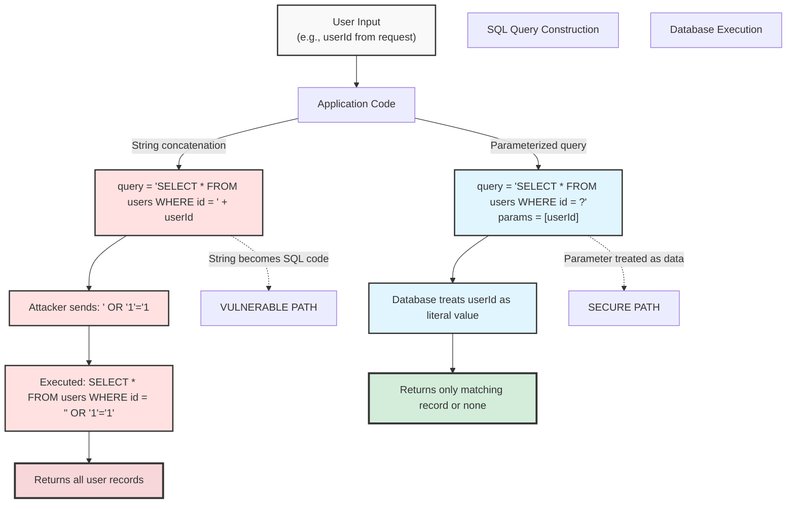
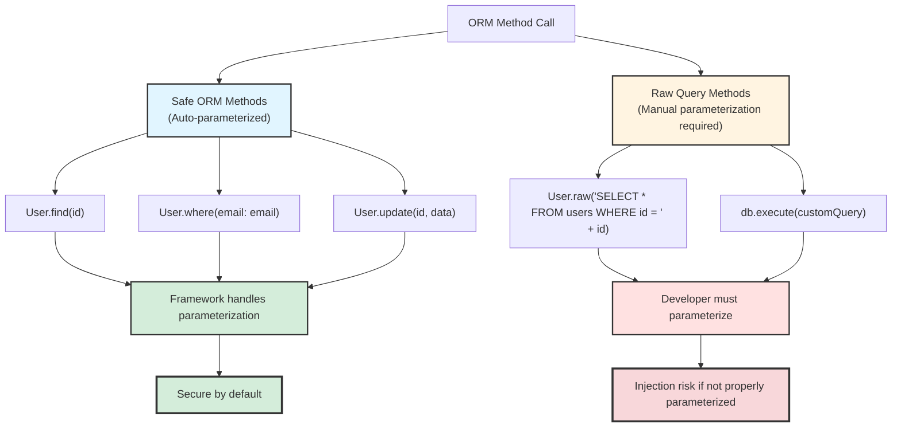
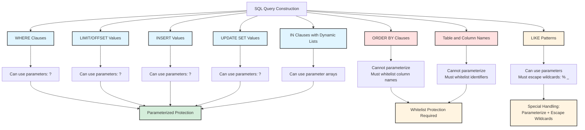

<!-- source: DeepWiki mcp.deepwiki.com · repo BehiSecc/VibeSec-Skill · page 7.2 SQL Injection Prevention · fetched 2026-10-26 -->

# SQL Injection Prevention

<details>
<summary>Relevant source files</summary>

The following files were used as context for generating this wiki page:

- [SKILL.md](SKILL.md)

</details>


## Purpose and Scope

This page documents SQL injection prevention strategies as defined in the VibeSec-Skill knowledge base. SQL injection occurs when user-controlled input is incorporated into SQL queries without proper sanitization, allowing attackers to manipulate database operations. This page covers parameterized queries, ORM security, critical injection points, and defense-in-depth measures.

For other server-side vulnerabilities, see [SSRF Prevention](#7.1), [XXE Prevention](#7.3), [Path Traversal Prevention](#7.4), and [Insecure File Upload Prevention](#7.5). For input validation principles that apply across all vulnerabilities, see [Core Security Principles](#4).

**Sources:** [SKILL.md:457-499]()

---

## Vulnerability Overview

SQL injection exploits occur when user input is concatenated directly into SQL query strings. Attackers can inject malicious SQL fragments that alter query logic, bypass authentication, extract sensitive data, modify records, or execute administrative operations.

### Attack Vector Flow



**Sources:** [SKILL.md:457-471]()

---

## Primary Defense: Parameterized Queries

Parameterized queries (also called prepared statements) are the **PRIMARY DEFENSE** against SQL injection. They separate SQL code from data by using placeholders for user input, ensuring user-provided values are always treated as literal data, never executable code.

### Vulnerable vs. Secure Pattern

| Pattern | Example | Security Status |
|---------|---------|-----------------|
| **Vulnerable (Concatenation)** | `query = "SELECT * FROM users WHERE id = " + userId` | ❌ Allows injection |
| **Secure (Parameterized)** | `query = "SELECT * FROM users WHERE id = ?"` <br/> `execute(query, [userId])` | ✅ Safe - data separated from code |

**Sources:** [SKILL.md:463-471]()

### Language-Specific Implementation

While the SKILL.md file provides pseudocode examples, the principle applies across all database interfaces:

**Parameterized Query Pattern:**
```
query = "SELECT * FROM users WHERE id = ?"
execute(query, [userId])
```

The placeholder (`?`) or named parameter syntax varies by language/framework, but the core concept remains: never concatenate user input into SQL strings.

**Sources:** [SKILL.md:464-471]()

---

## ORM Usage and Cautions

Object-Relational Mappers (ORMs) typically parameterize queries automatically, providing built-in SQL injection protection when used correctly.

### ORM Security Considerations



### ORM Security Rules

1. **Use ORM methods that automatically parameterize** - Standard CRUD operations are safe
2. **Be cautious with raw query methods** - Methods like `.raw()`, `.execute()`, or similar require manual parameterization
3. **Watch for ORM-specific injection points** - Some ORMs have edge cases where injection is possible

**Sources:** [SKILL.md:473-476]()

---

## Input Validation as Defense-in-Depth

Input validation provides an additional security layer but is **NOT** a replacement for parameterized queries.

### Validation Strategy

| Validation Type | Purpose | Implementation |
|----------------|---------|----------------|
| **Data Type Validation** | Ensure integers are integers, not strings | Cast/parse with strict type checking |
| **Whitelist Allowed Values** | Limit to known-good values | Compare against predefined set |
| **Format Validation** | Verify expected patterns | Regex matching, length checks |

**Critical:** Input validation is defense-in-depth, not the primary defense. Always use parameterized queries regardless of validation.

**Sources:** [SKILL.md:478-481]()

---

## Critical Injection Points

SQL injection can occur at multiple points in query construction. Each requires specific attention:

### Injection Point Reference



### Detailed Injection Points

| Injection Point | Can Parameterize? | Security Measure | Notes |
|-----------------|-------------------|------------------|-------|
| **WHERE clauses** | ✅ Yes | Use `?` placeholders | Standard parameterization applies |
| **ORDER BY clauses** | ❌ No | Whitelist column names | Often overlooked - parameters don't work for identifiers |
| **LIMIT/OFFSET values** | ✅ Yes | Use `?` placeholders | Treat as numeric parameters |
| **Table and column names** | ❌ No | Whitelist identifiers | Cannot parameterize SQL identifiers |
| **INSERT values** | ✅ Yes | Use `?` placeholders | Standard parameterization applies |
| **UPDATE SET values** | ✅ Yes | Use `?` placeholders | Standard parameterization applies |
| **IN clauses with dynamic lists** | ✅ Yes | Parameter arrays | Use array/list parameter binding |
| **LIKE patterns** | ⚠️ Partial | Parameterize + escape wildcards | Escape `%` and `_` characters in user input |

**Sources:** [SKILL.md:484-492]()

### ORDER BY and Table Name Handling

**Critical:** `ORDER BY` clauses and table/column names cannot be parameterized. These must use whitelisting:

```
# Whitelist approach for ORDER BY
allowed_columns = ['name', 'email', 'created_at']
if sort_column not in allowed_columns:
    return error
    
query = f"SELECT * FROM users ORDER BY {sort_column}"  # Safe because whitelisted
```

**Sources:** [SKILL.md:486-488]()

### LIKE Pattern Special Handling

`LIKE` patterns require both parameterization and wildcard escaping:

```
# User input: "test_value"
# Without escaping, _ matches any character
# Must escape: "test\_value"
escaped_input = input.replace('%', '\\%').replace('_', '\\_')
query = "SELECT * FROM users WHERE name LIKE ?"
execute(query, [escaped_input + '%'])
```

**Sources:** [SKILL.md:492]()

---

## Additional Defense Layers

Beyond parameterized queries, implement these defense-in-depth measures:

### Database-Level Protections

| Protection | Purpose | Implementation |
|-----------|---------|----------------|
| **Least Privilege** | Limit damage from successful injection | Database user should have minimum required permissions (SELECT, INSERT, UPDATE only - no DROP, ALTER, GRANT) |
| **Disable Dangerous Functions** | Prevent command execution | Disable `xp_cmdshell` (SQL Server), `sys_exec()`, `LOAD_FILE()`, and similar functions |
| **Error Handling** | Prevent information disclosure | Never expose SQL error messages to users; log errors server-side only |

**Sources:** [SKILL.md:495-498]()

### Database Permission Model

```mermaid
graph TB
    DBUser["Database User for Application"]
    
    DBUser --> AllowedPerms["Allowed Permissions"]
    DBUser --> DeniedPerms["Denied Permissions"]
    
    AllowedPerms --> SELECT["SELECT (read data)"]
    AllowedPerms --> INSERT["INSERT (create records)"]
    AllowedPerms --> UPDATE["UPDATE (modify records)"]
    AllowedPerms --> DELETE["DELETE (remove records)<br/>(if needed)"]
    
    DeniedPerms --> DROP["DROP (delete tables)"]
    DeniedPerms --> ALTER["ALTER (modify schema)"]
    DeniedPerms --> GRANT["GRANT (change permissions)"]
    DeniedPerms --> EXEC["EXECUTE system commands<br/>(xp_cmdshell, etc.)"]
    DeniedPerms --> LOAD["LOAD_FILE / OUTFILE"]
    
    AllowedPerms --> LimitDamage["Limits damage if injection occurs"]
    DeniedPerms --> BlockEscalation["Prevents privilege escalation<br/>and data exfiltration"]
    
    style AllowedPerms fill:#e1f5ff,stroke:#333,stroke-width:2px
    style DeniedPerms fill:#ffe1e1,stroke:#333,stroke-width:2px
    style LimitDamage fill:#d4edda,stroke:#333,stroke-width:2px
    style BlockEscalation fill:#d4edda,stroke:#333,stroke-width:2px
```



**Sources:** [SKILL.md:496-498]()

### Error Handling Requirements

**Never expose SQL errors to users:**
- Log detailed error messages server-side for debugging
- Return generic error messages to clients (e.g., "An error occurred")
- Prevents attackers from learning database structure through error messages

**Sources:** [SKILL.md:498]()

---

## Implementation Checklist

Use this checklist when implementing database operations:

- [ ] **All queries use parameterized queries or safe ORM methods**
- [ ] **No string concatenation of user input into SQL**
- [ ] **ORDER BY clauses use whitelisted column names**
- [ ] **Table/column names are whitelisted when dynamic**
- [ ] **LIKE patterns escape `%` and `_` wildcards**
- [ ] **IN clause arrays use parameter binding**
- [ ] **Database user has least-privilege permissions**
- [ ] **Dangerous functions (xp_cmdshell, etc.) are disabled**
- [ ] **SQL errors are not exposed to users**
- [ ] **Input is validated for expected data types**
- [ ] **Raw SQL methods in ORMs are avoided or carefully parameterized**

**Sources:** [SKILL.md:457-499]()

---

## Relationship to Core Principles

SQL injection prevention aligns with multiple core security principles documented in [Core Security Principles](#4):

| Core Principle | SQL Injection Application |
|----------------|--------------------------|
| **Defense in Depth** | Parameterized queries (primary) + input validation (secondary) + least privilege (tertiary) |
| **Fail Securely** | Return generic errors instead of SQL error details; deny access on validation failure |
| **Least Privilege** | Database user permissions limited to required operations only |
| **Input Validation** | Validate data types and formats even when using parameterized queries |

**Sources:** [SKILL.md:10-17](), [SKILL.md:478-498]()

---

