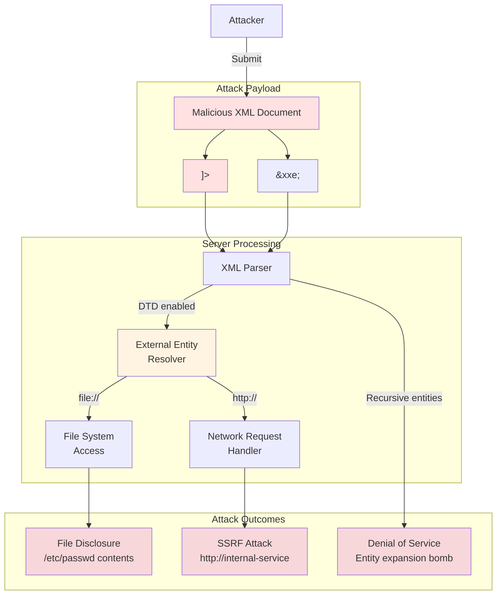
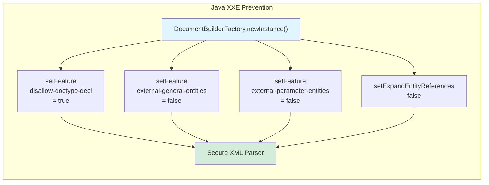
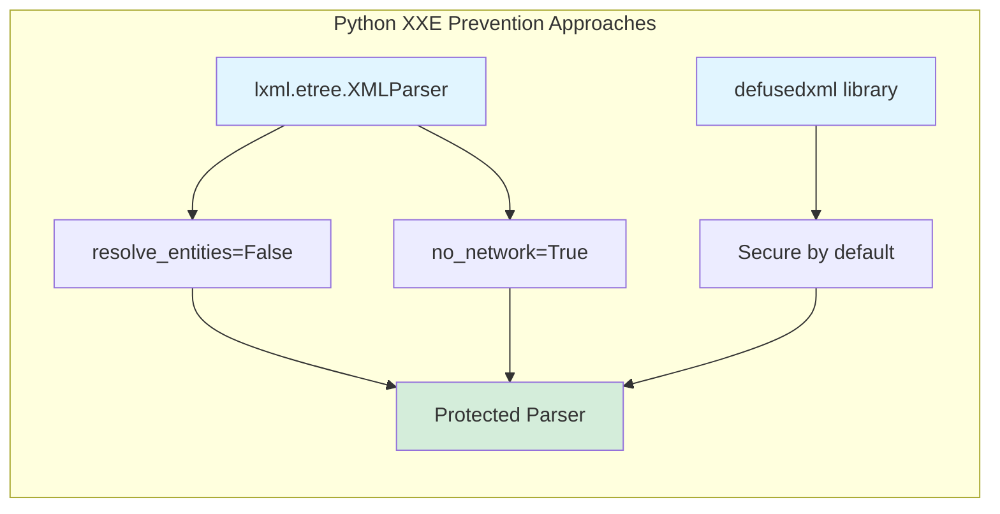
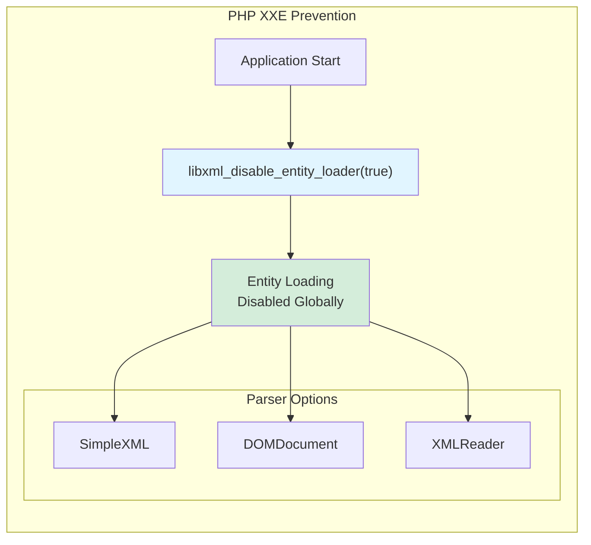
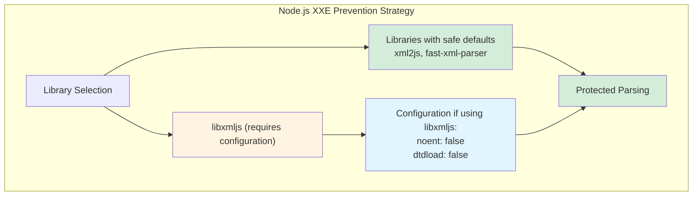
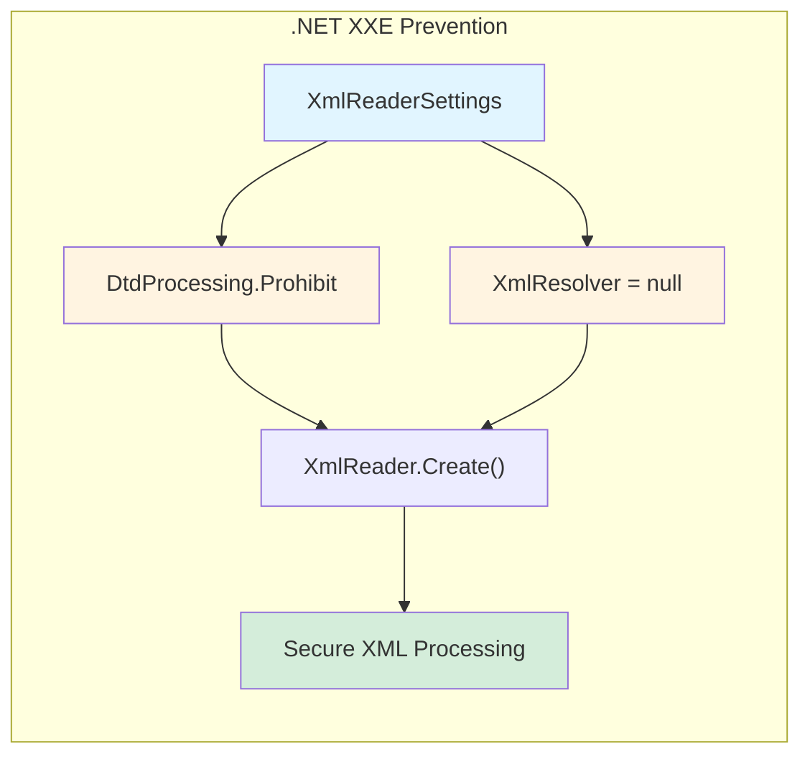
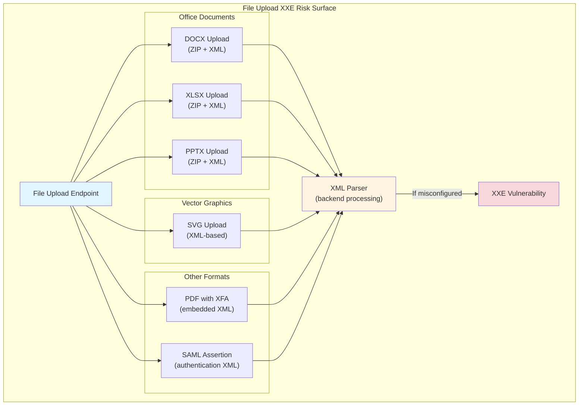

<!-- source: DeepWiki mcp.deepwiki.com · repo BehiSecc/VibeSec-Skill · page 7.3 XML External Entity (XXE) Prevention · fetched 2026-10-26 -->

# XML External Entity (XXE) Prevention

Relevant source files

The following files were used as context for generating this wiki page:

- [SKILL.md](SKILL.md)

## Purpose and Scope

This document details prevention strategies for XML External Entity (XXE) vulnerabilities in server-side code. XXE attacks exploit XML parsers that process external entity references in user-supplied XML documents, potentially leading to file disclosure, server-side request forgery, or denial of service.

This page covers parser configuration, vulnerable scenarios, and language-specific prevention code. For general server-side security principles, see [Server-Side Security](#7). For file upload security considerations that may involve XML-based formats, see [Insecure File Upload Prevention](#7.5).

**Sources:** [SKILL.md:502-569]()

---

## Understanding XXE Vulnerabilities

XML External Entity vulnerabilities occur when XML parsers process external entity references in user-supplied XML without proper restrictions. Attackers can exploit this to:

- **Read local files** via `file://` URIs
- **Perform SSRF attacks** via `http://` URIs to internal services
- **Cause denial of service** through entity expansion bombs
- **Exfiltrate data** to attacker-controlled servers

The vulnerability exists when parsers allow DTD (Document Type Definition) processing and external entity resolution by default.

**Sources:** [SKILL.md:502-505]()

---

## Attack Surface: Vulnerable Scenarios

### Direct XML Input

Applications that directly accept XML from users are primary targets:

| Scenario | Description | Risk Level |
|----------|-------------|------------|
| **SOAP APIs** | XML-based web service requests | High |
| **XML-RPC** | Remote procedure calls using XML | High |
| **XML file uploads** | User-uploaded XML configuration or data files | High |
| **Configuration file parsing** | Application settings in XML format | Medium |
| **RSS/Atom feed processing** | Parsing external feed sources | Medium |

**Sources:** [SKILL.md:506-514]()

### Indirect XML Vectors

Many file formats internally use XML, creating hidden attack surfaces:

| Format | Internal Structure | Common Use Cases |
|--------|-------------------|------------------|
| **Office Documents** | DOCX, XLSX, PPTX are ZIP archives containing XML | Document uploads, report generation |
| **SVG Files** | XML-based vector graphics | Image uploads, user avatars |
| **SAML Assertions** | XML authentication tokens | Single sign-on implementations |
| **PDF with XFA Forms** | XML Forms Architecture embedded in PDFs | Form processing |
| **Server-side conversions** | JSON/other formats converted to XML internally | API translation layers |

**Sources:** [SKILL.md:515-521]()

---

## XXE Attack Flow

**XXE Attack Flow Diagram**: Demonstrates how malicious XML documents exploit entity resolution to access files, make network requests, or cause denial of service through the XML parser's entity processing mechanism.

**Sources:** [SKILL.md:502-521]()

---

## Prevention Strategies by Language and Parser

### Java: DocumentBuilderFactory Configuration

The `DocumentBuilderFactory` class requires explicit feature disabling to prevent XXE:

**Java Parser Hardening**: Configuration chain for `DocumentBuilderFactory` to disable DTD processing and external entity resolution.

**Configuration Details:**

| Feature/Method | Purpose | Required |
|----------------|---------|----------|
| `http://apache.org/xml/features/disallow-doctype-decl` | Completely disables DTD processing | Recommended |
| `http://xml.org/sax/features/external-general-entities` | Disables external general entities | Yes |
| `http://xml.org/sax/features/external-parameter-entities` | Disables external parameter entities | Yes |
| `setExpandEntityReferences(false)` | Prevents entity expansion | Yes |

**Sources:** [SKILL.md:525-532]()

---

### Python: lxml and defusedxml

Python's `lxml` library provides parser-level controls:

**Python Parser Options**: Two approaches for XXE prevention—explicit `lxml` parser configuration or the purpose-built `defusedxml` library.

**Implementation Pattern:**

| Library | Configuration | Security Level |
|---------|---------------|----------------|
| **lxml** | `XMLParser(resolve_entities=False, no_network=True)` | High (if configured) |
| **defusedxml** | Drop-in replacement for stdlib XML modules | High (default) |

**Sources:** [SKILL.md:534-539]()

---

### PHP: libxml_disable_entity_loader

PHP requires runtime configuration before XML parsing:

**PHP Global Protection**: The `libxml_disable_entity_loader()` function provides application-wide protection for all libxml-based parsers.

**Sources:** [SKILL.md:541-545]()

---

### Node.js: Library Selection and Configuration

Node.js XML parsing requires careful library selection:

**Node.js Parser Security**: Strategy prioritizes libraries with secure defaults, with explicit configuration required for `libxmljs`.

**Library Comparison:**

| Library | Default Security | Configuration Needed |
|---------|-----------------|---------------------|
| `xml2js` | Secure | None |
| `fast-xml-parser` | Secure | None |
| `libxmljs` | Unsafe | `{ noent: false, dtdload: false }` |

**Sources:** [SKILL.md:547-551]()

---

### .NET: XmlReaderSettings

.NET's `XmlReader` requires explicit settings configuration:

**.NET Configuration Pattern**: Two-step hardening through DTD processing prohibition and null resolver assignment.

**Configuration Properties:**

| Property | Value | Purpose |
|----------|-------|---------|
| `DtdProcessing` | `DtdProcessing.Prohibit` | Completely disables DTD processing |
| `XmlResolver` | `null` | Prevents external resource resolution |

**Sources:** [SKILL.md:553-558]()

---

## Language-Specific Prevention Reference

### Complete Configuration Matrix

| Language/Framework | Parser Class/Function | Critical Configuration | Code Reference |
|-------------------|----------------------|----------------------|----------------|
| **Java** | `DocumentBuilderFactory` | `setFeature("http://apache.org/xml/features/disallow-doctype-decl", true)` | [SKILL.md:526-532]() |
| **Python** | `lxml.etree.XMLParser` | `resolve_entities=False, no_network=True` | [SKILL.md:535-539]() |
| **PHP** | `libxml_disable_entity_loader()` | `libxml_disable_entity_loader(true)` | [SKILL.md:542-545]() |
| **Node.js** | `libxmljs` | `{ noent: false, dtdload: false }` | [SKILL.md:548-551]() |
| **.NET** | `XmlReaderSettings` | `DtdProcessing = DtdProcessing.Prohibit` | [SKILL.md:554-558]() |

**Sources:** [SKILL.md:523-559]()

---

## Indirect XXE Attack Surfaces

File upload functionality creates multiple XXE vectors through format conversions:

**Indirect XXE Vectors**: Common file formats that internally use XML, creating hidden attack surfaces during server-side processing.

**Sources:** [SKILL.md:515-521](), [SKILL.md:427]()

---

## XXE Prevention Checklist

Implementation verification steps for secure XML processing:

### Parser Configuration

- [ ] **DTD processing disabled** entirely if not required for application functionality
- [ ] **External entity resolution disabled** for both general and parameter entities
- [ ] **External DTD loading disabled** to prevent remote schema exploitation
- [ ] **XInclude processing disabled** to prevent XML inclusion attacks
- [ ] **XML parser library updated** to latest patched version

### Development Practices

- [ ] **Validate/sanitize XML** before parsing if DTD functionality is required
- [ ] **Consider JSON alternatives** for new API development to avoid XML complexity
- [ ] **Test with attack payloads** including file disclosure and SSRF attempts
- [ ] **Review all XML processing points** including indirect vectors (file uploads, format conversions)

### Defense in Depth

- [ ] **Network segmentation** limits impact of SSRF if XXE bypass occurs
- [ ] **File system permissions** restrict readable files from application user
- [ ] **Logging and monitoring** detects external entity resolution attempts
- [ ] **Input validation** rejects documents with DTD declarations at application layer

**Sources:** [SKILL.md:560-568]()

---

## Implementation Verification

### Testing Strategy

| Test Type | Payload Example | Expected Behavior |
|-----------|----------------|-------------------|
| **File Disclosure** | `<!ENTITY xxe SYSTEM "file:///etc/passwd">` | Parsing fails or entity not resolved |
| **SSRF Attempt** | `<!ENTITY xxe SYSTEM "http://internal-service">` | No network request initiated |
| **Entity Expansion** | Recursive entity definitions (billion laughs) | Parsing fails with resource limit |
| **DTD Declaration** | Any document with `<!DOCTYPE>` | Rejected if DTD disabled |

### Common Misconfiguration Patterns

| Vulnerability Pattern | Unsafe Code | Secure Alternative |
|----------------------|-------------|-------------------|
| **Default settings** | `DocumentBuilderFactory.newInstance()` without configuration | Explicitly disable features per [SKILL.md:526-532]() |
| **Partial hardening** | Only disabling external entities, leaving DTD enabled | Disable DTD entirely with `disallow-doctype-decl` |
| **Parser version** | Using outdated XML libraries with known XXE issues | Update to patched versions |
| **Inconsistent protection** | Hardening one parser while another remains vulnerable | Apply configuration to all XML parsing instances |

**Sources:** [SKILL.md:560-568]()

---

## Integration with File Upload Security

XXE prevention intersects with file upload security for XML-based formats:

| Format | XXE Risk | Prevention Strategy | Cross-Reference |
|--------|----------|-------------------|-----------------|
| **Office Documents** | High - ZIP archives contain XML files | Apply XXE prevention to document processors | [SKILL.md:427](), [#7.5](#7.5) |
| **SVG Files** | High - Pure XML with script capabilities | Sanitize SVG or disable SVG uploads entirely | [SKILL.md:426](), [#7.5](#7.5) |
| **PDF/XFA** | Medium - XFA forms embed XML | Configure PDF libraries to disable XFA or apply XXE hardening | [SKILL.md:520]() |

**Sources:** [SKILL.md:427](), [SKILL.md:515-521]()

---

## Related Security Concerns

XXE vulnerabilities often co-occur with or enable other attack types:

- **SSRF attacks**: XXE can trigger server-side requests to internal resources - see [SSRF Prevention](#7.1)
- **File upload exploitation**: Office documents and SVG files create XXE vectors - see [Insecure File Upload Prevention](#7.5)
- **Polyglot file attacks**: Files valid as both XML and other formats bypass validation - see [SKILL.md:409]()
- **DNS rebinding**: External entity resolution can be combined with DNS rebinding for SSRF - see [SKILL.md:366-371]()

**Sources:** [SKILL.md:502-521](), [SKILL.md:323-391](), [SKILL.md:427]()

---

