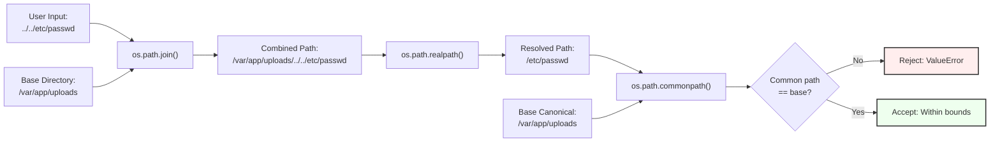
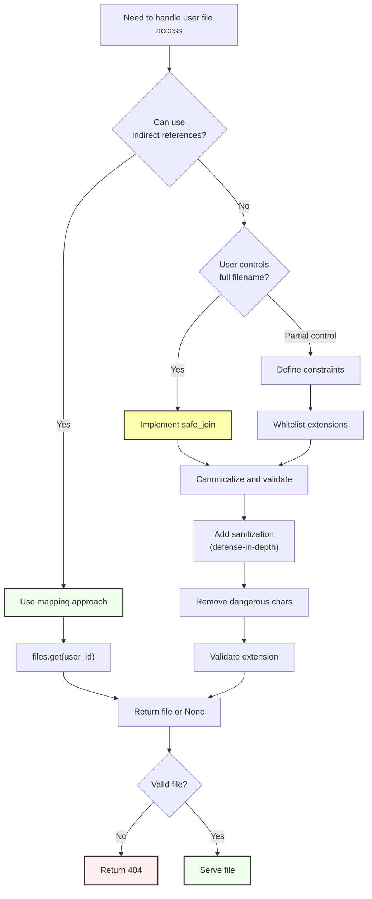
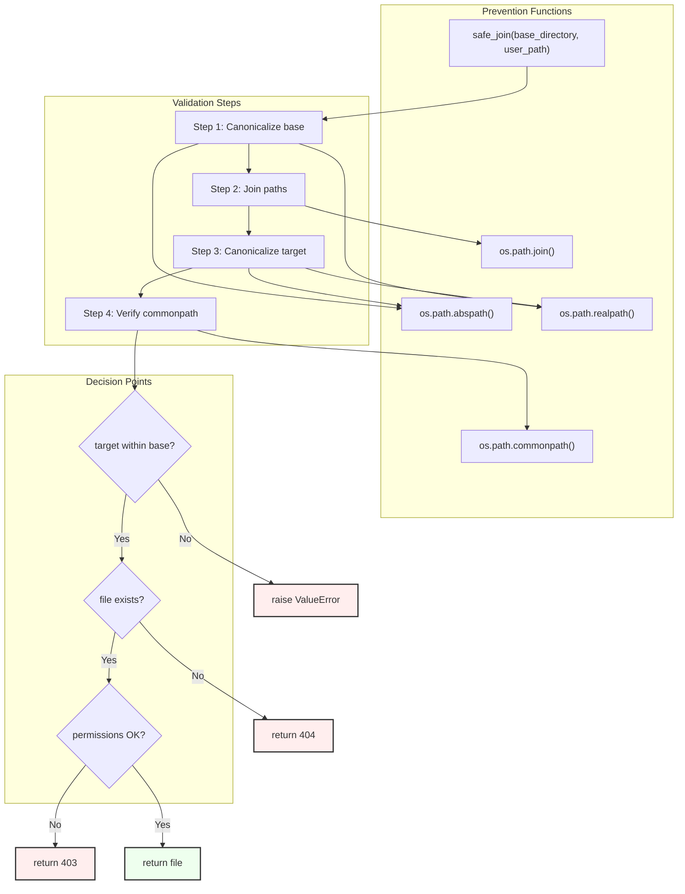

<!-- source: DeepWiki mcp.deepwiki.com · repo BehiSecc/VibeSec-Skill · page 7.4 Path Traversal Prevention · fetched 2026-10-26 -->

# Path Traversal Prevention

<details>
<summary>Relevant source files</summary>

The following files were used as context for generating this wiki page:

- [SKILL.md](SKILL.md)

</details>


## Purpose and Scope

This document covers path traversal vulnerability prevention in web applications. Path traversal attacks occur when user-controlled input influences file path operations, allowing attackers to access files outside intended directories. This includes reading arbitrary files, accessing configuration files, or manipulating file operations to compromise system integrity.

For related file security concerns, see [Insecure File Upload Prevention](#7.5). For input validation principles that apply broadly, see [Core Security Principles](#4).

**Sources:** [SKILL.md:572-627]()

---

## Vulnerability Mechanism

Path traversal vulnerabilities arise when applications construct file paths using unsanitized user input. Attackers exploit this by injecting directory traversal sequences (`../`, `..\`, or encoded variants) to navigate outside the intended directory structure.

### Common Vulnerable Patterns

The following code patterns expose path traversal vulnerabilities:

| Pattern | Vulnerability | Attack Example |
|---------|---------------|----------------|
| Direct concatenation | `"/uploads/" + user_input` | Input: `../../../etc/passwd` |
| Base directory joining | `base_dir + request.params['file']` | Input: `../../config/secrets.json` |
| Template path construction | `"templates/" + user_provided_template` | Input: `../../../app/database.yml` |

**Sources:** [SKILL.md:576-583]()

---

## Attack Flow Diagram

```mermaid
graph TB
    subgraph "Vulnerable Application Flow"
        A1["User Request"] -->|"filename=../../../etc/passwd"| B1["Application Code"]
        B1 -->|"file_path = '/uploads/' + user_input"| C1["Path Construction"]
        C1 -->|"/uploads/../../../etc/passwd"| D1["File System Access"]
        D1 -->|"Resolves to: /etc/passwd"| E1["Unauthorized File Read"]
    end
    
    subgraph "Secure Application Flow"
        A2["User Request"] -->|"file_id=report_q1"| B2["Application Code"]
        B2 -->|"files.get(user_input)"| C2["Indirect Reference Lookup"]
        C2 -->|"Returns: /reports/q1.pdf or None"| D2["Path Validation"]
        D2 -->|"Valid path within base"| E2["Authorized File Access"]
        D2 -->|"Invalid/Missing ID"| F2["Return 404/Error"]
    end
    
    style E1 fill:#fee,stroke:#333,stroke-width:2px
    style E2 fill:#efe,stroke:#333,stroke-width:2px
    style F2 fill:#ffe,stroke:#333,stroke-width:2px
```



**Sources:** [SKILL.md:572-627]()

---

## Prevention Strategy 1: Indirect References

The most secure approach eliminates user input from file paths entirely by using indirect references.

### Implementation Pattern

```python
# Mapping approach - user input never touches file system paths
files = {
    'report': '/reports/q1.pdf', 
    'invoice': '/invoices/2024.pdf',
    'statement': '/statements/march.pdf'
}

# User provides key, not path
file_path = files.get(user_input)

if file_path is None:
    return 404  # Invalid reference
```

### Benefits

| Aspect | Advantage |
|--------|-----------|
| Security | User input never directly controls file paths |
| Simplicity | No complex validation logic required |
| Maintainability | Centralized file path management |
| Performance | O(1) lookup with no parsing overhead |

**Sources:** [SKILL.md:587-593]()

---

## Prevention Strategy 2: Canonicalization and Validation

When user input must influence file paths (e.g., user-uploaded files with preserved names), canonicalization ensures the resolved path remains within allowed boundaries.

### Canonicalization Process Diagram



**Sources:** [SKILL.md:595-612]()

### safe_join Function Implementation

The following pattern demonstrates proper canonicalization and validation:

```python
import os

def safe_join(base_directory, user_path):
    # Ensure base is absolute and normalized
    base = os.path.abspath(os.path.realpath(base_directory))
    
    # Join and then resolve the result
    target = os.path.abspath(os.path.realpath(os.path.join(base, user_path)))
    
    # Ensure the commonpath is the base directory
    if os.path.commonpath([base, target]) != base:
        raise ValueError("Error!")
    
    return target
```

### Function Breakdown

| Step | Function | Purpose |
|------|----------|---------|
| 1 | `os.path.abspath()` | Convert to absolute path |
| 2 | `os.path.realpath()` | Resolve symbolic links and `.` / `..` sequences |
| 3 | `os.path.join()` | Combine base and user paths |
| 4 | `os.path.commonpath()` | Verify resolved path shares base as prefix |
| 5 | Comparison check | Reject if resolved path escapes base |

**Sources:** [SKILL.md:595-612]()

---

## Prevention Strategy 3: Input Sanitization

Input sanitization should be used as defense-in-depth, never as the primary control.

### Sanitization Rules

| Element | Action | Rationale |
|---------|--------|-----------|
| `..` sequences | Remove or reject | Directory traversal primitive |
| Absolute path indicators (`/`, `C:`) | Remove or reject | Bypass base directory entirely |
| Non-alphanumeric characters | Whitelist allowed set | Prevent encoding bypasses |
| File extension | Validate against allowlist | Restrict file types |

### Sanitization Limitations

Sanitization alone is insufficient because:

- **Encoding bypasses**: `..%2F`, `..%252F` (double encoding), URL-encoded variations
- **Unicode normalization**: `..%c0%af` can decode to `../`
- **Case variations**: Windows systems may treat `..` and `..` identically
- **Null byte injection**: `../../../etc/passwd%00.txt` may truncate validation
- **OS-specific behavior**: Different path separators (`/` vs `\`)

**Always combine sanitization with canonicalization validation.**

**Sources:** [SKILL.md:614-619]()

---

## Implementation Decision Tree



**Sources:** [SKILL.md:572-627]()

---

## Common Bypass Techniques

Understanding bypass techniques ensures comprehensive protection:

| Technique | Example | Mitigation |
|-----------|---------|------------|
| URL encoding | `..%2F..%2Fetc%2Fpasswd` | Decode before validation |
| Double encoding | `..%252F..%252Fetc` | Multiple decode passes or reject encoded input |
| Unicode encoding | `..%c0%af..%c0%af` | Normalize Unicode before validation |
| Null byte injection | `../../../etc/passwd%00.txt` | Reject null bytes (`\x00`) |
| Backslash on Windows | `..\..\..\windows\system32` | Normalize path separators |
| Overlong UTF-8 | `%e0%80%ae%e0%80%ae%e0%80%af` | UTF-8 validation |
| Case variation | `..\\..\\..\\` | Case normalization on case-insensitive systems |
| Absolute paths | `/etc/passwd`, `C:\Windows\` | Reject absolute path indicators |
| Mixed separators | `..\/..\/etc/passwd` | Normalize separators before validation |

**Sources:** [SKILL.md:614-619]()

---

## Verification Checklist

Use this checklist to verify path traversal protection in code:

### Pre-Deployment Checklist

- [ ] User input never directly concatenated into file paths
- [ ] Paths canonicalized using `os.path.realpath()` or equivalent
- [ ] Resolved paths validated against base directory using `os.path.commonpath()`
- [ ] File extensions restricted to allowlist (if applicable)
- [ ] Input sanitized to remove `..`, absolute paths, and dangerous characters
- [ ] Symbolic link resolution handled (prevents symlink bypass)
- [ ] Error messages don't reveal file system structure
- [ ] File access operations use least privilege (limited OS user permissions)

### Testing Checklist

- [ ] Test with `../` sequences
- [ ] Test with `..%2F` URL-encoded sequences
- [ ] Test with absolute paths (`/etc/passwd`)
- [ ] Test with null bytes (`%00`)
- [ ] Test with mixed path separators (`../\../`)
- [ ] Test with Unicode/encoding bypasses
- [ ] Test with symbolic links (if OS supports)
- [ ] Test with overly long paths
- [ ] Verify error responses don't leak information

**Sources:** [SKILL.md:621-627]()

---

## Code Entity Reference Map



**Sources:** [SKILL.md:595-612]()

---

## Integration with Other Security Controls

Path traversal prevention should integrate with broader security measures:

| Security Layer | Integration Point | Purpose |
|----------------|-------------------|---------|
| Access Control | Verify resource ownership before file access | Prevent IDOR (see [Access Control & Authorization](#5)) |
| Input Validation | Validate all parameters before path operations | Defense in depth (see [Core Security Principles](#4)) |
| File Upload Security | Validate uploaded file paths | Prevent ZIP slip (see [Insecure File Upload Prevention](#7.5)) |
| Error Handling | Return generic errors (404) for invalid paths | Prevent information disclosure |
| Least Privilege | Run file access with minimal OS permissions | Limit blast radius of successful attacks |
| Logging | Log path validation failures | Detect attack attempts |

**Sources:** [SKILL.md:10-17](), [SKILL.md:572-627]()

---

## Platform-Specific Considerations

Different platforms require specific adaptations:

### Python
- Use `os.path.realpath()` to resolve symlinks
- Use `os.path.commonpath()` for boundary validation
- Consider `pathlib.Path.resolve()` for modern code

### Node.js
- Use `path.resolve()` to canonicalize
- Use `path.relative()` to check if result contains `..`
- Beware of `path.join()` alone (doesn't canonicalize)

### Java
- Use `File.getCanonicalPath()` for resolution
- Use `Path.normalize()` and `Path.toRealPath()`
- Check `startsWith()` on canonical paths

### PHP
- Use `realpath()` for canonicalization
- Verify result with `strpos()` against base directory
- Handle `false` return from `realpath()` (file doesn't exist)

### .NET
- Use `Path.GetFullPath()` for normalization
- Use `Path.GetFullPath()` result with `StartsWith()` check
- Consider `Uri` class for additional validation

**Sources:** [SKILL.md:595-612]()

---

